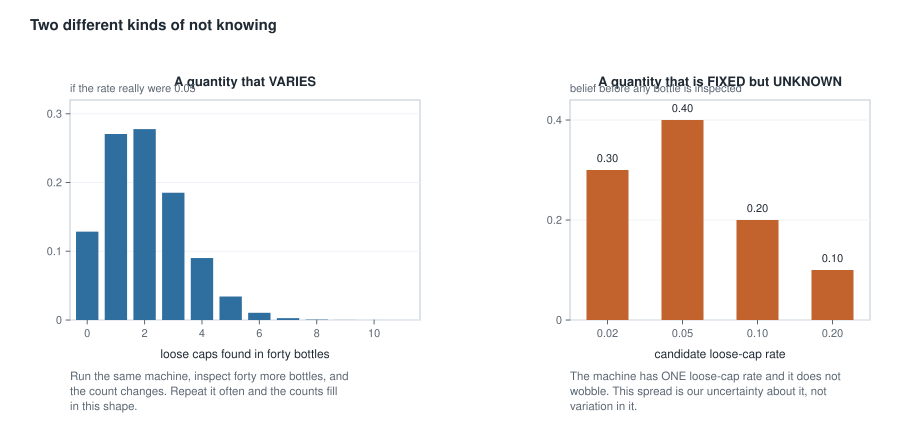
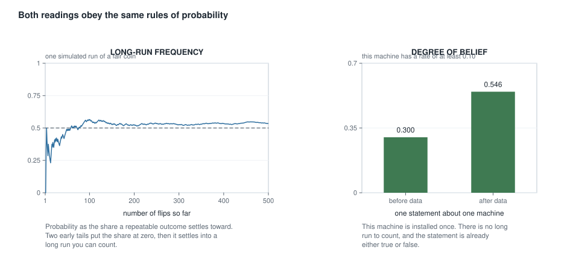
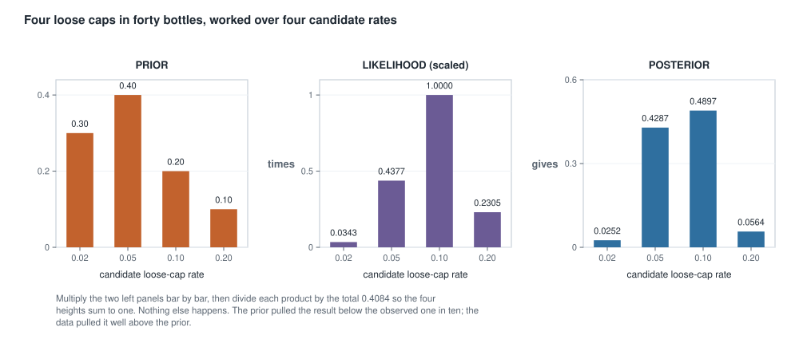
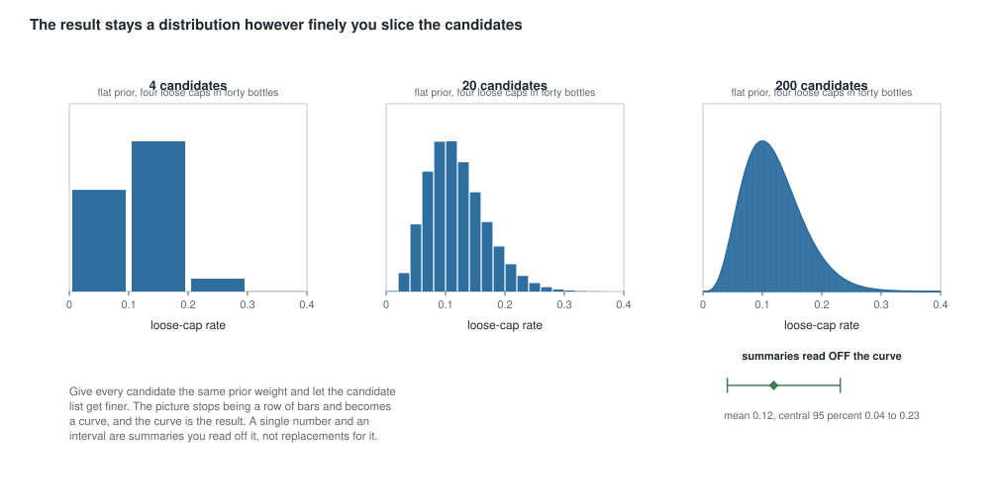
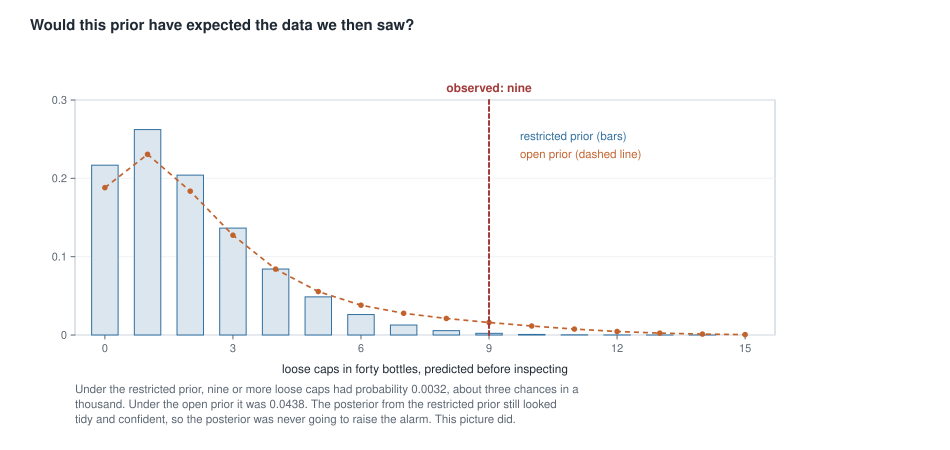

# Week 1 — Bayesian thinking and uncertainty

## Where this week starts

Your previous statistics course taught you to turn data into an estimate and attach a standard
error, a confidence interval, or a p-value to it. All of that machinery answers a question about the
*procedure*: if the world stayed the same and you repeated the study many times, how would the
numbers you computed behave?

That is a real question, but rarely the one that brought you to the data. A plant manager who has
just inspected forty bottles wants to know how likely it is that *this* capping machine, the one
bolted to the floor in front of her, is leaving loose caps at a rate she cannot live with. That is a
statement about a fixed, unknown quantity, and the classical toolkit deliberately refuses to make it,
because it reserves probability for things that vary.

This week is about the other choice: use probability to describe what you do not know, then let data
change that description. Before the data arrive you write down what is plausible; the data speak
through a likelihood; what comes out is again a distribution, not a number, and every summary you
might want is read off it afterward. There is no calculus on this page and almost no algebra, only
arithmetic, and you should do it as you read.

### Why this matters outside the classroom

A small bottling line has just refitted its capping head. A loose cap means a returned case, and the
maintenance crew must decide tonight whether to pull the head for another adjustment. They inspect
forty bottles and find four loose caps. One in ten sounds alarming. But forty bottles is a small
inspection, the crew has installed dozens of these heads and has usually seen them settle at one in
twenty or below, which makes a higher rate unlikely rather than impossible, and "one in ten" is a
lone number carrying no sense of how firmly the data hold it.

The Bayesian version of that meeting produces a distribution over the possible rates, built from what
the crew knew plus what the forty bottles said, from which you read the chance that the rate is at
least one in ten and hand it to whoever owns the decision. It does not make the decision, and it does
not make the machine good or bad; it reports the state of the evidence in a form someone can act
on.

## What you will be able to do

- **Classify** a quantity as one that varies from repetition to repetition or one that is fixed but
  unknown, and say which kind of uncertainty it carries.
- **State** the two readings of probability, long-run frequency and degree of belief, and give a
  claim only one of them can express.
- **Compute** a posterior by hand across a short list of candidate values, naming the prior,
  likelihood, and posterior as you go: multiply, total, divide.
- **Read** a mean, an interval, or a threshold probability off a posterior, and say what it does and
  does not license.
- **Explain** why a stated prior is an inspectable assumption, and describe the check that catches a
  prior which ruled out the truth.

## Terms and notation worth fixing

These symbols mean the same thing in every unit of this course.

| Symbol | What it means here |
|---|---|
| $\pi$ | a probability or proportion parameter: this week, a machine's long-run loose-cap rate |
| $\theta$ | a generic unknown parameter, when the specific letter does not matter |
| $y$ | the data you observed; $n$ is how many observations there are |
| $\tilde y$ | a new outcome the model predicts but you have not yet seen |
| $p(\theta)$ | the **prior**: your description of the unknown before these data |
| $p(y \mid \theta)$ | the **likelihood**: how plausible the observed data are under each parameter value |
| $p(\theta \mid y)$ | the **posterior**: your description of the unknown after these data |
| $p(y)$ | the prior predictive distribution of data, which also serves as the normalizing constant |
| $\propto$ | "is proportional to": equal after dropping factors free of the parameter |

Read $p(\theta \mid y)$ aloud as "the distribution of the unknown parameter given the data we
observed": the bar is the word "given", and everything right of it is held fixed.

## Two kinds of not knowing

Most confusion in a first Bayesian course traces to one distinction nobody states carefully, so it
gets stated carefully here: there are two very different reasons a number can be uncertain, and
probability is used for both.

### What varies and what is merely unknown

Some quantities genuinely change from one instance to the next. How many of forty inspected bottles
carry a loose cap is one: inspect forty more tomorrow and the count differs, maybe one, maybe five.
That variation is a physical fact about the process. If the rate really were 0.05, the count follows
a binomial distribution, and a count of two would have probability 0.278, a count of six 0.010.

Other quantities do not vary at all. The machine's loose-cap rate is a single number, fixed the
moment the head was bolted down; inspect every bottle the line will ever produce and you would know
it exactly. It is uncertain only because you have not seen enough to pin it down: that is uncertainty
about the world, not variation in it.

{fig-alt="Two panels. Left, a binomial bar chart of the number of loose caps in forty bottles when the rate is 0.05, peaking at one and two. Right, four orange bars of belief over candidate rates 0.02, 0.05, 0.10 and 0.20."}

Both panels are drawn as probability, but they answer different questions. On the left the axis is
an outcome you could observe and the heights are frequencies the world would produce; on the right
the axis is a parameter you can never observe directly and the heights are weights you assign.
Classical statistics is comfortable with the left panel and declines to draw the right one.

### Two readings of probability, and why the course keeps both

Behind that distinction sits an unsettled question about what "probability" means, and you should be
able to state both standard readings fairly. The **long-run frequency** reading says a probability is
the share of times an outcome occurs in a long sequence of repetitions: a fair coin has probability
one half of landing heads because, flipped enough times, the running share settles near one half.
The **degree of belief** reading says a probability measures how strongly a claim is supported by
what you currently know, which makes it sensible to say there is about a 55 percent chance that
this machine's rate is at least one in ten, even though the machine is installed once and there is
no long run to count.

{fig-alt="Left, the running share of heads over five hundred simulated flips starts at zero after two tails, swings widely, then settles toward the dashed line at one half. Right, two green bars for one machine, 0.300 before data and 0.546 after."}

The left panel is one simulated run of five hundred fair flips: the first two came up tails, so the
share starts at zero, swings widely, then settles near one half.
The right is a claim about a machine that will never be repeated, whose probability rose from 0.300
before the inspection to 0.546 after. Both are probabilities; only the
left has a long run you could count.

Be clear on the course's position. Both readings satisfy the same axioms, and conditional
probability behaves identically under either, which is why Bayes' rule is a theorem nobody disputes.
Working statisticians use both. This is not a course arguing that the frequency reading is wrong; it
is a course in what becomes sayable once you allow the second, and in the discipline that allowing it
demands.

## The three parts of every analysis in this course

Every analysis this semester, from next week's screening test to Week 13's hierarchical model, has
the same three parts. Learn the shape now, while nothing else is in the way.

### Prior, likelihood, posterior in one sentence each

The **prior**, $p(\theta)$, is a distribution over the unknown saying what you consider plausible
before these data. It is not a guess at the value but a range of values with weights on them, written
down and reported.

The **likelihood**, $p(y \mid \theta)$, runs from the parameter to the data. For each candidate
value it asks: if the world were like that, how plausible would the data I actually saw have been?
Notice the direction: the data are held fixed at what you observed while the parameter sweeps across
candidates. Students almost always read it the other way at first, and Week 3 walks that back.

The **posterior**, $p(\theta \mid y)$, is what you get by combining them: multiply prior weight by
likelihood at each candidate, then divide every product by their total so the weights add to one.
That is the entire operation, and it is the only formula you need this week.

$$p(\theta \mid y) \;\propto\; p(\theta) \; p(y \mid \theta)$$

The proportionality sign does real work: the products need not add to one, because dividing by their
total is what turns relative weights into probabilities, and anything multiplying all candidates
equally, such as the $\binom{n}{y}$ in a binomial likelihood, cancels in that division.

{fig-alt="Three bar panels over rates 0.02, 0.05, 0.10, 0.20. Prior heights 0.30, 0.40, 0.20, 0.10. Scaled likelihood 0.0343, 0.4377, 1.0000, 0.2305. Posterior 0.0252, 0.4287, 0.4897, 0.0564."}

Compare the first and third panels. The prior put most weight on the two smallest rates; the
likelihood from four loose caps in forty bottles peaks at 0.10; the posterior lands between them,
with 0.05 and 0.10 sharing almost 92 percent of the weight. It is neither the prior nor the data, but
what the two together support.

### Why the result is a whole distribution

Previously the output of an analysis was a number with a margin of error stapled to it. Here it is a
distribution, which is what permits direct probability statements about the unknown. Once you hold a
posterior you can ask it anything: which value carries most weight, what the mean is, which range
holds 95 percent of the weight, what the probability is that the rate is at least one in ten. Each is
a summary read off the same object, and none is the object. Nor is four candidates special; that was
a teaching choice so the arithmetic fits on a page.

{fig-alt="Three panels with a flat prior and four loose caps in forty bottles. Four fat bars, then twenty narrower bars, then two hundred bars forming a right-skewed curve peaking near 0.10, with a summary interval drawn beneath."}

Here every candidate starts with equal prior weight, so the shape is the likelihood's alone, and the
list is refined from four values to twenty to two hundred. The bars narrow and the outline becomes a
curve. Week 3 lets the list become a continuum, at which point the curve is a density and the sums
become integrals; nothing conceptual changes there.

The interval under the finest panel is the point of the section: on that grid the posterior mean sits
at 0.12 and the central 95 percent of the weight runs from about 0.04 to about 0.23. Report those
summaries, but read them off the curve rather than substituting them for it.

## Worked example — the capping machine's first forty bottles

Here is the complete arithmetic, with nothing hidden. Work it with a calculator as you read.

**The situation.** The refitted capping head leaves an unknown long-run share $\pi$ of bottles with a
loose cap. It is one fixed number, and the crew does not know it.

**The prior.** The crew has installed this model of head many times and will work with four candidate
rates and weights on them:

| Candidate rate $\pi$ | 0.02 | 0.05 | 0.10 | 0.20 |
|---|---|---|---|---|
| Prior weight $p(\pi)$ | 0.30 | 0.40 | 0.20 | 0.10 |

The four weights add to one, which makes them a distribution. Their implied average rate is
$0.30 \times 0.02 + 0.40 \times 0.05 + 0.20 \times 0.10 + 0.10 \times 0.20 = 0.066$: the crew's
stated position is that the head probably runs near one loose cap in twenty, with a tail out to one
in five.

**The data.** They inspect $n = 40$ bottles and find $y = 4$ loose caps: an observed share of
$4/40 = 0.10$.

**Step one, the likelihood.** Under a candidate rate $\pi$, the chance of exactly four loose caps in
forty bottles is $\binom{40}{4} \pi^4 (1-\pi)^{36}$, which evaluates to 0.007066, 0.090122, 0.205887
and 0.047452. Only relative size matters, so divide all four by the largest, 0.205887:

| Candidate rate $\pi$ | 0.02 | 0.05 | 0.10 | 0.20 |
|---|---|---|---|---|
| Scaled likelihood | 0.0343 | 0.4377 | 1.0000 | 0.2305 |

Read that row as a ranking of explanations: 0.10 explains four in forty best, since four in forty is
one in ten, while 0.05 explains them about 44 percent as well and 0.02 about 3 percent.

**Step two, multiply candidate by candidate.**

$$\begin{aligned}
0.30 \times 0.0343 &= 0.01030 \\
0.40 \times 0.4377 &= 0.17509 \\
0.20 \times 1.0000 &= 0.20000 \\
0.10 \times 0.2305 &= 0.02305
\end{aligned}$$

**Step three, total and divide.** The products total
$0.01030 + 0.17509 + 0.20000 + 0.02305 = 0.4084$, and dividing each by that total gives the
posterior:

| Candidate rate $\pi$ | 0.02 | 0.05 | 0.10 | 0.20 |
|---|---|---|---|---|
| Posterior $p(\pi \mid y)$ | 0.0252 | 0.4287 | 0.4897 | 0.0564 |

Check one yourself: $0.01030 / 0.4084 = 0.0252$, and the four weights add to 1.0000. One honest
note: because the likelihoods were scaled, 0.4084 is not $p(y)$ itself but $p(y)$ divided by the
largest of the four likelihoods. The division does not care, which is what $\propto$ promised.

**What the posterior says.** Its average rate is
$0.0252 \times 0.02 + 0.4287 \times 0.05 + 0.4897 \times 0.10 + 0.0564 \times 0.20 = 0.0822$,
which lands between the prior average of 0.066 and the observed 0.10, a little short of halfway and
so still on the prior's side of the midpoint 0.083. That is what these ingredients should give: the
prior put 70 percent of its weight on the two rates below one in ten, and forty bottles is not
enough evidence to overturn that. The probability that the rate is at least one in ten is
$0.4897 + 0.0564 = 0.5461$, up from $0.20 + 0.10 = 0.30$. The worst candidate was demoted, not
refuted: 0.20 fell from 0.10 to 0.0564.

**What this licenses.** One sentence: under these candidates and these prior weights, the evidence
puts a little over half the posterior weight on a rate of at least one in ten. It does not license
"the rate is 0.0822", nor "the machine is defective", a decision needing a cost and a threshold no
posterior supplies. Nor does it certify the four-candidate model: 0.07 was never on the table, and a
posterior cannot inform you about a value you refused to consider.

### The same reasoning, transferred

Change the story completely and the machinery does not move. A coin has been bent and you want the
probability $\pi$ of heads. Take three candidates, 0.3, 0.5 and 0.7, with prior weights 0.25, 0.50
and 0.25, because the bend probably did something but you doubt it did much. Flip it $n = 12$ times
and get $y = 9$ heads.

The likelihood $\binom{12}{9} \pi^9 (1-\pi)^3$, scaled by its largest value, is 0.006196, 0.224075
and 1.000000. Multiplying by the priors gives 0.001549, 0.112038 and 0.250000, totalling 0.363587.
Dividing through, the posterior is 0.0043, 0.3081 and 0.6876, with average
$0.0043 \times 0.3 + 0.3081 \times 0.5 + 0.6876 \times 0.7 = 0.6367$.

What stayed the same: a fixed but unknown parameter, a stated prior over candidates, a binomial
likelihood with the data held fixed, a normalized product. What changed: the subject, the candidate
list, the sample size, and a symmetric rather than low-tilted prior. The recipe never noticed, and
that portability is why the next eleven weeks are possible.

## Second worked example — a prior that ruled out the truth

The first example was a clean application. This one is a failure, and the more instructive, because
it shows the check you have to run and what happens when nobody runs it.

**The situation.** A month later a different technician inspects the same line. The vendor's service
sheet says this model of head "cannot run above one loose cap in ten", and the technician takes it
literally, giving the candidate 0.20 no weight at all:

| Candidate rate $\pi$ | 0.02 | 0.05 | 0.10 | 0.20 |
|---|---|---|---|---|
| Restricted prior | 0.35 | 0.45 | 0.20 | 0.00 |

**The data.** A fresh inspection of forty bottles turns up nine loose caps, a share of
$9/40 = 0.225$.

**The update.** The likelihood $\binom{40}{9} \pi^9 (1-\pi)^{31}$, scaled by its largest value, is
0.000001, 0.000785, 0.075242 and 1.000000. Multiplying by the restricted prior gives 0.0000002,
0.0003534, 0.0150483 and 0.0000000, totalling 0.0154020. Normalizing leaves essentially 0 on 0.02,
0.0229 on 0.05, 0.9770 on 0.10, and **exactly zero** on 0.20, with an average rate of 0.0989.

Sit with that, because it looks excellent: over 97 percent of the weight on one candidate, reading as
a confident conclusion. It is also badly wrong, and no further data can rescue it. Zero times any
likelihood is zero, so a candidate given no prior weight can never gain any, however loudly the data
argue.

**The same data without the restriction.** Run the identical nine-in-forty data through the crew's
original prior. The products are 0.0000002, 0.0003142, 0.0150483 and 0.1000000, totalling 0.1153627,
and the posterior is 0.0000, 0.0027, 0.1304 and 0.8668, average rate 0.1865. Same data, same
likelihood, and the two analyses disagree about which candidate is most plausible.

**The check that should have been run.** Before seeing data, ask what data the prior expects: for
each count $\tilde y$ from zero to forty, mix the binomial probabilities across candidates, as
$p(\tilde y = k) = \sum_j p(\pi_j) \binom{40}{k} \pi_j^{\,k} (1-\pi_j)^{40-k}$. That is the prior
predictive distribution, and it is where a prior meets reality before any posterior exists.

{fig-alt="Bars of the predicted loose-cap count under the restricted prior peak at one and fall to near zero by six, with an orange dashed line for the open prior slightly higher in the tail and a red dashed line marking the observed nine."}

Under the restricted prior the expected count is 1.98 loose caps in forty bottles, and nine or more
has probability 0.0032, about three chances in a thousand; under the open prior that tail has
probability 0.0438. Neither prior thought nine likely, but one thought it nearly impossible. When the
data you collected sit in the far tail of what your model expected beforehand, the model, prior
included, falls under suspicion.

**What to take from this.** The failure was not that the prior was informative; informative priors
are fine and often necessary. It was a prior assigning zero to a live possibility, unexamined. A tidy
posterior is not evidence that a model is adequate: it summarizes what the model concluded, and a
model that has ruled something out will conclude confidently and wrongly without complaining.

## The misreading to avoid

Here is the objection as students actually raise it, often with some heat: *"Bayesian statistics is
just statistics with an opinion mixed in. Pick a prior that leans the way you want and you can get
whatever result you like. That is not science."*

Take it seriously, because half of it is correct. The prior does affect the result, and this week's
second example proved it harshly: identical data, two priors, an average moving from 0.0989 to
0.1865. Three things make the objection collapse anyway.

**First, the prior is stated.** It is written down and available to anyone who wants to disagree. A
reader who thinks 0.30, 0.40, 0.20, 0.10 was too optimistic can name the weights they prefer, rerun
the arithmetic, and show what changes: an argument that can be had. An analysis that never mentions a
prior has not avoided assumptions; it has made them about which model to fit, which observations to
exclude, and which test to report, and left every one off the page.

**Second, the prior can be checked and varied.** The prior predictive check above is a real test, run
before any posterior exists, and the restricted prior failed it. Nor should reporting stop at one
prior: Week 5 runs four through one data set and reports the range of conclusions as the result. An
analysis stable across every defensible prior says the data are decisive; one that is not says
something equally important that a single number would hide.

**Third, the data win, and you can watch them win.** In the first worked example the prior average
0.066 became a posterior average of 0.0822, pulled almost halfway to the observed 0.10 by only forty
bottles, and multiplying the data by ten shrinks the prior's influence toward nothing. A prior is a
starting position, not a veto, unless you write it as one by assigning zero.

Two smaller misreadings are worth naming. A posterior probability is not a p-value: 0.5461 is the
probability that this machine's rate is at least one in ten given this model and this prior. And a
posterior is not a verdict; deciding what to *do* about a rate of 0.0822 needs a threshold and a cost
that live outside the statistics.

## Working reproducibly from day one

This page's arithmetic fits on a page; almost nothing else this semester will, so the course teaches
its computing rather than assuming it. Set the three tools up now, render one small document, and
take on the habits below.

### Installing R, VS Code, and Quarto

Install them in this order, because each one looks for the one before it.
[The R Project for Statistical Computing](https://www.r-project.org/) supplies the language and the
statistical functions every later week calls. [Visual Studio Code](https://code.visualstudio.com/)
is the editor we write in; once it opens, add its R and Quarto extensions from the extensions panel.
[Quarto](https://quarto.org/) is the document system that lets prose, code, and figures live in one
file that regenerates itself. Then run `quarto check` in a terminal: it reports what it found,
including whether it located R.

If it reports that R cannot be found, your first render will fail, so settle it now. Any one of
these three fixes is enough:

1. **Put R's `bin` directory on your PATH.** Find the folder inside your R installation that holds
   the R program itself, add that folder to the PATH environment variable, and open a new terminal
   so the change takes effect.
2. **Set the `QUARTO_R` environment variable** to the R program itself, not to the folder holding
   it. Quarto consults that variable before searching anywhere else, so it also settles which of two
   installed versions gets used.
3. **Render from a shell whose PATH already has R.** If typing `R --version` there prints a version,
   Quarto started from that same terminal will find R too.

### Your first Quarto document

A Quarto document is a plain text file ending in `.qmd`: a short header fenced by three hyphens
above and below, then prose, then code chunks. A chunk opens with a line of three backticks
immediately followed by `{r}` in braces and closes with a line of three backticks. A minimal file
starts like this:

```
---
title: "Week 1 notes"
format: html
---

The crew inspected forty bottles and found four loose caps.
```

Under that prose goes one chunk. Here is the first worked example as its body, written as a record
of what was done rather than output to trust on sight:

```r
# Four candidate loose-cap rates, and the crew's prior weights.
rates <- c(0.02, 0.05, 0.10, 0.20)
prior <- c(0.30, 0.40, 0.20, 0.10)

# Likelihood of 4 loose caps in 40 bottles at each candidate rate.
lik <- dbinom(4, size = 40, prob = rates)

# Multiply, total, divide: the entire update.
posterior <- prior * lik / sum(prior * lik)

round(posterior, 4)             # posterior weights on the four candidates
sum(posterior * rates)          # posterior average rate
sum(posterior[rates >= 0.10])   # posterior probability of at least one in ten
```

Seven lines of code, and that is the whole method; `lik` does not need scaling, since dividing by
the total handles any common factor. Render the file with `quarto render week-01-notes.qmd`, or with
the render button in Visual Studio Code, and you get an HTML file beside the `.qmd` carrying prose,
code, and output together. `quarto preview` re-renders each time you save.

### Habits that make the work reproducible

Reproducibility is part of the statistics rather than a courtesy added afterward. A Bayesian result
is a conditional statement: given this prior, this likelihood, and these data, here is the posterior.
A reader who cannot see the prior cannot evaluate the conclusion, and one who cannot rerun the
analysis cannot check the sensitivity you reported. Four habits carry most of that weight.

- **Fix a seed** with `set.seed(1234)` before anything random, so a simulation gives the same draws
  on your machine tomorrow and on a classmate's today.
- **Keep code and prose in one document**, rather than computing in a console and pasting numbers
  into a write-up where a reader cannot see where they came from.
- **Re-render from a clean start** before you hand work in; a document that renders only inside the
  session you happen to have open is not reproducible.
- **Never write a number you cannot regenerate.** If it came from a computation, let the document do
  that computation.

Install the three tools this week, and get one small document rendering while the arithmetic is
still this small.

## Practice on your own

These are for your own checking, not for submission. Work them with a calculator against the worked
examples.

1. **Sort the quantities.** For each, say whether it varies or is fixed but unknown, with one
   sentence on the uncertainty it carries: the number of customers arriving at a help desk between two
   and three this afternoon; the long-run average number arriving in an hour; whether one particular
   seed germinates; the germination rate of the lot it came from.

2. **Redo the update with a flatter prior.** Same four candidate rates and the same four loose caps
   in forty bottles, but give every candidate a prior weight of 0.25. The scaled likelihoods are
   unchanged at 0.0343, 0.4377, 1.0000 and 0.2305. Compute the products, their total, and the
   posterior, then say which candidates gained weight and why.

3. **Double the data.** Suppose the crew had found eight loose caps in eighty bottles, the same
   observed share. Using the original prior, evaluate $\binom{80}{8} \pi^8 (1-\pi)^{72}$ at each
   candidate, scale by the largest, and update. Does the posterior sit closer to the observed share
   than before, and why should that have been expected?

4. **Break a prior on purpose, then report carefully.** Give the candidate 0.05 a prior weight of
   zero, spread the rest however you like, and update on four loose caps in forty bottles. What
   posterior weight does 0.05 end up with, and what would change it? Then, from the first worked
   example's posterior, write one sentence a maintenance supervisor could act on and a second naming
   something that first sentence does not establish.

## Where to read more

- **Bayes Rules!**, this course's primary text. This week aligns with
  [Chapter 1](https://www.bayesrulesbook.com/chapter-1); the home page is
  [bayesrulesbook.com](https://www.bayesrulesbook.com/). Read the chapter after this page, since the
  second pass through an idea is where it sticks.
- **Tools.** Setup for R, Visual Studio Code, and Quarto is on this page, under "Working reproducibly
  from day one". The [resources overview](../resources/index.qmd) is where the course's reading links
  are collected.
- **Course pages.** The [syllabus](../syllabus.qmd) records how the semester is organized and the
  standing of every source, the [schedule](../schedule.qmd) lays out the fifteen weeks, and the
  [notes index](index.qmd) lists every unit.
- **Named but not linked.** *Statistical Rethinking* is a widely used alternative treatment at a
  somewhat higher level. Availability and licence confirmation is still open for every source here,
  so obtain them through the library.

## Where this goes next

Week 2 makes the update exact in the one setting where every quantity can be counted: diagnostic
testing. You will count how many of a screened population have a condition, how many of them test
positive, and how many healthy people also test positive, and find that the share of positive results
which are true can be startlingly small even for a test that is right almost every time. That week
also introduces the odds form of Bayes' rule, where sequential updating becomes something you can do
in your head. Read it at [week-02.qmd](week-02.qmd) once it is posted.

After that the parameter goes continuous. Weeks 3 and 4 replace the short candidate list with a whole
interval, using a seed lot's germination rate as the running case, and this page's bar charts become
the smooth densities you glimpsed in the third figure. Counts, means, regression, model checking, and
hierarchical structure follow, but the shape never changes: state what is plausible, let the data
speak through a likelihood, look at the distribution that results, and ask whether that model could
have produced the data you have. Return to the [course home page](../index.qmd) or the
[notes index](index.qmd) for the map.
