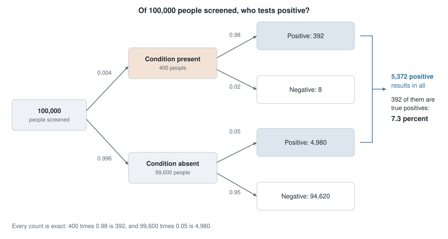
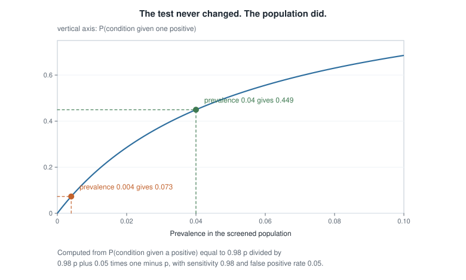
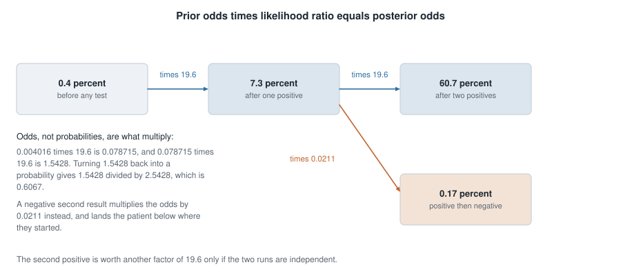
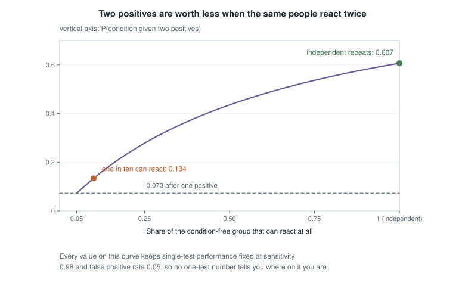
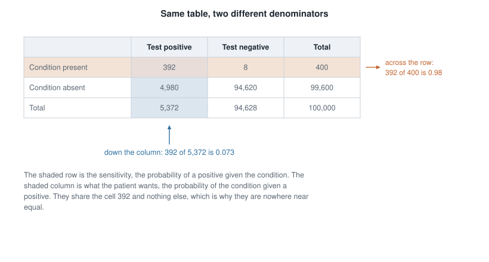

# Week 2 — Discrete Bayes' rule and diagnostic reasoning

## Where this week starts

Week 1 made a promise and then stopped short of keeping it. It argued that probability is a language
for describing what you do not know, that a fixed but unknown quantity can carry a probability
distribution, and that a Bayesian analysis has three parts: a prior describing what was plausible
before, a likelihood describing what the data would look like under each possibility, and a
posterior describing what is plausible now. What it did not do was show you the machine that turns
the first two into the third.

This week you build that machine in the easiest setting there is: a situation with only two
possibilities, where every quantity in the calculation is a count of people you can write in a box.
There are no integrals here and no unfamiliar distributions. Everything reduces to conditional
probability, which you met in your probability course, plus one rearrangement of the multiplication
rule. The reason to spend a whole week on something so small is that the small version is where the
reasoning is visible. When Week 3 replaces two hypotheses with a continuum of them, the shape of the
calculation will not change at all; only the bookkeeping will.

The running case for the week is the **Ridgeline Clinic screening test**, an invented walk-in clinic
that screens for an uncommon condition. Four people in every thousand screened have the condition.
The test finds 98 of every 100 people who have it, and it is negative for 95 of every 100 people who
do not, so it raises a false alarm on the other five. Those three numbers sound like a good test. By
the end of this page you will be able to say exactly what a positive result from it is worth, and
the number will surprise you.

What should feel different by Friday is your reflex when someone quotes you a test's accuracy. The
question a person actually cares about, "given that my result came back positive, how likely is it
that I have this", is not the number a test's specification sheet reports, and the gap between the
two is not small. It is the difference between 98 percent and 7.3 percent.

### Why this matters outside the classroom

A patient at that clinic gets a positive result on a screening test and is told that the test is
"98 percent accurate". Reading that as a 98 percent chance of having the condition, they spend a
week frightened, take an invasive follow-up procedure they might reasonably have declined, and make
a decision about work or treatment on a probability that is off by a factor of more than thirteen.
The clinician was not lying and the manufacturer's 98 percent is real; it answers a different
question than the one being asked, and nobody in the room converted between them.

The same structure sits behind a spam filter that quarantines a job offer, a fraud alert that
freezes a card during a family emergency, a quality-control alarm that halts a production line, and
a security screen that flags an ordinary traveller. In each of them a rare event is looked for with
an imperfect instrument, and the false alarms among the many ordinary cases swamp the true
detections among the few. Knowing that this conversion has to be done is one of the most portable
pieces of statistics you will learn all semester.

## What you will be able to do

- **Compute** a posterior probability from expected counts, by filling a two-way table of what would
  happen to a large screened population and dividing the cell you care about by its column total.
- **Translate** the same calculation into symbols, deriving Bayes' rule by writing one joint
  probability two different ways.
- **Explain in plain language** why the value of a positive result depends on the base rate, and
  show numerically what happens to that value when the base rate changes and the test does not.
- **Update sequentially** in odds form, multiplying prior odds by a likelihood ratio for each new
  result, and convert freely between odds and probabilities.
- **Diagnose** the swapped-conditional error in someone else's sentence, naming which conditional
  probability they used and which one they needed.
- **State the conditions under which** repeating a test is worth what the arithmetic says it is
  worth, and say what goes wrong when those conditions fail.

## Terms and notation worth fixing

These are the symbols this page uses. Later weeks add parameters and densities; this week everything
is an event, and every probability is a number between zero and one that you could get by counting.

| Symbol or term | Meaning as used in this course |
|---|---|
| $D$ | the event that a person has the condition; $D^{c}$ is the event that they do not |
| $+$ and $-$ | the events that the test result is positive and that it is negative |
| $P(A \mid B)$ | the probability of $A$ **given** $B$: the fraction of the $B$ cases that are also $A$ |
| Prevalence, $P(D)$ | the share of the screened population that has the condition, here 0.004 |
| Sensitivity, $P(+ \mid D)$ | the share of people **with** the condition whose test is positive, here 0.98 |
| Specificity, $P(- \mid D^{c})$ | the share of people **without** it whose test is negative, here 0.95 |
| Odds of an event | $P(A) / (1 - P(A))$: a probability of 0.2 is odds of 0.25, or one to four |
| Likelihood ratio | how many times more likely a given result is under $D$ than under $D^{c}$ |

## Counting your way to Bayes' rule

Start with no algebra at all. Imagine the clinic screens 100,000 people, and follow that population
through the two things that happen to it: some of them have the condition, and all of them take the
test. The number 100,000 is chosen so that every count below is a whole number.

Four in a thousand have the condition, so $100{,}000 \times 0.004 = 400$ people have it and the
remaining 99,600 do not. Among the 400, the test is positive for 98 percent of them:
$400 \times 0.98 = 392$ test positive and the other 8 test negative. Among the 99,600 who do not
have the condition, the test is negative 95 percent of the time and positive the other 5 percent of
the time: $99{,}600 \times 0.05 = 4{,}980$ of them test positive, and 94,620 test negative.

{fig-alt="A branching diagram: 100,000 screened split into 400 with the condition and 99,600 without, then into 392 and 8 results, and 4,980 and 94,620 results, with a bracket marking 5,372 positives and the label 7.3 percent."}

Now ask the patient's question. A positive result has come back. That result puts the person into
the group of people who tested positive, and nowhere else. How large is that group?
$392 + 4{,}980 = 5{,}372$ people. How many of them have the condition? The 392. So

$$P(D \mid +) \;=\; \frac{392}{5{,}372} \;=\; 0.0730 .$$

Seven people in every hundred who test positive have the condition, and ninety-three do not. Those
are the exact counts implied by the three numbers the clinic gave you. The whole result comes from
one fact about the population, which is that there are 249 condition-free people for every person
with the condition. Even a small false-alarm rate applied to a very large group produces more
positives than a near-perfect detection rate applied to a very small one. Count the two piles of
positives, 4,980 against 392, and you have the answer in front of you before any formula is written.

### Conditional probability and the multiplication rule

The counting argument used one idea repeatedly without naming it. When you wrote "of the 400 with
the condition, 98 percent test positive", you were using a conditional probability: a probability
computed inside a sub-population rather than across the whole one. In symbols,

$$P(A \mid B) \;=\; \frac{P(A \text{ and } B)}{P(B)},$$

read as: among the cases where $B$ happened, the share where $A$ happened too. Multiply both sides
by $P(B)$ and you get the multiplication rule, $P(A \text{ and } B) = P(B) \, P(A \mid B)$, which is
what you were doing every time you multiplied a count by a rate. The 392 came from
$100{,}000 \times 0.004 \times 0.98$, which is the population size times $P(D)$ times $P(+ \mid D)$,
and dividing by 100,000 turns it into a probability: $P(D \text{ and } +) = 0.004 \times 0.98 =
0.00392$.

### The same joint probability, written two ways

Here is the whole of Bayes' rule, and it is one observation. The joint probability
$P(D \text{ and } +)$ can be built in either order. Split the population by condition first and then
by test result, or split it by test result first and then by condition. Both describe the same cell
of the same table, so

$$P(D) \, P(+ \mid D) \;=\; P(D \text{ and } +) \;=\; P(+) \, P(D \mid +).$$

Divide by $P(+)$ and the unknown you want is alone on one side:

$$P(D \mid +) \;=\; \frac{P(D) \, P(+ \mid D)}{P(+)}, \qquad
P(+) \;=\; P(D) \, P(+ \mid D) + P(D^{c}) \, P(+ \mid D^{c}).$$

That second expression is the denominator you already computed as a count. It is the total
probability of a positive result, assembled from every route by which a positive can happen:
$0.004 \times 0.98 = 0.00392$ from people with the condition, plus $0.996 \times 0.05 = 0.0498$ from
people without it, giving $P(+) = 0.05372$. Then
$P(D \mid +) = 0.00392 / 0.05372 = 0.0730$, exactly the count version divided top and bottom by
100,000.

Notice the vocabulary the course will keep using. The prior is $P(D) = 0.004$, what you would have
said before the test. The likelihood is the pair of numbers $P(+ \mid D) = 0.98$ and
$P(+ \mid D^{c}) = 0.05$, describing how the observed result arises under each hypothesis. The
denominator $P(+)$ is the normalizing constant, whose only job is to make the two posterior
probabilities 0.0730 and 0.9270 add to one. Students often find the counting version obvious and the
symbolic version mysterious. They are the same calculation, and when a formula stops making sense
this semester, rebuilding it as a table of 100,000 people is a legitimate move, not a retreat.

## What a positive result is worth depends on the base rate

The 7.3 percent is not a property of the test. It is a property of the test **and** the population
it was used in, and only one of those two changed when the number came out so much lower than the
patient expected. This is the single most useful idea in the week.

### The same test in a different population

Suppose the clinic stops screening everyone who walks in and instead runs the identical test on
people referred with suggestive symptoms, among whom the condition is ten times more common:
prevalence 0.04 rather than 0.004. The test is unchanged. Sensitivity is still 0.98, the false alarm
rate is still 0.05, the machine and the technician and the specification sheet are all identical.
Redo the counts for 100,000 referred people: $100{,}000 \times 0.04 = 4{,}000$ have the condition
and 96,000 do not; $4{,}000 \times 0.98 = 3{,}920$ true positives and
$96{,}000 \times 0.05 = 4{,}800$ false ones, for $3{,}920 + 4{,}800 = 8{,}720$ positives in total.
Now

$$P(D \mid +) \;=\; \frac{3{,}920}{8{,}720} \;=\; 0.4495 .$$

The same positive result is worth about 7 percent in the walk-in queue and about 45 percent in the
referral queue. The figure below traces that value across every prevalence between zero and 0.10,
and both of the numbers you just computed sit on it.

{fig-alt="A curve rising steeply then flattening: the probability of the condition after one positive test against prevalence from 0 to 0.10, marked at 0.004 where it reads 0.073 and at 0.04 where it reads 0.449."}

Two lessons come out of that curve. A test result is evidence, not a verdict: it moves you from
where you were, and where you were matters as much as how good the instrument is. And the curve is
steepest exactly where screening programs operate, which is why arguments about who should be
screened are partly arguments about arithmetic.

### Prior odds times a likelihood ratio

There is a way of writing the update that makes the "moves you from where you were" idea literal,
and it is the form worth memorizing. The **odds** of an event are $P(A)/(1 - P(A))$, so the clinic's
prior odds of the condition are $0.004 / 0.996 = 0.004016$. Write Bayes' rule for $D$ and for
$D^{c}$ and divide one by the other; the denominator $P(+)$ appears in both and cancels, leaving

$$\underbrace{\frac{P(D \mid +)}{P(D^{c} \mid +)}}_{\text{posterior odds}}
\;=\;
\underbrace{\frac{P(D)}{P(D^{c})}}_{\text{prior odds}} \times
\underbrace{\frac{P(+ \mid D)}{P(+ \mid D^{c})}}_{\text{likelihood ratio}} .$$

The likelihood ratio for a positive result is $0.98 / 0.05 = 19.6$: a positive is 19.6 times more
likely to arise from someone with the condition than from someone without. The likelihood ratio for
a negative result is $0.02 / 0.95 = 0.021053$, which is 0.0211 to four decimal places: a negative is
only about one fiftieth as likely under the condition as without it. Every result you ever see
multiplies your current odds by its own ratio, and a ratio above 1 is evidence for the condition
while a ratio below 1 is evidence against.
Check it against the counting: $0.004016 \times 19.6 = 0.078715$, and converting odds back to a
probability with $p = \text{odds} / (1 + \text{odds})$ gives $0.078715 / 1.078715 = 0.0730$. The same
7.3 percent, by a route that needed no table.

## Worked example — a patient with two positive results

A person is screened at the clinic on Monday, the result is positive, and the clinic repeats the
test from a fresh sample on Wednesday. That result is positive too. What should the clinician say?
Work in odds, one result at a time.

**Step 1: state the prior odds.** Before either test, this person is an ordinary member of the
screened population, so their odds are $0.004 / 0.996 = 0.004016$, or about one to 249.

**Step 2: update on Monday's positive.** Multiply by the positive likelihood ratio:
$0.004016 \times 19.6 = 0.078715$. As a probability that is $0.078715 / 1.078715 = 0.0730$, the
7.3 percent you already know.

**Step 3: update on Wednesday's positive.** Monday's posterior odds are Wednesday's prior odds; this
is what makes the odds form so comfortable. Multiply again:
$0.078715 \times 19.6 = 1.5428$. Converting back, $1.5428 / 2.5428 = 0.6067$, so after two positive
results the probability of the condition is 60.7 percent.

**Step 4: check it by counting.** Of 100,000 screened, the expected number with the condition who
test positive twice is $400 \times 0.98 \times 0.98 = 384.16$, and the expected number without it
who do so is $99{,}600 \times 0.05 \times 0.05 = 249$. These are expected counts, not whole people. Then
$384.16 / (384.16 + 249) = 384.16 / 633.16 = 0.6067$, matching Step 3.

**Step 5: work the other branch.** Suppose Wednesday had come back negative instead. Then the
Monday odds get multiplied by the negative likelihood ratio: $0.078715 \times 0.021053 = 0.0016572$,
which as a probability is $0.0016572 / 1.0016572 = 0.001654$, or 0.17 percent. That is **below** the
0.4 percent this person started at, and it is not a paradox. The two results together multiply the
prior odds by $19.6 \times 0.021053 = 0.4126$, a number less than one, so the pair is net evidence
against the condition. A negative on this test is strong evidence precisely because the test misses
so rarely: only 2 percent of people with the condition would have produced it.

{fig-alt="A left-to-right chain of boxes: 0.4 percent before testing, then times 19.6 to 7.3 percent, then times 19.6 again to 60.7 percent, with a branch multiplying by 0.0211 down to 0.17 percent."}

Here is the same arithmetic as code you could run, with the sequence of multiplications made
explicit.

```r
# Case A: prevalence 0.004, sensitivity 0.98, specificity 0.95.
prevalence  <- 0.004
sensitivity <- 0.98
specificity <- 0.95

prior_odds <- prevalence / (1 - prevalence)
lr_pos <- sensitivity / (1 - specificity)   # 19.6
lr_neg <- (1 - sensitivity) / specificity   # about 0.021

two_pos <- prior_odds * lr_pos * lr_pos
two_pos / (1 + two_pos)                     # probability after two positives

pos_then_neg <- prior_odds * lr_pos * lr_neg
pos_then_neg / (1 + pos_then_neg)
```

What does the 60.7 percent license? It licenses saying that this person is now much more likely than
not to be in the small group, and that a confirmatory diagnostic step is warranted. It does not
license calling the condition established: on these assumptions almost four people in ten with two
positive screens still do not have it. And the whole calculation rests on treating Wednesday's test
as a fresh draw, independent of Monday's given the person's true status. That assumption is the
subject of the second worked example, and it is where this tidy number turns out to be fragile.

### The same reasoning, transferred

Move the identical structure to a factory. A line produces components of which 2 percent leave the
press with an internal crack, and a vibration rig flags a cracked component 90 percent of the time
and flags a sound one 10 percent of the time. Take 10,000 components: 200 are cracked and 9,800 are
sound; $200 \times 0.90 = 180$ cracked components are flagged and $9{,}800 \times 0.10 = 980$ sound
ones are flagged, for 1,160 flags in total. So $P(\text{cracked} \mid \text{flag}) = 180 / 1{,}160 =
0.1552$. In odds form the prior odds are $200 / 9{,}800 = 0.020408$, the likelihood ratio is
$0.90 / 0.10 = 9$, and $0.020408 \times 9 = 0.18367$, which converts to
$0.18367 / 1.18367 = 0.1552$ as it must.

What stayed the same is everything structural: two hypotheses, one observation, prior odds times a
likelihood ratio. What changed is both inputs. The base rate is five times higher than the clinic's,
which pushes the posterior up, while the rig is a much weaker instrument, a likelihood ratio of 9
against the test's 19.6, which pushes it down. The result, about 16 percent, is only twice the
clinic's 7.3 percent despite the far more common defect.

## Second worked example — when a retest is not a fresh test

The 60.7 percent above came from multiplying by 19.6 twice, and that step assumed that, for a person
without the condition, a second false positive is as unlikely as the first: probability 0.05 each
time, so 0.0025 for both. That is a **modelling assumption about people**, not a property of the
instrument, and the clinic never measured it. Suppose instead that the false alarms are not spread
evenly. Some people carry a biological feature that makes this particular test misfire on them, and
most people do not.

Make that concrete in the simplest way that keeps the clinic's published performance intact. Say
that among condition-free people, one in ten is a "reactor" who tests positive with probability 0.5
on any given run, and the other nine in ten never test positive at all. The single-test false alarm
rate is then $0.10 \times 0.5 + 0.90 \times 0 = 0.05$, exactly the 5 percent the clinic reports. No
one-test statistic can tell this model apart from the independent one. But two positives are a
different matter: the probability that a condition-free person tests positive twice is
$0.10 \times 0.5 \times 0.5 = 0.025$, ten times the 0.0025 the independence assumption gives.

Redo Step 4 of the worked example with that number. Of 100,000 screened, the expected count of
condition-free people with two positives is $99{,}600 \times 0.025 = 2{,}490$ rather than 249, while
the count of people with the condition and two positives is unchanged at 384.16. So

$$P(D \mid \text{two positives}) \;=\; \frac{384.16}{384.16 + 2{,}490} \;=\; \frac{384.16}{2{,}874.16}
\;=\; 0.1337 .$$

About 13 percent, not 60.7 percent. The second positive still helped, moving the patient from 7.3
percent to 13.4 percent, but under this model a reactor who was positive once is positive again with
probability 0.5, so the second result is worth a factor of $0.98 / 0.5 = 1.96$ in the odds rather
than 19.6. The figure sweeps the whole family of such models, from "only one condition-free person
in twenty can ever react, and they react every time" at the left through to the independent case at
the right.

{fig-alt="A curve rising from about 0.07 to 0.607 as the share of condition-free people who can react at all rises from 0.05 to 1, showing the probability of the condition after two positives, with a dashed line at 0.073."}

The diagnosis is uncomfortable and worth stating plainly. Every model along that curve reproduces
the clinic's sensitivity of 0.98 and false alarm rate of 0.05 exactly, and they disagree about a
patient with two positives by a factor of more than eight, from about 0.07 at one end of the curve
to 0.607 at the other. Sensitivity and specificity are single-test summaries, and no amount of care
with them settles a question about repeated tests. The check that should have been run is a direct
one: retest a group of people already known to be condition-free and record how often the second
test is positive **given** that the first one was. If that conditional rate is near 0.05, the
independence assumption survives; if it is near 0.5, the 60.7 percent was never a defensible number.
Until someone runs it, the honest statement to a patient is a range across the plausible models, not
the tidiest point in it.

This is the course's standing principle in its first concrete form. A calculation that goes through
cleanly is not thereby correct. The arithmetic in the worked example is flawless and its conclusion
can still be wrong by a factor of four or more, because arithmetic cannot audit its own assumptions.

## The misreading to avoid

The sentence to dismantle is the one the patient heard in the waiting room: *"the test is 98 percent
accurate, so a positive result means I have a 98 percent chance of having the condition."* It is not
a careless sentence. It is a specific, structured error, and naming the structure is what protects
you from it: the speaker has used $P(+ \mid D)$, the probability of a positive **given** the
condition, in place of $P(D \mid +)$, the probability of the condition **given** a positive. Those
two are computed from the same table with different denominators, which is why they can differ so
wildly and still both be true.

{fig-alt="A two-by-two table of expected counts with the condition-present row shaded, showing 392 of 400 is 0.98, and the test-positive column shaded, showing 392 of 5,372 is 0.073; the two shaded strips share only the cell containing 392."}

Read the shaded row: 392 of the 400 people with the condition test positive, and $392/400 = 0.98$.
Read the shaded column: 392 of the 5,372 people who test positive have the condition, and
$392/5{,}372 = 0.0730$. The two strips of the table meet in exactly one cell and are otherwise made
of different people. Swapping them is as wrong as concluding from "most professional cyclists own a
bicycle" that most bicycle owners are professional cyclists.

Two smaller misreadings ride along with it. The first is the word "accurate" itself, which is not a
well-defined quantity: here the overall share of correct calls is
$(392 + 94{,}620)/100{,}000 = 0.9501$, about 95 percent, but a useless test that reported "negative"
for everyone would score 99.6 percent by the same measure, so accuracy on its own tells you almost
nothing about a rare condition. The second is the belief that a low posterior means the test failed.
It did not. The test multiplied this person's odds by 19.6, which is a great deal of evidence. It
simply started from a very low place, and evidence moves you rather than deciding for you.

## Practice on your own

These are for checking yourself as you read, not for submission. Work each one on paper before
reaching for R, and use the counting table whenever the symbols stop feeling like anything.

1. Keep the Ridgeline Clinic test exactly as it is, but suppose the screened population has
   prevalence 0.01. Build the table for 100,000 people and find the probability of the condition
   after one positive result. Then do it again with the odds form and confirm you get the same
   number twice.
2. Now improve the test instead of the population: hold prevalence at 0.004 and raise specificity
   from 0.95 to 0.99, leaving sensitivity at 0.98. What is the new likelihood ratio for a positive
   result, and what does one positive now imply? Which change bought you more, the better test here
   or the two-and-a-half-times-higher prevalence in question 1?
3. In the independent-repeat model, a patient tests positive three times running. Multiply the prior
   odds by 19.6 three times and convert to a probability. Then say what would have to be true about
   the clinic's false alarms for that number to be trustworthy.
4. Explain to someone who has not taken this course why a positive followed by a negative leaves the
   patient at 0.17 percent, which is lower than the 0.4 percent they started with, without using the
   word "odds", then explain it again using odds.
5. In the reactor model of the second worked example, take the extreme case: one condition-free
   person in twenty can react, and they react on every run. Confirm that single-test performance is
   still 0.05, then work out what a second positive is worth.

## Where to read more

- This week aligns with Chapter 2 of the course's primary text, *Bayes Rules! An Introduction to
  Applied Bayesian Modeling* by Johnson, Ott, and Dogucu:
  [Bayes Rules! Chapter 2](https://www.bayesrulesbook.com/chapter-2). The book's front page is at
  [bayesrulesbook.com](https://www.bayesrulesbook.com/). Read it alongside these notes rather than
  instead of them; availability and licence terms for every source in this course are still being
  confirmed.
- The [resources page](../resources/index.qmd) is the course's list of links to the texts
  themselves, and nothing more; go there to reach a reading.
- Software setup for R, Visual Studio Code, and Quarto belongs to [Week 1](week-01.qmd), which
  introduces the three tools and says why reproducibility is part of the statistics.
- The [syllabus](../syllabus.qmd) records how the weeks fit together, and the
  [schedule](../schedule.qmd) says what happens on which day.
- The [notes index](index.qmd) lists every unit page in this course.

## Where this goes next

Everything this week was countable. There were two hypotheses, $D$ and $D^{c}$, and the denominator
$P(+)$ was a sum of two terms you could add up on a page. Week 3 keeps the structure and removes
that comfort: instead of two hypotheses there will be a whole continuum of them, because the unknown
will be a proportion that could be any number between zero and one. Prior odds times a likelihood
ratio becomes prior density times likelihood, the sum in the denominator becomes an integral, and
the bar chart of posterior probabilities becomes a curve. Nothing about the logic changes, which is
exactly why it was worth doing the countable version first.

Read [Week 3](week-03.qmd) next, where the seed-lot case that carries the middle of the course is
introduced and the three curves get drawn on one axis for the first time. Week 12 comes back to the
clinic when it compares what Bayesian and classical statements each claim.
The [course home page](../index.qmd) has the full map.
