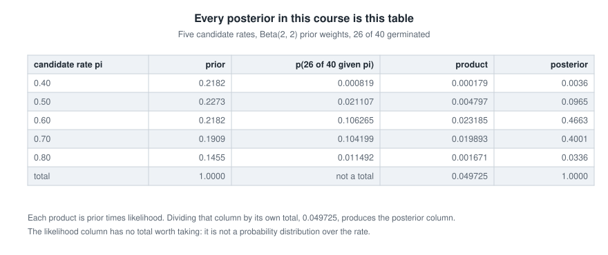
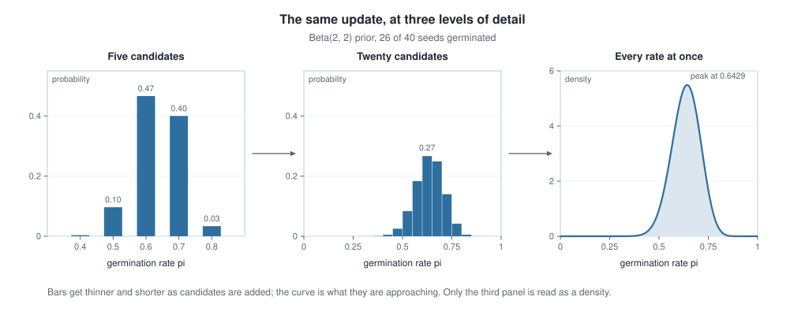
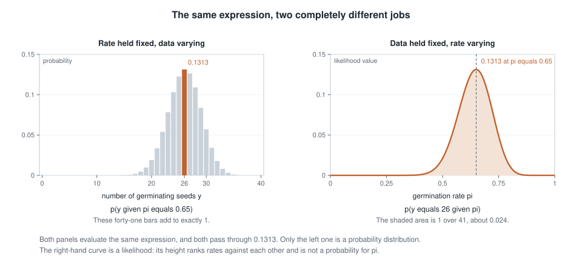
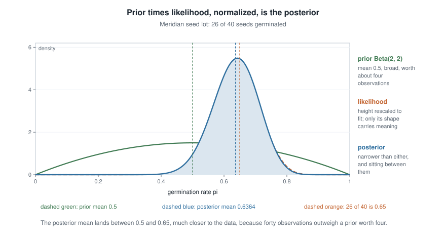
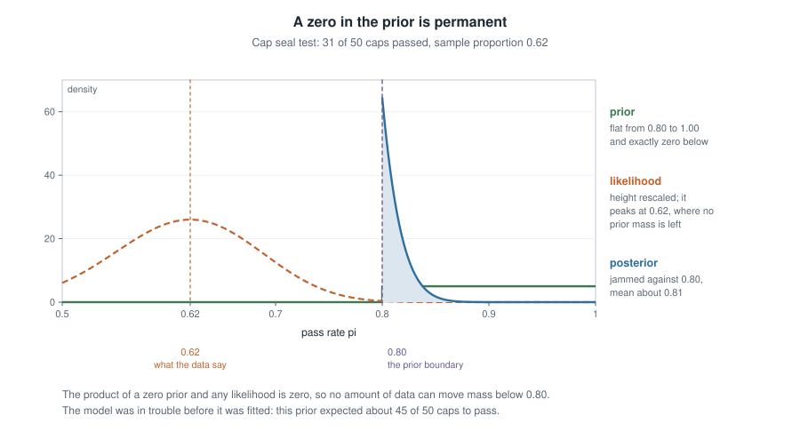

# Week 3 — Priors, likelihoods, and posterior distributions

## Where this week starts

Week 2 handed you Bayes' rule in the friendliest setting it has. There were two hypotheses, a person either had the condition or did not, and every quantity was a count of people. The posterior probability was a ratio of two counts you had already tallied.

This week the unknown stops being one of a short list. A supplier ships a lot of seed, and the quantity you care about is the proportion of those seeds that will germinate under standard conditions. Call it $\pi$, read as "the germination rate of this lot". It is a fixed number, the lot has whatever rate it has, but you do not know it, and it is not one of two or three candidates: it could be 0.61 or 0.6137 or anything between 0 and 1. There is no table to fill in, because a table needs rows and this unknown has infinitely many.

What replaces the table is a curve, and that is the content of the week. The prior becomes a curve over the values of $\pi$ instead of a column of probabilities. The likelihood becomes a curve too, though of a very different kind, and mistaking one for the other is the standard error at this stage. The posterior is still what it was in Week 2: prior times likelihood, rescaled so the total is one. The arithmetic changes from a sum to an integral; the reasoning does not change.

Three things should feel different by Friday. You should be able to look at a figure with three curves and say which is the prior, which is the likelihood, and which is the posterior, and why the posterior sits where it does. You should be able to say why the likelihood is not a probability distribution over the parameter. And you should be comfortable discarding constants: working "up to a constant of proportionality" is the technique that makes the rest of this course tractable.

### Why this matters outside the classroom

A seed buyer has to decide about a lot before planting a field. The real question is not "what is the germination rate" but "is this lot good enough, and how badly could I be wrong". A test tray gives a proportion, and a proportion from a small tray is noisy. Someone who reports only that proportion has reported a number with no width attached, and whoever reads it as the lot's rate will over-order or under-order seed and will not find out until the field is up.

The buyer's question needs a whole distribution over $\pi$, not a single figure. With one in hand you can ask directly for the probability that the rate clears a contract threshold, and see how much of that probability came from the data and how much from what you assumed before planting. Every piece of it is built this week: the prior, the likelihood, the product, and the rescaling.

## What you will be able to do

- **Describe** a continuous unknown with a prior distribution, and say in plain language what that prior asserts before any data arrive.
- **Evaluate** a binomial likelihood as a function of the parameter with the data held fixed, and explain how that differs from the same expression read as a distribution over the data.
- **Compute** a posterior over a grid of candidate values by multiplying prior by likelihood and dividing by the column total, showing every number.
- **Explain** why $p(\pi \mid y) \propto p(\pi) \, p(y \mid \pi)$ fully describes the posterior, and what the discarded constant $p(y)$ is.
- **Diagnose** a prior that has quietly decided the conclusion, including one that gives zero density to values the data support.
- **State** what a posterior licenses you to claim and what it does not.

## Terms and notation worth fixing

These symbols mean the same thing in every unit of this course, so read the table once slowly rather than guessing later.

| Symbol | What it means in this course |
|---|---|
| $\pi$ | an unknown probability or proportion, here the germination rate of one seed lot |
| $y$, $n$ | the observed data: $y$ successes among $n$ trials |
| $p(\pi)$ | the **prior**: a density over $\pi$ describing what is plausible before the data arrive |
| $p(y \mid \pi)$ | the **likelihood** when read as a function of $\pi$ with $y$ fixed: how well each candidate rate accounts for the data you got |
| $p(\pi \mid y)$ | the **posterior**: the density over $\pi$ after the data have been folded in |
| $p(y)$ | the probability the model gave the data actually observed, and the constant that rescales the posterior to total one |
| $\propto$ | "is proportional to": equal up to a factor that does not involve $\pi$ |
| Beta$(a, b)$ | the family of densities on the interval from 0 to 1 used for a proportion; Week 4 develops it |

## From counted hypotheses to a continuous parameter

The cleanest way into a continuous parameter is to refuse it at first. Put a handful of candidate rates on the axis, treat them like Week 2's short list of hypotheses, and do the update you already know. Then add candidates. The density arrives as a limit of something familiar rather than as a new object dropped in from above.

Here is the case for the rest of the week. A supplier ships seed lots to a grower. For one lot, the Meridian lot, the germination rate $\pi$ is unknown. A test tray of $n = 40$ seeds is planted under standard conditions and $y = 26$ germinate, so the sample proportion is $26/40 = 0.65$. The course's standing prior for that lot is Beta(2, 2), a gentle hump centred at 0.5 whose density is $p(\pi) = 6\pi(1-\pi)$. It says middling rates are somewhat more plausible than extreme ones, and nothing stronger. Week 4 owns this case and does its arithmetic in closed form; this week we build it by hand.

### Five candidate rates on the axis

Suppose you allow only five rates: 0.40, 0.50, 0.60, 0.70, and 0.80. This is a scaffold, not a realistic model. Give each a prior weight proportional to $6\pi(1-\pi)$ there, which gives 1.44, 1.50, 1.44, 1.26, and 0.96. Those add to 6.60, so dividing each by 6.60 turns them into prior probabilities adding to one: 0.2182, 0.2273, 0.2182, 0.1909, and 0.1455.

Now the likelihood. For a fixed candidate rate, the probability of exactly 26 germinations among 40 independent seeds is

$$p(y \mid \pi) \;=\; \binom{n}{y} \, \pi^{y} \, (1-\pi)^{\,n-y} \;=\; \binom{40}{26} \, \pi^{26} \, (1-\pi)^{14}.$$

At the five candidates that gives 0.000819, 0.021107, 0.106265, 0.104199, and 0.011492. Read those slowly: they are the entire evidence in this problem. A lot at 0.40 would produce this tray about eight times in ten thousand; a lot at 0.60 would produce it about eleven times in a hundred. The data are roughly a hundred and thirty times more consistent with 0.60 than with 0.40, and that ratio does the work.

Multiply each prior probability by its likelihood, add, and divide. The five products are 0.000179, 0.004797, 0.023185, 0.019893, and 0.001671, adding to 0.049725. Dividing each by that total gives posterior probabilities 0.0036, 0.0965, 0.4663, 0.4001, and 0.0336, which add to one.

{fig-alt="A five-row table of candidate rates 0.40 to 0.80 with columns for prior probability, the likelihood of 26 of 40, their product, and the posterior probability, with the product column totalling 0.049725."}

Two features deserve a pause. The candidate 0.60 ends up with more posterior probability than 0.70 even though their likelihoods are nearly equal, because the prior favoured it slightly. And the column total 0.049725 is the probability this five-candidate model gave the data in advance; dividing by it is the only step that turns products into probabilities.

### Twenty candidates, and then all of them

Nothing there depended on there being five candidates. Use twenty, spaced evenly, weighted by the same prior density and multiplied by the same likelihood. The tallest bar now sits at 0.625 and carries about 0.27 of the posterior probability, and the mass has spread into a shape rather than piling onto two candidates.

Keep going. With a hundred candidates each bar is shorter still, because the same total of one is shared among more of them, and the bar chart stops being readable. A density takes over. It does not report the probability of a single value, which for a continuous unknown is zero; it reports probability per unit of $\pi$, so that area over an interval is the probability the rate lies in that interval. Heights can exceed one, and that is fine: a density is not a probability.

{fig-alt="Three panels. Left: five bars with the tallest near 0.47 at rate 0.60. Middle: twenty visibly shorter bars on the same probability axis, peaking near 0.27 at 0.625. Right: a smooth posterior density peaking at 0.6429, height near 5.5."}

The third panel is the object this course works with. Week 4 will name it a Beta density with shape values 28 and 16; its peak sits at 0.6429, which you will verify below. The structural point is that the continuous posterior is not a different kind of thing from the twenty-bar posterior. It is what the bars converge to once you stop rationing candidates.

## The likelihood is a function of the parameter

Here is the idea that trips almost everyone. The expression $p(y \mid \pi)$ does two different jobs depending on which argument you hold still, and the notation does not tell you which. You have to be told, so you are being told.

### The same formula doing two different jobs

Hold the rate fixed at $\pi = 0.65$ and let the data vary. Then $p(y \mid 0.65)$ is a probability distribution over the forty-one possible values of $y$, from 0 to 40 germinating seeds. Its values are non-negative and add to exactly one, because some number of seeds must germinate. This is the reading from your probability course: the parameter is a known setting of the world and the data are the random thing.

Now hold the data fixed at $y = 26$ and let the rate vary. Then $p(26 \mid \pi)$ is a function of $\pi$, defined for every rate between 0 and 1, and it is called the likelihood. At $\pi = 0.65$ it equals 0.1313; at $\pi = 0.50$, 0.0211; at $\pi = 0.40$, 0.000819. Those numbers rank rates against each other: 0.65 makes the observed tray about six times as probable as 0.50 does, since $0.1313 / 0.0211 = 6.2$.

{fig-alt="Two panels. Left: forty-one bars over seed counts with the rate fixed at 0.65, highlighted at 26 with height 0.1313, adding to one. Right: a curve over rates with the count fixed at 26, peaking at 0.1313 at 0.65."}

Both panels evaluate the same expression and both pass through 0.1313. Nothing algebraic changed; only which argument you sweep, and that is enough to turn a probability distribution into something that is not one.

### Why the likelihood is not a distribution over the rate

Three arguments settle it, and each is worth carrying.

The units are wrong. The left panel adds to one over the forty-one seed counts because those counts are the sample space. Sweeping $\pi$ sweeps no sample space at all; under this reading the rate was never random.

The area is wrong, and you can compute it exactly. The area under the right-hand curve, $\int_0^1 p(26 \mid \pi) \, d\pi$, equals $1/41$, about 0.024. The argument fits in a line: for $n = 40$ the area under the likelihood curve is the same for every one of the forty-one possible counts, and those forty-one equal areas must add to one, so each is $1/41$. Densities have area one; this does not.

Most decisively, the scale is arbitrary. Multiply the likelihood by 1000 and every ranking among rates is unchanged, and so, as the next section shows, is the posterior. No probability distribution survives being multiplied by 1000. An object whose height carries no meaning, only whose shape does, is not a probability, which is why the likelihood in the figure below is drawn rescaled and labelled as such.

## Proportionality, and the constant you can drop

Bayes' rule for a continuous parameter is the statement you proved by counting in Week 2, with an integral where the sum used to be:

$$p(\pi \mid y) \;=\; \frac{p(\pi) \, p(y \mid \pi)}{p(y)}, \qquad \text{where} \quad p(y) \;=\; \int_0^1 p(\pi) \, p(y \mid \pi) \, d\pi.$$

Say that denominator in words before reading it as an integral. It asks: averaging over every rate the prior thought possible, weighted by how plausible each one was, how probable was the tray we actually got? It is one number, and it does not involve $\pi$, because $\pi$ has been integrated away.

### What the normalizing constant actually is

For the Meridian tray that integral can be evaluated in closed form, and it comes to $p(y) = 0.0328$. Compare it with the 0.049725 from the five-candidate table: the same idea on a coarser grid. Both are the probability the model attached, in advance, to the data that turned up, which is where any comparison between models starts. What it is not is part of the shape of the posterior. It is one number dividing every height of a curve by the same amount. Week 11 does its comparing differently, by how well each model predicts days it was not fitted to.

### Working up to a constant, then normalizing once

Because $p(y)$ does not depend on $\pi$, drop it while you work and restore it at the end:

$$p(\pi \mid y) \;\propto\; p(\pi) \, p(y \mid \pi).$$

Watch how much that buys. The prior density $6\pi(1-\pi)$ loses its 6, leaving $\pi^{1}(1-\pi)^{1}$, and the likelihood loses its binomial coefficient for the same reason. What is left is

$$p(\pi \mid y) \;\propto\; \pi^{1}(1-\pi)^{1} \cdot \pi^{26}(1-\pi)^{14} \;=\; \pi^{27}(1-\pi)^{15}.$$

Two multiplications became two additions of exponents. Everything discarded was a positive number that scaled the whole curve without moving it sideways or changing its width, and the final normalization undoes all of it at once. The shape is the statistics; the constant is bookkeeping.

## Worked example — the Meridian seed lot, from prior to posterior

Now run it end to end with every number in view: one seed lot, an unknown germination rate $\pi$, a tray of forty seeds, twenty-six of which germinated. The model has two parts, and you should be able to state both before touching arithmetic.

**Step 1. State the prior and what it asserts.** Take $p(\pi)$ to be Beta(2, 2), density $6\pi(1-\pi)$. Its mean is 0.5 and its shape strength, $2 + 2$, behaves like four prior observations, two of which germinated. In words: before planting we regard middling rates as more plausible than extreme ones, and we hold that loosely enough that forty real seeds will easily overrule it.

**Step 2. State the likelihood and what it assumes.** Treat the forty seeds as independent, each germinating with the same probability $\pi$, so $p(y \mid \pi) = \binom{40}{26}\pi^{26}(1-\pi)^{14}$. Independence and a common rate are modelling assumptions, not facts: seeds in one tray could share a bad corner of the greenhouse, and then this is the wrong likelihood.

**Step 3. Multiply, dropping constants.** As above, $p(\pi \mid y) \propto \pi^{27}(1-\pi)^{15}$.

**Step 4. Find where the posterior peaks.** Maximize the logarithm, $27\ln\pi + 15\ln(1-\pi)$. Setting its derivative to zero gives $27/\pi = 15/(1-\pi)$, so $42\pi = 27$ and $\pi = 27/42 = 0.6429$. That is the most plausible single rate under this posterior, and notice where it landed: above the prior's 0.5, below the tray's 0.65, much nearer the tray.

**Step 5. Normalize and read the picture.** Be careful about what gets divided. The constant $p(y) = 0.0328$ rescales the *full* product $p(\pi) \, p(y \mid \pi)$, with the 6 and the binomial coefficient restored, and that quotient has area one. The stripped $\pi^{27}(1-\pi)^{15}$ of Step 3 has the same shape but nothing like the same scale, so it takes a different constant of its own; dividing it by 0.0328 would leave an area nowhere near one. Both routes land on the same curve, which is exactly what working up to a constant buys you. Week 4 will name that curve Beta(28, 16) and show its mean is $28/44 = 0.6364$; take that as a preview rather than something derived here.

{fig-alt="A broad green prior centred at 0.5 with height 1.5, a dashed orange likelihood peaking at 0.65 with its height rescaled, and a tall narrow blue posterior peaking at 0.6429 with its mean marked at 0.6364."}

**Step 6. Say what this licenses and what it does not.** The posterior is narrower than the prior and narrower than the likelihood, which is what "we learned something" looks like on this axis. Its mean sits between the prior mean 0.5 and the tray proportion 0.65, closer to the tray because forty observations outweigh a prior worth four. It licenses a probability statement about $\pi$ under this model, which Week 4 will compute. It does not license a claim that the lot's rate is 0.6364, nor that the model is right: every number here is downstream of two unchecked assumptions. A posterior is evidence about a quantity, conditional on a model, not a verdict about the lot.

### The same reasoning, transferred

Change the scenario and watch how little changes. A campus bike shop wants $\pi$, the proportion of tune-ups it finishes the same day. The manager's prior is Beta(3, 3), proportional to $\pi^{2}(1-\pi)^{2}$: still centred at 0.5, but with strength $3 + 3$, worth about six prior jobs instead of four. Over one week, twelve tune-ups arrive and ten are finished the same day, a proportion of $10/12 = 0.8333$.

The move is identical. Drop constants and multiply: $\pi^{2}(1-\pi)^{2} \cdot \pi^{10}(1-\pi)^{2} = \pi^{12}(1-\pi)^{4}$; the exponents added, as before. Maximizing $12\ln\pi + 4\ln(1-\pi)$ gives $12(1-\pi) = 4\pi$, so $16\pi = 12$ and the peak is at $\pi = 0.75$. The rule Week 4 develops gives this posterior a mean of $13/18 = 0.7222$. Both values sit between the prior's 0.5 and the data's 0.8333.

What stayed the same: three objects, one multiplication, constants discarded, one normalization at the end. What changed: the prior is stronger relative to the sample, six against twelve rather than four against forty, so the posterior is pulled further back toward 0.5, and it is wider because twelve observations are fewer than forty. The balance is set by the relative strength of prior and data, not by which one you find more congenial.

## Second worked example — a prior that ruled out the truth

This one fails, and it fails at the prior rather than in the arithmetic. A bottling line receives caps from a co-packer whose contract states that at least 80 percent of caps pass a first-time seal test. The quality lead, reasoning that the contract settles the range, writes a prior that is flat on the interval from 0.80 to 1.00 and exactly zero below 0.80. On that interval the density is 5, since a flat density over a stretch of width 0.20 needs height 5 for its area to be one.

Fifty caps are then tested and thirty-one pass, a proportion of $31/50 = 0.62$.

**What the data say on their own.** The likelihood is proportional to $\pi^{31}(1-\pi)^{19}$ and peaks at 0.62. Compare its value there with its value at the boundary:

$$\frac{0.62^{31}(0.38)^{19}}{0.80^{31}(0.20)^{19}} \;=\; (0.775)^{31} \times (1.9)^{19} \;=\; 73.2 .$$

The data are about seventy-three times more consistent with a pass rate of 0.62 than with 0.80. Inside the allowed range the same calculation gives $(1.0625)^{31} \times (0.75)^{19} = 0.0277$ for 0.85 against 0.80, so the likelihood falls by a factor of about thirty-six across those five hundredths.

**What the posterior does anyway.** The posterior is proportional to prior times likelihood, and the prior is exactly zero below 0.80. Zero times anything is zero. So the posterior is zero below 0.80 whatever the caps said, and above 0.80 it is the likelihood renormalized, sliding steeply downhill from the boundary. Its mean is about 0.81, and essentially all its mass lies between 0.80 and 0.85.

{fig-alt="A flat green prior of height 5 from 0.80 to 1.00 and zero below, a dashed orange likelihood peaking at 0.62, and a tall blue posterior pressed against 0.80 with mean about 0.81 and almost no mass past 0.85."}

**The check that should have been run.** Before any caps were tested this model already made a prediction: if the pass rate really is between 0.80 and 1.00, then among fifty caps you should expect around forty-five to pass, and fewer than thirty-six only about seven times in a thousand. The chance such a model produces thirty-one or fewer is about 0.0002, roughly two in ten thousand. A prior predictive check of that kind takes a minute and would have flagged the trouble before any posterior was drawn. Week 6 builds predictive distributions properly, and Week 11 makes checks like this routine.

**The interpretation that went wrong.** The quality lead reported that the posterior put essentially all of its probability on a pass rate above 0.80, and called that strong evidence the contract was being met. It is nothing of the kind: that probability was in the prior before a single cap was tested, and the data pushed against it without being allowed to move it. A prior that assigns zero density to a region is not a cautious assumption, it is an unfalsifiable one. The contract may be a fine reason to expect a high pass rate; it is not a reason to make lower rates impossible. A prior saying "0.80 or above is very likely, but not certain" would have let the data speak, and the honest report would have been that the caps and the contract disagree.

## The misreading to avoid

Said the way students actually say it: "the likelihood is the probability that the parameter is right, so a curve peaking at 0.65 tells me there is a good chance the rate is 0.65."

Take it apart in the order the errors occur. "The probability that the parameter is right" already assumes the parameter has a probability distribution, and under the likelihood reading it does not: the rate is fixed and unknown, and the only random object in $p(y \mid \pi)$ is $y$. The 0.1313 at the peak is a probability, but it is the probability of the tray you observed if the rate were 0.65. It is a statement about seeds, not about rates.

Next, check the arithmetic the misreading implies. If the likelihood curve were a distribution over $\pi$, its area would be one. Its area is $1/41$, about 0.024. If someone tells you a curve with area 0.024 gives probabilities, ask what the missing 0.976 is doing.

Then the scale argument, which ends the discussion. Multiply the whole likelihood by 1000 and re-run the update: every product and the column total are multiplied by 1000, and the posterior is unchanged to the last decimal place. The likelihood's height is a ranking device, meaningful only in ratios between rates.

Finally, why the misreading persists. When the prior is flat the posterior really is the likelihood curve rescaled to area one, so the two shapes coincide and nothing visibly goes wrong. Even then it is the prior that made the statement a probability statement about $\pi$, and a flat prior is itself an assumption with consequences that Week 5 examines. The likelihood supplies the evidence; only the posterior supplies the probability.

A smaller misreading rides along with it: reading a tall narrow posterior as "we are now nearly certain". The Meridian posterior peaks at 0.6429 and is much narrower than the prior, but it still has real width, and its shape rests entirely on assumptions this page has not tested. Narrow is not the same as correct.

## Practice on your own

These are for your own checking, not for submission. Work them with a calculator or in R.

1. Redo the five-candidate table using candidates 0.55, 0.60, 0.65, 0.70, and 0.75 with **equal** prior probabilities of 0.2 each. Compute the likelihoods for 26 of 40, form the products, and normalize. Which candidate wins, and how much did dropping the Beta(2, 2) weights change the picture?
2. Take the product column from the table figure on this page and multiply every entry by 1000. Recompute the posterior column, then write one sentence explaining why discarding constants is safe.
3. For a tray with $n = 10$ and $y = 7$, and a second with $n = 100$ and $y = 70$, write both likelihoods up to a constant. Both peak at 0.7. Without computing anything, say which curve is wider and why that matters for the posterior.
4. A colleague proposes a prior for a germination rate that is zero below 0.5 and flat above. Describe a data set that should make you doubt it, and explain why the posterior alone would never reveal the problem.
5. Explain to someone outside the course why the area under the likelihood curve in the two-readings figure is $1/41$ rather than 1, using the idea that the forty-one counts share the total equally.

## Where to read more

- This week aligns with Chapters 2 and 3 of the course's primary text, [Bayes Rules!](https://www.bayesrulesbook.com/). Read [chapter 2](https://www.bayesrulesbook.com/chapter-2) and [chapter 3](https://www.bayesrulesbook.com/chapter-3) alongside these notes. Availability and licence confirmation is still open for every source in this course, so go through the resources page rather than assuming any copy is free to redistribute.
- To try the grid update yourself you need only base R, installed in Week 1; see [The R Project for Statistical Computing](https://www.r-project.org/). The code below runs as it stands; these notes quote none of its output.

```r
# Week 3: a grid update for the seed lot, using base R only.
pi_grid <- seq(0.005, 0.995, by = 0.01)
prior     <- dbeta(pi_grid, 2, 2)                  # the Beta(2, 2) prior density
lik       <- dbinom(26, size = 40, prob = pi_grid) # likelihood over rates
unnorm    <- prior * lik                           # prior times likelihood
posterior <- unnorm / sum(unnorm)                  # normalize once, at the end

plot(pi_grid, posterior, type = "h")
abline(v = 26 / 40, lty = 2)
```

- Course pages: the [syllabus](../syllabus.qmd), the [schedule](../schedule.qmd), the [resources page](../resources/index.qmd) for reading access, [Week 1](week-01.qmd) for setting up R, VS Code, and Quarto, and the [notes index](index.qmd) for the other units.

## Where this goes next

Week 4 finishes what this page set up. It develops the Beta family, shows that a Beta prior and a binomial likelihood give a Beta posterior whose shape values are the prior's plus the data's, and reads the Meridian posterior as Beta(28, 16). That is where the mean 0.6364 is derived rather than previewed, where the interval from 0.4907 to 0.7702 comes from, and where you learn to state a posterior probability about $\pi$ in a sentence a grower would accept.

Before going on, make sure the three objects are separate in your head: a prior over the parameter, a likelihood over the parameter that is not a distribution, and a posterior that is their normalized product. If you can draw the three curves from memory and say which is widest, you are ready for [Week 4](week-04.qmd). The [notes index](index.qmd) has the other units.
