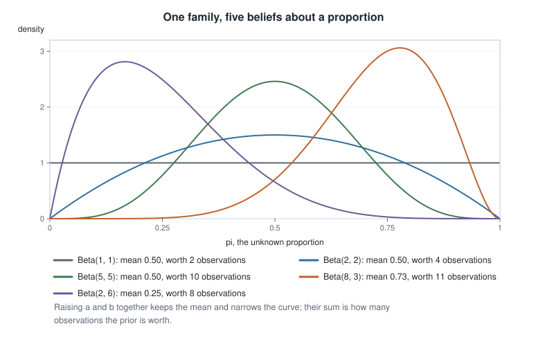
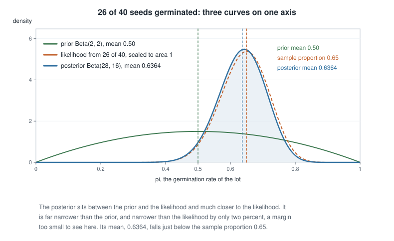
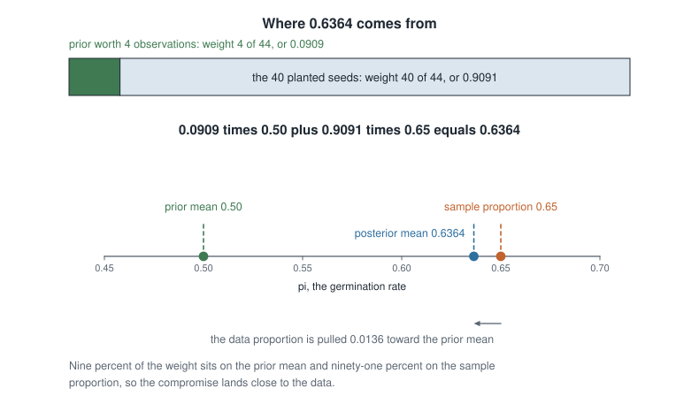
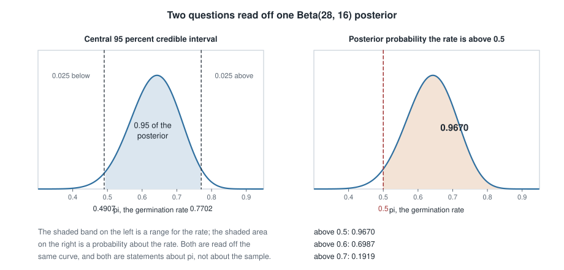
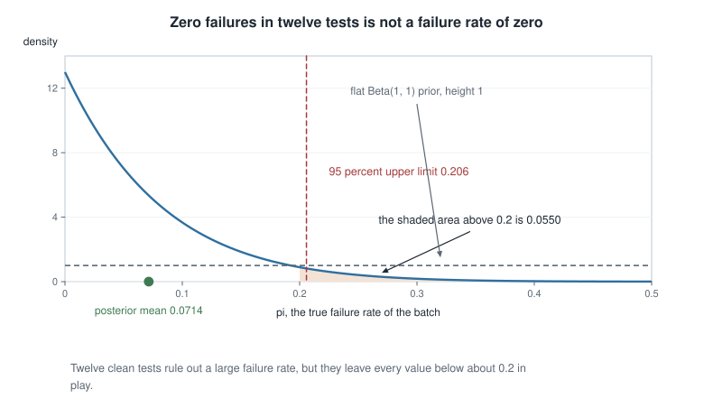

# Week 4 — The beta-binomial model

## Where this week starts

Last week you put a continuous parameter on the horizontal axis for the first time. A prior became a
curve over every value a proportion could take, the likelihood a function of that proportion with the
data held fixed, and the posterior their normalized product. You saw the three curves drawn together
for a seed lot in which 26 of 40 planted seeds germinated, and you were told the posterior in that
picture has a name. This week you earn the name.

Week 4 asks one narrow question with enormous reach: when the unknown quantity is a proportion and
the data are successes out of trials, is there a family of prior curves for which the update can be
done with arithmetic instead of integration? There is, it is the Beta family, and the arithmetic is
short enough to carry in your head. A Beta prior with shape values $a$ and $b$, combined with $y$
successes in $n$ trials, gives a Beta posterior with shape values $a + y$ and $b + n - y$. Two
additions. That is the whole update.

What last week left unfinished was the normalizing constant. You learned that
$p(\pi \mid y) \propto p(\pi) \, p(y \mid \pi)$, and that the constant $p(y)$ may be dropped while you
work but has to come back before the result is a probability distribution. This week it comes back
for free: the product has a recognizable shape, and a Beta curve carries its own constant.

Three things should feel different by Friday. A posterior should stop being an abstraction and become
an object you compute with, its mean, spread, quantiles, and tail areas each one line away. You
should be able to look at two shape values and say what belief they encode and how strongly. And you
should be able to say precisely what a 95 percent credible interval claims.

### Why this matters outside the classroom

A supplier ships a seed lot with a germination rate printed on the tag, and a grower must decide
whether to sow it, return it, or sow it at a heavier density. The grower plants a test tray of forty
seeds and twenty-six come up. Someone will say "sixty-five percent" and stop, as though forty seeds
had settled the matter. The beta-binomial model lets the grower say the honest version instead: the
plausible range for this lot runs from roughly 0.49 to roughly 0.77, so a rate below one half is not
ruled out and a rate high enough to sow at the normal density is not established either. That is a
different purchasing conversation, and a better one.

The same reasoning decides whether a maintenance crew calls a batch of parts safe after a handful of
clean tests. In each case the damage is done by reporting the sample proportion as though it were the
truth.

## What you will be able to do

- **Read a Beta prior.** Given shape values $a$ and $b$, state the prior mean $a/(a+b)$, say how many
  observations the prior is worth, and describe the belief it encodes.
- **Choose shape values to match a stated belief.** Turn "around 0.75, worth about eight
  observations" into a specific Beta prior, and say what the translation added.
- **Derive and apply the conjugate update.** Show in two lines why a Beta prior and a binomial
  likelihood produce a Beta posterior, then compute the posterior shape values for real data.
- **Decompose a posterior mean into its weights.** Write it as a weighted average of the prior mean
  and the sample proportion, and verify that the weights reproduce it exactly.
- **Compute and interpret a credible interval and a posterior tail probability**, naming the
  conditions each claim depends on.
- **Explain how a credible interval differs from a confidence interval**, without overclaiming what
  either one delivers.

## Terms and notation worth fixing

These are the symbols this page uses, in the sense the rest of the course uses them; each is also
glossed in words where it first does work.

| Symbol or term | What it means here |
|---|---|
| $\pi$ | the unknown proportion, for example the germination rate of one seed lot |
| $y$, $n$ | the number of successes observed, and the number of trials they came from |
| $a$, $b$ | the two shape values of a Beta distribution, both positive |
| $p(\pi)$ | the prior: which values of $\pi$ are plausible before the data |
| $p(y \mid \pi)$ | the likelihood: how probable the observed $y$ would be if the rate were $\pi$ |
| $p(\pi \mid y)$ | the posterior: plausibility for $\pi$ after seeing $y$ |
| $\propto$ | "is proportional to": equal up to a factor free of $\pi$ |
| conjugate family | a prior family the likelihood maps back into itself, so the posterior has the prior's form |

## The Beta family and what its shapes assert

A prior on a proportion has to live on the interval from 0 to 1, because that is where proportions
live. The Beta family is the standard supply of curves on that interval. A Beta distribution with
shape values $a$ and $b$ has the density

$$
p(\pi) = \frac{\pi^{a-1}(1-\pi)^{b-1}}{B(a,b)}, \qquad 0 < \pi < 1 ,
$$

where $B(a,b)$ is whatever constant makes the area under the curve equal one. Read it the way a
working statistician does: ignore the constant and look at the two exponents. The exponent on $\pi$
pushes the curve toward one, the exponent on $1 - \pi$ pushes it toward zero, and their size together
controls how tightly the curve concentrates.

The two summaries worth memorizing are the mean and the mode:

$$
\text{mean} = \frac{a}{a+b}, \qquad \text{mode} = \frac{a-1}{a+b-2} \ \ (\text{when } a > 1 \text{ and } b > 1) .
$$

The standard deviation has a formula too, $\sqrt{ab / ((a+b)^2 (a+b+1))}$, and its only important
feature is the $a + b + 1$ in the denominator: hold the mean fixed, make $a + b$ larger, and the
curve gets narrower.

{fig-alt="Five Beta density curves over a proportion from 0 to 1. Beta(1,1) is flat, Beta(2,2) a low hump at 0.5, Beta(5,5) a taller hump at 0.5, Beta(8,3) skewed left peaking near 0.78, and Beta(2,6) skewed right peaking near 0.17."}

Look at the flat curve first. Beta(1, 1) has both exponents equal to zero, so its density is the
constant one and every value of $\pi$ is equally plausible. Now compare Beta(2, 2) and Beta(5, 5):
both have mean $a/(a+b) = 0.5$ and both are symmetric, but Beta(5, 5) is visibly narrower. Only the
confidence in the centre changed. Finally Beta(8, 3), with mean $8/11 = 0.727$, and Beta(2, 6), with
mean $2/8 = 0.25$: making one exponent larger slides the curve toward that end of the interval.

### Reading a and b as prior observations

One interpretation makes the family easy to hold in mind, and it is an analogy rather than a theorem.
Think of $a - 1$ as prior successes and $b - 1$ as prior failures, so Beta(1, 1) corresponds to no
prior trials at all, which is why it is flat, and Beta(2, 2) to one success and one failure.

For the update arithmetic ahead, the cleaner bookkeeping is to say that a Beta$(a, b)$ prior is
**worth $a + b$ observations**, because $a + b$ is exactly what appears in the denominator when you
weigh prior against data. That is the version this course uses and the version printed in the figure
above. Both readings say the same thing qualitatively: the sum of the shape values is the strength
dial, and their ratio sets the centre.

This is where the course's standing principle first bites. A prior is a modeling choice: preferring
Beta(16, 4) to Beta(2, 2) asserts that you will enter the analysis carrying about twenty observations
of evidence you did not collect here. With a long supplier record that may be defensible. It is never
automatically defensible, and it is never neutral.

### Choosing shape values to match a stated belief

Suppose a grower says: "for this supplier I would expect around three quarters germination, and I
would take that about as seriously as a tray of eight seeds." Translate the halves separately. The
centre gives $a/(a+b) = 0.75$, the strength gives $a + b = 8$, so $a = 0.75 \times 8 = 6$ and
$b = 8 - 6 = 2$. The prior is Beta(6, 2), with mean $6/8 = 0.75$ and standard deviation
$\sqrt{6 \times 2 / (8^2 \times 9)} = \sqrt{12/576} = 0.1443$.

Now say the honest thing about that translation. The grower gave a centre and a rough strength; you
returned a specific curve, including specific claims about how much mass sits above 0.9 and below
0.5. Those extra commitments came from the family, not from the grower. The right response is not to
pretend the choice is innocent but to check whether conclusions move when it moves, which is exactly
what Week 5 does on this seed lot.

## Conjugate updating in two lines

Now the data. If each of $n$ trials succeeds independently with the same probability $\pi$, the
count of successes $y$ is binomial, and the probability of the observed count is

$$
p(y \mid \pi) = \binom{n}{y} \pi^{y} (1-\pi)^{n-y} .
$$

The move that makes this week work is one you met last week: read that expression as a function of
$\pi$ with $y$ and $n$ held at their observed values. Under that reading the binomial coefficient
$\binom{n}{y}$ is a constant, since it involves no $\pi$, so as far as shape is concerned,

$$
p(y \mid \pi) \propto \pi^{y}(1-\pi)^{n-y} .
$$

Compare that with the Beta density stripped of its own constant, $\pi^{a-1}(1-\pi)^{b-1}$. They are
the same kind of expression: a power of $\pi$ times a power of $1 - \pi$. That is the entire reason
the Beta family and the binomial likelihood fit together.

### Why the posterior stays in the Beta family

Multiply the two, dropping every factor that does not involve $\pi$:

$$
\begin{aligned}
p(\pi \mid y) &\propto p(\pi) \, p(y \mid \pi) \\
&\propto \pi^{a-1}(1-\pi)^{b-1} \times \pi^{y}(1-\pi)^{n-y} \\
&= \pi^{(a+y)-1}(1-\pi)^{(b+n-y)-1} .
\end{aligned}
$$

Read the last line. It has exactly the form of a Beta density with shape values $a + y$ and
$b + n - y$. Since it is proportional to that Beta density and both are probability distributions
over the same interval, they must be the same distribution: the missing constant is forced. So

$$
\pi \sim \text{Beta}(a, b) \ \text{ and } \ y \mid \pi \sim \text{Binomial}(n, \pi)
\quad \Longrightarrow \quad \pi \mid y \sim \text{Beta}(a + y,\ b + n - y) .
$$

Add the successes to the first shape value, the failures to the second. Nothing is integrated,
nothing is approximated, and the result is exact. A prior family with this property is called a
conjugate prior for that likelihood.

{fig-alt="Three curves over germination rates from 0 to 1: a low broad prior hump centred at 0.5, a taller dashed likelihood peaking at 0.65, and a shaded posterior peaking near 0.64, between them and far narrower than the prior."}

The figure shows all three curves for the seed lot: the Beta(2, 2) prior as the low wide hump, the
likelihood from 26 successes in 40 trials rescaled to enclose an area of one as the dashed curve
peaking at $26/40 = 0.65$, and the Beta(28, 16) posterior shaded. Three features are worth reading
off that picture, and each one arrives with a condition rather than as a law.

The first is a genuine rule, and the next subsection proves it in a line: the posterior mean always
lands between the prior mean and the sample proportion, and nearer whichever of the two carries more
weight. Here that is the data, because forty seeds outweigh a prior worth four observations, which is
why the shaded curve sits close against the dashed one.

The second and third features are true of this picture and are not true of every picture. The
posterior here is far narrower than the prior, standard deviation 0.0717 against 0.2236, and that
gap is the forty seeds doing their work. It is also narrower than the rescaled likelihood, but only
just: 0.0717 against 0.0731, a margin of about two percent that you will not see by eye in the
drawing above, so do not go hunting for it. The reason the margin is so thin is worth carrying. A
likelihood from $y$ successes in $n$ trials, rescaled to area one, is itself a Beta curve,
Beta$(y + 1,\ n - y + 1)$, and by this week's bookkeeping it is already worth $n + 2$ observations.
The posterior, worth $a + b + n$, gains on it only through whatever weight the prior adds beyond
those two, and Beta(2, 2) adds exactly two. Take the flat Beta(1, 1) prior instead, as this page's
second worked example does, and the prior adds nothing at all: the posterior and the rescaled
likelihood coincide curve for curve, so there the posterior is neither narrower than the likelihood
nor strictly between two distinct curves. So say the compromise and the shrinkage plainly, and treat
"narrower than both" as a statement about how much weight this particular prior is carrying.

### The posterior mean as a weighted compromise

"Nearer the likelihood" can be made exact, and the exact version is this week's most useful
sentence. The posterior mean is

$$
E(\pi \mid y) = \frac{a+y}{a+b+n}
= \underbrace{\frac{a+b}{a+b+n}}_{\text{weight on the prior}} \times \frac{a}{a+b}
+ \underbrace{\frac{n}{a+b+n}}_{\text{weight on the data}} \times \frac{y}{n} .
$$

Expand the right-hand side to check it: the first term is $a/(a+b+n)$, the second is $y/(a+b+n)$, and
they sum to $(a+y)/(a+b+n)$. The posterior mean is a weighted average of the prior mean and the
sample proportion, with weights proportional to prior strength $a + b$ and data size $n$.

That formula says when the prior matters, without hand-waving. Hold $a + b$ fixed and let $n$ grow:
the data weight $n/(a+b+n)$ goes to one and the posterior mean converges on the sample proportion.
Hold $n$ fixed and make the prior strong: the posterior mean is dragged toward the prior mean. No
sample size makes the prior formally disappear, and no prior strength formally ignores the data.
There is only the ratio.

{fig-alt="A horizontal bar split into a narrow prior segment of 4 out of 44 and a wide data segment of 40 out of 44, above a number line from 0.45 to 0.70 marking prior mean 0.50, posterior mean 0.6364, and sample proportion 0.65."}

The figure puts the two weights side by side as lengths for the seed lot. The prior claims four
forty-fourths of the bar and the forty seeds claim the rest, so the compromise on the number line
below lands within a hundredth and a half of the sample proportion. When you report a posterior
mean, this bar is the picture to have in mind, and you should be able to say how the weights were
set.

## Worked example — the Meridian seed lot, 26 of 40 seeds

Here is the case in full, from the setup to the sentence you would write in a report. A supplier
ships seed lots to a wholesale grower. For one lot the germination rate $\pi$ is unknown, meaning the
long-run proportion of seeds from this lot that would germinate under the grower's standard
conditions. A test tray of $n = 40$ seeds is planted and $y = 26$ germinate, a sample proportion of
$26/40 = 0.65$. The course's standing prior for this lot is Beta(2, 2): mean 0.5, mildly favouring
the middle over the extremes, worth about four observations.

**Step 1: name the model.** The prior is $\pi \sim \text{Beta}(2, 2)$ and the likelihood is
$y \mid \pi \sim \text{Binomial}(40, \pi)$. That second line is an assumption with content: the forty
seeds succeed or fail independently, each with the same probability $\pi$. If a dry corner of the
tray hurt one group, the assumption is wrong and everything downstream inherits the error.

**Step 2: update.** Add successes to the first shape value and failures to the second:

$$
a_{\text{post}} = 2 + 26 = 28, \qquad b_{\text{post}} = 2 + (40 - 26) = 16 .
$$

The posterior is Beta(28, 16). Notice that $28 + 16 = 44 = 4 + 40$: the posterior is worth the prior
plus the data, exactly as the bookkeeping promised.

**Step 3: summarize the centre.** The posterior mean is $28/44 = 0.6364$ and the posterior mode is
$(28-1)/(44-2) = 27/42 = 0.6429$. The posterior median is 0.6384. All three sit close together
because this posterior is nearly symmetric; do not expect that in general.

**Step 4: check the compromise.** The prior weight is $4/44 = 0.0909$ and the data weight is
$40/44 = 0.9091$. Then

$$
0.0909 \times 0.5 + 0.9091 \times 0.65 = 0.04545 + 0.59091 = 0.6364 ,
$$

which reproduces the posterior mean. Ninety-one percent of the weight is on the observed proportion,
so the prior moved the estimate down from 0.65 by about 0.0136.

**Step 5: report the spread.** The posterior standard deviation is

$$
\sqrt{\frac{28 \times 16}{44^2 \times 45}} = \sqrt{\frac{448}{87120}} = \sqrt{0.005142} = 0.0717 ,
$$

against $\sqrt{4/(16 \times 5)} = 0.2236$ for the prior: the forty seeds cut the uncertainty about
this lot by a factor of about three.

**Step 6: give an interval and a probability.** The central 95 percent credible interval for $\pi$
runs from 0.4907 to 0.7702, the 0.025 and 0.975 quantiles of the Beta(28, 16) distribution. The
central 90 percent interval is narrower, 0.5148 to 0.7508, as it must be: less coverage buys a
shorter interval. And $P(\pi > 0.5 \mid y) = 0.9670$.

{fig-alt="Two panels of the same posterior curve. The left panel shades the region from 0.4907 to 0.7702 and labels it 0.95 of the posterior. The right panel shades everything above 0.5 and labels the area 0.9670."}

Here is the R that produces all of it. Run the block yourself in
[The R Project for Statistical Computing](https://www.r-project.org/) and compare with the numbers
above.

```r
# Case B: 26 of 40 seeds germinated, starting from a Beta(2, 2) prior.
a_post <- 2 + 26
b_post <- 2 + (40 - 26)

a_post / (a_post + b_post)               # posterior mean
qbeta(c(0.025, 0.975), a_post, b_post)   # central 95 percent credible interval
qbeta(c(0.05, 0.95), a_post, b_post)     # central 90 percent credible interval
1 - pbeta(0.5, a_post, b_post)           # posterior probability the rate exceeds 0.5

grid <- seq(0, 1, length.out = 501)
plot(grid, dbeta(grid, a_post, b_post), type = "l",
     xlab = "germination rate", ylab = "density")
lines(grid, dbeta(grid, 2, 2), lty = 2)
```

Now say what the result licenses. The interval statement runs: given this model and this prior,
there is a 95 percent posterior probability that this lot's germination rate lies between 0.4907 and
0.7702. That is a probability statement about the rate, conditional on two things that were chosen
rather than observed, the Beta(2, 2) prior and the binomial sampling assumption. The tail statement
runs: given the same model, there is a 0.9670 posterior probability that the rate exceeds one half.
You may report that directly, because a posterior is a distribution over the parameter and you are
entitled to read areas off it.

Now say what it does not license. It does not say the lot is good, because "good" is a threshold
someone must choose and defend on agronomic and commercial grounds, not a quantity in this model. And
a clean run of this arithmetic is no evidence that the model is adequate: the update would have
produced an equally tidy Beta posterior if half the tray had sat in poor soil, breaking the
assumption in Step 1 without leaving a mark on any number here. A posterior is evidence about a
parameter within a model, never a verdict on the model itself. Week 11 makes checking the model its
own skill.

To see the same conclusions through simulation, draw from the posterior instead of integrating it:

```r
draws <- rbeta(10000, a_post, b_post)
mean(draws)                 # approximates 0.6364
quantile(draws, c(0.025, 0.975))
mean(draws > 0.5)           # approximates 0.9670
```

A run of ten thousand draws of that kind puts about 97 percent of the draws above one half. Say
"about" whenever you quote a simulated figure; the exact 0.9670 comes from `pbeta`, not from the
draws. Week 7 is where simulation stops being a convenience and becomes the only way through.

### The same reasoning, transferred

A campus print shop wants the proportion of orders it fills without an error, $\pi$ again but a
different quantity in a different setting. The manager's belief is "around 0.75, worth about eight
orders", which by the translation rule earlier gives a Beta(6, 2) prior. The shop audits 80 orders
and finds 68 correct, a sample proportion of $68/80 = 0.85$.

The update is the same two additions: $a_{\text{post}} = 6 + 68 = 74$ and
$b_{\text{post}} = 2 + (80 - 68) = 14$, so the posterior is Beta(74, 14) with mean
$74/88 = 0.8409$. The weights are $8/88 = 0.0909$ on the prior mean and $80/88 = 0.9091$ on the
sample proportion, and the check runs
$0.0909 \times 0.75 + 0.9091 \times 0.85 = 0.06818 + 0.77273 = 0.8409$. The posterior standard
deviation is $\sqrt{74 \times 14 / (88^2 \times 89)} = \sqrt{0.001503} = 0.0388$, about half the
spread you found for the seed lot.

What stayed the same: the family, the two-addition update, and the weighted-average structure. What
changed: the prior is off-centre rather than symmetric, the quantity is an accuracy rate, and the
posterior is narrower because 88 is a bigger total than 44. Worth noticing is that the weights came
out identical, 0.0909 and 0.9091, because eight against eighty is the same ratio as four against
forty. Weights depend on how much of each kind of information you have, never on what the numbers
mean.

## Second worked example — zero failures in twelve tests

This one goes wrong before it goes right. A maintenance crew pressure-tests twelve valves from a
delivered batch and none fails. The crew reports that the batch's failure rate is zero and clears it
for installation.

That report is not a rounding error, it is a category mistake. The sample proportion is genuinely
$0/12 = 0$, but an estimate with no distribution around it conceals how much room is left: twelve
clean tests sit comfortably with a batch that fails one valve in twenty. Let the beta-binomial say
so.

**Step 1: model and prior.** Let $\pi$ be the batch's failure rate, with the tests independent at
common failure probability $\pi$, so $y \mid \pi \sim \text{Binomial}(12, \pi)$ and $y = 0$. Take the
flat prior $\pi \sim \text{Beta}(1, 1)$, so the arithmetic is driven by the twelve tests.

**Step 2: update.** Add successes and failures as always: $a_{\text{post}} = 1 + 0 = 1$ and
$b_{\text{post}} = 1 + (12 - 0) = 13$. The posterior is Beta(1, 13).

**Step 3: read it.** A Beta(1, b) posterior is fully closed form. With $a = 1$ the density reduces to
$p(\pi \mid y) = 13(1-\pi)^{12}$, and integrating it from a threshold rate $\pi_0$, meaning any
failure rate you want to ask about, up to 1 gives

$$
P(\pi > \pi_0 \mid y) = (1-\pi_0)^{13} .
$$

Everything follows from that one expression. The posterior mean is $1/(1+13) = 1/14 = 0.0714$. The
median is the threshold that solves $(1-\pi_0)^{13} = 0.5$, giving
$\pi_0 = 1 - 0.5^{1/13} = 0.0519$. The probability that the rate exceeds 0.2 is
$(1 - 0.2)^{13} = 0.8^{13} = 0.0550$. And the 95 percent upper limit, the value with only 5 percent
of the posterior above it, solves $(1-\pi_0)^{13} = 0.05$, giving
$\pi_0 = 1 - 0.05^{1/13} = 0.2058$.

{fig-alt="A posterior curve starting at height 13 at zero and falling steeply, with a flat prior line at height 1, the region above 0.2 shaded and labelled 0.0550, and a red line at the 95 percent upper limit of 0.206."}

**Step 4: say what should have been reported.** Not "the failure rate is zero", but: after twelve
clean tests, under a flat prior, the posterior mean failure rate is 0.0714, the posterior puts 95
percent of its mass below 0.206, and a posterior probability of 0.0550 remains that the rate is worse
than one valve in five. That is a report a supervisor can act on, and it exposes the missing check,
which is one of design rather than arithmetic: twelve tests could never rule out a small failure
rate, and how many tests were needed should have been settled before the batch was cleared.

**Step 5: notice what the "neutral" prior asserted.** Beta(1, 1) is often described as assuming
nothing. Look at what it said here: before testing, it placed half its probability above 0.5, taking
a batch in which most valves fail as seriously as one in which almost none do. For a delivered
industrial component that is not neutral, it is implausible. A mildly informed Beta(1, 4) prior, mean
0.2, would have given the posterior Beta(1, 16), mean $1/17 = 0.0588$, and
$P(\pi > 0.2 \mid y) = 0.8^{16} = 0.0281$, about half the tail probability the flat prior produced.
With twelve observations the prior is doing visible work, and pretending otherwise is the real error.
Week 5 turns that into a method.

## The misreading to avoid

Here is the sentence students write this week, almost verbatim: "the 95 percent credible interval
0.4907 to 0.7702 means the same thing as a 95 percent confidence interval, so Bayesian statistics
just relabels what I already learned."

It does not, and the difference is worth getting straight now, though the full treatment waits until
Week 12. The credible interval is a statement about the parameter given the data you have: 95 percent
of the posterior's area lies between 0.4907 and 0.7702, so there is a 95 percent posterior
probability that this lot's germination rate is in that range. The classical 95 percent attaches to a
procedure: repeat the sampling many times, apply the same recipe to each sample, and about 95 percent
of the intervals produced would cover the true rate. Once you hold one interval from one sample, the
classical framework does not let you call the probability that the rate is inside it 0.95, because
there the rate is a fixed unknown constant and the interval either covers it or does not.

The two intervals therefore address different questions, and they can differ numerically too,
because the credible interval uses the prior and the confidence interval does not. Two smaller
misreadings ride along. The first treats $P(\pi > 0.5 \mid y) = 0.9670$ as a p-value; it is a
posterior area, while a p-value is a statement about data under an assumed parameter value. The
second hears the interval statement as unconditional. It is conditional on the Beta(2, 2) prior and
the binomial model for the forty seeds, and changing either gives a different, equally tidy-looking
interval. Say the condition out loud and you will never overclaim.

## Practice on your own

Work these with a calculator or in R. They are for your own checking, and none is submitted.

1. **Translate three beliefs into priors.** Write the Beta prior for each: a centre of 0.5 worth ten
   observations; a centre of 0.9 worth twenty observations; a centre of 0.3 worth five observations.
   State each mean and standard deviation, and say what evidence would justify carrying it in.
2. **Work a larger tray.** A different lot from the same supplier is tested with 400 seeds, of which
   260 germinate, under the same Beta(2, 2) prior. Compute the posterior shape values, the posterior
   mean, and the two weights, then describe what the larger tray bought.
3. **Push a prior against the data.** Using the same 26 of 40 seeds, compute the posterior under a
   Beta(10, 10) prior and under a Beta(1, 1) prior, and explain the gap between the two posterior
   means with the weight formula rather than intuition.
4. **Work the closed-form tail.** For a batch tested twenty times with no failures and a flat prior,
   write down the posterior, then use $P(\pi > \pi_0 \mid y) = (1-\pi_0)^{b}$ with the right $b$ to
   find the posterior probability that the failure rate exceeds 0.1, and the 95 percent upper limit.
   Compare both with the twelve-test versions above.
5. **Write the sentence.** In three sentences, report the seed lot result to a grower who has never
   heard of a prior: the interval, what it is conditional on, and one thing it does not establish.

## Where to read more

- This week aligns with Chapter 3 of the course's primary text, *Bayes Rules! An Introduction to
  Applied Bayesian Modeling*:
  [Bayes Rules! chapter 3](https://www.bayesrulesbook.com/chapter-3). The
  [Bayes Rules! home page](https://www.bayesrulesbook.com/) is the entry point for the book. Read it
  alongside this page: the notation and the running examples here are the course's own.
- For the software, [The R Project for Statistical Computing](https://www.r-project.org/) documents
  the `dbeta`, `pbeta`, `qbeta`, and `rbeta` functions used above, and
  [Quarto](https://quarto.org/) is what this page and your own write-ups are built with.
- *Statistical Rethinking* is a well-known alternative treatment at a slightly higher level, named
  here in case you want another voice; the course does not link or assign it.
- Course pages: the [notes index](index.qmd), the [syllabus](../syllabus.qmd), the
  [schedule](../schedule.qmd), and the [resources page](../resources/index.qmd).

## Where this goes next

Week 5 leans on the model you just built, asking two questions this page left standing. Does it
matter whether the forty seeds arrive all at once, in two batches, or one at a time? And how much
does the conclusion depend on the Beta(2, 2) prior you were handed? The first has a reassuring
result and the second does not: on this same 26 of 40, a strong prior pointed the other way moves the
posterior mean from 0.6364 to exactly 0.5000 and the posterior probability of beating one half from
0.9670 to exactly 0.5000, with no change in the data. Have the weight formula in hand before you
meet that table, because the formula is what makes the result unsurprising rather than alarming.

Week 6 then keeps the rhythm and changes the data type, moving to counts with a gamma-Poisson model
and to means with a normal-normal model, and adding prediction on top of estimation. Recognize the
shape, add the data into the shape, read the posterior as a distribution: that is the pattern the
rest of the course repeats. Head back to the [notes index](index.qmd) for the full sequence, or on to
[Week 5](week-05.qmd) when you are ready.
