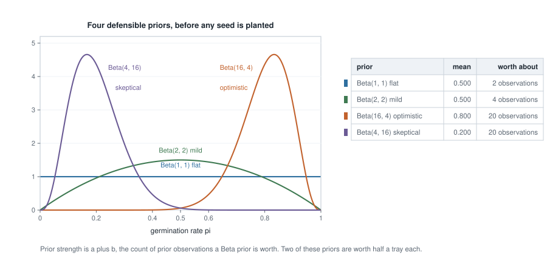
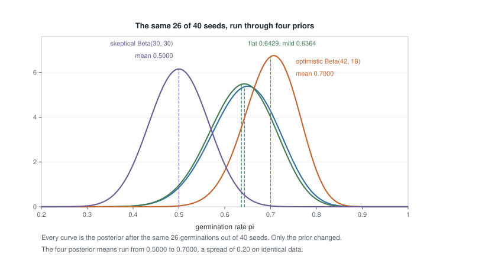
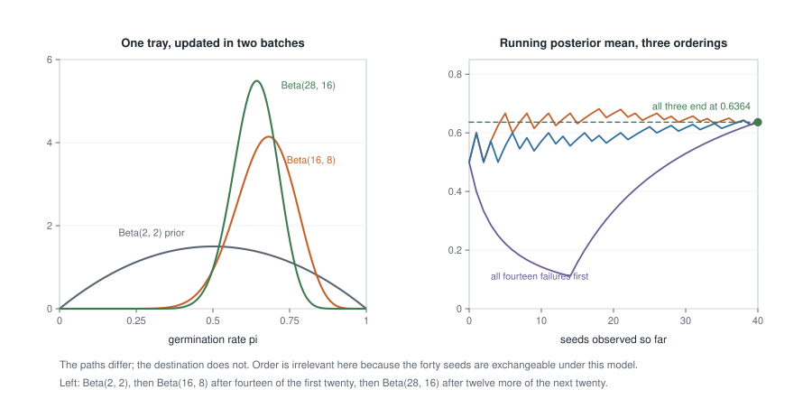
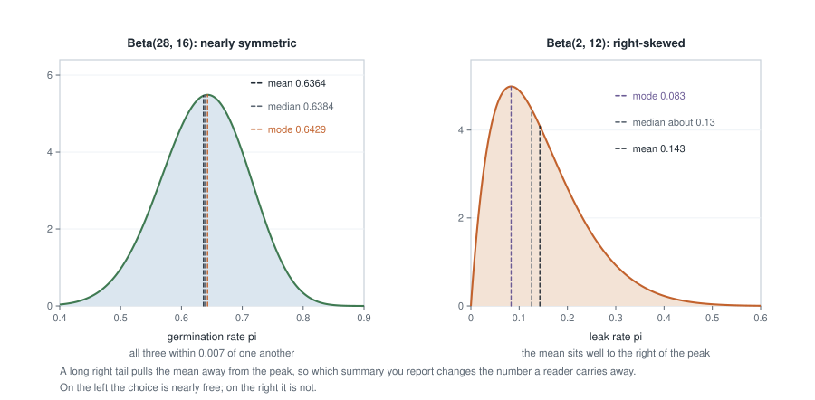
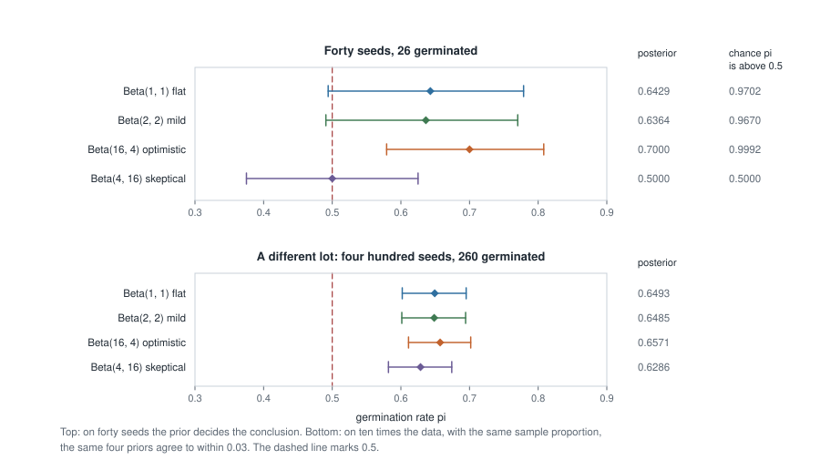

# Week 5 — Prior sensitivity, sequentiality, and posterior summaries

## Where this week starts

Last week the beta-binomial machine got built and run once. A test tray from the Meridian seed lot: forty seeds, twenty-six germinated, and a Beta(2, 2) prior on the unknown germination rate $\pi$ (the proportion of seeds in this lot that would germinate under these conditions). Out came the posterior Beta(28, 16), mean $28/44 = 0.6364$, with a 95 percent credible interval from 0.4907 to 0.7702.

A careful reader does not stop there. The first question is procedural: **does it matter how the data arrived?** Suppose the grower had counted twenty seeds on Tuesday and twenty more on Friday, updating after each batch, or one seed at a time. Would the three routes land on the same posterior? The second is uncomfortable: **how much of that 0.6364 came from the seeds, and how much from the Beta(2, 2) prior somebody chose before any seed was planted?**

The good news is clean: order does not matter here, for a reason that takes two lines of algebra. The uncomfortable news is that on the same forty seeds, a skeptical Beta(4, 16) prior, worth about twenty prior observations and pointed toward a low rate, drags the posterior mean from 0.6364 to exactly 0.5000 and the posterior probability that the rate beats one half from 0.9670 to exactly 0.5000. Not one seed changed.

What should feel different by the end of the week is your idea of a finished analysis. A single posterior from a single prior is one line of one; the finished version reports the range of conclusions across the priors a reasonable person might have brought, and names which summary of the posterior it quotes.

### Why this matters outside the classroom

A grower is deciding whether to accept this lot or send it back. Two reports land on the desk. The first says the germination rate is about 0.64 and there is a 97 percent posterior chance it exceeds one half, so accept. The second says the rate is about 0.50 and it is a coin flip, so send it back. Both used the same forty seeds, and neither made an arithmetic mistake: they differ only in a prior that neither report bothered to state. That is an ordinary way two competent analyses reach opposite recommendations, and one extra paragraph prevents it.

The second report's skepticism about this supplier exists whether or not anyone writes it as Beta(4, 16). Writing it down is what lets a reader disagree with it on purpose.

## What you will be able to do

- **Update a Beta prior in batches or one observation at a time** and show the running posterior lands where a single update on the pooled counts lands.
- **State the condition that makes order irrelevant** (the observations are exchangeable under the model) and describe a situation in which it fails.
- **Compute the posterior for one data set under several priors** and express each posterior mean as a weighted compromise, weights written out.
- **Read the prior strength $a + b$ as a count of prior observations** and predict, before computing, how far a prior will move a given sample.
- **Compute and distinguish the posterior mean, median, and mode**, say which you are reporting, and explain when the choice matters.
- **Write a sensitivity comparison in plain language**: the range of conclusions across defensible priors, and what the data alone do not settle.

## Terms and notation worth fixing

| Term or symbol | What it means in this course |
|---|---|
| $\pi$ | the unknown proportion being estimated, here a seed lot's germination rate |
| $a, b$ | the two shape values of a Beta distribution; the prior mean is $a/(a+b)$ |
| prior strength | the sum $a + b$, read as the number of prior observations the prior is worth |
| sequential updating | using the posterior from one batch of data as the prior for the next |
| exchangeable | the model treats observations as interchangeable, so relabelling which came first changes nothing |
| sensitivity analysis | recomputing the same summaries under several defensible priors, and reporting the range |
| posterior mean, median, mode | three summaries of one posterior: its balance point, its half-way value, and its peak |

## How much of the conclusion belongs to the prior

Week 4's arithmetic answers this exactly, with no simulation needed. With a Beta$(a, b)$ prior and $y$ successes in $n$ trials the posterior is Beta$(a + y,\, b + n - y)$, and its mean rearranges into a weighted compromise:

$$\frac{a+y}{a+b+n} \;=\; \underbrace{\frac{a+b}{a+b+n}}_{\text{weight on the prior}} \cdot \underbrace{\frac{a}{a+b}}_{\text{prior mean}} \;+\; \underbrace{\frac{n}{a+b+n}}_{\text{weight on the data}} \cdot \underbrace{\frac{y}{n}}_{\text{sample proportion}}$$

Everything this week turns on that first weight. The prior is worth $a + b$ observations, the data are worth $n$, and the two compete in exactly that ratio: a prior worth four observations against a sample of forty gets about a tenth of the vote, and a prior worth twenty gets a third. When a prior moves a conclusion it is simply being counted, and you can see in advance how many votes it holds.

### Four priors, each one defensible

Here are four priors on that germination rate, each a position a real person could hold before planting.

{fig-alt="Four Beta density curves over germination rates from 0 to 1: a flat line at height 1, a low broad hump centred at 0.5, a curve peaking near 0.83, and its mirror image peaking near 0.17, beside a table of means and prior strengths."}

The **flat** Beta(1, 1) is a horizontal line: every rate between 0 and 1 is equally plausible. Its mean is 0.500 and its strength is $1 + 1 = 2$, so it is worth two prior observations. It is often described as expressing no opinion, which the second worked example shows is not quite true. The **mild** Beta(2, 2) is this case's standing prior: mean 0.500, strength 4, a gentle preference for the middle over the extremes.

The **optimistic** Beta(16, 4) has mean $16/20 = 0.800$ and strength 20, a strong claim that this supplier has been reliable. The **skeptical** Beta(4, 16) is its mirror image, mean $4/20 = 0.200$ and strength 20, saying the opposite with equal force. Both are priors an experienced buyer might hold: they are not straw men.

### The same twenty-six seeds through all four

Now run the identical data through all four. The conjugate update adds 26 to each $a$ and 14 to each $b$.

| Prior | Prior mean | Posterior | Posterior mean | 95 percent interval | $P(\pi > 0.5 \mid y)$ |
|---|---|---|---|---|---|
| Beta(1, 1), flat | 0.500 | Beta(27, 15) | 0.6429 | 0.4941 to 0.7788 | 0.9702 |
| Beta(2, 2), mild | 0.500 | Beta(28, 16) | 0.6364 | 0.4907 to 0.7702 | 0.9670 |
| Beta(16, 4), optimistic | 0.800 | Beta(42, 18) | 0.7000 | 0.5792 to 0.8081 | 0.9992 |
| Beta(4, 16), skeptical | 0.200 | Beta(30, 30) | 0.5000 | 0.3750 to 0.6250 | 0.5000 |

{fig-alt="Four Beta posterior curves over germination rates: three overlapping humps peaking near 0.65, 0.64 and 0.71, and a fourth peaking at 0.50, each with a dashed drop line marking its posterior mean, all from the same 26 of 40 seeds."}

Look first at the two priors with mean 0.500. The flat prior gives 0.6429 and the mild prior 0.6364, a difference of 0.0065, less than a tenth of the posterior standard deviation 0.0717: between those two the choice is invisible in any report. Now the outer two. The four posterior means run from 0.5000 to 0.7000, a spread of 0.20 on identical data, and $P(\pi > 0.5 \mid y)$ runs from 0.9702 down to 0.5000. One report calls the evidence nearly conclusive; another calls it a coin flip.

The skeptical row is the point of the week: a prior worth twenty observations, pointed the other way, moves the posterior mean from 0.6364 to exactly 0.5000 and the posterior probability of beating one half from 0.9670 to exactly 0.5000, on data that did not change by a single seed. The exactness is no coincidence. The weighted compromise gives $(20/60) \times 0.2 + (40/60) \times 0.65 = 0.0667 + 0.4333 = 0.5000$, and the resulting Beta(30, 30) is perfectly symmetric about 0.5, so exactly half its probability sits on each side.

### What a sensitivity comparison is for

It is tempting to read that table as a scandal. It is a measurement, and what it measures is the data, not the method: forty seeds carry enough information to overwhelm a prior worth four observations and not enough to overwhelm one worth twenty. Reporting only the Beta(2, 2) row would have hidden that behind a number that looks decisive.

Notice what a sensitivity comparison is not. It is not a search for the prior that gives the most convenient conclusion, and it is not a licence to average the four rows into one number. It is a statement of range: across these four starting positions, the posterior mean falls between 0.50 and 0.70. A statistical result is evidence, not a verdict, and this is one of the honest ways to show how much of a verdict the evidence supports.

## Updating all at once, in batches, or one seed at a time

Now the procedural question. Return to the Beta(2, 2) prior and suppose the tray was counted in two halves: fourteen of the first twenty seeds germinated, and twelve of the next twenty. The pooled data are unchanged.

Update on the first half: Beta(2, 2) with fourteen successes and six failures gives Beta$(2 + 14,\, 2 + 6) = $ Beta(16, 8), mean $16/24 = 0.6667$. Treat that as the prior for the second half: Beta(16, 8) with twelve successes and eight failures gives Beta$(16 + 12,\, 8 + 8) = $ Beta(28, 16), the posterior Week 4 obtained in one step.

Reverse the halves. Beta(2, 2) with twelve successes and eight failures gives Beta(14, 10), mean $14/24 = 0.5833$, a different waypoint; the other twenty seeds then give Beta$(14 + 14,\, 10 + 6) = $ Beta(28, 16) again. Update one seed at a time and each germination adds 1 to the first shape, each failure 1 to the second, so after twenty-six germinations and fourteen failures in any order the shapes are $2 + 26 = 28$ and $2 + 14 = 16$.

{fig-alt="Left: the Beta(2, 2) prior, a Beta(16, 8) half-way posterior and the taller Beta(28, 16) final posterior. Right: three running posterior mean paths from 0.5, one dipping to about 0.11, all converging on 0.6364 at forty seeds."}

The right-hand panel follows the posterior mean as the seeds are counted, under three orderings: each half-tray first in turn, and an adversarial ordering putting all fourteen failures at the front. The paths are completely different, and one sinks near 0.11 before recovering. All three end at 0.6364.

### Why order cannot matter under this model

Two facts do the work. The first is that the model treats the seeds as conditionally independent given $\pi$, so the tray's likelihood is the product of the individual likelihoods. Multiplying a prior by the first batch's likelihood and then the second's is the same as multiplying by both at once, and multiplication does not care about order:

$$p(\pi \mid y_1, y_2) \;\propto\; p(\pi)\, p(y_1 \mid \pi)\, p(y_2 \mid \pi)$$

The second is that the binomial likelihood depends on the data only through the counts of successes and failures. Every ordering of twenty-six germinations and fourteen failures gives the same two counts, hence the same likelihood function, hence the same posterior. In words: the posterior remembers how many, not which ones, and not when. So an analysis can be updated as data arrive without revisiting the old data, and two analysts who split a data set differently will agree. Yesterday's posterior is today's prior.

### Where order invariance would fail

The invariance is a property of the model, not a law of nature. Order stops mattering only while the observations are exchangeable, that is, while an observation's position in the sequence tells you nothing about it.

Suppose the second twenty seeds came from the bottom of a bin and had been in storage six months longer. Then a single rate $\pi$ shared by all forty seeds is the wrong model; the right one has two rates, or a rate that declines with storage time. There the split point carries information, because knowing that twelve of the *older* twenty germinated is a different fact from knowing that twelve of the *fresher* twenty did. Before relying on order invariance, ask whether anything about when an observation arrived also tells you how it was likely to turn out.

## Three summaries of one posterior

A posterior is a whole distribution. But a report often needs one number, and there are three standard candidates. The **posterior mean** is the balance point, $a/(a+b)$ for a Beta. The **posterior median** is the value with half the posterior probability on either side, obtained from `qbeta(0.5, a, b)` because it has no simple formula. The **posterior mode** is the peak, $(a-1)/(a+b-2)$ when both shapes exceed 1. For Beta(28, 16) these are 0.6364, 0.6384, and 0.6429: they span 0.0065, under a tenth of the posterior standard deviation 0.0717. That near-agreement is a fact about this posterior, which is close to symmetric, and it does not transfer.

{fig-alt="Left: a nearly symmetric Beta(28, 16) with mean 0.6364, median 0.6384 and mode 0.6429 marked by drop lines almost on top of each other. Right: a right-skewed Beta(2, 12) whose mode 0.083, median about 0.13 and mean 0.143 are far apart."}

The right-hand panel is the Beta(2, 12) posterior from the valve pilot below. Its mode is 0.083, its median about 0.13, and its mean 0.143: the mean is over seventy percent larger than the mode, because a long right tail pulls the balance point away from the peak. On a posterior shaped like that, the choice of summary is a decision:

- the **mean** is what you want when the cost of an error grows with the square of the error, and it combines correctly with counts (the expected number of leaks in a batch of new valves is the batch size times the posterior mean);
- the **median** is the steadier report for a skewed posterior, and it reads cleanly in words: the parameter is equally likely to be above or below it;
- the **mode** is the single most plausible value, usually what someone means by "your best guess", but it ignores the shape around it and can sit at the edge of the range.

Whichever you report, name it. "The germination rate is 0.64" is an incomplete sentence in this course; "the posterior mean is 0.6364, with a 95 percent credible interval from 0.4907 to 0.7702" is complete.

## Worked example — the seed lot read through four priors

Here is the week on one case, end to end. **The situation:** a grower must decide whether the Meridian lot is good enough to plant at scale. **The data:** forty seeds, twenty-six germinated, sample proportion $26/40 = 0.65$. **The model:** each seed germinates independently with probability $\pi$, so the likelihood is binomial and the prior on $\pi$ is a Beta.

**Step 1. Write down each prior and its strength.** Beta(1, 1), mean 0.500, strength 2. Beta(2, 2), mean 0.500, strength 4. Beta(16, 4), mean 0.800, strength 20. Beta(4, 16), mean 0.200, strength 20.

**Step 2. Update each one.** Add twenty-six to $a$ and fourteen to $b$: Beta(27, 15), Beta(28, 16), Beta(42, 18), Beta(30, 30).

**Step 3. Check each posterior mean as a weighted compromise.** For the mild prior the weights are $4/44 = 0.0909$ and $40/44 = 0.9091$, and $0.0909 \times 0.5 + 0.9091 \times 0.65 = 0.0455 + 0.5909 = 0.6364$, which is $28/44$ as it must be. The optimistic prior has weights $20/60 = 0.3333$ and $40/60 = 0.6667$, giving $0.2667 + 0.4333 = 0.7000$; the skeptical prior has the same weights and gives $0.0667 + 0.4333 = 0.5000$; the flat prior has weights $0.0476$ and $0.9524$ and gives $0.0238 + 0.6190 = 0.6429$.

**Step 4. Read off the interval and the probability.** These come from the Beta distribution function, not a simulation: they are the last two columns above.

{fig-alt="Top: four horizontal intervals for forty seeds, three crossing a dashed line at 0.5 and the optimistic Beta(16, 4) interval lying entirely above it. Bottom: four narrower intervals for four hundred seeds, spanning about 0.58 to 0.70."}

**Step 5. Say what the comparison licenses.** Across the four priors the posterior mean falls between 0.5000 and 0.7000 and $P(\pi > 0.5 \mid y)$ falls between 0.5000 and 0.9992. Under any prior that does not already lean strongly low, the evidence favours a rate above one half; under a prior worth twenty observations that leans low, forty seeds cannot move the conclusion off the fence. That is the honest report, in two sentences.

**Step 6. Say what it does not license.** Not "the germination rate is 0.6364", and not picking a prior because it gives the tidiest number or because caution sounds responsible. It also does not certify the binomial model: every row assumed the seeds germinate independently at a common rate, so if the tray was watered unevenly all four rows are wrong together. A sensitivity comparison varies one assumption and says nothing about the ones it holds fixed.

### The same reasoning, transferred

Change one thing: the amount of data. A different lot from a different supplier is tested with four hundred seeds, of which 260 germinate, so the sample proportion is again $260/400 = 0.65$. Run the same four priors. Beta(1, 1) gives Beta(261, 141), mean $261/402 = 0.6493$. Beta(2, 2) gives Beta(262, 142), mean $262/404 = 0.6485$. Beta(16, 4) gives Beta(276, 144), mean $276/420 = 0.6571$. Beta(4, 16) gives Beta(264, 156), mean $264/420 = 0.6286$.

What stayed the same: the model, the priors, the sample proportion, and every step of the arithmetic. What changed: the weight the prior gets, since the strongest prior is now worth twenty observations against four hundred, a weight of $20/420 = 0.0476$ rather than $20/60 = 0.3333$. Check the skeptical row: $0.0476 \times 0.2 + 0.9524 \times 0.65 = 0.0095 + 0.6190 = 0.6286$. The four posterior means now span 0.6286 to 0.6571, a range of about 0.03 instead of 0.20, every interval lies between roughly 0.58 and 0.70, and all four put the posterior probability that the rate beats one half above 0.999.

Carry the pattern: the prior's influence shrinks like $(a+b)/(a+b+n)$, fading as the sample grows and fading faster for weak priors than strong ones. It never quite reaches zero, and with a small sample it does not fade at all.

## Second worked example — a valve pilot with twelve observations

The first example was a clean application. This one is a diagnosis, and the failure is not in the arithmetic.

**The situation:** a campus grounds crew installed a new type of irrigation valve as a pilot. Twelve valves went in and one leaked in the first season. They want the leak rate $\pi$, because a purchasing office is about to order three hundred more and the department treats a rate above 0.10 as the level at which the valve type is not worth buying.

**Step 1. The first analysis.** The crew lead uses a flat Beta(1, 1) prior, reasoning that it assumes nothing. One leak in twelve gives Beta$(1 + 1,\, 1 + 11) = $ Beta(2, 12), and the report says "the most likely leak rate is 8 percent", which is the posterior mode $(2-1)/(14-2) = 1/12 = 0.0833$.

**Step 2. The summary that should have been reported.** The purchasing office needs an expected number of leaks among three hundred valves, and expectations combine with the posterior *mean*, not the mode. The mean is $2/14 = 0.1429$, so the expected count is $300 \times 0.1429 = 42.9$, call it forty-three valves, where the mode gives $300 \times 0.0833 = 25$. The error was handing the peak of a skewed posterior to someone about to multiply it by a batch size.

**Step 3. Notice what the flat prior actually did.** Its strength is $1 + 1 = 2$ against $n = 12$, so the weights are $2/14 = 0.1429$ on the prior mean 0.5 and $12/14 = 0.8571$ on the sample proportion $1/12 = 0.0833$, and $0.1429 \times 0.5 + 0.8571 \times 0.0833 = 0.0714 + 0.0714 = 0.1429$. Half of the posterior mean came from the prior. A flat prior is not the absence of an assumption; it is the assumption that every rate is equally plausible, centred at 0.5, enormously high for a leak rate.

**Step 4. Run the sensitivity comparison that was skipped.** An engineer offers a prior from the manufacturer's bench testing: Beta(2, 20), mean $2/22 = 0.0909$, strength 22. With one leak in twelve the posterior is Beta$(2 + 1,\, 20 + 11) = $ Beta(3, 31), mean $3/34 = 0.0882$; weights $22/34 = 0.6471$ and $12/34 = 0.3529$ check it, since $0.0588 + 0.0294 = 0.0882$.

**Step 5. Look at the question the department actually asked.** Under the flat prior the posterior probability that the leak rate exceeds 0.10 is 0.6213, checkable by hand because a Beta whose first shape is 2 has a tidy tail, equal to the chance of at most one leak in thirteen trials at rate 0.10: $0.9^{13} + 13(0.1)(0.9^{12}) = 0.9^{12} \times 2.2 = 0.6213$. Under the manufacturer's prior it is about 0.35. So "the leak rate probably exceeds the threshold" is true under one defensible prior and false under another, and twelve valves cannot settle it. Both posteriors are wide; under the flat prior the central 95 percent interval runs from about 0.02 to about 0.36.

**What this licenses:** a larger pilot, or a decision made on what being wrong costs in each direction. **What it does not license:** a statement that the valve type fails the threshold, or that it passes. On the seed lot the three summaries agreed to within 0.007; here the mean is over seventy percent larger than the mode, and quoting one instead of another changed a purchase order.

## The misreading to avoid

The misreading sounds like this: *"If changing the prior changes the conclusion, the analysis is broken and the whole approach is untrustworthy."*

Turn it around. A sensitivity comparison that moves the conclusion has told you something true: **the data are not decisive on their own**. Forty seeds against a prior worth twenty observations is a fair fight, and the tie is the finding. The alternative was never a conclusion free of assumptions; it was the same conclusion with the assumption hidden. The method did not create the fragility. It measured it.

Two corollaries, because students reach for both. The first: *"then I will use a flat prior, so no assumption is being made."* Beta(1, 1) is a real prior with mean 0.5 and strength 2, and on twelve valves it supplied half the posterior mean. Flat is a choice, not an abstention, and an odd choice when the quantity is known in advance to be small. The second: *"then I will report whichever prior gives the cleanest result."* That is prior shopping, and the defence is procedural: write down the priors you will compare before computing any of them.

A mirrored error is quieter and just as common: concluding that because the four posteriors agreed on the four-hundred-seed lot, the model must be right. Agreement across priors means the data dominated the prior, and says nothing about whether the binomial model, the independence assumption, or the sampling of the lot was sound.

## Practice on your own

For your own working, not for submission.

1. **A fifth prior on the seed lot.** Update a Beta(8, 2) prior (mean 0.800, strength 10) with the same twenty-six germinations out of forty seeds, and compute its posterior mean both directly and as a weighted compromise. Does it land inside the range the four priors reported?

2. **Four batches instead of two.** Split the forty seeds into four batches of ten in which 7, 6, 7, and 6 germinated. From Beta(2, 2), update four times and write down every intermediate posterior, then do it in reverse order. Confirm Beta(28, 16) both times, and name the property of the binomial likelihood that makes it inevitable.

3. **Summaries that separate.** For Beta(30, 30), compute the mean and mode by hand and get the median with `qbeta(0.5, 30, 30)`. Do the same for Beta(2, 12), then explain to a non-statistician why the three agree in the first case and not the second.

4. **A different pilot prior.** Redo the valve pilot with a Beta(1, 9) prior (mean 0.100, strength 10) and one leak in twelve. Give the posterior, its mean, and that mean as a compromise, then draft a two-sentence sensitivity report covering all three priors.

5. **The paragraph.** Write the sensitivity paragraph for the Meridian lot as it would appear in a report: the model, the priors compared, the range of posterior means and of $P(\pi > 0.5 \mid y)$, and what the comparison does not settle.

## Where to read more

- The primary text is [Bayes Rules!](https://www.bayesrulesbook.com/), and this week aligns with [Chapter 4](https://www.bayesrulesbook.com/chapter-4). Read it alongside these notes; the cases here are our own.
- The software home page for this course's language is [The R Project for Statistical Computing](https://www.r-project.org/). This week needs only `dbeta`, `pbeta`, and `qbeta`, all in base R.
- Week 4's page, [week-04.qmd](week-04.qmd), has the conjugate update and the credible interval this week varies; the [notes index](index.qmd) lists every unit, the [course schedule](../schedule.qmd) shows where this week sits, and the [resources page](../resources/index.qmd) links the reading for the course. If R, VS Code, or Quarto still need installing, [Week 1](week-01.qmd) walks through the software setup.

The R that reproduces the week, shown and not run:

```r
# Sequential updating: two batches of twenty, then one seed at a time.
shape_a <- 2; shape_b <- 2
shape_a <- shape_a + 14; shape_b <- shape_b + 6   # first twenty seeds
shape_a <- shape_a + 12; shape_b <- shape_b + 8   # next twenty seeds
c(shape_a, shape_b)

# Four priors, one data set: 26 germinations out of 40 seeds.
prior_a <- c(1, 2, 16, 4)
prior_b <- c(1, 2, 4, 16)
post_a <- prior_a + 26
post_b <- prior_b + 40 - 26
post_a / (post_a + post_b)          # posterior means
qbeta(0.025, post_a, post_b)        # lower ends of the 95 percent intervals
qbeta(0.975, post_a, post_b)        # upper ends
1 - pbeta(0.5, post_a, post_b)      # posterior chance the rate beats one half

# Three summaries of one posterior.
28 / (28 + 16)                      # mean
(28 - 1) / (28 + 16 - 2)            # mode
qbeta(0.5, 28, 16)                  # median
```

## Where this goes next

Every posterior so far has had a name and a formula. [Week 6](week-06.qmd) keeps the conjugate machinery and changes what is estimated: a rate for counts with the gamma-Poisson model, and a mean for measurements with the normal-normal model. The same weighted-compromise structure appears in both, which is where the pattern stops being a fact about the Beta family and becomes a fact about conjugate updating. Week 6 also introduces the posterior predictive distribution, which answers a different question from any interval on this page: not "where is the parameter" but "what will the next observation be".

Carry two habits forward: report which summary of the posterior you are quoting, and vary the prior before committing to a conclusion. Both survive the move to counts and means, and the move to regression in Weeks 9 through 11, where priors are less visible and easier to forget. The [notes index](index.qmd) and the [course home page](../index.qmd) will take you anywhere else.
