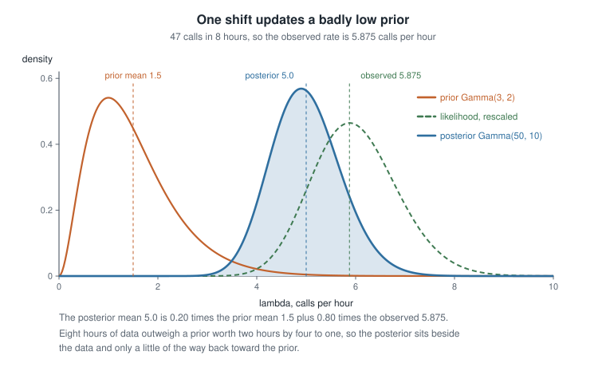
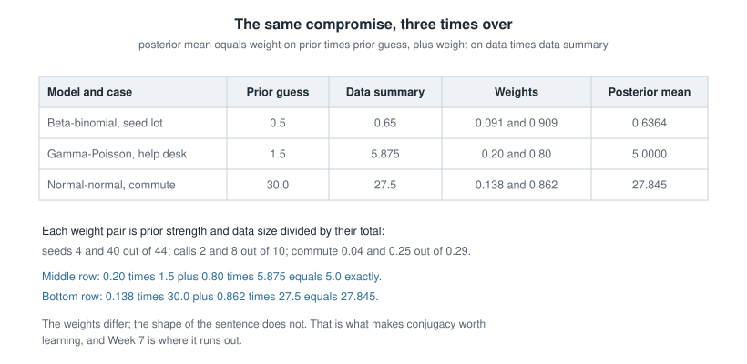
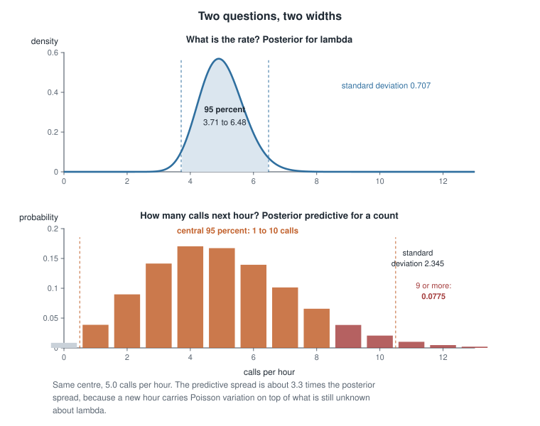
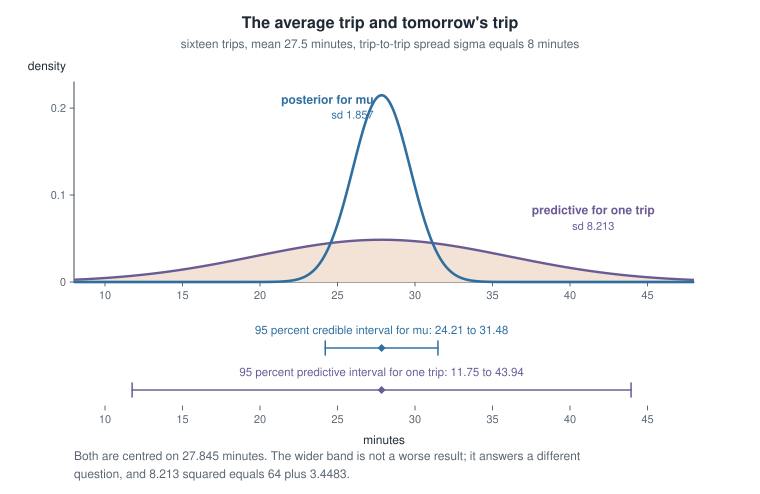
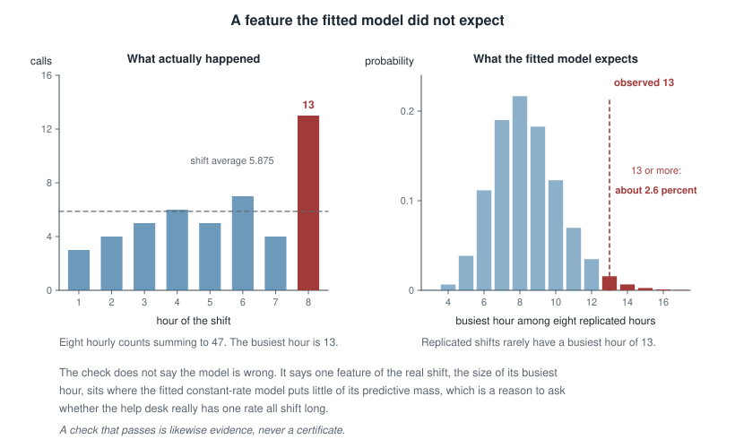

# Week 6 — Beyond proportions, and posterior predictive thinking

## Where this week starts

For three weeks the course has run on one model: forty seeds in a tray, twenty-six of them up, and
a Beta prior meeting a binomial likelihood to give a Beta posterior. That model earned its
attention, but
it left you with a fair suspicion, that the tidy arithmetic of Week 4 was a lucky accident of
proportions.

It is not an accident, and this week does the same thing twice more on quantities that are not
proportions at all: a campus help desk that wants an arrival rate, a count per unit of time, and a
commuter who wants an average trip length. Neither quantity is a probability and neither likelihood
is binomial, yet both updates come out in closed form, and both posterior means are the weighted
compromise you already know how to read.

Then the week turns to what is genuinely new. Every posterior so far has described a *parameter* you
will never observe directly: the germination rate, the call rate, the mean trip time. What you
observe is data, such as how many calls arrive in the next hour. Turning a posterior about a
parameter into a distribution over the next observation is a separate move with a separate name, the
**posterior predictive distribution**, and it is always wider than the posterior it came from. By
the end of this page you should see two intervals for this week's help desk, 3.71 to 6.48 and 1 to
10, and say without hesitating which is which and why the second has to be wider.

### Why this matters outside the classroom

The help desk has to decide how many staff to put on the phones. Suppose someone reads the posterior
for the call rate, sees a 95 percent credible interval of 3.71 to 6.48 calls per hour, and treats
its upper end as the busy case to plan for. That looks careful. It is not: the interval says
where the *long-run average rate* probably sits, and a single hour scatters around whatever the rate
is. Next hour's count reaches 10 calls inside its central 95 percent, and even a plan built for
eight calls is overrun with probability 0.0775.

The same confusion runs the other way in reporting. A commuter who says the mean trip is between
24.21 and 31.48 minutes has said something true about the commute in general and something worthless
about whether to leave at 7:40 tomorrow, for which the honest range is 11.75 to 43.94 minutes.
Presenting the first when someone asked the second is how a correct analysis produces a bad
decision.

## What you will be able to do

- **Update** a Gamma prior on a rate with Poisson count data, and a normal prior on a mean with
  normal data of known spread, showing the shape, rate, and precision arithmetic.
- **Compute** each posterior mean as a weighted average of a prior guess and a data summary, and
  check that the two weights reproduce the number.
- **Distinguish** in plain language a posterior for a parameter from a posterior predictive
  distribution for a new observation, and say which question each answers.
- **Derive** a predictive distribution's extra width from its two sources: uncertainty about the
  parameter, and variation of a single outcome around it.
- **Run and interpret** an informal posterior predictive check, stating when it is informative and
  what a passing check does not license.

## Terms and notation worth fixing

| Symbol or term | What it means in this course |
|---|---|
| $\lambda$ | a rate parameter for counts, here calls per hour at the help desk |
| $s, r$ | the shape and rate of a Gamma distribution, written Gamma$(s, r)$, with mean $s/r$ |
| $\mu$ | a mean parameter, here the commuter's average trip time in minutes |
| $\sigma$ | the observation-level standard deviation, the spread of single outcomes around $\mu$ |
| $\tilde y$ | a new, not-yet-observed outcome the fitted model is asked to predict |
| $p(\tilde y \mid y)$ | the posterior predictive distribution of $\tilde y$ given the data already seen |
| precision | one divided by a variance; precisions add, which makes the normal update easy |
| $T(y)$ | a test quantity: one number computed from a data set and compared across replicates |

One habit of reading saves time all week: whenever you meet a distribution, ask what varies in it,
a parameter or a data value.

## Two more conjugate models, one shared shape

Learning a second and third conjugate model is worthwhile not because you will meet these exact
situations often, but because seeing the same algebra land three times turns a trick into a pattern,
and a pattern is what you carry into Week 7 when the closed forms run out. Both models below are set
up the same way: name the unknown, state a prior, write the likelihood with the data held fixed,
then multiply and read off what is left.

### Counts over time: the gamma-Poisson model

The Northgate help desk logs calls. The natural model for a count over an interval is the Poisson
distribution: if calls arrive at rate $\lambda$ per hour and that rate does not change over the
shift, the number arriving in $t$ hours is Poisson with mean $\lambda t$. The unknown $\lambda$ is
positive, so its prior must live on the positive half-line, where the Gamma family is standard.

The course's prior here is Gamma(shape 3, rate 2), with mean $3/2 = 1.5$ calls per hour and standard
deviation $\sqrt{3}/2 = 0.866$; its rate value of 2 makes it worth about two hours of watching. Say
what that asserts before looking at data: roughly one or two calls an hour. It is weak, and as you
will see it is badly aimed.

Then the shift. Over an $8$-hour shift, $47$ calls arrive, so the observed rate is $47/8 = 5.875$
calls per hour, nearly four times the prior guess. The likelihood, as a function of $\lambda$ with
the count held fixed, is $p(y \mid \lambda) \propto \lambda^{47} e^{-8\lambda}$: how plausible is
each candidate rate, given 47 calls in eight hours. The Gamma$(s, r)$ prior density is proportional
to $\lambda^{s-1} e^{-r\lambda}$, so multiplying and collecting exponents gives

$$p(\lambda \mid y) \;\propto\; \lambda^{3-1} e^{-2\lambda} \cdot \lambda^{47} e^{-8\lambda}
\;=\; \lambda^{(3+47)-1} e^{-(2+8)\lambda}.$$

That is a Gamma density with shape $3 + 47 = 50$ and rate $2 + 8 = 10$. The rule is as plain as the
beta-binomial one: **add the total count to the shape, add the total exposure time to the rate.**
The posterior mean is $50/10 = 5.0$ exactly, the mode is $49/10 = 4.9$, and the standard deviation
is $\sqrt{50}/10 = 0.7071$.

{fig-alt="Three curves over calls per hour from 0 to 10: a broad low prior peaking near 1, a dashed likelihood peaking at 5.875, and a taller narrow posterior peaking at 4.9, sitting just left of the likelihood."}

The posterior is nowhere near the prior, because eight hours of counting outweigh a prior worth two
hours by four to one, and the weighted check confirms it:
$0.20 \times 1.5 + 0.80 \times 5.875 = 0.3 + 4.7 = 5.0$, the weights being prior rate and observed
time as fractions of their total.

Everything worth reporting follows from Gamma(50, 10): a central 95 percent credible interval of
3.711 to 6.478 calls per hour, a posterior median of 4.967, and direct probability statements such
as $P(\lambda > 5.5 \mid y) = 0.2322$ and $P(\lambda > 6 \mid y) = 0.0844$. That last one is a
statement about the rate itself.

```r
# Gamma-Poisson update: Gamma(shape 3, rate 2) prior, 47 calls over an 8-hour shift.
shape_post <- 3 + 47      # 50
rate_post  <- 2 + 8       # 10
shape_post / rate_post                             # posterior mean
qgamma(c(0.025, 0.975), shape_post, rate_post)     # 95 percent credible interval
1 - pgamma(6, shape_post, rate_post)               # posterior probability the rate exceeds 6
```

### A mean with known spread: the normal-normal model

Now a quantity on a continuous scale. A commuter wants $\mu$, the mean morning trip time in minutes.
Trip-to-trip variation is treated as known at $\sigma = 8$ minutes, a real assumption: mornings
scatter around the average with a standard deviation of eight minutes, and that scatter does not
itself need estimating. Sixteen trips are timed and average $\bar y = 27.5$ minutes. The prior is
normal with mean 30 and standard deviation 5: the commuter thinks the average is around half an hour
and would be mildly surprised below 20 or above 40.

The update is easiest in terms of **precision**, one over the variance, which measures how much
information a distribution carries. Precisions add, and the posterior mean is the precision-weighted
average of the prior mean and the sample mean:

$$\text{prior precision} = \frac{1}{5^2} = 0.04, \qquad
\text{data precision} = \frac{n}{\sigma^2} = \frac{16}{64} = 0.25.$$

Adding gives a posterior precision of 0.29, so the posterior variance is $1/0.29 = 3.4483$ and the
posterior standard deviation is 1.8570 minutes. The posterior mean is

$$\frac{0.04 \times 30 + 0.25 \times 27.5}{0.29}
= \frac{1.2 + 6.875}{0.29} = \frac{8.075}{0.29} = 27.845 \text{ minutes}.$$

Data precision grows with $n$ and shrinks with $\sigma^2$. Sixteen trips carry precision 0.25, six
and a quarter times the prior's 0.04, so the posterior mean sits much closer to 27.5 than to 30.
The posterior is exactly normal, so its 95 percent credible interval is
$27.845 \pm 1.96 \times 1.857$, from 24.21 to 31.48 minutes.

### The pattern all three updates share

Put the three models on one line and the family resemblance is unmissable: each posterior mean is a
weighted average of a prior guess and a data summary, with weights that are prior strength and data
size as fractions of their total.

{fig-alt="A four-row table listing three conjugate models with prior guess, data summary, weight pair, and posterior mean, showing 0.6364 for the seed lot, 5.0 for the help desk, and 27.845 for the commute."}

Week 4's seed lot combined 0.5 with 0.65, weighting them $4/44 = 0.0909$ and $40/44 = 0.9091$ to
give 0.6364. The help desk combines 1.5 and 5.875 with weights 0.20 and 0.80 to give exactly 5.0.
The commute combines 30.0 and 27.5 with weights $0.04/0.29 = 0.138$ and $0.25/0.29 = 0.862$:
$0.138 \times 30 + 0.862 \times 27.5 = 4.14 + 23.705 = 27.845$. Three families, one sentence.

The pattern also tells you when each method is informative: when the prior family genuinely
describes what you believe and the likelihood genuinely describes how the data arose. The
gamma-Poisson update assumes calls arrive independently at an unchanging rate; the normal-normal
update assumes independent trips around a fixed mean with a known spread. Both are checkable, and
one of them fails later on this page.

## Predicting a new observation, not just a parameter

Everything so far produced a distribution over something you cannot see: nobody has ever observed a
call rate. What the desk observes is a number of calls in an hour, and the manager's real question
is how many calls to be ready for, not what $\lambda$ is. If you knew $\lambda$ exactly, a new
hour's count would be Poisson with mean $\lambda$. You do not know it; you have a posterior. So
average the Poisson distribution over every value $\lambda$ could take, weighting each by its
posterior plausibility:

$$p(\tilde y \mid y) \;=\; \int p(\tilde y \mid \lambda)\, p(\lambda \mid y)\, d\lambda .$$

The words matter more than the integral: **the posterior predictive distribution is the model's
distribution for a new observation, averaged over everything you still do not know about the
parameter.** It is not the likelihood at a best estimate, nor the posterior rescaled. Here the
integral has a closed form: averaging a Poisson over a Gamma$(s, r)$ posterior gives a negative
binomial with size $s$ and probability $r/(r+1)$, so size 50 and probability $10/11$, with mean 5.0
and standard deviation 2.345 calls.

### Where the extra width comes from

The two standard deviations, 0.7071 for the rate and 2.345 for next hour's count, sit on the same
scale and differ by a factor of about 3.3. Do not take that on faith: the variance splits into two
pieces you can compute.

$$\operatorname{Var}(\tilde y \mid y)
= \underbrace{E[\lambda \mid y]}_{\text{Poisson noise}}
+ \underbrace{\operatorname{Var}(\lambda \mid y)}_{\text{uncertainty about the rate}}
= 5.0 + 0.5 = 5.5 .$$

The first term is 5.0 because a Poisson variance equals its mean; the second is
$\operatorname{Var}(\lambda \mid y) = 50/10^2 = 0.5$, the square of 0.7071. Their sum is 5.5, and
$\sqrt{5.5} = 2.345$. The extra width is not a safety margin: it is Poisson variation that would be
there even if you knew $\lambda$ perfectly, plus the admission that you do not.

It also tells you which term you can shrink. More data drives
$\operatorname{Var}(\lambda \mid y)$ toward zero, so the predictive standard deviation falls toward
$\sqrt{5.0} = 2.236$ and stops there. Predictive intervals narrow to a floor, because the remaining
spread is the world, not your ignorance.

### Reading the two intervals side by side

Now put both distributions on one axis and read them.

{fig-alt="Two stacked panels over calls per hour. The top shows a narrow density peaking near 4.9 with the range 3.71 to 6.48 shaded. The bottom shows spread-out bars from 0 to 13 with 1 to 10 marked and the bars from 9 upward highlighted."}

The top panel is the posterior for $\lambda$, with a central 95 percent interval of 3.711 to 6.478.
The sentence it licenses: given this model and this prior, there is a 95 percent posterior
probability that the desk's average arrival rate lies between about 3.7 and 6.5 calls per hour.

The bottom panel is the predictive distribution for one new hour, with a central 95 percent interval
of 1 to 10 calls, and its sentence is different: there is at least a 95 percent posterior predictive
probability that next hour's count falls between 1 and 10. That interval is a set of whole numbers,
asymmetric because a count cannot be negative.

Two numbers make it concrete:
$P(9 \text{ or more calls in the next hour} \mid y) = 0.0775$, roughly one hour in thirteen, and the
probability of a completely quiet hour is $(10/11)^{50} = 0.0085$, what a negative binomial with
size 50 and probability $10/11$ puts on a count of zero. Both are statements about hours, not rates,
and neither can be read off the credible interval.

## Worked example — the help desk's next hour

Here is the whole week's move on one case, from prior to a decision-relevant probability, with every
number shown. The Northgate help desk wants its call rate and a staffing plan for the coming hour.

**Step 1. Name the unknown and state the prior.** The unknown is $\lambda$, the arrival rate in
calls per hour, assumed constant across the shift. The prior Gamma(shape 3, rate 2) has mean 1.5.

**Step 2. Write the likelihood.** Over eight hours the count is Poisson with mean $8\lambda$, so 47
calls give a likelihood proportional to $\lambda^{47} e^{-8\lambda}$.

**Step 3. Update.** Add the count to the shape and the exposure to the rate: shape 50, rate 10,
posterior Gamma(50, 10).

**Step 4. Summarize the posterior.** Mean $50/10 = 5.0$; mode 4.9; standard deviation 0.7071; median
4.967; central 95 percent credible interval 3.711 to 6.478. The weighted check
$0.20 \times 1.5 + 0.80 \times 5.875 = 5.0$ holds.

**Step 5. Move to the prediction.** Averaging Poisson over Gamma(50, 10) gives a negative binomial
with size 50 and probability $10/11$, mean 5.0 and variance $5.0 + 0.5 = 5.5$, so standard deviation
2.345, and a central 95 percent predictive interval of 1 to 10 calls.

**Step 6. Report what was asked.** The manager wants the risk of being swamped, here nine or more
calls in an hour. That probability is 0.0775.

```r
# Posterior predictive for one new hour, from Gamma(50, 10).
size_pp <- 50
prob_pp <- 10 / 11
qnbinom(c(0.025, 0.975), size = size_pp, prob = prob_pp)   # predictive interval, in calls
1 - pnbinom(8, size = size_pp, prob = prob_pp)             # probability of 9 or more calls
dnbinom(0, size = size_pp, prob = prob_pp)                 # probability of a quiet hour
```

**What this licenses, and what it does not.** It licenses saying that under this model a plan built
for eight calls an hour is overrun about eight percent of the time. It does not license saying the
rate "is" 5.0: that is a posterior mean, and 3.711 to 6.478 is part of the result. Nor does it make
0.0775 a verdict. Whether one hour in thirteen is acceptable weighs a caller waiting against a
staffed seat, and no posterior contains that judgment.

### The same reasoning, transferred

Run the identical structure on the commute. The unknown $\mu$ is a mean in minutes rather than a
rate, and the posterior from the precision arithmetic above is normal with mean 27.845 and standard
deviation 1.8570, giving a 95 percent credible interval of 24.21 to 31.48 minutes.

Now predict one new trip. The predictive distribution is again normal, centred at the same 27.845,
with the two variances added as before: observation variance $\sigma^2 = 64$ plus posterior variance
3.4483 gives 67.4483, so the predictive standard deviation is $\sqrt{67.4483} = 8.213$ minutes and
the 95 percent predictive interval is $27.845 \pm 1.96 \times 8.213$, from 11.75 to 43.94 minutes.

{fig-alt="Two normal curves centred at 27.845 minutes, one tall and narrow with standard deviation 1.857 and one low and wide with standard deviation 8.213, with their intervals 24.21 to 31.48 and 11.75 to 43.94 drawn below."}

What stayed the same: name the unknown, state a prior, write a likelihood, update in closed form,
summarize, then average the sampling distribution over the posterior to predict. What changed: the
families, the units, and the algebraic form of the extra width. For counts it was
$E[\lambda \mid y] + \operatorname{Var}(\lambda \mid y)$; here it is
$\sigma^2 + \operatorname{Var}(\mu \mid y)$. Both are observation noise plus parameter uncertainty,
and in both the second term is smaller: 3.4483 against 64 here, 0.5 against 5.0 for the calls.
Sixteen trips pinned the average down and left the variability of mornings untouched.

```r
# Normal-normal update and prediction for the commute.
sigma <- 8; n <- 16; ybar <- 27.5
prec_prior <- 1 / 5^2
prec_data  <- n / sigma^2
post_mean  <- (prec_prior * 30 + prec_data * ybar) / (prec_prior + prec_data)
post_sd    <- sqrt(1 / (prec_prior + prec_data))
pred_sd    <- sqrt(post_sd^2 + sigma^2)
qnorm(c(0.025, 0.975), post_mean, post_sd)   # credible interval for the mean trip
qnorm(c(0.025, 0.975), post_mean, pred_sd)   # predictive interval for one trip
```

## Second worked example — a busy hour the model did not expect

Everything above assumed the desk's calls arrive at one constant rate all shift long, an assumption
never checked. Checking it is the week's first taste of what Week 11 makes rigorous.

**The idea.** A fitted model claims it could have produced data like yours, so take it at its word.
Generate replicated data sets from it, the same size and shape as the real one, compute a feature of
each, and see where the real data's value of that feature falls among them. Such a feature is a
**test quantity**, written $T(y)$.

**The real data, hour by hour.** The 47 calls did not arrive evenly. The shift log reads 3, 4, 5, 6,
5, 7, 4, 13, which sums to 47 and averages 5.875. Seven hours look like a desk running around five
calls an hour. The eighth had 13.

**The test quantity.** Take $T(y)$ to be the busiest single hour, so $T(y) = 13$. The shift total
would be a poor choice here, because the update already used it, so comparing it back is circular.
The busiest hour is a feature the update never targeted, and exactly the feature a constant-rate
assumption would distort.

**The replication.** Draw a rate from the posterior Gamma(50, 10), draw eight Poisson counts at that
rate, record the largest, and repeat.

```r
set.seed(20260906)
lambda_draws <- rgamma(10000, shape = 50, rate = 10)
busiest <- sapply(lambda_draws, function(lam) max(rpois(8, lam)))
mean(busiest >= 13)     # how often a replicated shift is as lopsided as the real one
hist(busiest)
```

**What comes out.** A run of 10,000 replicated shifts put about 2.6 percent of them at a busiest
hour of 13 or more; most peak between seven and ten calls. The same negative binomial gives 0.0034
for a *particular* pre-specified hour reaching 13; the busiest-of-eight figure is larger because
you get eight chances at it.

{fig-alt="Left, eight bars for hourly calls with seven near five and one at 13 highlighted. Right, the predicted distribution of the busiest hour peaking near 8, with the observed 13 marked far out in the thin upper tail."}

**How to say what this means.** The real shift's busiest hour sits where the fitted model puts about
2.6 percent of its predictive mass. That is a flag, not a refutation: a genuinely constant-rate
desk can have one hour of 13. What the check does is direct attention at the assumption that should
have been suspicious all along: help desks have rush periods, and a model with a single $\lambda$
for the whole shift cannot represent one.

**What follows, and what the check does not settle.** The honest report says the estimate of 5.0
calls per hour is a shift average, that the constant-rate assumption is doubtful, and that a plan
built on the hour-by-hour predictive interval will understate the busy period. It does not say the
model is refuted, and it would not have certified the model had the observed 13 landed in the
middle. A passing check tells you only that this feature did not contradict the model. Two honesties
belong in the report as well: the replicates were compared against the same eight hours used to fit
the model, which makes the check mildly optimistic, and the 2.6 percent moves under a different
seed.

## The misreading to avoid

Here is the sentence students write, almost word for word, in the week after they meet credible
intervals: *"There's a 95 percent chance the next hour has between 3.71 and 6.48 calls."* It is
wrong twice over.

The first error is about *what the interval describes*. The interval 3.711 to 6.478 came from the
posterior for $\lambda$, a rate averaged over the long run, while next hour's calls are a whole
number drawn from a Poisson distribution once $\lambda$ is fixed. The interval never had anything to
say about a single hour, and you can watch it fail: it excludes 3 calls and excludes 7 calls, both
perfectly ordinary hours at this desk.

The second is about *width*. A student who has grasped that the interval is about the rate often
still expects the predictive interval to be a slightly stretched version of it. It is not: 1 to 10
against 3.71 to 6.48, standard deviations 2.345 against 0.7071. The commute is starker, 11.75 to
43.94 against 24.21 to 31.48. That gap is neither a defect nor conservatism. It is the sampling
variability of one outcome, a property of the world, added to leftover uncertainty about the
parameter, a property of your information.

A useful test before writing any interval down: finish the sentence "there is a 95 percent
probability that ..." out loud. If what follows is a parameter, an average, or a rate, you want the
credible interval; if it is something you could go and measure tomorrow, you want the predictive
interval. A third confusion, between credible and confidence intervals, is Week 12's business.

One smaller misreading is worth heading off: *"the wider interval means the model is worse."* A wide
predictive interval is not a failing model, and one that looks suspiciously narrow beside the
scatter in your data is the one to distrust.

## Practice on your own

These are for your own checking, not for submission. Use a calculator and R.

1. **A quieter desk.** Keep the Gamma(3, 2) prior, but suppose the shift logged 12 calls in 8 hours
   instead of 47. Find the posterior shape, rate, mean, and standard deviation, then check that the
   two weights reproduce the posterior mean. Does the prior matter more here, and why?

2. **Doubling the shift.** Take a second identical shift, so 94 calls over 16 hours, updated from
   the original Gamma(3, 2) prior. By what factor does the posterior standard deviation shrink, and
   by what factor the *predictive* standard deviation for one new hour? Explain the difference using
   the variance decomposition.

3. **A tighter prior on the commute.** Replace the commuter's prior standard deviation of 5 minutes
   with 2 minutes, keeping the prior mean at 30. Recompute the prior and posterior precisions, the
   posterior mean, and the posterior standard deviation. How far does the posterior mean move, and
   does the predictive interval for one trip change much?

4. **Choosing the interval.** For each, decide whether it needs a credible or a predictive interval
   and say why: (a) how long is my commute on average; (b) should I leave at 7:35 to arrive by 8:15;
   (c) is the desk's arrival rate above five calls an hour; (d) how many chairs should be staffed
   for the coming hour.

5. **Another test quantity.** For the shift log 3, 4, 5, 6, 5, 7, 4, 13, let $T(y)$ be the number of
   hours with 3 or fewer calls. Compute it for the real data, then write the R that would generate
   its distribution under the fitted model, predicting first whether it flags the constant-rate
   assumption as sharply as the busiest hour did.

## Where to read more

- This week aligns with **Chapter 5** and **Chapter 8** of the course's primary text,
  [Bayes Rules!](https://www.bayesrulesbook.com/); both are linked here,
  [Chapter 5](https://www.bayesrulesbook.com/chapter-5) and
  [Chapter 8](https://www.bayesrulesbook.com/chapter-8). Read them alongside this page rather than
  instead of it.
- The code above uses only base R and the `stats` package that ships with
  [The R Project for Statistical Computing](https://www.r-project.org/). If `qnbinom` is new, run
  `?qnbinom` and read the parameterization note: the negative binomial has two common
  parameterizations and they are easy to mix up.
- *Statistical Rethinking* is a well-regarded alternative treatment of posterior prediction, named
  in words here for anyone wanting a second voice on it.
- Course pages: the [notes index](index.qmd), the [syllabus](../syllabus.qmd), the
  [schedule](../schedule.qmd), and the [resources page](../resources/index.qmd). Availability and
  licensing for every source in this course are still being confirmed, so treat the course pages as
  the reliable route.
- Revisit [Week 4](week-04.qmd) for the arithmetic this week generalizes, and
  [Week 5](week-05.qmd) for a prior strong enough to move a conclusion.

## Where this goes next

Week 7 is where the closed forms stop. Every posterior on this page came out in a named family
because the prior and likelihood were chosen to make it so, and that will not survive a model with
two or three parameters or a prior that is not conjugate. Next week you will approximate this same
help desk posterior on a grid and then with Markov chain Monte Carlo, checking both against the
exact Gamma(50, 10) derived here. The diagnostics that come with simulation are that week's real
content,
and the line drawn here applies there too: a clean diagnostic says the algorithm did not obviously
fail, not that the model is right.

The posterior predictive idea has a longer road ahead of it. Choosing a test quantity and asking
where the real data fall among replicates becomes a systematic part of model checking for regression
in [Week 11](week-11.qmd), and the predictive distribution becomes the object a decision is made on
in Week 14. Carry one sentence forward: a distribution for a parameter and one for a future
observation are different objects with different widths, and confusing them turns a correct
posterior into a wrong recommendation. The [course home page](../index.qmd) lays out all fifteen
weeks in order.
