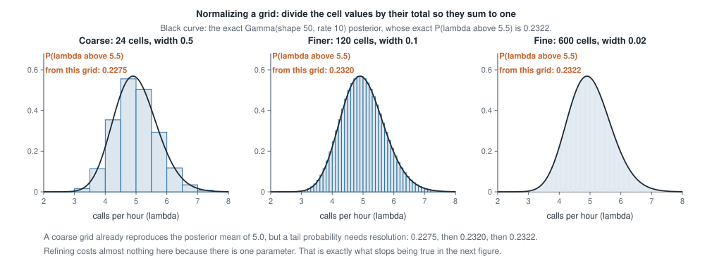
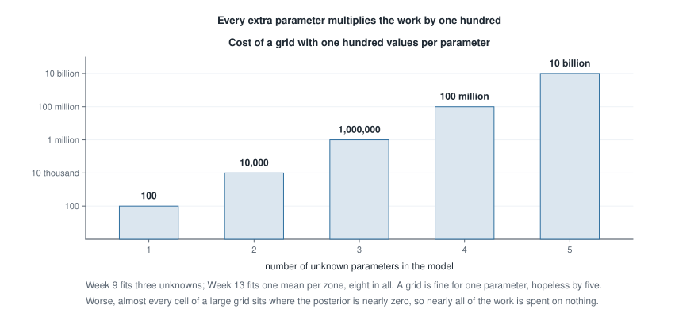
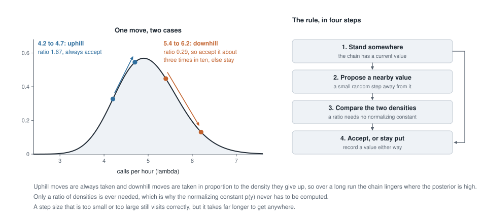
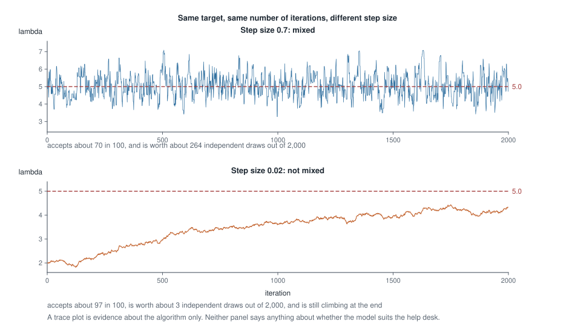
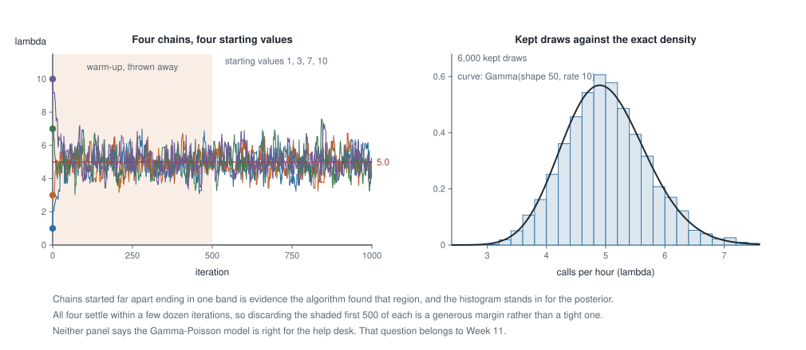

# Week 7 — Simulation-first computation

## Where this week starts

For six weeks every posterior you met had a name and a formula. Week 6 closed that sequence with the
Northgate help desk: an unknown arrival rate $\lambda$, read as the average number of calls per hour,
a Gamma(shape 3, rate 2) prior, and 47 calls logged over an 8-hour shift. Conjugate updating handed
back Gamma(shape 50, rate 10), whose mean is exactly $50/10 = 5.0$ and whose standard deviation is
$\sqrt{50}/10 = 0.7071$. Nothing was approximated: the 95 percent credible interval of 3.711 to 6.478
and the probability $P(\lambda > 5.5 \mid y) = 0.2322$ came straight out of a named distribution.

That was good fortune with a technical name, conjugacy, and it does not survive contact with most
real models. The posterior always exists: prior times likelihood, divided by whatever constant makes
the result integrate to one. What stops existing is your ability to write that constant down. Change
the Gamma prior to something shaped like your actual beliefs and the algebra closes; add a second
unknown and a third and it closes harder. From Week 9 onward the models here routinely carry three
or more unknowns at once, so this week is the machinery that makes the second half of the semester
possible.

This week replaces formulas with numbers, in two stages. The first is **grid approximation**: chop
the range of plausible parameter values into cells, evaluate prior times likelihood once in each
cell, and divide by the total so the values sum to one. On the help desk posterior you can check that
against the exact Gamma result, which is why it is the right place to start. The second is **Markov
chain Monte Carlo**, usually shortened to MCMC: instead of visiting every cell, let one wandering
chain spend time in each region in proportion to the posterior density there, and treat the values it
visits as draws. From here on a posterior is very often a long list of draws and every summary is
computed from that list, which is a gain in reach and a loss in certainty, because a list of draws
can be wrong in ways a formula cannot.

### Why this matters outside the classroom

Picture the help desk supervisor rostering the evening shift. The analysis reaches her as one
sentence: the model puts the arrival rate at about 3.5 calls an hour. She staffs for 3.5. In fact
that number came from a simulation started badly and stopped early, which never reached the region
where the posterior lives; the posterior mean is 5.0. The model was fine and the code ran without an
error message. What failed sat between the model and the number, and the cost is a chronically
understaffed evening.

That failure mode is everywhere now, because almost all applied Bayesian work is done by software
that returns draws. Such software will happily return draws from a run that never settled down, and
those draws will happily produce a mean, an interval, and a confident sentence.

## What you will be able to do

- **Build** a grid approximation to a one-parameter posterior: choose a range and a cell width,
  evaluate prior times likelihood, normalize, and read off a mean and a tail probability.
- **Check** a grid against a known exact posterior, saying which summaries a coarse grid gets right.
- **Explain** why a grid becomes unusable as the number of unknowns grows.
- **Describe** the proposal-and-accept rule behind a Markov chain sampler, and why it needs only a
  ratio of densities and never the normalizing constant.
- **Diagnose** a run from its trace plot, its agreement across chains started apart, and its
  effective sample size, and compute the Monte Carlo standard error on a reported mean.
- **State** when each of these tools is informative, and what a clean set of diagnostics does not
  establish.

## Terms and notation worth fixing

| Term or symbol | Meaning as this course uses it |
|---|---|
| $\lambda$ | the unknown arrival rate for the help desk, in calls per hour |
| $g(\lambda)$ | the *unnormalized* posterior value, prior times likelihood, before dividing by anything |
| $q_i$ | the normalized weight a grid puts on its $i$th cell, so the $q_i$ sum to one |
| grid approximation | replacing a continuous posterior by a finite list of representative values and their normalized weights |
| Markov chain Monte Carlo | a rule for wandering the parameter space so that, in the long run, time spent in a region is proportional to posterior density |
| warm-up | early iterations thrown away because the chain had not yet reached the posterior's neighbourhood |
| effective sample size | how many independent draws a correlated run is worth, at most the number of iterations |
| Monte Carlo standard error | the wobble in a reported summary caused by using finitely many draws |

## Approximating a posterior on a grid

A posterior is a curve, and a curve is an infinite object. A grid approximation stops pretending you
need the infinite object: replace the continuous range of $\lambda$ by a finite list of
representative values, work out how plausible each is, and let that list stand in for the curve.
Every summary you would have got from an integral becomes a sum.

### Building the grid, then normalizing it

Start with the proportionality statement Week 3 established:
$p(\lambda \mid y) \propto p(\lambda) \, p(y \mid \lambda)$. The Gamma(shape 3, rate 2) prior has
density proportional to $\lambda^{2} e^{-2\lambda}$, and the likelihood for 47 calls in an 8-hour
shift comes from a Poisson distribution with mean $8\lambda$, which as a function of $\lambda$ is
proportional to $\lambda^{47} e^{-8\lambda}$. Multiplying,

$$
g(\lambda) \;=\; \lambda^{2} e^{-2\lambda} \times \lambda^{47} e^{-8\lambda}
\;=\; \lambda^{49} e^{-10\lambda}.
$$

Read that as the unnormalized posterior value at any candidate rate $\lambda$. It is not a
probability and does not integrate to one; it is only proportional to the posterior. Here you happen
to recognize it as the Gamma(shape 50, rate 10) kernel, which is how you will grade the
approximation. In a model where you did not recognize it, $g$ would still be computable, and that is
the point.

Now the grid. Choose a range wide enough that the posterior is negligible outside it, say $\lambda$
from 0 to 12 calls per hour. Chop it into equal cells and put one representative value at the centre
of each. Evaluate $g$ at each to get $g(\lambda_1), g(\lambda_2), \ldots$ Then **normalize**, the
step students most often skip and the reason the result behaves like a distribution:

$$
q_i \;=\; \frac{g(\lambda_i)}{\sum_j g(\lambda_j)}.
$$

Dividing by the total does the job the normalizing constant $p(y)$ does in the exact calculation,
without ever knowing what $p(y)$ is. Any constant factor you were sloppy about in $g$, the Poisson's
$1/47!$ or the Gamma's normalizing constant, cancels top and bottom and never affects a $q_i$. The
summaries are then sums: the posterior mean is $\sum_i \lambda_i q_i$, and the probability that the
rate exceeds 5.5 is the total of the $q_i$ whose $\lambda_i$ exceeds 5.5.

{fig-alt="Three panels of call rates from 2 to 8. Chunky bars at width 0.5 give a tail probability of 0.2275; at width 0.1 it is 0.2320; at width 0.02 the bars merge into the exact curve and it is 0.2322."}

The figure shows what refinement buys. All three grids reproduce the posterior mean of 5.0, while the
tail probability moves from 0.2275 to 0.2320 to 0.2322 as the cells shrink, and only the finest grid
matches the exact value. A coarse grid can be perfectly adequate for a centre and badly wrong in a
tail, so the resolution you need depends on the question.

### Where a grid stops being usable

Grids are wonderful in one dimension for exactly the reason that kills them later: they look
everywhere. With one unknown and one hundred values across its range you evaluate $g$ one hundred
times. With two unknowns you need one hundred values of each in every combination, which is ten
thousand. Three unknowns is a million. Five is ten billion.

{fig-alt="Bars rising on a ten-fold scale: 100 cells for one parameter, 10,000 for two, 1,000,000 for three, 100 million for four, and 10 billion for five unknown parameters."}

The figure notes a second problem, arguably worse than the counting. In a large grid almost every
cell sits where the posterior is effectively zero, so most of the work contributes nothing. Week 9's
regression has three unknowns, an intercept, a slope, and a residual standard deviation, and Week
13's hierarchical model carries one unknown mean for each of its eight neighborhood zones. What you
need is something that goes where the posterior is without being told in advance where that is.

## Chains that visit in proportion to density

Markov chain Monte Carlo is the standard answer, and the idea underneath it is more approachable than
its name. Instead of evaluating the posterior everywhere, you take a walk, under one rule arranged so
that over a long enough walk the fraction of time spent in any region matches that region's posterior
probability. Record where the walk has been and you have something that behaves like a sample from
the posterior.

### The proposal-and-accept rule

Stand at some current value of $\lambda$ and propose a nearby value, a small random step away. Then
compare the unnormalized posterior at the proposal with the one where you are. If the proposal is
uphill, that is, if $g(\text{proposal}) > g(\text{current})$, move there. If it is downhill, move
there anyway, but only with probability $g(\text{proposal}) / g(\text{current})$; otherwise stay put.
Either way record a value, because staying put counts as a visit.

{fig-alt="A Gamma density with a blue uphill move from 4.2 to 4.7 labelled ratio 1.67, always accept, and an orange downhill move from 5.4 to 6.2 labelled ratio 0.29, accept about three times in ten."}

The figure works two moves on the help desk posterior. A move from 4.2 to 4.7 has a density ratio of
1.67, so it is uphill and always taken. A move from 5.4 to 6.2 has a ratio of 0.29, so it is taken
roughly three times in ten. Refusing most downhill moves but not all of them keeps the walk near the
bulk of the posterior while still letting it reach the tails, and it is why the long-run pattern of
visits reproduces the posterior shape rather than piling up on the mode.

Two features deserve saying out loud. First, only the **ratio** of two densities is ever needed, and
any factor common to both cancels, so the walk never needs $p(y)$: the quantity that made the exact
calculation impossible is the one the algorithm never asks for. Second, the step size is yours to
choose, and it does not change where the chain eventually goes, only how long it takes to get there.
That tuning choice is what the second worked example turns on. The formal argument that the procedure
converges is a graduate topic, and you do not need it to use the method carefully.

### Diagnostics as evidence, not certification

Because the chain is a walk, consecutive recorded values are correlated, and because the walk starts
somewhere arbitrary, its first stretch is not representative of anything. Both problems are checked
for rather than proved absent, by four checks worth running every time.

**Look at the trace.** Plot the recorded values against iteration number. A working run looks like a
fuzzy horizontal band, crossing the same range over and over, with no drift and no long flat
stretches.

{fig-alt="Top panel: a chain with step size 0.7 fills a band from about 3 to 7 around a line at 5.0. Bottom panel: a chain with step size 0.02 climbs slowly from 2 to about 4.4 and never reaches 5.0 in two thousand iterations."}

**Start several chains far apart.** One chain that looks settled might be settled in the wrong place.
Four chains launched from very different starting values that end up wandering the same band is much
stronger evidence than one tidy-looking chain.

{fig-alt="Left: four coloured chains from starting values 1, 3, 7 and 10 all reach a band around 5.0 within a few dozen iterations, with the first five hundred shaded as warm-up. Right: a histogram of kept draws under the exact Gamma curve."}

**Ask what the run is worth.** Correlated draws carry less information than independent ones, and the
**effective sample size** puts a number on that: the count of independent draws that would have told
you the same amount. A run of 2,000 iterations worth about 260 independent draws is normal rather
than scandalous, but 260 is the number to reason with.

**Attach an error to the number you report.** With independent draws, the wobble in a reported
posterior mean is

$$
\text{Monte Carlo standard error} \;\approx\; \frac{\text{posterior standard deviation}}{\sqrt{\text{number of draws}}} .
$$

Here the standard deviation is 0.7071, so 1,000 independent draws give $0.7071/\sqrt{1000} = 0.0224$
and 4,000 give $0.7071/\sqrt{4000} = 0.0112$. Four times the draws halves the error, so squeezing
another decimal place out of a simulation costs a hundred times the computing. For a correlated run,
put the effective sample size where the number of iterations would go: 2,000 iterations worth about
260 independent draws carry a Monte Carlo standard error near 0.044, not 0.016.

Now the sentence this course insists on. Every one of those four checks is a check on **the
algorithm**, not on **the model**. A chain that mixes beautifully tells you the software explored the
posterior of the model you wrote down. If that model is the wrong shape for the help desk, because
calls cluster at shift change and a constant Poisson rate is untenable, the chain will explore the
wrong model's posterior just as beautifully. Diagnostics are evidence that the computation did not
obviously fail; they are not a verdict on the model, and the two must never be reported as one thing.
Week 11 is where model adequacy is put on trial.

## Worked example — the help desk posterior on three grids

Take the Northgate help desk as Week 6 set it up: prior Gamma(shape 3, rate 2) with mean 1.5, 47
calls in an 8-hour shift, so the observed rate is $47/8 = 5.875$ calls per hour. Conjugacy names the
posterior Gamma(shape 50, rate 10), whose mean is the weighted compromise
$0.20 \times 1.5 + 0.80 \times 5.875 = 5.0$. Pretend you know none of that, and approximate the
posterior on a grid.

**Step 1. Write down the unnormalized posterior.** As above,
$g(\lambda) = \lambda^{49} e^{-10\lambda}$, the prior's $\lambda^{2} e^{-2\lambda}$ times the
likelihood's $\lambda^{47} e^{-8\lambda}$, with every factor free of $\lambda$ dropped.

**Step 2. Choose a range and a cell width.** Take $\lambda$ from 0 to 12 and cells of width 0.5: 24
cells, with representative values 0.25, 0.75, 1.25, and so on up to 11.75.

**Step 3. Evaluate and normalize.** Compute $g$ at each of the 24 values and divide by their total,
giving weights $q_i$ that sum to one.

**Step 4. Read off the summaries.** The grid posterior mean is $\sum_i \lambda_i q_i$; the grid
probability that the rate exceeds 5.5 is the total weight on cells above 5.5.

**Step 5. Refine and compare.** Repeat at width 0.1 and at width 0.02.

| Grid | Cell width | Cells | Grid posterior mean | Grid $P(\lambda > 5.5 \mid y)$ | Grid $P(\lambda > 6 \mid y)$ |
|---|---|---|---|---|---|
| Coarse | 0.5 | 24 | 5.0000 | 0.2275 | 0.0807 |
| Finer | 0.1 | 120 | 5.0000 | 0.2320 | 0.0843 |
| Fine | 0.02 | 600 | 5.0000 | 0.2322 | 0.0844 |
| Exact Gamma(50, 10) | — | — | 5.0000 | 0.2322 | 0.0844 |

Here is the code, short enough to read line by line.

```r
# Grid approximation for the help desk rate lambda.
# Gamma(shape 3, rate 2) prior; 47 calls arriving over an 8-hour shift.
width   <- 0.02
lambda  <- seq(width / 2, 12 - width / 2, by = width)
unnorm  <- dgamma(lambda, shape = 3, rate = 2) * dpois(47, lambda * 8)
weights <- unnorm / sum(unnorm)

sum(lambda * weights)          # grid posterior mean
sum(weights[lambda > 5.5])     # grid probability the rate exceeds 5.5
```

The table's arithmetic is what that block performs, run with `width` set to 0.5, 0.1, and 0.02. The
exact row exists only because this model is conjugate; the grid rows would be computed the same way
if it were not.

What the result licenses: for this model and this prior, a rate of about 5 calls an hour, with
roughly a 23 percent posterior probability that the rate exceeds 5.5. What it does not license: any
claim that the range 0 to 12 was wide enough, which you assumed rather than checked, or that
Gamma-Poisson describes the help desk. A grid computed on the wrong model is an accurate
approximation to the wrong posterior.

### The same reasoning, transferred

Run the identical five steps on Week 4's Meridian seed lot, where the unknown is a germination rate
$\pi$: a Beta(2, 2) prior, 26 of 40 seeds germinating, and the posterior that conjugacy names Beta(28, 16).
The unnormalized posterior is $g(\pi) = \pi^{27}(1-\pi)^{15}$, the prior's $\pi^{1}(1-\pi)^{1}$ times
the binomial likelihood's $\pi^{26}(1-\pi)^{14}$. The range is now 0 to 1, because a proportion
cannot leave it, so widths 0.05, 0.01, and 0.002 give 20, 100, and 500 cells.

| Cell width | Cells | Grid posterior mean | Grid $P(\pi > 0.5 \mid y)$ |
|---|---|---|---|
| 0.05 | 20 | 0.6364 | 0.9694 |
| 0.01 | 100 | 0.6364 | 0.9671 |
| 0.002 | 500 | 0.6364 | 0.9670 |
| Exact Beta(28, 16) | — | 0.6364 | 0.9670 |

What stayed the same: the proportionality statement, the normalizing division, and a coarse grid
nailing the mean while the tail probability needs finer cells. What changed: the family and the
parameter's range, and nothing else. Grid approximation is the general method; conjugacy is the lucky
special case.

## Second worked example — a chain that has not arrived

Now a failure, because the failure is where the learning is. Run a random-walk chain on the same help
desk posterior, but make two ordinary-looking choices badly: start at $\lambda = 2$ calls an hour,
which the prior mean of 1.5 makes superficially reasonable, and take steps of size 0.02, which sounds
prudently cautious. Run 2,000 iterations. Nothing errors.

**What the run reports if nobody checks.** The mean of the 2,000 recorded values is about 3.5 calls
an hour, and not one exceeds 5.5, so the estimated $P(\lambda > 5.5 \mid y)$ is 0.00. Written up,
that is a confident and wrong pair of sentences.

**What the trace shows.** The lower panel of the trace figure above is this run. It does not wander a
band; it climbs, steadily and slowly, from 2 toward 4.4, and is still climbing when the run stops. A
trace with a direction has not finished its warm-up, and no part of it is a draw from the posterior.

**What the acceptance rate shows.** About 97 proposals in every 100 are accepted, which sounds
excellent and is in fact the diagnosis: with steps of 0.02 the proposal sits so close to the current
value that the density ratio is near one, so almost everything is accepted and the chain crawls. A
very high acceptance rate on a random-walk sampler is a warning, not a reassurance.

**What the effective sample size shows.** The run is worth about 3 independent draws. Two thousand
values carrying the information of three: reporting that mean to two decimals was never defensible.

**The repair, and its limit.** Raise the step size to 0.7, roughly the posterior standard deviation,
and start four chains at 1, 3, 7, and 10. Each reaches the band around 5 within a few dozen
iterations, as the four-chain figure shows. Discard those first 500 iterations as warm-up, pool the
rest into 6,000 kept draws, and the summaries come back sensible: a posterior mean of about 5.0, a
posterior standard deviation of about 0.72 against the exact 0.7071, and about 0.23 of the draws
above 5.5 against the exact 0.2322. The estimated probability above 6 is about 0.092 against the
exact 0.0844, a gap that illustrates Monte Carlo error rather than a defect.

And the limit. Every repair improved the **computation**. None touched whether a single constant
Poisson rate describes a help desk where calls plausibly cluster around class changes and drop
overnight. The repaired run is an accurate picture of the model's posterior; whether that model
deserves belief is asked in Week 11.

## Keeping the run reproducible

A simulation that gives different numbers every time it runs is not a result anybody can check,
including you. Two habits fix that.

Set a seed once, at the top, before any random number is drawn. `set.seed(20270707)` makes the run
repeatable, so a colleague who reruns your file sees your numbers rather than numbers near yours.
Then report the iterations, the warm-up discarded, the number of chains, and the seed: a simulation
summary without them cannot be reproduced even in principle.

```r
# A random-walk sampler for the same posterior, written out in full.
log_target <- function(lam) {
  if (lam <= 0) return(-Inf)
  dgamma(lam, shape = 3, rate = 2, log = TRUE) + dpois(47, lam * 8, log = TRUE)
}

set.seed(20270707)
draws   <- numeric(2000)
current <- 5

for (i in seq_along(draws)) {
  proposal <- rnorm(1, current, 0.7)
  if (log(runif(1)) < log_target(proposal) - log_target(current)) current <- proposal
  draws[i] <- current
}

plot(draws, type = "l")   # the trace plot, looked at before anything is reported
```

Keep the code and its output in one document rather than pasting numbers into prose by hand, which is
what [Quarto](https://quarto.org/) is for and why this course teaches it alongside
[R](https://www.r-project.org/) and [Visual Studio Code](https://code.visualstudio.com/). The test is
simple: delete every output, rerun from a clean session, and see whether the same numbers come back.
If they do not, something in the write-up is not what the code produced.

Working in logs is not fussiness either. At $\lambda = 5$ the value
$g(\lambda) = \lambda^{49}e^{-10\lambda}$ involves $5^{49}$, a number with 35 digits, and larger
models overflow ordinary arithmetic outright. Comparing log densities and exponentiating only their
difference keeps every quantity in range, which is why the code above adds rather than multiplies.

## The misreading to avoid

The sentence to watch for, in your own writing and other people's, is: **"the chains converged, so
the model is good."** It sounds like a conclusion and it is a category error. Convergence is a
property of an algorithm exploring a fixed target: it says the sampler found and stayed in the region
where your model's posterior lives. It says nothing about whether your model describes the help desk,
because the sampler was never shown the help desk, only the posterior you wrote down.

Run the thought experiment. Suppose the help desk really takes 26 calls in the first hour of a
shift and three an hour after that, which still totals 47 over eight hours but makes a single
constant rate $\lambda$ a poor description. Fit
Gamma-Poisson anyway and the chains will mix, four chains from different starts will agree, the
effective sample size will be respectable, and the Monte Carlo standard error will be small. Every
diagnostic passes, because every diagnostic was only asking whether the arithmetic was done properly,
and it was.

Two smaller versions of the same confusion are worth naming. A narrow posterior is not a correct
posterior: its width reflects how much your model and prior committed to, not how well they fit. And
a finished simulation is not a checked one; the check comes afterwards, and it is evidence rather
than certification even when it goes well.

The honest formulation is a division of labour. Diagnostics say whether the numbers can be trusted as
summaries of your model's posterior. Posterior predictive checks, which Week 11 builds properly, ask
whether that model could have produced data like yours. Neither one, and not both together, makes a
model true.

## Practice on your own

These are for your own checking, not for submission. Work them with a calculator or a short R script,
and compare with the exact values where they exist.

1. Build a grid approximation to the Meridian seed lot posterior over $\pi$ from 0 to 1 with cells of
   width 0.1. Compare the grid posterior mean with the exact 0.6364, then the grid probability that
   $\pi > 0.7$ with the exact 0.1919. Which summary did the coarse grid handle better, and why?
2. Suppose a grid on the help desk posterior runs from 0 to 6 calls per hour instead of 0 to 12.
   Before computing anything, say what goes wrong and which summaries suffer most. Then compute the
   grid posterior mean over that range and see whether your prediction held.
3. A colleague reports a posterior mean of 4.87 calls per hour from 500 iterations with an effective
   sample size of 12. Using a posterior standard deviation of 0.7071, work out the Monte Carlo
   standard error on that report and decide how many decimal places it deserves.
4. Work out by hand the acceptance probability for a move from $\lambda = 5.0$ to $\lambda = 4.0$
   under $g(\lambda) = \lambda^{49}e^{-10\lambda}$, working in logs. Then say in one sentence why the
   move is not simply rejected for being downhill.
5. Write two sentences reporting the repaired help desk simulation to the supervisor: one on what the
   posterior says about the arrival rate, one on what the diagnostics do and do not establish.

## Where to read more

- The primary text for this course is *Bayes Rules! An Introduction to Applied Bayesian Modeling* by
  Johnson, Ott, and Dogucu, at [the Bayes Rules! site](https://www.bayesrulesbook.com/). This week is
  aligned with [Chapter 6](https://www.bayesrulesbook.com/chapter-6) and
  [Chapter 7](https://www.bayesrulesbook.com/chapter-7). Read them alongside these notes, which were
  written independently and use this course's own invented cases.
- Tooling for the workflow above: [R](https://www.r-project.org/),
  [Visual Studio Code](https://code.visualstudio.com/), and [Quarto](https://quarto.org/).
- Course pages: the [notes index](index.qmd), the [syllabus](../syllabus.qmd), the
  [schedule](../schedule.qmd), and the [resources page](../resources/index.qmd). Week 6's conjugate
  models are the direct prerequisite and live at [week-06.qmd](week-06.qmd).

## Where this goes next

Week 8 draws the first half of the course together, setting the discrete screening problem, the
beta-binomial seed lot, the gamma-Poisson help desk, and the normal-normal commute side by side so
the shared structure is visible. This week is what makes the second half possible: from Week 9
onward the regression posteriors carry several unknowns at once and are reached by simulation rather
than by a formula. When a regression summary reports a posterior mean and interval for a slope,
those numbers came from draws, produced by a chain, that somebody should have looked at first.

Carry two things forward. A posterior you cannot write down is still a posterior, and a list of draws
is a respectable way to hold one. And diagnostics are evidence about the computation while model
checks are evidence about the model, neither being a verdict. Continue from the
[notes index](index.qmd), or look ahead to [week-08.qmd](week-08.qmd) and to
[week-11.qmd](week-11.qmd), where model adequacy is put to the test.
