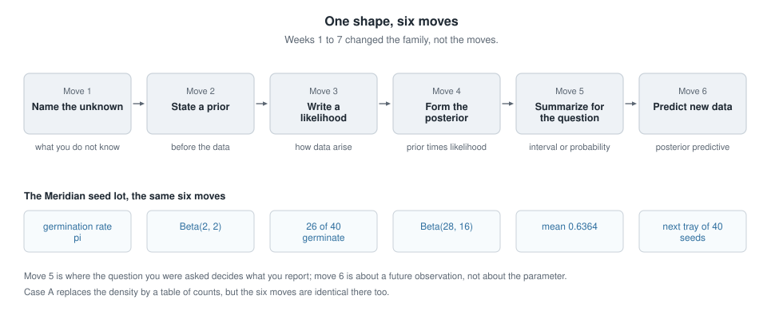
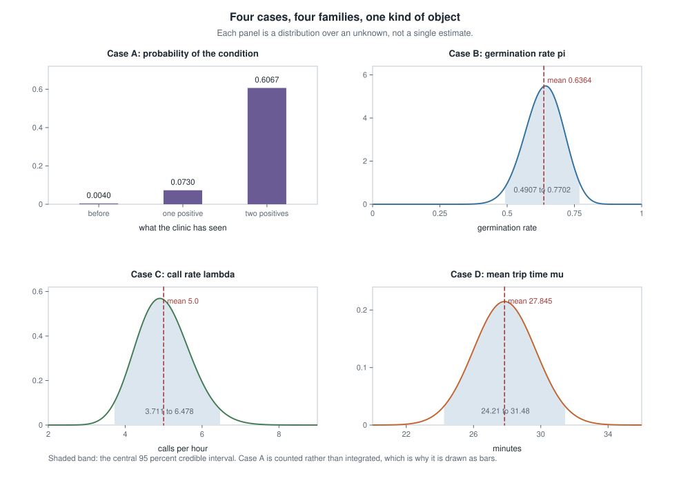
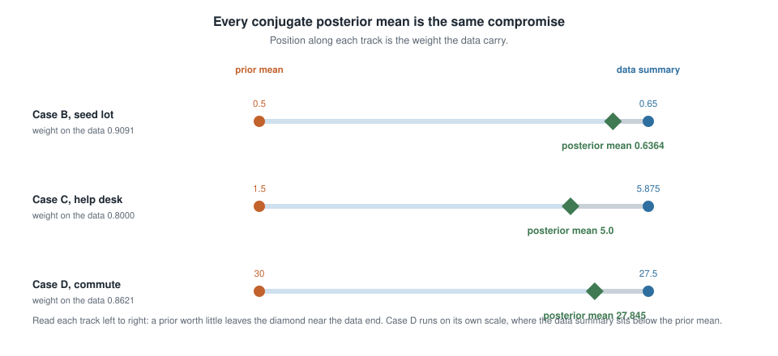
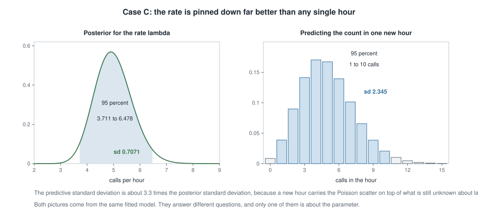
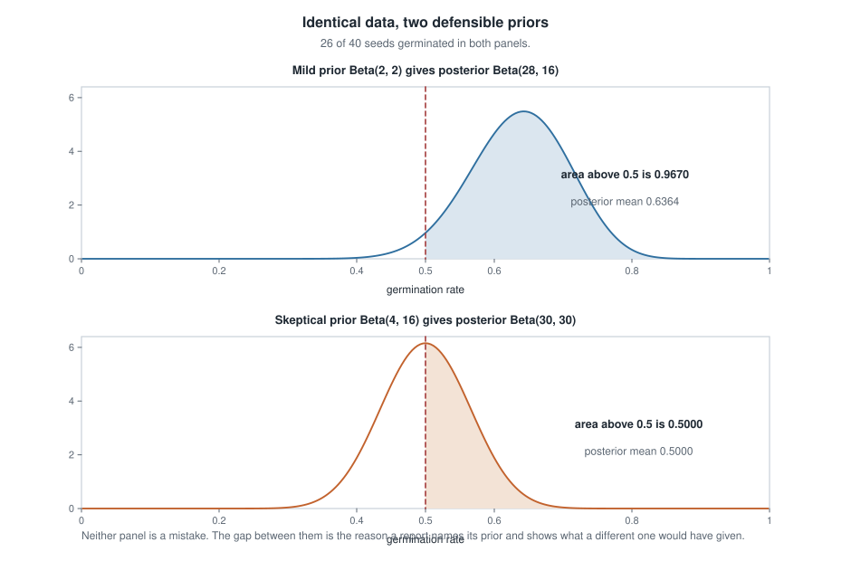

# Week 8 — Midterm synthesis

## Where this week starts

Seven weeks ago you had conditional probability and little else. Since then you have built a screening calculation out of counts, a Beta posterior for a germination rate, a Gamma posterior for a call rate, a normal posterior for a mean commute time, and a simulated posterior no formula would have handed you. That looks like a pile of separate techniques. This week asks whether it is instead one technique wearing four costumes.

It is one technique. Every analysis so far named an unknown, stated a prior for it, wrote a likelihood saying how data arise once that quantity is fixed, combined the two into a posterior, summarized that posterior for the question actually asked, and, when the question was about the future, predicted a new observation through it. The families changed from week to week. The six moves did not.

Week 7 left something unfinished. Once you can approximate a posterior by simulation, conjugacy stops being the boundary of what you may model, and the safety rail goes with it: closed-form arithmetic was checkable by hand. From Week 9 onward a posterior arrives as a cloud of draws from software you did not write, so if you cannot say in plain words what the unknown is, what the prior asserts, and what your summary claims, all you have is output, and output is not a conclusion. Two things should feel different by the end: given a described situation you should be able to name the model it asks for and the assumption it commits you to, and given a sentence about a posterior you should be able to say whether the posterior supports it and, if not, repair it.

### Why this matters outside the classroom

A clinician sees a positive screening result and tells the patient the test is right 98 percent of the time, so there is roughly a 98 percent chance the condition is present. Week 2 worked the counts: of 100,000 screened, 5,372 test positive and only 392 of those have the condition, so the probability after one positive is $392/5{,}372 = 0.0730$. A real number has been attached to the wrong question, and the gap is the difference between a routine second test and a frightened patient.

The mirror-image failure runs the other way. A supervisor staffing the Northgate help desk reads the 95 percent credible interval of 3.711 to 6.478 calls per hour and staffs for eight calls at most. That interval describes the rate, not a single hour: the predictive interval for one new hour's count runs from 1 to 10 calls, and the probability of nine or more next hour is 0.0775, so about one hour in thirteen overruns the plan. Both did correct arithmetic on the wrong quantity.

## What you will be able to do

- Restate any analysis from the first seven weeks in the same six moves: unknown, prior, likelihood, posterior, summary, prediction.
- Choose between a Beta-binomial, a Gamma-Poisson, and a normal-normal model for a described situation, naming the assumption each choice commits you to.
- Recognize a situation where the obvious family is wrong, and say which assumption the data violate.
- Compute a conjugate posterior by hand and check its mean as a weighted compromise.
- Distinguish a credible interval from a posterior predictive interval, and say which question each answers.
- Judge whether a posterior supports a written claim about it, and rewrite the claim so that it does.

## Terms and notation worth fixing

The rest of the page uses these in exactly these senses.

| Symbol or term | What it means in this course |
|---|---|
| $\theta$ | a generic unknown, standing in for a probability $\pi$, a rate $\lambda$, or a mean $\mu$ |
| $p(\theta)$ | the prior: what is plausible before these data arrive |
| $p(y \mid \theta)$ | the likelihood: the data model as a function of $\theta$, with the observed $y$ fixed |
| $p(\theta \mid y)$ | the posterior: what the prior becomes once the data are accounted for |
| $p(\tilde y \mid y)$ | the posterior predictive: a new outcome $\tilde y$, averaged over the posterior |
| conjugate pair | a prior family and likelihood whose posterior stays in the prior's family, so updating is arithmetic |
| prior strength | what a prior is worth in observations: $a + b$ for Beta, the rate $r$ for Gamma, precision for normal |
| credible interval | an interval carrying a stated posterior probability for the parameter, under this model and prior |

## The one shape every analysis has

Start with the shape, then check it against all four cases. The six moves are: name the unknown; state a prior; write a likelihood; form the posterior; summarize the posterior for the question you were asked; predict new data through the posterior predictive. Nothing in Weeks 1 through 7 adds a seventh. Grid approximation and Markov chain Monte Carlo are two ways of carrying out move four when no formula is available.

{fig-alt="Six labelled boxes in a row joined by arrows: name the unknown, state a prior, write a likelihood, form the posterior, summarize for the question, predict new data. Beneath, the same six moves filled in for the seed lot."}

Read the lower strip as a sentence: the unknown is the germination rate $\pi$ of one seed lot, the prior is Beta(2, 2), the data are 26 germinations in a tray of 40 seeds, the posterior is Beta(28, 16), the summary is a mean of 0.6364, and the prediction is about the next tray, not the rate.

| | Case A, screening | Case B, seed lot | Case C, help desk | Case D, commute |
|---|---|---|---|---|
| Unknown | has this patient the condition | germination rate $\pi$ | call rate $\lambda$ per hour | mean trip time $\mu$ |
| Prior | prevalence 0.004 | Beta(2, 2) | Gamma(3, 2), mean 1.5 | normal, mean 30, sd 5 |
| Data | one positive test | 26 of 40 germinate | 47 calls in 8 hours | 16 trips averaging 27.5 |
| Likelihood | sensitivity 0.98, false positive rate 0.05 | binomial | Poisson | normal, $\sigma = 8$ known |
| Posterior | probability 0.0730 | Beta(28, 16) | Gamma(50, 10) | normal, 27.845, sd 1.8570 |
| A summary | 0.0730, then 0.6067 after a second positive | 0.4907 to 0.7702 | 3.711 to 6.478 | 24.21 to 31.48 |
| A prediction | the result of a second test | germinations in a new tray | 1 to 10 calls next hour | 11.75 to 43.94 minutes |

Case A looks like the odd one out: its unknown takes only two values, so its posterior is a probability rather than a curve, counted rather than integrated. That is a difference in arithmetic, not structure, and Week 3 made the transition by putting five, then twenty, then a continuum of candidate values on the axis.

{fig-alt="Four panels: three bars at 0.0040, 0.0730 and 0.6067; a Beta posterior peaking near 0.64 with 0.4907 to 0.7702 shaded; a Gamma posterior centred at 5.0; and a normal posterior centred at 27.845."}

Four families, four shapes, one kind of object: every panel is a distribution over an unknown, and every shaded band is a central 95 percent credible interval. A student who can say what each axis measures and what each band claims has most of the first half.

### Naming the unknown, and what a prior owes you

The first move is the one most often skipped, and skipping it is where the rest goes wrong. Naming the unknown means saying what quantity you are uncertain about, in units, for a specific object or population. "The germination rate" is not enough; "the germination rate of this seed lot, the proportion of its seeds that would sprout under the supplier's stated conditions" is.

A prior then owes you three things. It must live on the right space, which already narrows the family: a probability between zero and one, a rate on the positive numbers, a mean of a symmetric measurement on the whole line. It must have a location you can defend in the problem's units. And it must have a strength you can state as a rough count of observations: Beta(2, 2) is worth about four, which is why forty seeds swamp it, while the skeptical Beta(4, 16) Week 5 ran is worth about twenty and is not swamped.

Say all three out loud and the prior stops being a formality. "A Gamma(3, 2) prior on the call rate" is jargon; "before the shift we thought one and a half calls an hour was typical, held about as firmly as two hours of watching would warrant" is a claim someone can disagree with.

### The compromise every conjugate posterior makes

In all three continuous cases the posterior mean is a weighted average of the prior mean and a data summary, with weights set by prior strength and sample size. That is not a coincidence; it is what conjugacy does. For Case B the weights are $4/44 = 0.0909$ and $40/44 = 0.9091$, and $0.0909 \times 0.5 + 0.9091 \times 0.65 = 0.6364$. For Case C they are $2/10 = 0.20$ and $8/10 = 0.80$, and $0.20 \times 1.5 + 0.80 \times 5.875 = 5.0$ exactly. For Case D the weights are precisions over their total: prior precision $1/25 = 0.04$, data precision $16/64 = 0.25$, total 0.29, so the data carry $0.25/0.29 = 0.8621$ and $(0.04 \times 30 + 0.25 \times 27.5)/0.29 = 27.845$.

{fig-alt="Three horizontal tracks, one per case, each running from the prior mean on the left to the data summary on the right. A diamond marks the posterior mean at 0.9091, 0.8000 and 0.8621 of the way across, close to the data end each time."}

Each track runs from the prior mean to the data summary, with the posterior mean at the fraction of the way across given by the weight on the data. In all three the diamond sits near the data end, because the prior was worth much less than the sample. That is the most useful sanity check of the first half: a conjugate posterior mean lands between the two ends, nearer whichever carries more weight, and anything outside is an arithmetic mistake.

### Reading the posterior for the question you were asked

Move five is a translation step and depends entirely on what someone asked. "How big is it?" wants a posterior mean, median, or mode. "How sure are you?" wants a posterior standard deviation or a credible interval. "Is it above the threshold?" wants a posterior probability, the area of the posterior on one side of a line. Case B supplies all three: mean 0.6364, standard deviation 0.0717, central 95 percent interval 0.4907 to 0.7702, and $P(\pi > 0.5 \mid y) = 0.9670$.

Move six is a different question again, and that distinction is where most of this week's repair work lives: a credible interval is about the parameter, while a predictive interval is about a future observation and carries the observation-level variability on top. Week 6 pinned the contrast on Case C, and the transfer below works it through.

## Choosing the model a situation asks for

From Week 9 you will be handed descriptions rather than models, so make the choice mechanical where it can be and honest where it cannot. Three questions decide most of it. What kind of thing is the outcome: a yes-or-no result, a count, or a measurement on a continuous scale? What is it measured out of: a fixed number of trials, an interval of time or space, or nothing in particular? And is the unknown a proportion, a rate, or a mean?

### Three situations and the family each one names

A proportion of successes out of a fixed number of trials calls for a binomial likelihood and, for conjugacy, a Beta prior. The seed lot fits: the tray held exactly 40 seeds, each germinated or did not, and they are plausibly exchangeable draws from one lot. Say that out loud: seeds pooled from four suppliers would not be exchangeable.

A count arising over an interval of time or space, with no ceiling in sight, calls for a Poisson likelihood and a Gamma prior on the rate. The help desk fits: calls arrive over an eight-hour shift with no fixed number of opportunities to count against. The Poisson model assumes a constant rate and independent arrivals, which is what to interrogate first.

A roughly symmetric measurement whose mean you care about calls for a normal likelihood and, with the observation-level standard deviation known, a normal prior on the mean. The commute fits: trips near half an hour with a spread of eight minutes are plausibly symmetric and nowhere near zero. Here precision, not sample size, is what adds.

### One situation where the obvious choice is wrong

Now the case where the obvious family fails. Suppose the help desk wants the call rate for a whole weekday, not one shift. Counts over an interval: Poisson, obviously. But a single-rate Poisson model says the expected count is the same at nine in the morning as at three in the afternoon, and any campus help desk knows it is not. Pooling the day into one rate produces counts more spread out than that model can generate.

That has a signature you can check. A Poisson distribution forces the variance to equal the mean, so hourly counts with a mean near 5 and a sample variance near 15 contradict the model rather than merely fitting it loosely. The repair is not a better prior; it is a better likelihood, either separate rates for parts of the day or a rate depending on the hour, which is a regression and is where Week 9 begins.

The same trap has a normal twin: treating a right-skewed, non-negative quantity such as a repair time as normal puts predictive probability on negative values. Case D escapes it only because its predictive interval, 11.75 to 43.94 minutes, stays positive.

## Worked example — the seed lot from prior to prediction

The Meridian seed lot, through all six moves with every number shown. A test tray of $n = 40$ seeds is planted and $y = 26$ germinate, so the observed proportion is $26/40 = 0.65$.

**Move one, name the unknown.** The unknown is $\pi$, the long-run proportion of this lot's seeds that would sprout under the supplier's stated conditions. It is fixed but unknown rather than varying seed to seed, which is the kind of quantity Week 1 said Bayesian methods put a distribution on.

**Move two, state the prior.** The standing prior here is Beta(2, 2): mean $2/(2+2) = 0.5$, mildly favouring the middle over the extremes, worth roughly four prior observations because $a + b = 4$. That asserts something modest: a rate near one half was more plausible than one near zero or one, and not firmly held.

**Move three, write the likelihood.** Treating the 40 seeds as exchangeable with a common rate, the number sprouting is binomial, so with the data fixed the likelihood is proportional to $\pi^{26}(1-\pi)^{14}$. Read it as a function of $\pi$: it says how compatible each candidate rate is with the tray you planted.

**Move four, form the posterior.** Multiplying prior by likelihood and dropping every factor free of $\pi$,

$$
p(\pi \mid y) \propto \pi^{2-1}(1-\pi)^{2-1} \cdot \pi^{26}(1-\pi)^{14} = \pi^{28-1}(1-\pi)^{16-1},
$$

the Beta(28, 16) density up to its normalizing constant. The conjugate rule is exactly that: add successes to $a$ and failures to $b$, giving $2 + 26 = 28$ and $2 + 40 - 26 = 16$.

**Move five, summarize for the question.** The posterior mean is $28/44 = 0.6364$, and the compromise check confirms it: $0.0909 \times 0.5 + 0.9091 \times 0.65 = 0.6364$. The standard deviation is 0.0717, the median 0.6384, the mode $27/42 = 0.6429$, and those three nearly coincide because this posterior is close to symmetric. The central 95 percent credible interval runs from 0.4907 to 0.7702: given this model and this prior, there is a 95 percent posterior probability the lot's rate lies there. Asked whether the lot beats one half, report $P(\pi > 0.5 \mid y) = 0.9670$; for a stricter bar, $P(\pi > 0.7 \mid y) = 0.1919$.

```r
# Case B: a Beta(2, 2) prior updated by 26 germinations in a tray of 40 seeds.
a_prior <- 2
b_prior <- 2
y <- 26
n <- 40
a_post <- a_prior + y          # 28
b_post <- b_prior + n - y      # 16
a_post / (a_post + b_post)     # the posterior mean
qbeta(c(0.025, 0.975), a_post, b_post)
1 - pbeta(0.5, a_post, b_post) # posterior probability the rate beats one half
```

**Move six, predict.** A second tray of 40 seeds does not germinate at exactly $40 \times 0.6364$: its count carries the remaining uncertainty about $\pi$ plus the binomial scatter of a new tray, so the predictive spread is wider than the posterior spread. Always.

What this licenses: a report saying the lot's rate is most plausibly around 0.64, and that beating one half is well supported under this prior. What it does not license: a claim that the rate *is* 0.6364, that the interval holds under a different defensible prior, or that the lot is fit for sale, which is a decision needing a threshold somebody has to choose and defend.

### The same reasoning, transferred

The same six moves on the Northgate help desk, different family, different scale. The unknown is $\lambda$, calls per hour. The prior is Gamma(shape 3, rate 2), mean 1.5, which turns out badly low. The likelihood is Poisson: 47 calls in an eight-hour shift, an observed rate of $47/8 = 5.875$. The conjugate update adds the count to the shape and the hours to the rate, giving Gamma(shape 50, rate 10), posterior mean $50/10 = 5.0$ exactly, and the compromise check holds: $0.20 \times 1.5 + 0.80 \times 5.875 = 5.0$. The standard deviation is 0.7071 and the central 95 percent interval runs from 3.711 to 6.478.

```r
# Case C: a Gamma(3, 2) prior updated by 47 calls in an 8-hour shift.
shape_post <- 3 + 47
rate_post <- 2 + 8
shape_post / rate_post
qgamma(c(0.025, 0.975), shape_post, rate_post)
```

Move six earns this case its place. The count in one new hour has predictive standard deviation 2.345 against the posterior's 0.7071, about 3.3 times wider, with a central 95 percent predictive interval of 1 to 10 calls and $P(9 \text{ or more calls in the next hour}) = 0.0775$.

{fig-alt="Left: a narrow Gamma posterior with the band 3.711 to 6.478 shaded and standard deviation 0.7071 marked. Right: a much wider bar distribution for one hour's count, with 1 to 10 calls shaded and standard deviation 2.345."}

What stayed the same: the six moves, the conjugate shortcut, the posterior mean as a weighted compromise, and the split between summarizing a parameter and predicting an observation. What changed: the family, since the outcome is a count over time; the units of prior strength, hours rather than seeds; and the size of the estimation-to-prediction gap, dramatic here because one hour is small and noisy while eight hours pin the rate down.

## Second worked example — four readings of the seed lot posterior

Four sentences somebody might write about Case B's posterior, Beta(28, 16), from 26 germinations in 40 seeds. Three are wrong in ways easy to miss and one is right; decide which is which before reading the repairs.

**Reading one.** "There is a 95 percent chance the germination rate is between 0.4907 and 0.7702, no matter what prior you started from." Wrong in its second clause: every posterior statement is conditional on the model and the prior. Week 5 ran four defensible priors on these data, and the skeptical Beta(4, 16) gives Beta(30, 30) with a 95 percent interval of 0.3750 to 0.6250. Repaired: "given the Beta(2, 2) prior and the binomial model, there is a 95 percent posterior probability that the rate lies between 0.4907 and 0.7702."

**Reading two.** "About 95 percent of future test trays will germinate at a rate between 0.4907 and 0.7702." Wrong: the credible-versus-predictive confusion in its commonest disguise. The interval is about $\pi$, one fixed feature of the lot, while a future tray varies around it with binomial scatter on top. Repaired: "that interval covers the lot's rate with 95 percent posterior probability; predicting one new tray needs the posterior predictive distribution, which is wider."

**Reading three.** "Since $P(\pi > 0.5 \mid y) = 0.9670$, there is only about a 3 percent chance of seeing data like this if the true rate were one half." Wrong, and the swap is structural: a statement about the parameter given the data has been read as one about the data given a parameter value. The number 0.9670 is posterior area to the right of 0.5 under Beta(28, 16), not a tail probability of a sampling distribution and not a p-value. Repaired: "under this model and prior, the posterior probability that the rate exceeds one half is 0.9670."

**Reading four.** "The posterior mean 0.6364 lies between the prior mean 0.5 and the observed 0.65, much nearer the second, because the prior is worth about four observations against a tray of forty." Right: right about the arithmetic, since $0.0909 \times 0.5 + 0.9091 \times 0.65 = 0.6364$; right about the mechanism, since the weights are prior strength and sample size over their total; and careful, since it describes the posterior rather than asserting the rate. Notice what even this sentence does not do: it does not say the lot is good, the model is right, or the interval survives a different prior.

## The misreading to avoid

The misreading to dismantle this week is not about a number. It is the belief that "Bayesian analysis is a sequence of steps to run": pick the conjugate family, add the successes, read off the interval, report. Students arrive there honestly: six repeatable moves are exactly what this page laid out. But the steps are the easy part. The statistics lives in the three choices the steps do not make for you: which likelihood the situation deserves, which prior you will defend, and which summary you report. Change any one and the conclusion can change while the data sit untouched.

{fig-alt="Two stacked panels on one axis. Top: posterior Beta(28, 16) from a mild prior, area above 0.5 shaded and labelled 0.9670. Bottom: posterior Beta(30, 30) from a skeptical prior, area above 0.5 labelled 0.5000."}

The figure makes it concrete on the comparison Week 5 owns. The same 26 germinations out of 40 seeds, under the mild Beta(2, 2) prior, give mean 0.6364 and $P(\pi > 0.5 \mid y) = 0.9670$. Under the skeptical Beta(4, 16) prior, worth about twenty prior observations and pointed the other way, the same data give Beta(30, 30), posterior mean exactly 0.5000, and posterior probability of beating one half exactly 0.5000. One report says the lot very likely clears one half; the other says it is a coin flip. Neither analyst made an arithmetic error.

That is not a defect of the method and not a reason to abandon priors. It is information: these data are not decisive on their own, and one number from one prior would have concealed it. That is why Week 5's sensitivity work is not an optional extra step, and the same caution runs through everything ahead. A credible interval describes uncertainty; it does not deliver a verdict. A converged chain in Week 7 says the algorithm did not obviously fail, not that the model is right. A posterior probability of 0.9670 is evidence about a rate, not a decision about a seed lot: the decision needs a threshold, and a threshold is a value judgment somebody has to own.

## Practice on your own

These are for your own checking, not for submission. Work them with a calculator and your notes.

1. A tray from a different lot is planted: 55 seeds, 33 germinate. With the same Beta(2, 2) prior, name the posterior, compute its mean, verify it as a weighted compromise, and say which weight grew.
2. The help desk runs a quieter second shift: 22 calls over 8 hours. Starting from the Gamma(50, 10) posterior as your prior, work out the new shape and rate, then compare the new mean with 5.0 and with the new observed rate.
3. For Case D the posterior for $\mu$ has standard deviation 1.8570 minutes while the predictive standard deviation for one new trip is 8.213. Explain without formulas why the second is so much larger, and which you would quote to a commuter deciding when to leave.
4. Three situations: the proportion of a batch of 200 valves failing a pressure test; the number of vehicles crossing a bridge between two and three in the morning; the average weight of apples in a shipment. For each, name the likelihood, a conjugate prior, and one assumption you would check.
5. Write one sentence about Case C's posterior that is wrong in the way reading two is wrong, then repair it.

## Where to read more

- This week draws together the chapters the first half worked through, in the course's primary text, *Bayes Rules! An Introduction to Applied Bayesian Modeling*: [Chapter 1](https://www.bayesrulesbook.com/chapter-1) with Week 1, [Chapter 2](https://www.bayesrulesbook.com/chapter-2) with Weeks 2 and 3, [Chapter 3](https://www.bayesrulesbook.com/chapter-3) with Weeks 3 and 4, [Chapter 4](https://www.bayesrulesbook.com/chapter-4) with Week 5.
- The rest of that span: [Chapter 5](https://www.bayesrulesbook.com/chapter-5) and [Chapter 8](https://www.bayesrulesbook.com/chapter-8) with Week 6, [Chapter 6](https://www.bayesrulesbook.com/chapter-6) and [Chapter 7](https://www.bayesrulesbook.com/chapter-7) with Week 7. The book's home page is [Bayes Rules!](https://www.bayesrulesbook.com/).
- This week's alignment is that span, so read inside it rather than around it. Other well-known texts sit at this level too, Statistical Rethinking among them, and [Week 15](week-15.qmd) is where this course points forward to reading past the end of the term. Availability and licence terms are still being confirmed for every source this course names, so consult rather than redistribute.
- To re-run the arithmetic here: [The R Project for Statistical Computing](https://www.r-project.org/), [Visual Studio Code](https://code.visualstudio.com/), and [Quarto](https://quarto.org/).
- Course pages: [the notes index](index.qmd), [course home](../index.qmd), [syllabus](../syllabus.qmd), [schedule](../schedule.qmd), [resources overview](../resources/index.qmd). Units drawn on here: [week-02.qmd](week-02.qmd), [week-03.qmd](week-03.qmd), [week-04.qmd](week-04.qmd), [week-05.qmd](week-05.qmd), [week-06.qmd](week-06.qmd), [week-07.qmd](week-07.qmd).

## Where this goes next

Week 9 changes one thing and keeps everything else. The unknown stops being one number and becomes a small collection: an intercept and a slope describing how a numerical outcome moves with a predictor. The prior becomes a prior on those coefficients, the likelihood a normal model whose mean depends on the predictor, and the posterior a joint distribution rather than a curve over one axis. The six moves survive intact.

Two habits carry directly: keep checking a posterior against a compromise you can predict, because the same pull toward the data reappears in regression under another name, and keep asking what question a summary answers. When you are ready, go on to [week-09.qmd](week-09.qmd), or return to [the notes index](index.qmd).
