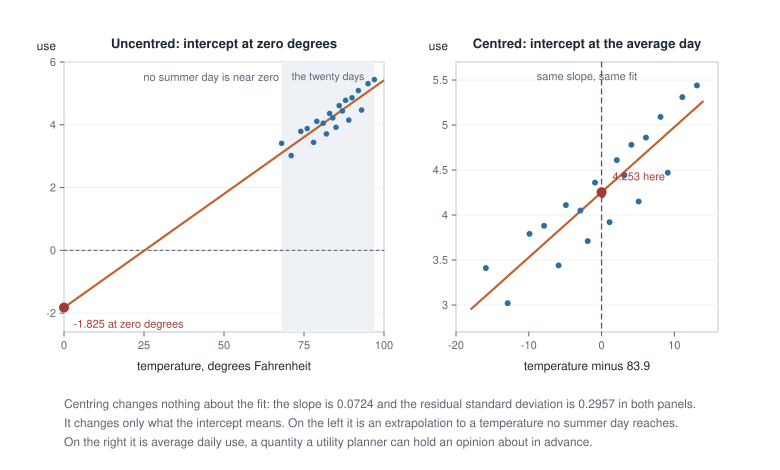
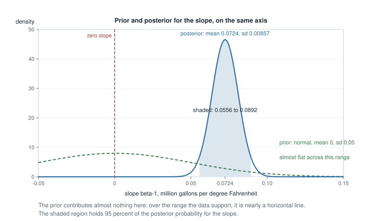
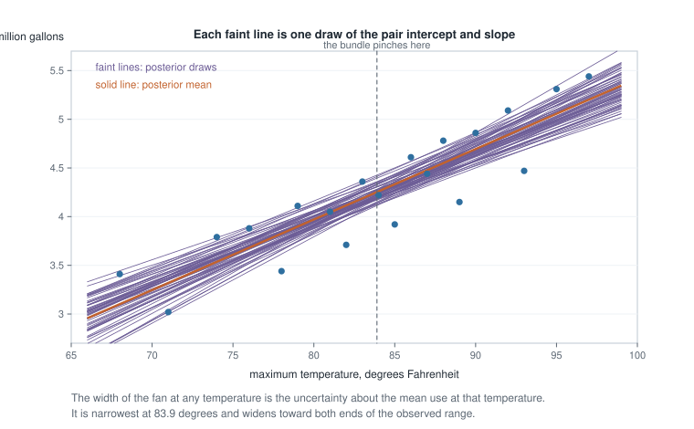
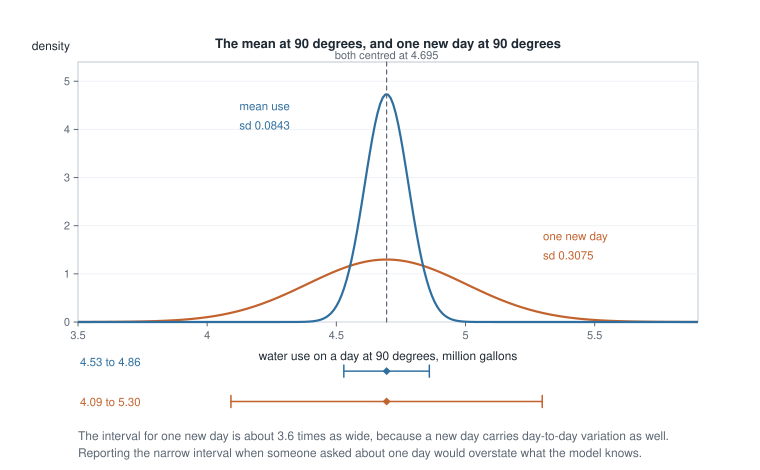
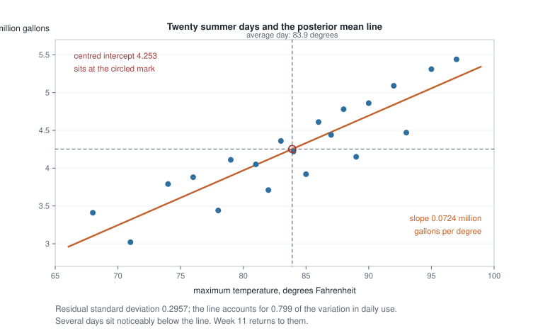

# Week 9 — Bayesian regression for a numerical outcome

## Where this week starts

Every model you have fitted so far had exactly one unknown: a germination rate, a call arrival rate,
a mean commute time. You stated what you believed beforehand, stated how data would behave for each
possible value of that unknown, and combined the two into a posterior over a single quantity. The
picture was always a curve on one axis.

This week the mean is allowed to depend on something you measured. A municipal water utility does not
want "average daily water use" as a single number, because a ninety-degree Saturday and a
sixty-eight-degree Tuesday are not draws from the same distribution. So we write the mean as a
straight-line function of a measured predictor, and the unknowns become the two numbers defining that
line, plus the spread of days around it. Three unknowns instead of one.

Almost nothing else changes. There is still a prior, still a likelihood, still a posterior, still a
posterior predictive distribution for a day you have not seen. What changes is the shape of the thing
you are uncertain about: last week's posterior was a curve over a number, and this week's is a
distribution over *lines*, whose honest picture is a bundle of plausible lines drawn faintly on top
of each other rather than one line through a scatterplot. By the end you should see three separate
things where you used to see one: a statement about the slope, a statement about the average outcome
at some predictor value, and a statement about a single new day. Those carry three different amounts
of uncertainty, and confusing them is the most expensive mistake in this unit.

### Why this matters outside the classroom

A planner sizing next August's pumping schedule has to commit real money to a guess about demand. If
the analyst reports "use goes up about 0.07 million gallons per extra degree" and stops, the planner
has a slope and no idea how firmly it is pinned down. If instead the analyst reports the interval for
the *average* ninety-degree day when the planner asked about a *particular* one, the schedule rests
on an interval roughly a third as wide as it should be, and the first hot Saturday that overruns the
plan looks like a shocking anomaly when it was ordinary.

Both are failures of reading rather than arithmetic: a number was reported with the wrong uncertainty
attached, and nothing downstream repairs that.

## What you will be able to do

- **Write** a regression for a numerical outcome as a probability statement, naming all three
  unknowns and saying in plain language what each one is.
- **Compute** a slope and a centred intercept from a small data set, with the residual standard
  deviation and the proportion of variation explained.
- **State** what a prior on a slope asserts in the units of the problem, and how much weight it
  carries against a given quantity of data.
- **Interpret** a credible interval for a slope, including when it is informative and what it cannot
  address.
- **Distinguish** the interval for the mean outcome at a stated predictor value from the predictive
  interval for one new observation there, and compute both.
- **Explain** why an interval excluding zero is not evidence that the predictor causes the outcome.

## Terms and notation worth fixing

These symbols are fixed for the rest of the course, so pin down what each one refers to in the
utility case before any arithmetic starts.

| Symbol or term | What it means in this course |
|---|---|
| $y_i$ | the outcome for day $i$: water delivered that day, in million gallons |
| $x_i$ | the predictor for day $i$: that day's maximum temperature, in degrees Fahrenheit |
| $\bar x$ | the average predictor value in the observed data, here 83.9 degrees |
| $\beta_0$ | the intercept: the mean outcome when the predictor equals its centring value |
| $\beta_1$ | the slope: the change in the mean outcome per one-unit increase in the predictor |
| $\sigma$ | the observation-level standard deviation: how far days scatter around the line |
| centring | replacing $x_i$ by $x_i - \bar x$, so $\beta_0$ describes an average day |
| $\tilde y$ | a new, not-yet-observed day the fitted model predicts |

Note that $\sigma$ is not the uncertainty about the line. It is the spread of real days around the
line, and it does not shrink as you collect more data: more days pin the line down better, but the
weather still varies. Keeping the two apart is most of this week.

## The regression model as a probability statement

Regression was probably introduced to you as a recipe: find the line minimizing the sum of squared
vertical distances. That recipe produces the same slope we will, but it never says what random
process generated the data, so it cannot tell you what to be uncertain about. A Bayesian regression
starts at the other end: say how a day's water use arises, then ask what the data imply.

### Three unknowns instead of one

Here is the whole model, written as a probability statement:

$$
y_i \mid \beta_0, \beta_1, \sigma \;\sim\; \text{Normal}\big(\beta_0 + \beta_1 (x_i - \bar x),\; \sigma\big),
\qquad i = 1, \ldots, 20 .
$$

Read it in words before symbols. *If you told me the intercept, the slope, and the day-to-day spread,
then water use on day $i$ would be a normal quantity whose centre sits on the straight line at that
day's temperature, with the same standard deviation on every day.* The line supplies the centre,
$\sigma$ supplies the scatter.

That one line carries four assumptions, each a place the model can fail. The mean is **linear** in
the predictor; the scatter is **normal**; the scatter is the **same size** at every temperature; and
days are **independent** given the line. None is guaranteed by nature, and none becomes established
merely because the arithmetic runs. Week 11 is where they get checked.

Each unknown needs a prior:

$$
\begin{aligned}
\beta_0 &\sim \text{Normal}(4.0,\; 1.0) \\
\beta_1 &\sim \text{Normal}(0,\; 0.05) \\
\sigma  &\sim \text{Exponential with mean } 1.0, \text{ restricted to positive values.}
\end{aligned}
$$

Combining those with the twenty days through the likelihood gives a joint posterior over all three at
once. "The posterior for the slope" means the margin of that joint distribution concerning
$\beta_1$, having accounted for every value the other two might take.

### Centring, and what the intercept is allowed to mean

Centring looks cosmetic and is not. Write the model with raw temperature and $\beta_0$ becomes mean
water use on a day whose maximum temperature is zero degrees Fahrenheit. For these twenty summer days
that value is $-1.825$ million gallons: a negative quantity of water, at a temperature the data never
approach. That is not an arithmetic slip. It is the honest consequence of asking a straight line
about a place it was never fitted.

{fig-alt="Two panels of one fitted line. Left, extended to zero degrees, it crosses below zero at minus 1.825, far outside the shaded band of observed days. Right, centred, its intercept 4.253 sits inside the data."}

Centre the predictor instead and $\beta_0$ becomes mean use at 83.9 degrees, the average of the
twenty observed temperatures. That is 4.253 million gallons, it sits in the middle of the data, and a
planner could have held an opinion about it beforehand. That last property is why centring matters
for a Bayesian: you must put a prior on the intercept, and you cannot honestly put a prior on a
number you have never conceived of. "Normal with mean 4.0 and standard deviation 1.0" is a defensible
claim about average summer demand; the same prior on use at zero degrees is nonsense.

Centring changes nothing about the fit: same slope, same residuals, same residual standard deviation,
same prediction at every real temperature, one identical line in both panels above. Only the meaning
of the intercept moves, from unanswerable to answerable.

### What a prior on a slope asserts

The prior on $\beta_1$ is "normal with mean 0 and standard deviation 0.05". Translate it into the
units of the problem, because that is the only form in which a prior can be judged. The slope is in
million gallons per degree Fahrenheit, so this prior puts about two-thirds of its probability between
$-0.05$ and $0.05$ and about 95 percent between $-0.10$ and $0.10$: a slope of one-tenth of a million
gallons per degree would already be surprising.

Is that reasonable in advance? The days run from 68 to 97 degrees, a spread of 29 degrees, so a slope
of 0.10 would put the hottest day $29 \times 0.10 = 2.9$ million gallons above the coolest. That gap
is about as much as this utility delivers on a whole ordinary day: the twenty daily totals themselves
run only from 3.02 to 5.44 million gallons. That is genuinely surprising, so the prior says
something sensible rather than something arbitrary. A prior standard deviation of 5 would say almost
nothing; one of 0.001 would fight the data. This one is **weakly informative**.

{fig-alt="Densities over slope values from minus 0.05 to 0.15. A low dashed prior centred at zero is nearly flat here, while a tall narrow posterior peaks at 0.0724 with the region 0.0556 to 0.0892 shaded, well away from the marked zero."}

You can also say how much weight it carries, which beats calling it weak and moving on. Precision is
one over variance, and precisions add here as they did in the normal-normal work earlier in the
course. The prior precision is $1 / 0.05^2 = 400$. The precision the twenty days carry about the
slope is the predictor spread over the residual variance: with a spread of 1189.8 (computed in the
worked example) and a residual variance of $0.2957^2 = 0.0874$, that is
$1189.8 / 0.0874 \approx 13{,}600$, about thirty-four times the prior. The prior therefore holds
roughly $400 / 14{,}000$, under three percent of the total weight; pulling three percent of the way
from 0.0724 toward a prior mean of zero moves the slope by about 0.002, a quarter of one posterior
standard deviation. The summaries here come from a fit whose priors are weak enough that the twenty
days do essentially all of the work.

The same calculation shows when a slope prior *would* matter: a smaller sample, a predictor with less
spread, or a genuinely informative prior. These twenty days simply out-vote this one.

## Reading a posterior over lines

Once the posterior exists, the reporting problem begins. A posterior over three unknowns can be
summarized many ways, and different summaries answer different questions. Here are the two that
matter most.

### The bundle of lines and what its width means

The right mental image is not a line with error bars stapled on. It is a bundle. Each posterior draw
is a triple of intercept, slope, and spread, and the first two define one straight line. Draw sixty
faintly over the scatterplot and you see the posterior directly.

{fig-alt="A scatterplot of water use against temperature overlaid with sixty faint posterior lines. They pinch tightly near 83.9 degrees and fan out toward both ends of the range, with the posterior mean line solid through the middle."}

Two features deserve names. First, the bundle **pinches** near the average temperature and **fans
out** at both ends. That is not an artefact of the drawing: the data pin down the height of the line
far better than its tilt, and a small error in tilt is amplified as you move away from the centre,
which is why extrapolation is risky even inside a well-behaved model.

Second, the vertical width of the bundle at any temperature is uncertainty about the **mean** outcome
there, and nothing else. It is not the range of days you should expect to see: the observed days
scatter far more widely, and they should, because the bundle says where the line is while a day is
the line plus its own weather. Nearly every serious misreport in a regression setting comes from
reading the width of that bundle as the range for next Tuesday.

### From an average day to one particular day

Suppose someone asks about a ninety-degree day. Two questions hide in that request, and each gets its
own arithmetic.

The first is about the **mean**: across all ninety-degree days, what is average demand? Its posterior
mean is $4.253 + 0.0724 \times (90 - 83.9) = 4.253 + 0.4416 = 4.695$ million gallons, and its
uncertainty is uncertainty about the line, which is what the bundle showed. It shrinks as you gather
more days.

The second is about **one day**, the not-yet-observed $\tilde y$: what might next Tuesday, forecast
at ninety degrees, demand? Its centre is the same 4.695, but a single day stacks two sources of
variation: the line is uncertain, *and* the day scatters around it by $\sigma$. Because those are
independent, their variances add. This is the estimation-versus-prediction distinction the course
drew earlier for count and mean models, now in a regression setting.

{fig-alt="Two normal curves centred at 4.695 million gallons: a tall narrow one for the mean, standard deviation 0.0843, and a low wide one for a single new day, standard deviation 0.3075, with interval bars reading 4.53 to 4.86 and 4.09 to 5.30."}

The predictive interval turns out about 3.6 times as wide as the interval for the mean, and the whole
gap is $\sigma$, the day-to-day variation better data collection does not remove.

## Worked example — the Vale utility's twenty summer days

The Vale Municipal Water Utility recorded twenty summer days: maximum temperature in degrees
Fahrenheit, whether the day fell on a weekend, and water delivered in million gallons. The record is
invented for this course, and every later unit uses exactly these values.

| temp | weekend | use | | temp | weekend | use |
|---|---|---|---|---|---|---|
| 68 | 0 | 3.41 | | 85 | 1 | 3.92 |
| 71 | 1 | 3.02 | | 86 | 0 | 4.61 |
| 74 | 0 | 3.79 | | 87 | 0 | 4.44 |
| 76 | 0 | 3.88 | | 88 | 0 | 4.78 |
| 78 | 1 | 3.44 | | 89 | 1 | 4.15 |
| 79 | 0 | 4.11 | | 90 | 0 | 4.86 |
| 81 | 0 | 4.05 | | 92 | 0 | 5.09 |
| 82 | 1 | 3.71 | | 93 | 1 | 4.47 |
| 83 | 0 | 4.36 | | 95 | 0 | 5.31 |
| 84 | 0 | 4.22 | | 97 | 0 | 5.44 |

Fourteen of the twenty are weekdays and six are weekend days. This week's model uses temperature
alone; the weekend column is here because a later unit needs it.

**Step 1: the centring quantities.** The temperatures sum to 1,678, so $\bar x = 1678 / 20 = 83.9$
degrees. The deliveries sum to 85.06, so the average is $85.06 / 20 = 4.253$ million gallons.

**Step 2: the slope.** The slope is the sum of cross-products, 86.196 here, divided by the predictor
spread, 1189.8 here:

$$
\beta_1 = \frac{\sum (x_i - \bar x)(y_i - \bar y)}{\sum (x_i - \bar x)^2}
= \frac{86.196}{1189.8} = 0.072446,
$$

reported as **0.0724 million gallons per degree Fahrenheit**: one extra degree is associated with
about seventy-two thousand extra gallons.

**Step 3: the intercept.** Because the predictor is centred, the intercept is the average outcome,
$\beta_0 = 4.253$ million gallons at 83.9 degrees. The uncentred version is
$4.253 - 0.072446 \times 83.9 = 4.253 - 6.078 = -1.825$.

**Step 4: the spread around the line.** The squared residuals sum to 1.5739, with $20 - 2 = 18$
residual degrees of freedom once intercept and slope are accounted for:

$$
\sigma = \sqrt{\frac{1.5739}{18}} = \sqrt{0.087438} = 0.2957 \text{ million gallons.}
$$

The outcome's total squared spread around its own mean is 7.8184, so the proportion of variation
accounted for is $1 - 1.5739 / 7.8184 = 0.799$.

**Step 5: how firmly the slope is pinned down.** Its posterior standard deviation is the residual
spread over the square root of the predictor spread: $0.2957 / \sqrt{1189.8} = 0.2957 / 34.49 =
0.00857$. A central 95 percent credible interval is the posterior mean give or take two of those,

$$
0.0724 \pm 1.96 \times 0.00857 = 0.0724 \pm 0.0168,
$$

running from **0.0556 to 0.0892** million gallons per degree. That 1.96 multiplier is a
large-sample approximation rather than an exact quantile: because $\sigma$ is unknown and
estimated from the same twenty days, the marginal posterior for the slope is t-shaped with
eighteen residual degrees of freedom rather than normal, so its exact central 95 percent
interval is slightly wider at both ends than the one quoted here. The same approximation sits
behind the two intervals in Step 6.

{fig-alt="Scatterplot of daily water use against maximum temperature for twenty days, rising from about 3.0 at 68 degrees to about 5.4 at 97 degrees, with the fitted line of slope 0.0724 and the average day circled at 83.9 degrees and 4.253."}

**Step 6: the two intervals at ninety degrees.** The centre is $4.253 + 0.0724 \times 6.1 = 4.695$,
and uncertainty about the mean there combines uncertainty in the line's height with uncertainty in
its tilt:

$$
\text{sd(mean at } 90) = 0.2957 \sqrt{\frac{1}{20} + \frac{6.1^2}{1189.8}}
= 0.2957 \sqrt{0.05 + 0.03127} = 0.2957 \times 0.2851 = 0.0843 .
$$

A 95 percent credible interval for average demand on ninety-degree days is
$4.695 \pm 1.96 \times 0.0843$, or **4.53 to 4.86**. For one new day, add the day's own variation:

$$
\text{sd(one new day at } 90) = \sqrt{0.2957^2 + 0.0843^2} = \sqrt{0.094545} = 0.3075 ,
$$

giving a 95 percent posterior predictive interval of $4.695 \pm 1.96 \times 0.3075$, or **4.09 to
5.30** million gallons: about 3.6 times as wide, the extra width being $\sigma$.

**What this licenses, and what it does not.** Under this model the temperature slope is positive with
a great deal of posterior confidence, and a single ninety-degree day should be planned for anywhere
between roughly 4.1 and 5.3. What it does not license is any claim that the model is adequate. The
line leaves a fifth of the variation unaccounted for, and some days sit well below it rather than
scattering evenly around it. That pattern is real and this model cannot produce it. A fit that runs
is not a fit that is right.

Here is the code for the fit, shown rather than executed; every number above comes from the
closed-form arithmetic in the steps.

```r
temp <- c(68, 71, 74, 76, 78, 79, 81, 82, 83, 84,
          85, 86, 87, 88, 89, 90, 92, 93, 95, 97)
use  <- c(3.41, 3.02, 3.79, 3.88, 3.44, 4.11, 4.05, 3.71, 4.36, 4.22,
          3.92, 4.61, 4.44, 4.78, 4.15, 4.86, 5.09, 4.47, 5.31, 5.44)
temp_c <- temp - mean(temp)          # centred predictor
sum(temp_c^2)                        # the predictor spread
fit <- lm(use ~ temp_c)              # matches the weak-prior posterior means
summary(fit)
```

For the fully Bayesian fit, the `rstanarm` package is what a student in this course would reach for:
it simulates draws of all three unknowns at once. The bundle figure earlier on this page is not that
package's output. Its sixty lines are drawn from the normal approximation to the joint posterior for
the intercept and slope, which is why they are reproducible here. R itself is at
[The R Project for Statistical Computing](https://www.r-project.org/).

### The same reasoning, transferred

Now change one thing that looks large and is not: report temperature in degrees Celsius. The days do
not change, only the ruler. The average temperature becomes $(83.9 - 32) / 1.8 = 28.83$ degrees
Celsius, the centred intercept is untouched at 4.253 million gallons because the average day is still
the average day, and the residual standard deviation is still 0.2957 with the explained proportion
still 0.799, because neither depends on the predictor's units.

The slope, though, is now per Celsius degree, and a Celsius degree is 1.8 Fahrenheit degrees:
$0.0724 \times 1.8 = 0.1303$ million gallons per degree Celsius, with a 95 percent interval of
$0.0556 \times 1.8 = 0.100$ to $0.0892 \times 1.8 = 0.161$. The prior must be rescaled too, or it
silently becomes a different assertion: a prior standard deviation of 0.05 on the Fahrenheit slope is
$0.05 \times 1.8 = 0.09$ on the Celsius slope.

What stayed the same: the model statement, the fit, the residual spread, the explained variation, and
every prediction. What changed: the slope's value, its interval, and its prior, all by the factor
1.8. A slope is never just a number. It is a number attached to a pair of units, and quoting it
without them is quoting nothing.

## Second worked example — the intercept that meant nothing

An analyst fits the same twenty days but skips centring, regressing use on raw temperature. Knowing
the intercept needs a prior, they reason sensibly: "average daily delivery is around 4 million
gallons and I would be surprised outside 2 to 6, so I will use a normal prior with mean 4.0 and
standard deviation 1.0." They keep the slope prior of "normal with mean 0 and standard deviation
0.05" and report that the intercept came out near 4 and the model looks sensible.

**What went wrong.** Uncentred, the intercept is not average daily delivery. It is mean delivery at
zero degrees Fahrenheit. The data put that quantity at $-1.825$ million gallons; the prior puts it at
$4.0 \pm 1.0$, about 5.8 prior standard deviations away. That prior is not weakly informative at all:
it is a hard, badly aimed assertion about a quantity nobody meant to assert anything about.

**What that does to the rest of the model.** Uncentred, the intercept and slope are strongly linked,
because moving the line's height at zero degrees forces a compensating change in its tilt. Pushing
the intercept toward 4.0 therefore pushes the slope toward zero, so the reported slope comes out
smaller than 0.0724 with its interval shifted to match. A prior meant as a mild statement about
average demand has become a statement that temperature matters less than it does.

**The check that should have been run.** Before fitting, ask what each prior implies about *data* at
temperatures you will actually see. Uncentred, the mean at 85 degrees is $\beta_0 + 85 \beta_1$,
whose prior standard deviation is $\sqrt{1.0^2 + (85 \times 0.05)^2} = \sqrt{19.06} = 4.37$ million
gallons: nearly uninformative about August demand while sharp about a temperature that never occurs,
which is exactly backwards. Centred, the mean at 85 degrees is $\beta_0 + 1.1 \beta_1$, with a prior
standard deviation of $\sqrt{1.0^2 + (1.1 \times 0.05)^2} = 1.00$, so the prior says what the analyst
meant. Drawing a handful of lines from each prior makes the difference obvious in seconds.

**The repair, and its limit.** Centre the predictor, restate the same belief on the centred intercept
where it is a claim about an average summer day, and refit; the slope returns to 0.0724 with its
interval of 0.0556 to 0.0892. The episode shows that a prior is meaningful only relative to the
parameterisation it is written in. It does not show that the centred model is correct: both versions
still assume a straight line, constant scatter, and independent days, and nothing here has tested
those.

## The misreading to avoid

Here is the sentence students write, almost verbatim, the first time they see this output: *"The
95 percent credible interval for the slope is 0.0556 to 0.0892, which excludes zero, so temperature
causes water use to rise."* Two errors are packed into that.

The first is the leap from association to cause. The interval is a statement about a parameter inside
a model that says water use scatters around a straight line in temperature. Nothing in that model
distinguishes "heat drives irrigation and showering" from "hot days in this record happened to be
days when other demand drivers were also high". These days were observed, not assigned: nobody set
the temperature of a Tuesday to see what happened. A credible interval quantifies uncertainty about a
coefficient given the model; it cannot promote a coefficient into a mechanism. A causal reading must
be defended from what you know about how water gets used, as the separate argument it is.

The second error is treating "excludes zero" as the finding, a habit imported from a testing mindset
that throws away most of what the posterior offers. The interesting content is not that the slope is
nonzero, which nobody doubted; it is that it is around 0.07 and almost certainly between about 0.056
and 0.089, so a five-degree heat wave means roughly a quarter to a half of a million extra gallons a
day. That is usable. "Excludes zero" is not, and it invites the reverse error: had the interval
included zero, the right reading would have been "these twenty days do not pin the slope down well",
not "temperature does not matter".

A third confusion appears in the same student paragraph: the interval 0.0556 to 0.0892 is not a
statement about days but about the slope. If the question is how much water a day might use, the
interval you want is the predictive one, 4.09 to 5.30 at ninety degrees. Slopes, means, and days each
get their own interval, and reaching for the narrowest is always the wrong instinct.

## Practice on your own

These are for your own checking, not for submission. Work them with a calculator and the numbers
above.

1. Compute the posterior mean use at 75 degrees and at 95 degrees, then the standard deviation of the
   mean at each, using $0.2957 \sqrt{1/20 + (x - 83.9)^2 / 1189.8}$. Which is more uncertain, and
   does the bundle figure agree?
2. A colleague proposes a slope prior of "normal with mean 0 and standard deviation 0.5" instead of
   0.05. Translate that into a claim about the difference in delivery between a 68-degree day and a
   97-degree day, then redo the precision comparison. Would you assert it in advance?
3. Take the day at 93 degrees, which delivered 4.47 million gallons. Compute its fitted mean and its
   residual. How many residual standard deviations from the line is it? Find two other days on the
   same side by a similar amount.
4. The utility asks: "what is the chance a single day at 92 degrees needs more than 5.0 million
   gallons?" Write down whether 0.0843 or 0.3075 is the right kind of standard deviation for that
   calculation, and why. Naming the right quantity is the exercise.
5. Rewrite the model statement with the predictor centred at 90 degrees rather than 83.9. What is the
   new intercept, and what changes about the slope?

## Where to read more

- [Bayes Rules!](https://www.bayesrulesbook.com/) is this course's primary text, and this week aligns
  with [Chapter 9](https://www.bayesrulesbook.com/chapter-9). Read it alongside this page rather
  than instead of it.
- [The R Project for Statistical Computing](https://www.r-project.org/) for the base functions in the
  code block above, including `lm`, `mean`, and `sqrt`.
- The [course home page](../index.qmd), the [syllabus](../syllabus.qmd), the
  [schedule](../schedule.qmd), and the [resources page](../resources/index.qmd) for reading access.
  Software setup for R, VS Code, and Quarto is in [week-01.qmd](week-01.qmd).
- The [notes index](index.qmd) to revisit how estimation and prediction were separated for count and
  mean models.

## Where this goes next

Week 10 keeps the utility and adds predictors, starting with the weekend column you were asked to
leave alone. The temperature slope shifts slightly when a second predictor joins, and you will learn
to say what a coefficient means *in the presence of* the others. That unit also builds regression for
a yes-or-no outcome, where a straight line on the probability scale fails and the log-odds scale
rescues it. Both are this week's three-part story again: a probability statement for how data arise,
priors in the units of the problem, and a posterior summarized for the question asked. See
[week-10.qmd](week-10.qmd) next.

Week 11 pulls the loose thread left here. Several of these days sit noticeably below the fitted line,
and a model that cannot produce that pattern is missing something; that unit builds the check that
finds it. Until then, hold the standing position of this course: 0.799 of the variation explained and
a slope interval well away from zero are evidence about a model's parameters, not a verdict that the
model is right. Return to the [notes index](index.qmd) whenever you like.
