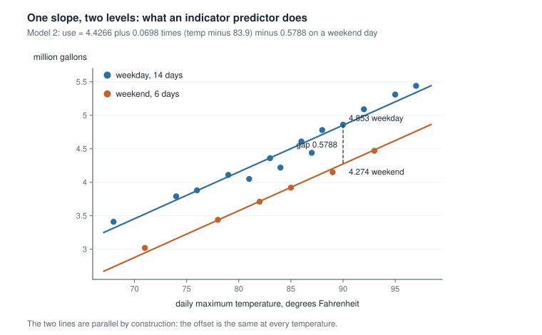
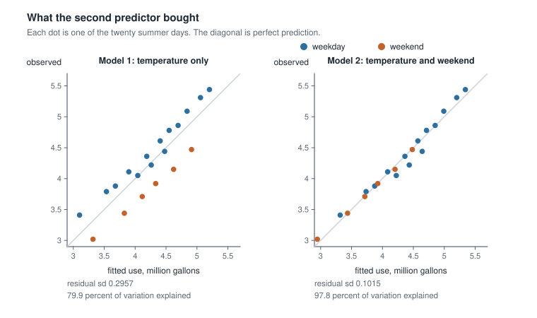
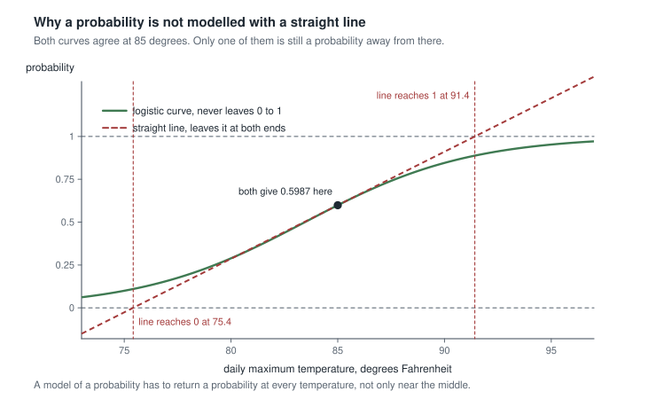
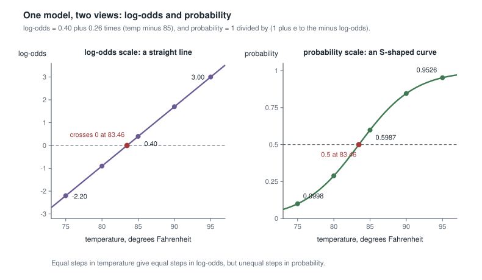
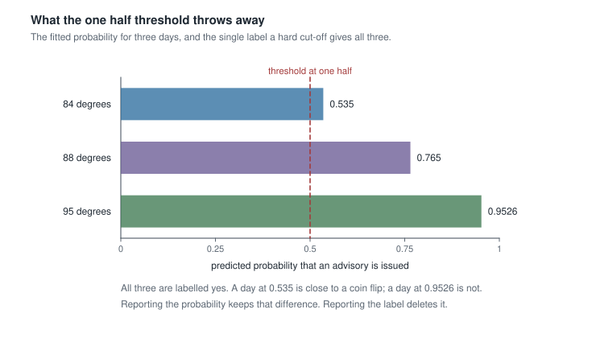

# Week 10 — Regression with several predictors and binary outcomes

## Where this week starts

Week 9 fitted one predictor to one outcome. The Vale Municipal Water Utility gave us twenty summer days, each with a maximum temperature and a total delivery of water in million gallons, and we described the second with a straight line in the first. The posterior mean of the slope was 0.0724 million gallons per degree, with a 95 percent credible interval of 0.0556 to 0.0892, the residual standard deviation was 0.2957, and the model explained about 0.799 of the variation in daily use.

It was also visibly incomplete. Some days sat well below the fitted line, and they were not scattered at random: they were the weekend days. A model that knows only the temperature has no vocabulary for saying "and this was a Saturday", so it cannot help being wrong about Saturdays systematically. This week gives it that vocabulary. We add an indicator equal to one on a weekend day and zero otherwise, and three things happen at once: the fit tightens sharply, the temperature slope moves a little, and its meaning changes even where its value barely does.

The second half of the week changes the outcome instead of the predictors. Plenty of quantities a utility cares about are yes-or-no: was a conservation advisory issued that day, did a valve fail, did a household enroll in a rebate. You cannot put a normal distribution on a quantity that is only ever zero or one, and a straight line on a probability eventually predicts a probability above one or below zero. Logistic regression is the standard repair: an ordinary linear model fitted on a transformed scale, then transformed back.

Two habits should feel automatic by Friday. When you read a coefficient, ask what else is in the model, because that changes the coefficient's meaning. When a model produces a probability, resist rounding it to a yes or a no, because the rounding is a decision and the probability is the evidence.

### Why this matters outside the classroom

Suppose the utility's operations manager plans staffing from the Week 9 model alone. On a hot Saturday that model predicts a weekday's demand, over-forecasts by roughly half a million gallons, and a crew waits a shift for pumping never called for. The error is not random noise: it runs the same direction every weekend, which is exactly the error a model carrying the missing predictor would not make. A model can be well fitted, tightly estimated, and reliably wrong on an identifiable subset of days.

The binary half has a sharper version of the same stake. A utility that reports "an advisory is expected" on a day whose fitted probability is 0.53, and the same sentence where it is 0.95, has deleted the difference between a coin flip and a near certainty before anyone downstream saw it. A threshold is a decision rule chosen by someone with something at stake, and it belongs after the probability is reported, never instead of it.

## What you will be able to do

Work through this page with a calculator open, and you should be able to do each of the following.

- Write a two-predictor regression as a probability statement, and say what each coefficient claims when the others are held fixed.
- Code a categorical predictor with indicators, name the baseline category, and predict the outcome for any combination of values.
- Explain why a coefficient can change when a second predictor joins, and diagnose when that shift signals entangled predictors.
- Write a logistic regression, move between the probability, odds, and log-odds scales in both directions, and say what a slope of 0.26 means in odds.
- Interpret a fitted probability as a statement about one new day, and state what a threshold destroys when it turns that probability into a label.
- Say what a credible interval on a regression coefficient does and does not license.

## Terms and notation worth fixing

These are the symbols this page uses, with the meaning they carry here rather than elsewhere.

| Term or symbol | Meaning as used in this course |
|---|---|
| $x_i$ | a predictor's value for observation $i$; here the day's maximum temperature |
| $w_i$ | an indicator: $w_i = 1$ on a weekend day, $w_i = 0$ otherwise |
| $\beta_2$ | the coefficient on that indicator: the modelled shift between categories at a fixed temperature |
| baseline category | the category coded by zeros on every indicator; other categories are differences from it |
| $\pi_i$ | the probability that the binary outcome on day $i$ is a yes, so $0 \le \pi_i \le 1$ |
| odds | $\pi / (1 - \pi)$: how many times more likely a yes is than a no |
| log-odds | $\log\left(\pi / (1 - \pi)\right)$, the scale on which the logistic model is straight |
| $p(\tilde y \mid y)$ | the posterior predictive distribution for a new day |

## Adding a second predictor changes the question

The Week 9 model said the expected use on day $i$ is a straight-line function of temperature, centred at the twenty-day mean of 83.9 degrees Fahrenheit. Adding a predictor does not change the shape of that statement; it lengthens the mean.

$$
y_i \sim \text{Normal}\left(\beta_0 + \beta_1 (x_i - 83.9) + \beta_2 w_i, \; \sigma \right)
$$

In words: the water use on day $i$ is normally distributed around a mean built from three pieces, a level, a temperature term, and a weekend term, with a standard deviation $\sigma$ describing how far single days scatter around it. There are four unknowns now, and a Bayesian fit returns a joint posterior over all four; the summaries below are posterior means from such a fit, using the weakly informative priors Week 9 argued for. They are a weekday level of 4.4266 million gallons at the average temperature, a slope of 0.0698 per degree, and a weekend offset of $-0.5788$, with the residual standard deviation falling to 0.1015 and the proportion of variation explained rising to 0.978.

{fig-alt="Scatterplot of water use against temperature for twenty days, weekdays in blue and weekend days in orange, with two parallel fitted lines: the weekday line above and the weekend line 0.5788 below it, and the gap labelled at 90 degrees."}

The figure is the whole idea. Setting $w_i = 0$ gives one line; setting $w_i = 1$ gives a second, lower by exactly 0.5788 at every temperature, because $\beta_2$ multiplies nothing that varies. Two lines, one slope. The model asserts that the weekend effect is the same size on a cool day as on a hot one, an assumption you have made whether you noticed or not.

### What an indicator variable actually codes

An indicator is a column of ones and zeros standing in for a category. Here $w_i = 1$ on the six weekend days and $w_i = 0$ on the fourteen weekdays, so the weekday is the **baseline category**: the case the intercept describes on its own. That is why 4.4266 reads as "the modelled mean use on a weekday at 83.9 degrees" and not as an average over all days. Reverse the coding and the intercept would describe a weekend day while the offset flipped to $+0.5788$; every prediction would be identical, and only the reading would change.

A categorical predictor with three levels needs two indicators, not three. A third would be redundant, since the three columns always sum to one and the intercept could no longer be told apart from the category effects. In general a predictor with $J$ levels contributes $J - 1$ indicators, and the level left out is the baseline every other coefficient is measured against.

This is where a coefficient table is most often mis-read. The offset $-0.5788$ is not the difference between average weekend use and average weekday use in the data. It is the difference *at the same temperature*, a different quantity whenever the groups differ in temperature, and here they do.

### Why a coefficient moves when its company changes

The temperature slope was 0.0724 in Week 9 and is 0.0698 now, a drop of 0.0026 million gallons per degree. That is not an error in either fit. Temperature and day type are mildly entangled in this record: the fourteen weekdays average 84.29 degrees and the six weekend days average 83.0, so weekend days here are slightly cooler as well as lower in use. A model that cannot see day type must attribute the weekend days' lower use to something, and the only thing it can see is that they were a little cooler, so part of the weekend effect gets loaded onto the temperature slope, which comes out slightly steeper.

Once the indicator is present that borrowing stops, and 0.0698 answers a narrower question: among days of the same type, how much more water per additional degree? Week 9's 0.0724 answers a broader one: across summer days as they come, with both types mixed in this record's proportions, how much more water accompanies an additional degree? Neither number corrects the other, and which you want depends on what you will do with it.

{fig-alt="Two panels of observed against fitted water use with a diagonal reference line. In the left panel the six orange weekend days fall clearly below the diagonal; in the right panel all twenty days sit tightly on it."}

The panels plot observed use against each model's prediction. Under the temperature-only model the six weekend days sit below the diagonal, all of them, in the same direction. Under the two-predictor model the cloud collapses onto the line and the residual standard deviation falls from 0.2957 to 0.1015. Be exact about what that is not. Seeing a pattern in a plot is a suspicion, not a check; Week 11 turns it into a posterior predictive check with a stated test quantity. A tighter fit to days you already have is the cheapest thing in statistics to buy, and on its own it certifies nothing.

## Modelling a yes-or-no outcome

The same utility records something else about each summer day: whether it issued a voluntary conservation advisory asking customers to defer irrigation. That is a yes or a no, and the advisory log runs over several seasons rather than only the twenty days of Week 9's case, so there is enough of it to fit. Let $y_i$ equal one when an advisory was issued and zero otherwise, and let $\pi_i$ be the probability day $i$ gets one:

$$
y_i \sim \text{Bernoulli}(\pi_i)
$$

The job is to say how $\pi_i$ depends on temperature. The obvious first move, writing $\pi_i = \beta_0 + \beta_1 (x_i - 85)$ and fitting it like any other line, fails.

{fig-alt="A green logistic curve rising from near zero to near one, and a dashed red straight line matching it at 85 degrees but passing below zero near 75.4 degrees and above one near 91.4 degrees."}

A probability must stay between zero and one; a straight line will not. The dashed line is the one agreeing with the fitted logistic model at 85 degrees, where both give 0.5987. Follow it down and it reaches zero near 75.4 degrees, claiming a negative probability for a cool day; follow it up and it passes one near 91.4. Those are not near-misses; they are statements that are not probabilities at all, and any interval built on them inherits the nonsense.

### From probability to log-odds and back

The repair is to model something allowed to be any real number, then map it back. Start with the **odds**, $\pi / (1 - \pi)$, how many times more likely a yes is than a no. A probability of 0.5987 is odds of $0.5987 / 0.4013 = 1.4919$, about three to two. Odds fix the upper end, running from zero to infinity. Take the natural logarithm and the lower end is fixed too. The result is the **log-odds**, which ranges over all real numbers, and a straight line can live there:

$$
\log\left(\frac{\pi_i}{1 - \pi_i}\right) = \beta_0 + \beta_1 (x_i - 85)
$$

Solving for $\pi_i$ gives the inverse map, the logistic function:

$$
\pi_i = \frac{1}{1 + e^{-\left(\beta_0 + \beta_1 (x_i - 85)\right)}}
$$

The fitted posterior means for the advisory model are $\beta_0 = 0.40$ and $\beta_1 = 0.26$, with temperature centred at 85 degrees, and the 95 percent credible interval for the temperature coefficient runs from 0.17 to 0.36.

{fig-alt="Two panels. On the left, log-odds against temperature is a straight line of slope 0.26 crossing zero at 83.46 degrees. On the right, the same model on the probability scale is an S-shaped curve through 0.0998, 0.5987 and 0.9526."}

Both panels are the same model. On the left, equal steps in temperature give equal steps in log-odds: every degree adds 0.26, and the line crosses zero at 83.46 degrees, which is where the probability crosses one half. On the right, those equal steps give very unequal steps in probability. From 80 to 85 degrees the probability moves from 0.2891 to 0.5987, a change of about 0.310; from 90 to 95 it moves from 0.8455 to 0.9526, a change of about 0.107. When an advisory is nearly certain already, more heat has little room left to work.

### Reading a logistic coefficient in the problem's own units

"A slope of 0.26" means nothing to an operations manager, so translate it. Each degree adds 0.26 to the log-odds, and adding a constant on the log scale multiplies on the original scale, so the odds are multiplied by $e^{0.26} = 1.297$ per degree, and by $e^{1.3} = 3.669$ over five degrees. "Each extra degree multiplies the odds of an advisory by about 1.3" is the honest plain-language reading, and unlike any statement about probabilities it holds at every temperature.

The interval carries over the same way: 0.17 to 0.36 on the log-odds scale becomes $e^{0.17} = 1.185$ to $e^{0.36} = 1.433$, so the model puts 95 percent posterior probability on the per-degree odds multiplier lying between about 1.19 and 1.43. That is a statement about the parameter given this model and this prior, and it feels considerably less tidy in words than 0.26 does.

## Worked example — twenty summer days with two predictors

Take the utility's twenty summer days exactly as Week 9 recorded them: for each day, the maximum temperature, an indicator for Saturday or Sunday, and the water delivered in million gallons. The mean temperature is 83.90, the mean use is 4.253, and there are fourteen weekdays and six weekend days. Nothing about the data changes this week; only the model does.

**Step 1: write the model.** Mean use on day $i$ is $\beta_0 + \beta_1 (x_i - 83.9) + \beta_2 w_i$, with days scattering around it with standard deviation $\sigma$. Temperature is centred so that $\beta_0$ describes a real day, an average-temperature weekday, rather than a day at zero degrees.

**Step 2: read the posterior summaries.** The posterior means are $\beta_0 = 4.4266$, $\beta_1 = 0.0698$, $\beta_2 = -0.5788$, and $\sigma = 0.1015$.

**Step 3: say what each claims.** The level 4.4266 is the modelled mean use on a weekday at 83.9 degrees. The slope 0.0698 is the modelled increase per degree, comparing days of the same type. The offset $-0.5788$ is the modelled drop on a weekend day against a weekday at the same temperature. The residual standard deviation 0.1015 says that once type and temperature are accounted for, single days scatter around their predicted mean by about a tenth of a million gallons.

**Step 4: predict a specific day.** For a weekday at 90 degrees, temperature enters as $90 - 83.9 = 6.1$ degrees above average, so the predicted mean use is $4.4266 + 0.0698 \times 6.1 = 4.4266 + 0.4258 = 4.8524$; carrying the slope at full precision gives the value the fit reports, 4.853 million gallons. For a weekend day at the same 90 degrees, subtract the offset: $4.853 - 0.5788 = 4.274$. The gap between those predictions is the offset itself, and it would be the same gap at 78 degrees or at 95.

**Step 5: separate the mean from the day.** Those are predicted *means*. A single new weekday at 90 degrees also carries the scatter $\sigma = 0.1015$, so a predictive interval for that one day is roughly two standard deviations either side of 4.853, about 4.65 to 5.06, before allowing for uncertainty in the coefficients themselves. That is Week 6's distinction between estimating a parameter and predicting an observation, now inside a regression.

**What this licenses, and what it does not.** It licenses saying that, under this model and these priors, weekend days in this record run about 0.58 million gallons below comparable weekdays. It does not license "weekends cause lower water use": the indicator labels a bundle of things that differ on weekends, from irrigation schedules to business demand. Nor does it license extrapolating to a 105-degree day, or to winter, about which this record says nothing.

Here is code that fits both models, shown so you can run it, not so you can read numbers off it.

```r
# Case E: twenty summer days from the Vale Municipal Water Utility.
util$temp_c <- util$temp - mean(util$temp)   # centre at 83.9

fit1 <- lm(use ~ temp_c, data = util)                # Week 9's model
fit2 <- lm(use ~ temp_c + weekend, data = util)      # this week's model
summary(fit2)

# Predicted mean use, weekday and weekend, at 90 degrees.
predict(fit2, newdata = data.frame(temp_c = 90 - 83.9, weekend = c(0, 1)))
```

Least squares is not a Bayesian fit, but with weakly informative priors it lands close to the posterior means, which makes it a useful arithmetic check while you are learning. The Bayesian fits come from the regression functions in the `rstanarm` package, which return draws from the joint posterior rather than one estimate per coefficient.

### The same reasoning, transferred

Move the structure to a different setting and a categorical predictor with more levels. A community swimming pool records daily electricity use, in kilowatt-hours, against the day's maximum temperature and a day type with three levels: weekday, Saturday, and Sunday. Three levels need two indicators, so the model carries one for Saturday and one for Sunday, and the weekday is the baseline. Suppose the fitted posterior means give a weekday level of 240 kilowatt-hours at 85 degrees, a temperature slope of 5.0 per degree, a Saturday offset of $+55$, and a Sunday offset of $+30$.

Predicting is the same addition. A Saturday at 90 degrees is $240 + 5.0 \times 5 + 55 = 320$ kilowatt-hours; a Sunday at 90 degrees is $240 + 25 + 30 = 295$. What stayed the same: one shared slope, level shifts by category, a baseline the intercept describes, and coefficients that mean "at the same temperature". What changed: three categories, so two indicators, and a new quantity that is not a coefficient at all. The Saturday-to-Sunday difference is $55 - 30 = 25$ kilowatt-hours, and in a Bayesian fit you would get its posterior by taking that difference inside every posterior draw rather than by subtracting two summaries.

## Second worked example — an advisory read off a threshold

This one is a failure rather than a clean application, and the failure is in the reporting rather than the fitting. An analyst takes the advisory model, log-odds $= 0.40 + 0.26 \, (x - 85)$, computes each day's probability, and labels every day above one half as "advisory expected". The model is fine. The report is not.

**Step 1: compute three days.** At 84 degrees the log-odds are $0.40 + 0.26 \times (-1) = 0.14$. Since $e^{-0.14} = 0.8694$, the probability is $1 / 1.8694 = 0.535$. At 88 degrees the log-odds are $0.40 + 0.26 \times 3 = 1.18$, and $e^{-1.18} = 0.3073$, giving $1 / 1.3073 = 0.765$. At 95 degrees they are $0.40 + 0.26 \times 10 = 3.00$, giving 0.9526.

**Step 2: apply the analyst's rule.** All three exceed one half, so all three days are labelled "advisory expected" and the report shows three identical entries.

{fig-alt="Three horizontal bars of predicted advisory probability, 0.535 at 84 degrees, 0.765 at 88 degrees and 0.9526 at 95 degrees, all crossing a dashed threshold line at one half and all labelled yes."}

**Step 3: see what was deleted.** The 84-degree day is barely distinguishable from a coin flip: the model gives it a 0.465 chance of no advisory, against 0.047 for the 95-degree day. Those days are not remotely alike, and after the threshold they are indistinguishable in the report. The part of the posterior that says *how sure* has been discarded in the final step.

**Step 4: notice the quieter failure.** The threshold of one half is doing work nobody declared. One half is the right cut only when a false yes and a false no cost the same. Here they plainly do not: an unnecessary advisory costs some goodwill, while missing a day that needed one can cost pressure across the network. A manager who weighs a miss five times more heavily should act at a much lower probability, and that weighting is a judgment about consequences, not a fact the data supply. Week 14 takes this up properly.

**Step 5: report it correctly instead.** Give the probability with its uncertainty and let the threshold be applied afterwards by whoever owns the consequence. The honest object is the posterior predictive probability for the new day, got by computing the logistic probability inside every posterior draw of the coefficients: a distribution over $\pi$, summarized as a fitted probability with an interval rather than one number pretending to be exact.

```r
# Fit on the advisory log, then predict on the probability scale.
adv$temp_c <- adv$temp - 85
fit_adv <- glm(advisory ~ temp_c, data = adv, family = binomial)

# The fitted probability for an 84-degree day, on the probability scale.
plogis(predict(fit_adv, newdata = data.frame(temp_c = 84 - 85)))
```

**What went wrong, in one sentence.** The analyst treated a probability as a classifier, and a classifier is what you get only after combining a probability with a stated loss.

## The misreading to avoid

Here is the sentence students write every year: "The temperature coefficient dropped from 0.0724 to 0.0698 when the weekend indicator was added, so one of the two models must be wrong."

Neither is wrong, and the sentence hides an assumption worth naming: that a predictor has one true coefficient a correct model would recover. It does not. A coefficient is defined relative to the other predictors beside it. Week 9's 0.0724 is the modelled change in mean use per degree across summer days as they come, both types mixed in this record's proportions. This week's 0.0698 is the modelled change per degree among days of the same type. Two different questions give two different numbers, and had they come out identical it would only mean temperature and day type happened to be unentangled here.

The size of the movement is itself a diagnostic. Here it is small, 0.0026, because the two groups differ in average temperature by only about 1.3 degrees; had the weekend days been ten degrees cooler, the same offset would have distorted the slope far more. A large shift when a predictor is added tells you the predictors are strongly entangled in your data.

Two relatives travel with it. The first is "the credible interval for the weekend offset excludes zero, so weekends cause lower use": a credible interval is a statement about a parameter under a model, and the indicator labels a calendar category, not a mechanism. The second is "the two-predictor model explains 0.978 of the variation, so it is the right model": a larger explained proportion on the days you fitted is nearly free, since adding predictors can hardly ever lower it, and it says nothing about a day the model has not seen. Even a model that wins Week 11's held-out comparison is a description that survived the checks someone thought to run.

## Practice on your own

These are for your own checking, not for submission. Work them with a calculator and compare against the arithmetic above.

1. Using Model 2, predict mean use for a weekday and a weekend day at 78 degrees, confirm the difference matches the one at 90 degrees, and say why the model forces that.
2. Re-code the indicator so weekdays get a one and weekend days a zero. Write down the new intercept and offset, and check that both codings predict the same use for a weekend day at 88 degrees.
3. For the advisory model, compute the probability at 82 and at 87 degrees from the log-odds, then compute the ratio of the odds at those temperatures and confirm it equals $e^{0.26 \times 5}$.
4. The pool example has three day types. Write out both indicator columns for a week of days, predict Sunday use at 96 degrees, and say which quantity you would need a posterior for if the manager asked whether Saturdays and Sundays differ.
5. A manager tells you a missed advisory is four times as costly as an unnecessary one. Without new modelling, argue what that should do to the probability at which the utility acts, and why the model cannot supply that number.

## Where to read more

This week aligns with two chapters of the course's primary text. Read them alongside these notes; the explanations here were written independently of them.

- [Bayes Rules! Chapter 11](https://www.bayesrulesbook.com/chapter-11), one of this week's two aligned chapters.
- [Bayes Rules! Chapter 13](https://www.bayesrulesbook.com/chapter-13), the other aligned chapter for this week.
- [Bayes Rules! home page](https://www.bayesrulesbook.com/), the course's primary text.
- [The R Project for Statistical Computing](https://www.r-project.org/) and [Quarto](https://quarto.org/), the tools you fit and write this in.
- The course [schedule](../schedule.qmd), the [notes index](index.qmd), and the [resources page](../resources/index.qmd). Week 9's development is at [week-09.qmd](week-09.qmd); re-read its section on centring.

## Where this goes next

Week 11 does what this page kept deferring. It builds posterior predictive checks properly: simulate replicated data sets from a fitted model, pick a test quantity sensitive to a failure you would care about, and compare what you saw against what the model says you should have seen. The weekend structure we simply asserted here gets *discovered* there, by a check that can fail, and the two models get compared on how well each predicts a day it was not fitted to. That is the difference between a model that fits and a model that has been tested, and it is why this page called the tighter fit an improvement and not a vindication.

Bring three things with you: the two-predictor model, the habit of asking what else is in the model before reading a coefficient, and the discomfort you should feel about a report saying yes or no where a probability was available. The [notes index](index.qmd) has the full sequence, and the [course home page](../index.qmd) has the rest of the site.
