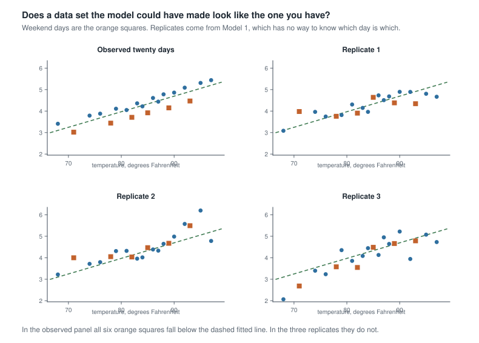
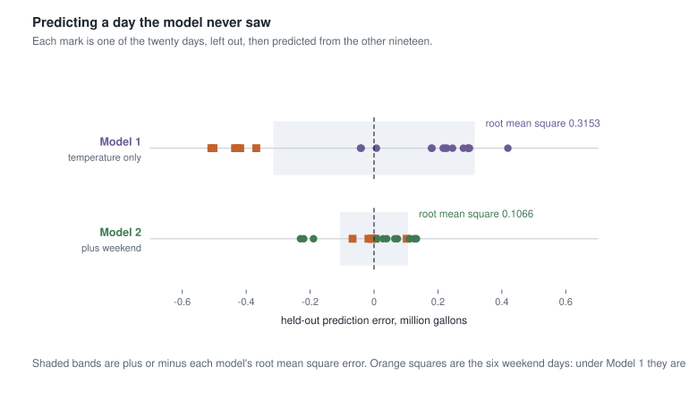
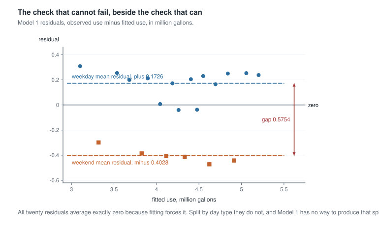
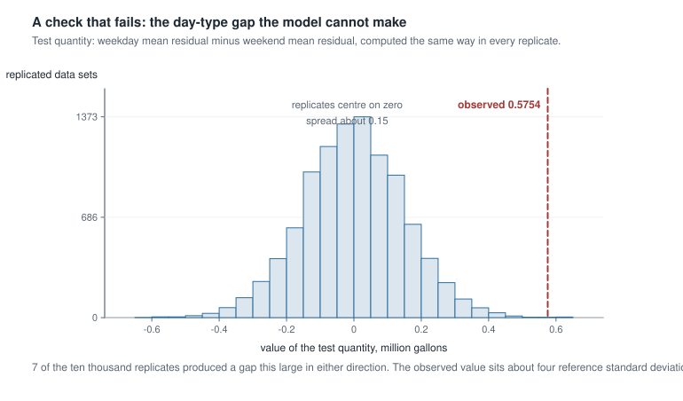
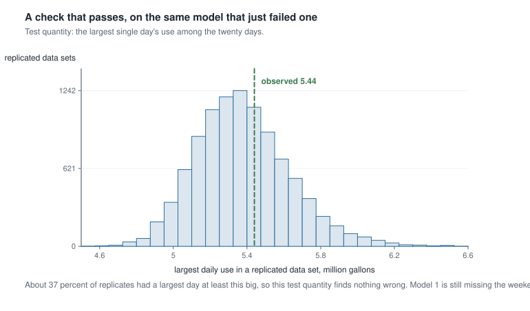

# Week 11 — Model checking and model comparison

## Where this week starts

For ten weeks this course has been building models and reading what comes out of them. What it has not yet done is ask the harder question. Not "what does this model say?" but "could this model have produced the data I actually have?"

Week 9 fitted the Vale Municipal Water Utility's twenty summer days with temperature alone; Week 10 added a weekend indicator and watched the fit tighten. Both weeks cheated slightly, and said so. Week 9 noticed by eye that some days sat below the line, and Week 10 asserted those days were the weekends. Neither ran a procedure that could have come back and said "no, the model is fine". That is what this week supplies: a check with a stated question, a stated reference, and the genuine possibility of a clean result.

The machinery is one idea. If a model is right, data sets simulated from the fitted model should look like the data set you have. Simulate a few thousand of them, pick a number computable from any data set, compute it in every simulated set and in the real one, and see where the real one falls. That number is the **test quantity**, written $T(y)$, and choosing it well is the whole craft. Choose a quantity the fitting process forces to come out right and the check cannot fail; choose one sensitive to a way the model might be wrong that you would care about, and it can, which is the only kind worth running.

The second half of the week compares models rather than checking one. A model that fits the days you already have is easy to build; one that predicts a day it has never seen is harder and more useful. Leave-one-out cross-validation makes that concrete, and by Friday you should be able to say what a comparison establishes: that one model predicted a held-out day better, on this data, among the models compared. Not that it is true, not that it is causal, and not that you may stop checking.

### Why this matters outside the classroom

The utility's Week 9 model is well fitted, tightly estimated, and wrong every Saturday and Sunday by roughly half a million gallons in the same direction. Nothing in the ordinary summary output says so: the residual standard deviation averages over both kinds of day, the proportion of variation explained is nearly 0.80, and the credible interval for the slope is narrow and comfortably away from zero. A manager reading only those numbers would keep over-forecasting weekends for as long as the model was in service. The failure was there for anyone who thought to split the residuals by day of the week, and invisible to anyone who did not.

The reverse mistake carries the other half of the stake. A model that passes a check gets promoted in people's minds from "not yet caught out" to "correct", and the checking stops. A statistical result is evidence, not a verdict.

## What you will be able to do

Work through this page with a calculator, and each of these should be something you can carry out.

- Simulate replicated data sets from a fitted model and say in plain language what each replicate represents.
- Choose a test quantity $T(y)$ that is sensitive to a specific way a model could be wrong, and explain why the fitting process does not force it to come out right.
- Compare an observed test quantity against its reference distribution, and read off a posterior predictive p-value without treating it as a significance test.
- Identify a check that cannot fail, and say what it would have taken to make it informative.
- Carry out leave-one-out cross-validation on a small data set by hand, and compare two models by held-out prediction error.
- State exactly what a model comparison licenses, and name at least two conclusions it does not license.

## Terms and notation worth fixing

These are the symbols this page uses, with the job each holds here.

| Term or symbol | Meaning as used in this course |
|---|---|
| $y$ | the data you actually observed; here the twenty days' water use |
| $y^{\text{rep}}$ | replicated data: a twenty-day data set the fitted model says could have replaced $y$ |
| $T(y)$ | a test quantity: any number computable from a data set, observed or replicated |
| reference distribution | the spread of $T(y^{\text{rep}})$ across many replicates, the yardstick $T(y)$ is judged against |
| posterior predictive p-value | the fraction of replicates whose test quantity is at least as extreme as the observed one |
| residual | observed value minus the value the fitted model predicts for that same observation |
| held-out error | the error a model makes on an observation that was not used to fit it |
| $M_1, M_2$ | the temperature-only model and the temperature-plus-weekend model |

## Checking a model against data it could have made

Start from what a fitted Bayesian model is. Not a line: a joint posterior over every unknown, in which every draw is one complete description of how the data were generated. For Week 9's water model that means an intercept, a slope, and an observation-level standard deviation $\sigma$, drawn together. Take one such draw, generate a fresh water-use value for each of the twenty days at their real temperatures, and you have one **replicated data set**: twenty numbers the fitted model regards as an ordinary alternative to the twenty you observed.

Do that a few thousand times and you have a picture of what this model thinks summer looks like. The question a posterior predictive check asks is then disarmingly simple. Put your real data beside that pile of simulated data. Does it belong?

### Simulating replicated data sets

The recipe has four steps, and the fourth is the one students skip.

1. Draw one set of parameter values from the posterior. Not the posterior means: a draw, so uncertainty about the parameters travels into the replicate.
2. Using those values, generate a value for every observation, at the real predictor values.
3. Repeat, keeping each replicated data set.
4. Compare, using a quantity chosen in advance because it would reveal a failure you care about.

Skipping step four turns the exercise into a picture-matching game, though the picture is where intuition starts.

{fig-alt="Four small scatterplots of water use against temperature with the fitted line dashed. In the observed panel all six orange weekend squares fall below the line; in the three replicated panels the orange squares scatter above and below it."}

Look at the four panels without reading the labels, and one is different. In the observed panel every one of the six orange squares, the weekend days, sits below the dashed line. In the replicated panels they land above and below it, four of six below in the first, one of six in the second, four of six in the third. A test quantity is what turns that impression into a number.

### Choosing a test quantity that can fail

A test quantity is any function of a data set. The freedom is total, and that is the difficulty: a badly chosen one is worse than useless, because it produces a reassuring result for no reason.

What matters is whether the fitting process forces agreement. Fit a regression by any of the usual routes and the residuals are built to average zero, because the intercept is chosen to make it so. Compute the mean residual on the observed data and you get zero; compute it on any replicate and refit, and you get zero there too. The observed value sits at the centre of a reference distribution with no spread at all, and a student who reports "the mean residual is zero, so the model fits" has reported the arithmetic of least squares rather than a property of the world.

A test quantity that can fail is one the fit does not control, and splitting the residuals by a variable the model never saw gives exactly that. Nothing in the temperature-only model constrains weekend residuals to resemble weekday residuals, so if the two groups differ systematically, the check has room to say so.

Two other families are worth having in hand: an extreme, the largest or smallest value, which probes the model's tails, and a count, how many observations exceed some level or are exactly zero, which probes its shape. In every case write the quantity and your reason down before computing it.

## Comparing models by what they predict

Checking asks whether one model is contradicted by the data. Comparing asks which of several models to prefer. Those are different questions, and the second is not answered by the first.

The tempting comparison is fit. Model 2 explains 0.978 of the variation in the twenty days against Model 1's 0.799, and the residual standard deviation falls from 0.2957 to 0.1015. Both numbers are computed on the same days used to choose the coefficients, and a model with more predictors can nearly always be made to fit better that way; taken far enough, one reproduces every observation exactly and predicts nothing. In-sample fit mixes how flexible the model was with how well it caught the structure, and the number alone cannot tell you which you are seeing.

### Leave-one-out cross-validation, one day at a time

Out-of-sample prediction separates them, by making the model earn its accuracy on data it has not seen. With a small data set, hold out one observation at a time.

Set one day aside. Fit the model to the other nineteen. Predict the day you set aside, and record the error. Put it back, take out the next one, and repeat until every day has had a turn. You end with twenty held-out errors, none from a fit that had seen the day it was predicting.

Two summaries of those errors are standard: the **root mean square error**, which squares each error, averages, and takes the square root, so large misses count heavily; and the **mean absolute error**, which averages the sizes and treats a miss of 0.4 as twice as bad as a miss of 0.2. Report both when they disagree, since that tells you the errors are unevenly sized.

For the utility's two models, Model 1 has a leave-one-out root mean square error of 0.3153 million gallons and a mean absolute error of 0.2805; Model 2 has 0.1066 and 0.0783. Model 2 predicts a held-out day roughly three times more accurately, since $0.3153 / 0.1066 = 2.96$.

{fig-alt="Two horizontal rows of held-out errors. Model 1's spread from about minus 0.51 to plus 0.42 with a wide shaded band of 0.3153; Model 2's cluster near zero inside a narrow band of 0.1066, with the orange weekend squares no longer extreme."}

Two details repay attention. Under Model 1 the six orange weekend squares are among the worst misses, all on the negative side, which is the residual check's failure in a different currency; under Model 2 they are unremarkable. And in both rows the held-out error exceeds the in-sample residual standard deviation, 0.3153 against 0.2957 and 0.1066 against 0.1015. That gap is the price of having used each day to help choose the coefficients that then predict it, and it is exactly the optimism in-sample fit hides.

### What a comparison establishes and what it does not

Say the conclusion carefully, because the careless version travels. What the comparison establishes: of these two models, fitted to these twenty days with these priors, Model 2 predicted a held-out day substantially better.

What it does not establish. Not that Model 2 is true: both models are false in the ordinary sense that daily water use is not generated by a straight line plus normal noise, and ranking two descriptions is not certifying one. Not that weekends cause lower use: the indicator labels a calendar category standing in for irrigation schedules, business demand, and whatever else moves on a Saturday. Not that Model 2 is the best available model, only that it beat the one it was compared against; a third model carrying humidity was never in the running. And not that you may stop: Model 2 has faced neither the day-type check that broke Model 1 nor any other, and a model that wins a comparison is exactly as unchecked as before it won.

## Worked example — the utility's weekend, found by a check

Here is the whole week on one data set. The Vale Municipal Water Utility's twenty summer days are exactly as Week 9 recorded them: a maximum temperature, an indicator for Saturday or Sunday, and total delivery in million gallons. Fourteen are weekdays and six are weekend days, the mean temperature is 83.90 degrees Fahrenheit, and the mean use is 4.253 million gallons. Model 1 is the temperature-only model, with posterior means $\beta_0 = 4.253$, $\beta_1 = 0.0724$, and $\sigma = 0.2957$. Pretend nobody has yet noticed anything about weekends.

**Step 1: pick a test quantity that could fail.** Take $T(y)$ to be the mean residual on weekdays minus the mean residual on weekend days. It is computable from any data set, real or replicated, and nothing in the fitting of Model 1 constrains it, since that model never sees the day type.

**Step 2: compute it on the observed data.** Each day's residual is its use minus its fitted value. For the weekend day at 89 degrees the fitted value is $4.253 + 0.0724458 \times (89 - 83.9) = 4.253 + 0.3695 = 4.6225$, and the observed use was 4.15, so the residual is $4.15 - 4.6225 = -0.4725$, the largest miss in the record. For the weekday at 92 degrees the fitted value is $4.253 + 0.0724458 \times 8.1 = 4.8398$ against an observed 5.09, a residual of $+0.2502$. Averaging all twenty within groups gives $+0.1726$ on the fourteen weekdays and $-0.4028$ on the six weekend days, so $T(y) = 0.1726 - (-0.4028) = 0.5754$ million gallons.

**Step 3: confirm the uninformative check first.** The overall mean residual is $\left(14 \times 0.1726 + 6 \times (-0.4028)\right) / 20 = (2.4164 - 2.4168)/20$, zero to the rounding shown and exactly zero before it. Every replicate gives zero as well, so that check has a reference distribution with no width. It is the check that cannot fail.

{fig-alt="Residuals against fitted water use for twenty days. Blue circles for weekdays scatter around a dashed line at plus 0.1726; six orange weekend squares all sit below zero around a dashed line at minus 0.4028, with the gap of 0.5754 marked."}

**Step 4: build the reference distribution.** Ask what $T(y^{\text{rep}})$ would look like if Model 1 were right. Under the model the residuals in a replicate are independent draws with standard deviation $\sigma$, so a mean of fourteen of them and a mean of six of them differ by an amount centred on zero with standard deviation $\sigma \sqrt{1/14 + 1/6} = 0.2957 \times \sqrt{0.2381} = 0.2957 \times 0.4880 = 0.1443$. That hand calculation holds $\sigma$ and the fitted line fixed. A full check draws the parameters from the posterior and refits every replicate; a run of 10,000 replicates done that way gave a reference spread of about 0.15, close enough to trust the hand figure.

**Step 5: locate the observed value.** The observed 0.5754 against a reference standard deviation of 0.1443 is $0.5754 / 0.1443 = 3.99$, about four standard deviations from a centre of zero. In the same run of 10,000 replicates, about seven produced a gap that large in either direction, a posterior predictive p-value of roughly 0.0007.

{fig-alt="Histogram of the weekday minus weekend mean residual across ten thousand replicated data sets, centred on zero with spread about 0.15, and a dashed red line at the observed 0.5754 well beyond the right edge of the histogram."}

**What this licenses, and what it does not.** It licenses saying that Model 1 is contradicted by these data in a specific, named way: it cannot produce the systematic gap the record shows, and the direction of that gap points at a missing predictor. It does not say what the right model is. Deciding the repair is a weekend indicator rather than an irrigation-schedule variable that happens to change on weekends is a modelling judgment, informed by the check but not delivered by it.

Here is the shape of the code, shown to run rather than to read numbers off.

```r
# Case E: twenty summer days from the Vale Municipal Water Utility.
util$temp_c <- util$temp - mean(util$temp)
fit1 <- lm(use ~ temp_c, data = util)

# The test quantity, computed the same way on any data set.
gap <- function(resid, weekend) {
  mean(resid[weekend == 0]) - mean(resid[weekend == 1])
}
gap(residuals(fit1), util$weekend)

# One replicated data set from the fitted model, then refit and recompute.
y_rep <- rnorm(20, mean = fitted(fit1), sd = summary(fit1)$sigma)
gap(residuals(lm(y_rep ~ util$temp_c)), util$weekend)
```

Running that last pair of lines a few thousand times and marking where the observed 0.5754 falls is the whole check. The Bayesian version draws the parameters from the posterior instead of fixing them at the fitted values, which the regression functions in the `rstanarm` package give you directly.

### The same reasoning, transferred

Move to a different family, data shape, and test quantity, and the steps do not change. A campus bike-share dock logs rentals in each of twenty-four hours, and the first model is a Poisson with a single rate $\lambda$, fitted with posterior mean 3.0 rentals per hour. The worry is not a missing group; it is that the dock sits empty for long stretches, so the model may be wrong about zeros.

Take $T(y)$ to be the number of hours with no rentals at all. Under a Poisson with rate 3.0, one hour is empty with probability $e^{-3} = 0.0498$, so across twenty-four hours the count of empty hours has mean $24 \times 0.0498 = 1.195$ and standard deviation $\sqrt{24 \times 0.0498 \times 0.9502} = \sqrt{1.136} = 1.066$. If the record has eight empty hours, then $(8 - 1.195)/1.066 = 6.38$: more than six standard deviations above what this model can comfortably produce.

What stayed the same: a quantity the fit does not control, a reference distribution built from the fitted model, and an observed value located inside it. What changed: the family is Poisson rather than normal, the test quantity is a count rather than a difference of means, and the reference distribution is closed form, since a count of empty hours is binomial once the rate is fixed. What it suggests differs too: not a missing predictor but a mismatch in shape, the sort of thing a model allowing extra zeros would address.

## Second worked example — a model that passed the checks it was given

This example is a failure of process rather than arithmetic, and the more common failure in practice. An analyst is handed Model 1 and asked whether it is adequate. They run three things, all defensible-looking, and report that the model checks out.

**Their first check: the mean residual.** They compute it, get zero, and record that the model is unbiased. Fitting forces this, as Step 3 above showed: the reference distribution is a spike, the observed value is on it, and no information changed hands.

**Their second check: the proportion of variation explained.** They report 0.799 and call it strong, having compared it against nothing at all. A number reported without a yardstick is a summary, not a check. And this one would not have become a check even with a yardstick attached. The proportion of variation explained is a function of a data set, so it has a reference distribution like any other test quantity: compute it on every replicate and look at the spread. Do that, refitting each replicate the way the observed data were fitted, and the middle 95 percent of the replicate values run from about 0.51 to about 0.92, with the observed 0.799 landing near the middle, at roughly the 51st percentile. It lands there by construction. The quantity is measured on the same days used to choose the coefficients, so refitting a replicate reproduces that replicate's own in-sample fit, and the weekend failure this model actually has does not move the number. Contrast the mean residual, whose reference distribution has no width at all: this one is wide and still uninformative, because its width runs in a direction unrelated to the way the model is wrong.

**Their third check: the largest day.** This one is real, and properly done. The largest observed use is 5.44 million gallons, on the 97-degree day, and they ask how often a replicate's largest day reaches it.

{fig-alt="Histogram of the largest daily use across ten thousand replicated data sets, spread from about 4.9 to 5.9 million gallons, with a dashed green line at the observed 5.44 sitting inside the bulk near the middle."}

**What the third check found.** In a run of 10,000 replicates, about 37 percent had a largest day at least that big, so the observed maximum is ordinary under this model. That is a genuine result: the upper tail is not obviously wrong, and had the maximum come out at, say, 6.8, this check would have caught it. It could have failed, and it did not.

**Where the report goes wrong.** The analyst writes that the model passed its checks and is suitable for forecasting. Two of the three were not checks, and the third asked about the tail. None asked whether the model was systematically wrong on an identifiable subset of days, the failure actually present, worth about half a million gallons every Saturday and Sunday, and findable in one line of arithmetic. A clean result on the maximum is perfectly compatible with being badly wrong about weekends, because the two questions are unrelated.

**How to write it up honestly instead.** Report what was checked, what each check could have caught, and what was found. "The upper tail was checked with the largest observed day and found unremarkable, about 37 percent of replicates being as extreme. Residual behaviour by day type was checked and failed, with a weekday-to-weekend gap of 0.5754 million gallons against a reference spread of about 0.15." That makes the boundary of the evidence visible instead of hiding it behind the word "passed".

## The misreading to avoid

Here is the sentence to watch for, in your own writing as much as anyone else's: "The model passed the check, so the model is correct."

A check is a question, not a verdict. Passing means one specific way of being wrong was looked for and not found, in one data set, with one test quantity, against a reference distribution built by assuming the model is right. Model 1 passed a real check on its largest day while being, at that moment, systematically wrong on six of the twenty days. Nothing about that check was misleading; it answered the question it was asked. A model can pass every check you thought to run and still be wrong in a way you did not think to check, and no amount of passing converts a description into a truth.

Two relatives travel with it. The first is "the check failed, so the model is worthless". A failed check identifies a discrepancy, and how much it matters depends on what the model is for: one wrong by half a million gallons on weekends may be fine for a seasonal total and useless for scheduling a Saturday crew.

The second is "Model 2 won the comparison, so Model 2 is correct". Cross-validation ranks the models you gave it, and if every model on the list misses the same predictor it still returns a winner, wrong in the same way as the rest. Both misreadings share a root: treating a procedure as though it settled something, when what it did was supply evidence about one narrow question.

## Practice on your own

These are for your own checking, not for submission. Work them with a calculator against the arithmetic on this page.

1. Using Model 1's posterior means, compute the fitted value and residual for the 71-degree weekend day, whose use was 3.02, and the 68-degree weekday, whose use was 3.41. Say which the model handles worse, and whether that surprises you.
2. Suppose the record had ten weekdays and ten weekend days instead of fourteen and six, with the same residual standard deviation of 0.2957. Recompute the reference standard deviation for the day-type gap, and say whether a gap of 0.5754 would then be more or less extreme.
3. Propose a test quantity that could reveal a failure Model 2 might plausibly have, and say why the fit does not force it to come out right. Then propose one the fit does force.
4. Carry out one leave-one-out step by hand for Model 1. Drop the 89-degree weekend day, refit on the other nineteen (mean temperature 83.63, mean use 4.2584, refitted slope 0.0746), predict the dropped day, and compare the held-out error with that day's ordinary residual of $-0.4725$. Explain why the held-out error is larger.
5. For the bike-share dock, suppose the record showed three empty hours rather than eight. Recompute how many standard deviations that is from the model's expectation, and say what you would conclude and what you would still want to check.

## Where to read more

This week aligns with Chapter 10 of the course's primary text. Read it alongside these notes; the explanations here are written independently and the notation may differ.

- [Bayes Rules! Chapter 10](https://www.bayesrulesbook.com/chapter-10), the chapter this week aligns with.
- [Bayes Rules! home page](https://www.bayesrulesbook.com/), the course's primary text.
- [The R Project for Statistical Computing](https://www.r-project.org/) and [Quarto](https://quarto.org/), the tools you fit and write in.
- The course [schedule](../schedule.qmd), [syllabus](../syllabus.qmd), [notes index](index.qmd), and [resources page](../resources/index.qmd).
- The two pages this one checks: [week-09.qmd](week-09.qmd) for the temperature-only model and [week-10.qmd](week-10.qmd) for the two-predictor model.

## Where this goes next

Week 12 steps back from models to statements. You will put a credible interval and a confidence interval side by side and say exactly what each claims, then do the same for a posterior probability and a p-value. This week is what makes that comparison honest rather than tribal: every interval and every probability in it is conditional on a model, and this is where you learned what conditioning costs and how you find out when it has failed you.

Bring three habits forward. Write your test quantity down before you compute it. Ask of every reassuring number whether the fit forced it. And when you report that a model passed, say what it passed and what nobody asked. The [notes index](index.qmd) has the full sequence, and the [course home page](../index.qmd) has the rest of the site.
