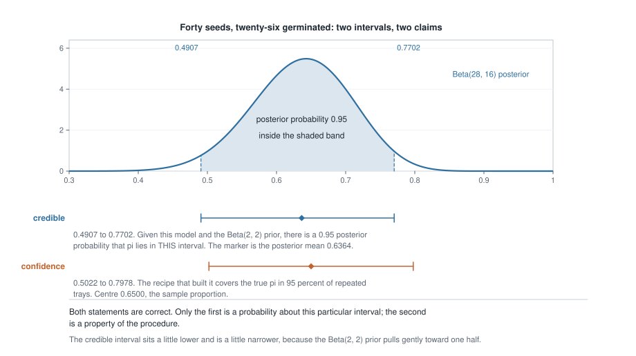
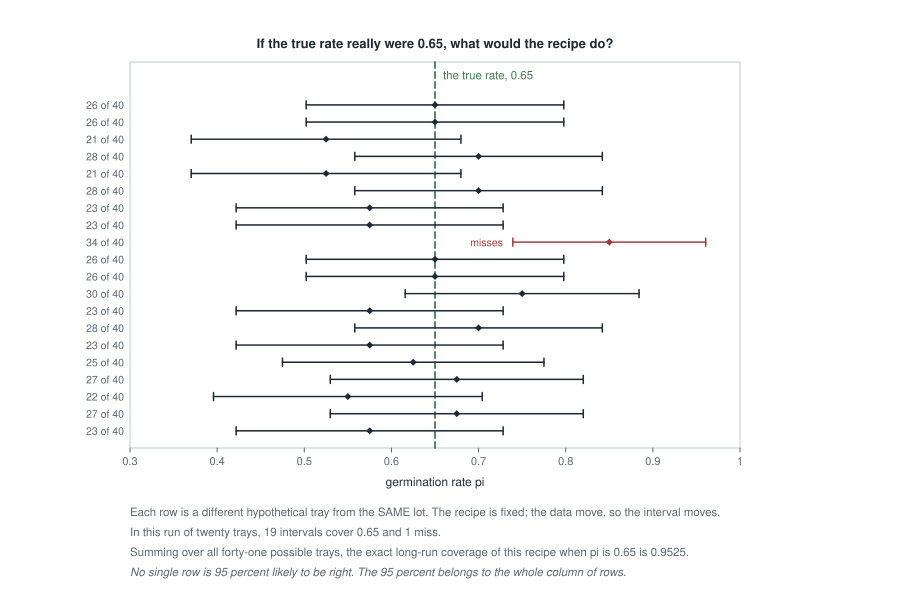
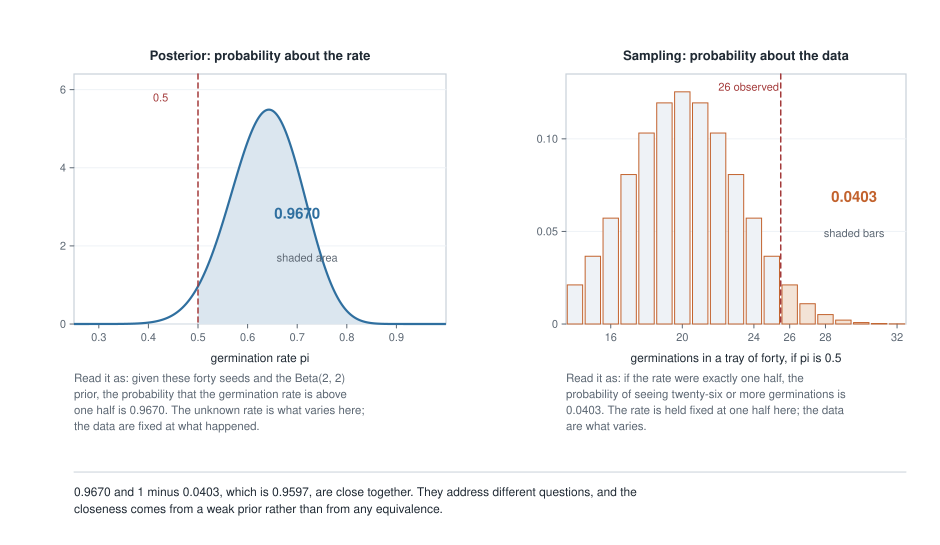
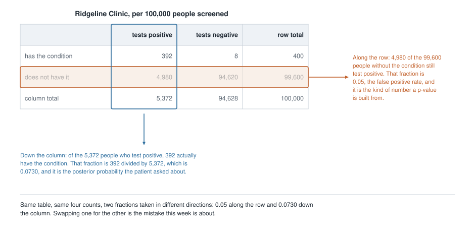
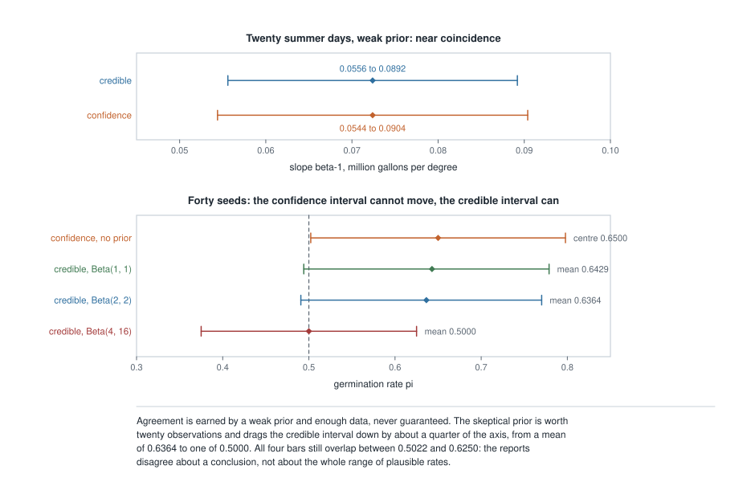

# Week 12 — Bayesian and classical inference in conversation

## Where this week starts

Eleven weeks in, you can build a posterior, summarize it, predict from it, check it, and compare two models with it. What you have not done is set those results beside what a classical course would produce from the same data and say how the two differ. That is this week's business, and the course intends to hold the conversation fairly: classical inference is not a mistake that Bayesian inference corrects, but a different guarantee bought with different assumptions.

Here is the week in one comparison. Week 4 took the Meridian seed lot, forty seeds planted and twenty-six germinated, put a Beta(2, 2) prior on the germination rate $\pi$ (read that as "the proportion of seeds in this lot that would germinate under these conditions"), and reported the posterior Beta(28, 16) with a central 95 percent credible interval from 0.4907 to 0.7702. A classical analysis of the identical tray reports the sample proportion $26/40 = 0.65$ with a 95 percent confidence interval from 0.5022 to 0.7978. Two intervals covering almost the same stretch of the number line, built by different reasoning. Only one permits the sentence most people say out loud when they see either.

The second half of the week does that job for one-number summaries. On the seed lot, $P(\pi > 0.5 \mid y) = 0.9670$ is a direct probability about the germination rate; a one-sided p-value from the same twenty-six germinations is 0.0403, a statement about data rather than about the rate. They sit close together, which is why students collapse them. By the end you should be able to pick up any reported interval or probability and say what was conditioned on what, and which sentences the report may write.

### Why this matters outside the classroom

A patient at a walk-in clinic tests positive on a screen for an uncommon condition. The false positive rate is 0.05, so somebody says "there is only a 5 percent chance this is a false alarm" and starts talking about treatment. In the Ridgeline Clinic figures Week 2 pinned down, that patient's probability of having the condition is 0.0730, about seven in a hundred, not ninety-five in a hundred. The two numbers are fractions of the same table taken in different directions, and the swap is the difference between reassurance and alarm.

The same swap runs through reports that never mention medicine: a p-value of 0.03 described as a 3 percent chance the effect is not real, an interval described as 95 percent likely to hold the parameter. Neither sentence follows from the number behind it.

## What you will be able to do

- **State what a 95 percent credible interval claims and what a 95 percent confidence interval claims**, and say which is a probability statement about the interval in front of you.
- **Compute both intervals for a proportion from the same data**, one from the Beta posterior and one from the sample proportion plus or minus 1.96 standard errors, and compare them.
- **Say exactly what a p-value conditions on**, write that conditioning in symbols, and explain why no rearrangement yields the probability that a hypothesis is true.
- **Name the conditions under which the two nearly coincide**, a weak prior and a shared likelihood, and produce a case where they do not.
- **Diagnose a transposed conditional** in someone else's sentence and rewrite it to match the quantity actually computed.
- **Write a responsible short report**: the model, the prior, the interval, what it claims, and what it does not settle.

## Terms and notation worth fixing

| Term or symbol | What it means in this course |
|---|---|
| credible interval | an interval carrying a stated posterior probability, read off $p(\theta \mid y)$ |
| confidence interval | an interval from a recipe whose long-run coverage is the stated level |
| coverage | the proportion of repeated hypothetical samples whose interval contains the true value |
| p-value | the probability, under a stated parameter value, of data at least as extreme as observed |
| sampling distribution | the distribution of a statistic across repeated data sets, parameter held fixed |
| transposed conditional | reading $P(A \mid B)$ as though it were $P(B \mid A)$ |
| $\pi$ | the unknown proportion being estimated, here one seed lot's germination rate |
| $\beta_1$ | the utility's slope of daily water use on temperature, million gallons per degree |

## Two intervals, two different claims

Both intervals come from the same data and are written the same way, a pair of endpoints with "95 percent" attached. The difference is in what is treated as random, and everything below follows from that. In the Bayesian account the data are fixed at what happened and the parameter is uncertain, so it gets a distribution. In the classical account the parameter is a fixed unknown constant with no distribution at all, and the data are what could have come out otherwise, so any probability statement must be about the procedure. Neither view is a trick; they are two questions asked in similar words.

### What the credible interval claims

The credible interval is read straight off the posterior. For the seed lot the posterior is Beta(28, 16), obtained by adding the twenty-six germinations to the first shape of the Beta(2, 2) prior and the fourteen failures to the second, and its central 95 percent interval runs from 0.4907 to 0.7702. The claim is: **given this model and this prior, the posterior probability that $\pi$ lies between 0.4907 and 0.7702 is 0.95.** The subject of that sentence is $\pi$: the interval is a fixed pair of numbers, and the probability describes where the unknown rate plausibly sits.

{fig-alt="A posterior curve peaking near 0.64, the band from 0.4907 to 0.7702 shaded and labelled as holding posterior probability 0.95, and below it two interval bars, a blue credible one marked at its mean 0.6364 and an orange one at 0.65."}

Two features are worth naming. The credible interval sits around the posterior mean 0.6364 rather than around the sample proportion 0.65, because the Beta(2, 2) prior contributes four observations' worth of pull toward one half. Be careful with the word centred, though: an equal-tailed credible interval is not generally centred on any summary of the posterior. The midpoint of 0.4907 and 0.7702 is 0.6305, which sits a little below the mean, because the lower arm of the interval is the longer of the two, $0.6364 - 0.4907 = 0.1457$ against $0.7702 - 0.6364 = 0.1338$. A confidence interval built as an estimate plus or minus a multiple of a standard error is symmetric by construction; a posterior read at its 2.5 percent and 97.5 percent quantiles is only as symmetric as the posterior itself, and this one is mildly lopsided. The second feature is width: $0.7702 - 0.4907 = 0.2795$ is a little under the classical 0.2956, because the prior added information the data alone did not. Both effects are small only because this prior is weak, as Week 5 showed.

### What the confidence interval claims

The classical interval for a proportion is the sample proportion plus or minus a multiple of its standard error. Writing the sample proportion as $\hat\pi$, so that $\hat\pi = 26/40 = 0.65$ with $n = 40$:

$$0.65 \;\pm\; 1.96 \sqrt{\frac{0.65 \times 0.35}{40}} \;=\; 0.65 \pm 1.96 \times 0.07542 \;=\; 0.65 \pm 0.1478$$

giving 0.5022 to 0.7978. No prior entered that calculation, and no distribution over $\pi$ entered it either. So what does the 95 percent attach to? Not to this interval, but to the recipe. **If the true rate were some fixed value and you repeated the business of planting forty seeds and building this interval, about 95 percent of those intervals would contain that value.** The interval in front of you either contains $\pi$ or it does not, and classical theory offers no probability for which.

{fig-alt="Twenty stacked horizontal intervals with a green dashed line at 0.65. Nineteen cross the line and are drawn in dark ink; one, from a tray with thirty-four germinations, sits to the right in red and is labelled as missing."}

That figure is the definition made visible. Each row is a different hypothetical tray from a lot whose rate really is 0.65, and the intervals move because the data move. Nineteen of the twenty rows cover 0.65; the tray in which thirty-four of forty germinated does not. Summing binomial probabilities over all forty-one possible trays, the exact long-run coverage when $\pi$ is 0.65 is 0.9525. Notice what that computation needed: a value for $\pi$. Coverage is a property the recipe has against an assumed truth, which is why it never becomes a statement about the one interval you hold.

One honest wrinkle: coverage is not the same at every $\pi$. At a true rate of one half this recipe covers only about 0.9193 of the time, so "95 percent" is a nominal level, met better at some parameter values than others.

### Reading both on the utility's slope

Now a different case and a different kind of parameter. Week 9 fitted the Vale Municipal Water Utility's twenty summer days with a centred straight line, daily use against maximum temperature, and reported a slope $\beta_1$ with posterior mean 0.0724 million gallons per degree, posterior standard deviation 0.00857, and a 95 percent credible interval from 0.0556 to 0.0892. Check it: $0.0724 \pm 1.96 \times 0.00857 = 0.0724 \pm 0.0168$, which is 0.0556 to 0.0892. A regression slope's posterior under a weak prior is nearly symmetric, so the familiar plus-or-minus-two-standard-deviations shape shows up here too.

The classical least-squares fit to those days gives the same estimate 0.0724 and a standard error of 0.00857, agreeing with the posterior standard deviation to the digits shown. Its interval uses a $t$ multiplier on $20 - 2 = 18$ degrees of freedom, 2.101 rather than 1.96:

$$0.0724 \;\pm\; 2.101 \times 0.00857 \;=\; 0.0724 \pm 0.0180$$

giving 0.0544 to 0.0904. The widths are 0.0336 and 0.0360, so the classical interval is about seven percent wider and the whole difference is the multiplier. Someone reading only endpoints will say the methods agree. They agree numerically and still claim different things: a 0.95 posterior probability about $\beta_1$, against a coverage property of a procedure.

## Probability about a parameter, probability about data

The interval comparison has a one-number twin that does more damage in practice. A posterior probability and a p-value are both numbers between zero and one attached to a claim about a parameter. They condition in opposite directions, and no arithmetic converts one into the other without supplying something extra.

### A p-value in one careful sentence

Suppose the grower asks whether this lot germinates better than half the time. The classical move fixes $\pi$ at exactly 0.5, asks how surprising twenty-six or more germinations out of forty would be under that value, and reports the probability of that or anything more extreme. Write $Y$ for the number of germinations a tray of forty would produce:

$$P(Y \ge 26 \mid \pi = 0.5) \;=\; \sum_{k=26}^{40} \binom{40}{k} \left(\tfrac{1}{2}\right)^{40} \;=\; 0.0403$$

A normal approximation gets close: the standard error of $\hat\pi$ under the null value is $\sqrt{0.25/40} = 0.07906$, so $z = (0.65 - 0.5)/0.07906 = 1.897$ and the upper standard normal tail is about 0.029. Either way the sentence attached to the number is: **if the germination rate were exactly one half, data this extreme or more would arise about four percent of the time.** Every word is conditional on $\pi = 0.5$. It is not the probability that $\pi = 0.5$, and not the probability that the lot is bad. The posterior probability, $P(\pi > 0.5 \mid y) = 0.9670$, is the one phrased in the grower's own words.

{fig-alt="Two panels. Left: a posterior density over the germination rate, everything above 0.5 shaded and labelled 0.9670. Right: bars for counts out of forty when the rate is one half, those at twenty-six and above shaded, labelled 0.0403."}

Set the panels side by side and the difference stops being verbal. On the left the axis is the germination rate: the data are fixed and the rate varies, so the shaded region is a set of rates. On the right the axis is a count: the rate is pinned at one half and the data vary, so the shaded region is a set of possible trays. Two axes, two different objects being called probable.

### The question with no p-value

Take Case A back out of Week 2. Of 100,000 people screened, 400 have the condition and 392 of those test positive; of the 99,600 who do not, 4,980 still test positive. So 5,372 test positive in all, and $392/5{,}372 = 0.0730$ of them have the condition.

{fig-alt="A two-way table of one hundred thousand screened people. An orange arrow along the no-condition row shows 4,980 of 99,600 giving 0.05; a blue arrow down the test-positive column shows 392 of 5,372 giving 0.0730."}

Watch the two arrows. Along the row, $4{,}980/99{,}600 = 0.05$: given no condition, the chance of a positive. That fraction is exactly the ingredient a p-value is made of, with "no condition" playing the null value and "positive" playing the extreme data. Down the column, $392/5{,}372 = 0.0730$: given a positive, the chance of the condition. Only the second is what the patient asked.

Here is the sharp part. A classical test of the null "this person does not have the condition" reports $p = 0.05$ and, at the usual threshold, calls the result significant, while the posterior probability of the condition is 0.0730. No p-value answers "what is the chance this patient has the condition", because that quantity does not exist until somebody supplies the prevalence, and supplying the prevalence is supplying a prior.

### When the two nearly agree, and why

Back to the seed lot. The posterior probability that the rate beats one half is 0.9670, the one-sided p-value is 0.0403, and its arithmetic complement $1 - 0.0403 = 0.9597$ is close to 0.9670 without being it. Do not read that near miss as a convergence you can drive by weakening the prior. Under the flat Beta(1, 1) prior from Week 5 the posterior gives 0.9702, which is farther from 0.9597 rather than nearer: the gap widens from $0.9670 - 0.9597 = 0.0073$ to $0.9702 - 0.9597 = 0.0105$. Removing the last of the prior's pull moved the posterior probability further above the classical complement, not toward it, so the closeness of 0.9670 and 0.9597 is a property of this particular tray and not a limit the two methods are approaching. What is general is the reason the two numbers live in the same neighbourhood at all: when the prior is weak relative to the data the posterior is dominated by the likelihood, and the likelihood is the same function the classical procedure is built from. Both methods read one curve, one by integrating it and one by measuring tails of a sampling distribution derived from it.

{fig-alt="Top: a credible interval 0.0556 to 0.0892 and a confidence interval 0.0544 to 0.0904, nearly on top of each other. Bottom: a confidence interval and three credible intervals for the germination rate, the lowest one at mean 0.5000."}

The bottom panel is Week 5's table read as a comparison. The confidence interval for forty seeds is 0.5022 to 0.7978 and it cannot move, because no prior can be fed into it. The credible interval moves: 0.4941 to 0.7788 under the flat prior, 0.4907 to 0.7702 under the mild Beta(2, 2), and 0.3750 to 0.6250 under the skeptical Beta(4, 16), whose posterior mean is exactly 0.5000 and whose posterior probability of beating one half is exactly 0.5000. Identical seeds; one report calls the evidence nearly conclusive and another calls it a coin flip. The p-value stayed at 0.0403 throughout, because it never consulted a prior at all.

So state the agreement as a condition. Bayesian and classical summaries approximately coincide when the prior is weak relative to the sample and the model's likelihood is the one the classical procedure assumes. Change either and they part, which is no defect in either method: the two numbers were never the same quantity, and their closeness was a property of the case.

## Worked example — the seed lot judged both ways

Here is one tray reported twice, with every number shown. **The situation:** a grower must decide whether the Meridian lot germinates well enough to plant at scale. **The data:** forty seeds, twenty-six germinated, sample proportion $26/40 = 0.65$. **The model:** each seed germinates independently with probability $\pi$, so the count is binomial.

**Step 1. The Bayesian report.** With the standing Beta(2, 2) prior the posterior is Beta$(2 + 26,\, 2 + 14) = $ Beta(28, 16), mean $28/44 = 0.6364$, standard deviation 0.0717, central 95 percent credible interval 0.4907 to 0.7702. The posterior probability that the rate exceeds one half is 0.9670, that it exceeds 0.6 is 0.6987, that it exceeds 0.7 is 0.1919.

**Step 2. The classical report.** The estimate is $\hat\pi = 0.65$ with standard error $\sqrt{0.65 \times 0.35/40} = 0.07542$, giving $0.65 \pm 1.96 \times 0.07542 = 0.65 \pm 0.1478$, that is 0.5022 to 0.7978. The one-sided test of $\pi = 0.5$ has $z = 1.897$ and an exact binomial p-value of 0.0403.

**Step 3. Line them up.** The posterior mean and the sample proportion differ by $0.6500 - 0.6364 = 0.0136$, about a fifth of a posterior standard deviation, and the widths by $0.2956 - 0.2795 = 0.0161$. Now put one half beside them. The confidence interval excludes one half, barely: its lower endpoint is 0.5022. The credible interval does not exclude it, because its lower endpoint is 0.4907. That difference is worth slowing down for, because it looks like a contradiction and is not one. A central 95 percent credible interval trims exactly 2.5 percent from each tail, and the Beta(28, 16) posterior puts $1 - 0.9670 = 0.0330$, that is 3.3 percent, below one half. Since 3.3 percent is more than the 2.5 percent the interval trims, one half cannot be cut off, so it stays inside. The tray therefore supports both of these sentences at once: the posterior probability that the rate beats one half is 0.9670, and one half is still inside the central 95 percent credible interval. Both reports lean the same way, and the Bayesian one is the more cautious of the two here.

**Step 4. Write the sentence each licenses.** Bayesian: given the binomial model and the Beta(2, 2) prior, there is a 0.95 posterior probability that the germination rate lies between 0.4907 and 0.7702, and a 0.9670 posterior probability that it exceeds one half. Classical: the interval 0.5022 to 0.7978 came from a recipe covering the true rate in about 95 percent of repeated trays, and data this favourable would arise about four percent of the time if the rate were one half.

**Step 5. Write the sentences neither licenses.** Not "there is a 95 percent chance the rate is between 0.5022 and 0.7978", because that interval came with no prior. Not "there is a 4 percent chance the rate is one half", because the p-value conditioned on that value rather than assigning it a probability. And not "the lot is good", because both reports describe a germination rate and neither knows what the grower loses by planting a weak lot. A statistical result is evidence, not a verdict; Week 14 combines a posterior with a loss into a decision.

**Step 6. Say what would change the comparison.** Only the prior's strength and the amount of data moved anything here: Week 5's skeptical Beta(4, 16), worth twenty observations, would drag the credible interval to 0.3750 to 0.6250 and leave the confidence interval and the p-value untouched.

### The same reasoning, transferred

Run the identical comparison on the utility's slope, where the parameter is not a proportion and the sample is twenty days rather than forty seeds. The credible interval for $\beta_1$ is 0.0556 to 0.0892 and the confidence interval is 0.0544 to 0.0904, both built above from the same 0.0724 and 0.00857.

What stayed the same: the structure of both claims, word for word. What changed: the parameter's family, the multiplier (2.101 from a $t$ distribution on 18 degrees of freedom rather than 1.96), and the near coincidence, because the prior on the slope was deliberately weak and the temperature signal in those days is strong. The classical $t$ ratio is $0.0724/0.00857 = 8.45$, far beyond any conventional threshold, and the posterior probability that the slope is positive is essentially one. Carry the pattern, not the numbers: when a weak prior meets an informative sample the endpoints converge, and the claims still do not.

## Second worked example — a positive screen called significant

The first example was a fair comparison. This one diagnoses a report that used correct arithmetic to support the wrong sentence.

**The situation:** the Ridgeline Clinic screens for an uncommon condition. Prevalence is 0.004, sensitivity 0.98, specificity 0.95, so the false positive rate is 0.05. A patient tests positive, and the clinic's note reads: *"The screen is significant at the 5 percent level, so the probability this is a false alarm is only 5 percent."*

**Step 1. Identify what was computed.** The 0.05 is $P(\text{positive} \mid \text{no condition})$, the fraction along the no-condition row, $4{,}980/99{,}600$. It is a property of the test, and it would be 0.05 whether the condition affected one person in a hundred or one in a million.

**Step 2. Identify what was claimed.** The note treats $P(\text{no condition} \mid \text{positive})$ as 0.05. That is a column fraction, and column fractions depend on how many people sit in each row, that is, on the prevalence.

**Step 3. Compute the quantity wanted.** Per 100,000 screened, 392 of the 5,372 who test positive have the condition, so $P(\text{condition} \mid \text{positive}) = 392/5{,}372 = 0.0730$. The note was wrong by a factor of thirteen, in the direction that frightens people.

**Step 4. See why the gap is so large.** In odds form the update is clean: prior odds $0.004/0.996 = 0.004016$, positive likelihood ratio $0.98/0.05 = 19.6$, posterior odds $0.004016 \times 19.6 = 0.078715$, probability $0.078715/1.078715 = 0.0730$. A likelihood ratio of 19.6 is strong evidence and still cannot carry prior odds of about one in 249 past the halfway mark in one step. Rarity does the work, and rarity is prior information.

**Step 5. Watch a smaller p-value fail to fix it.** Screen the patient again, independently, and a second positive gives a two-test p-value of $0.05 \times 0.05 = 0.0025$. Multiply the odds again: $0.078715 \times 19.6 = 1.5428$, so the probability is $1.5428/2.5428 = 0.6067$. A result twenty times more "significant" corresponds to a 60.7 percent chance of the condition. Shrinking a p-value never turns it into the probability the patient asked about, because the missing ingredient is not evidence but the prevalence.

**What this licenses:** telling the patient that one positive screen raises their chance from four in a thousand to about seven in a hundred, and that a confirmatory test is the sensible next step. **What it does not license:** the 95 percent sentence in either direction, nor dismissing the screen, since the odds moved by a factor of 19.6. The clinic should also have written down the prevalence it assumed, since that is the number a reader would want to argue with.

## The misreading to avoid

This week's misreading sounds sophisticated, which is what makes it durable: *"Bayesian methods just let you say the things everyone always wanted to say about a confidence interval. So relabel it a credible interval and say there is a 95 percent chance the parameter is inside."*

The relabelling is not free. "There is a 0.95 probability that $\pi$ lies between 0.4907 and 0.7702" is licensed only because a Beta(2, 2) prior was written down, multiplied by a binomial likelihood, and normalized into a posterior of which this interval holds 0.95. Strip out the prior and there is no posterior; with no posterior there is no distribution for $\pi$; and then a probability statement about $\pi$ has no object. The classical interval 0.5022 to 0.7978 is not a badly worded credible interval but a different construction, one that never had a distribution over the parameter, and relabelling does not conjure one.

The proof that they are different objects is that they respond to different things. Change the prior from Beta(2, 2) to Beta(4, 16) and the credible interval moves to 0.3750 to 0.6250, while the confidence interval and the p-value do not move at all. That immovability is what classical inference offers: a guarantee that holds without your defending a prior, at the cost of attaching to the procedure rather than to your interval.

Two smaller versions are worth naming. First, *"a 95 percent confidence interval contains the true value 95 percent of the time, so this one does with probability 0.95"*: the coverage figure refutes it, since each row either covers or misses. Second, *"the numbers nearly agree, so the distinction is academic"*: they agreed on twenty summer days with a weak prior and parted on forty seeds with a prior worth twenty observations, and where they part is where you most need to know which claim you are making.

## Practice on your own

These are for your own working, not for submission.

1. **Both intervals on a smaller tray.** A second tray plants twenty seeds and thirteen germinate, so the sample proportion is again 0.65. Compute the classical interval from $\hat\pi \pm 1.96\sqrt{\hat\pi(1 - \hat\pi)/20}$ and the Beta posterior under the Beta(2, 2) prior. Which is wider, and which moved further from 0.65 when the sample shrank?

2. **Coverage by hand.** For $n = 10$ and a true rate of 0.5, list the eleven possible values of $y$, build the classical interval for each, and mark which contain 0.5. Weight those by their binomial probabilities for the exact coverage, and say why it differs from the nominal level.

3. **The transposed conditional in the wild.** Rewrite each of these to match what was computed: "the p-value was 0.02, so the null hypothesis is 2 percent likely"; "the 95 percent confidence interval is 3.1 to 4.7, so the mean is 95 percent likely to be in that range"; "the screen is 98 percent sensitive, so a positive result means a 98 percent chance of disease".

4. **A prior strong enough to matter.** For the utility slope, suppose an engineer insists on a prior centred at 0 with standard deviation 0.005, worth roughly three times the information in these twenty days. Without computing the posterior, argue from Week 5's weighted-compromise reasoning whether the credible interval would still resemble 0.0544 to 0.0904.

5. **The paragraph.** Write the two-sentence report of the seed lot you would send the grower, giving the model, the prior, the interval, and what it claims, then add the sentence you would write if a colleague asked whether a classical analysis would say something different.

## Where to read more

- The primary text is [Bayes Rules!](https://www.bayesrulesbook.com/), and this week aligns with [Chapter 8](https://www.bayesrulesbook.com/chapter-8). The classical comparison developed here is the course's own.
- *Statistical Rethinking* treats this comparison at length if you want a second voice. Under this course's source policy it is named and not linked.
- The software home page for this course's language is [The R Project for Statistical Computing](https://www.r-project.org/); everything here is base R.
- The sensitivity table belongs to [week-05.qmd](week-05.qmd), the seed lot posterior to [week-04.qmd](week-04.qmd), the clinic table to [week-02.qmd](week-02.qmd), and the utility slope to [week-09.qmd](week-09.qmd); the [notes index](index.qmd) lists every unit.
- The [course schedule](../schedule.qmd) shows where this week sits, the [syllabus](../syllabus.qmd) records the source policy, the [resources page](../resources/index.qmd) collects the course's reading links, and [Week 1](week-01.qmd) carries the software setup for R, VS Code, and Quarto.

Here is the R that reproduces the week. It is shown, not run, and the values it computes are the ones worked above.

```r
# The two intervals for 26 germinations out of 40 seeds.
a_post <- 2 + 26
b_post <- 2 + 40 - 26
qbeta(c(0.025, 0.975), a_post, b_post)       # credible interval

p_hat <- 26 / 40
se <- sqrt(p_hat * (1 - p_hat) / 40)
p_hat + c(-1, 1) * 1.96 * se                 # confidence interval

1 - pbeta(0.5, a_post, b_post)               # posterior chance the rate beats one half
1 - pbinom(25, 40, 0.5)                      # one-sided p-value if the rate were one half

# Exact coverage of the classical recipe when the true rate is 0.65.
y <- 0:40
ph <- y / 40
half <- 1.96 * sqrt(ph * (1 - ph) / 40)
sum(dbinom(y, 40, 0.65)[ph - half <= 0.65 & 0.65 <= ph + half])

# The utility slope, both ways, from the twenty summer days.
0.0724 + c(-1, 1) * 1.96 * 0.00857           # credible interval
0.0724 + c(-1, 1) * qt(0.975, 18) * 0.00857  # confidence interval
```

## Where this goes next

[Week 13](week-13.qmd) sets the two frameworks aside and returns to model building, with a structure that has no comfortable classical twin at this level: hierarchical models, in which the parameters of eight neighborhood zones are themselves draws from a population distribution. Watch for the moment estimates get pulled toward a common mean. That pull is a prior doing visible work, estimated from the groups themselves, and this week tells you what kind of statement the resulting intervals make.

Carry three habits forward. Name the quantity your probability is about before you quote a number. Say what you conditioned on, every time, because that is where both of this week's errors live. And when a Bayesian and a classical summary land in the same place, treat the agreement as a finding about your data rather than permission to stop distinguishing them. The [notes index](index.qmd) and the [course home page](../index.qmd) will take you anywhere else.
