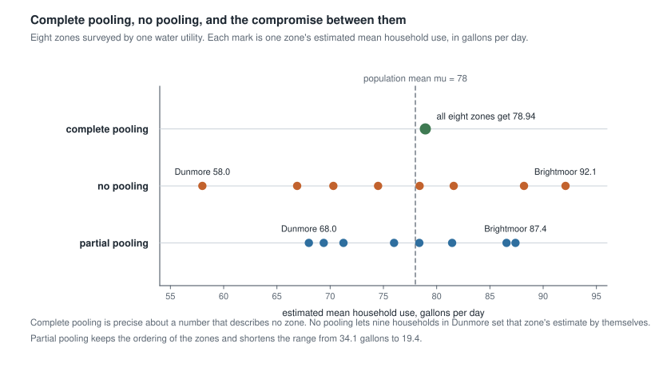
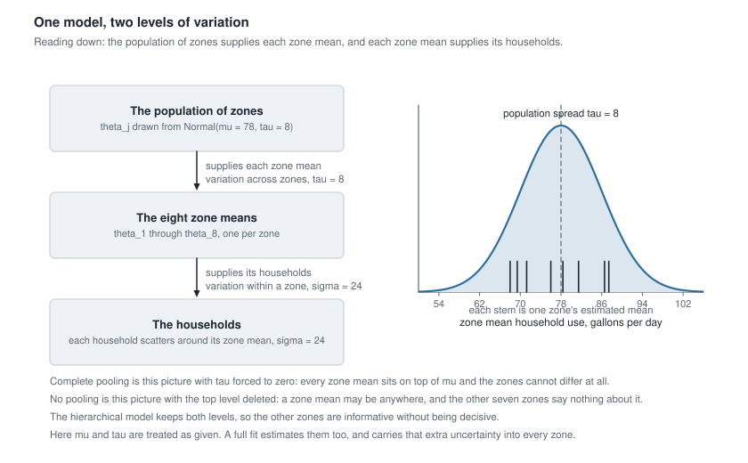
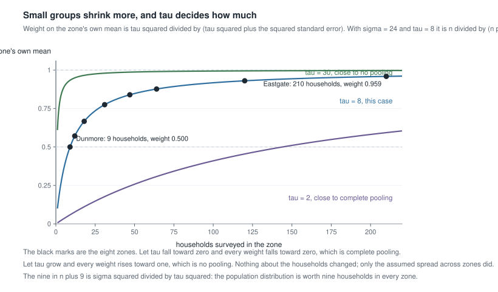
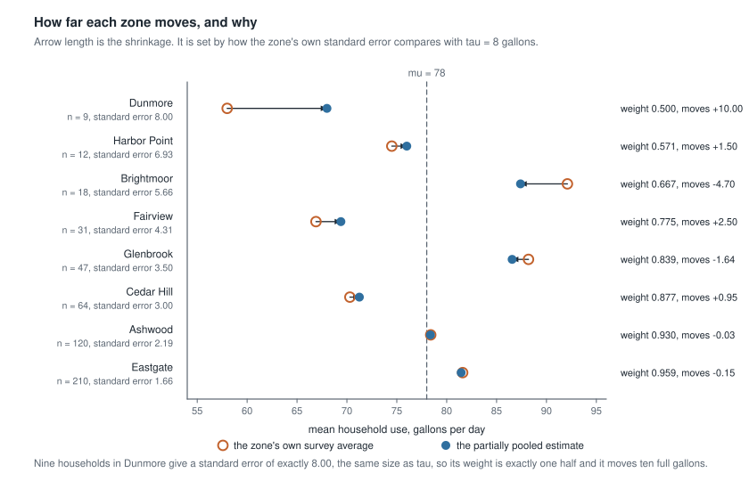
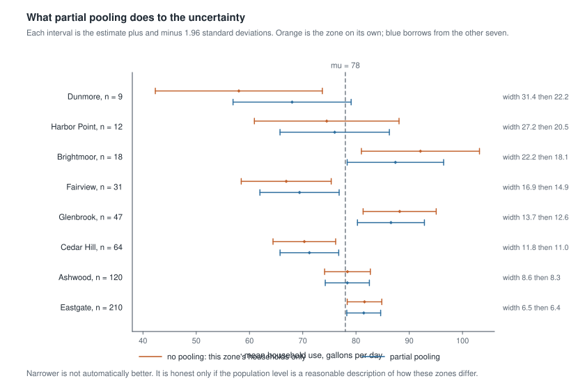

# Week 13 — Hierarchical and multilevel ideas

## Where this week starts

Every model this course has built so far has had one group inside it: one seed lot, one help desk, one commuter, one utility's twenty summer days. This week the data arrive in pieces, the same quantity measured in several places, none of them measured equally well. That is ordinary in applied work, and it needs a move the course has not made yet.

Here is the case this week owns. The Vale Municipal Water Utility surveys household water use, in gallons per household per day, in eight neighborhood zones, and the effort was not spread evenly: Eastgate contributed 210 households and Dunmore contributed nine. Household-to-household variation is treated as known, with a standard deviation of $\sigma = 24$ gallons, so a zone that surveyed $n_j$ households reports an average whose standard error is $24 / \sqrt{n_j}$. Dunmore's average therefore carries a standard error of 8.0 gallons, and yet its number, 58.0 gallons, is the most dramatic in the survey.

Week 12 left you with a clear account of what a single posterior claims. It did not say what to do when you have eight of them at once and suspect they should be talking to each other. There are two obvious moves, and both are wrong. You can pool everything, treating the eight zones as one sample, which throws away the differences you surveyed in order to find. Or you can pool nothing, which hands Dunmore's estimate to nine households and lets them say whatever they like.

The hierarchical model is the third option. Its idea is that the eight zone means are themselves a sample, drawn from a population of zones described by a mean $\mu$ and a standard deviation $\tau$. Once you say that, each zone's estimate becomes a compromise between what its own households said and what the other seven suggest is plausible. What should feel different by Friday is that you can say, for any group, how far its estimate should move, why, and what that movement does not fix.

### Why this matters outside the classroom

Suppose the utility aims a conservation campaign at the zone with the highest household use, read straight off the survey averages. Brightmoor tops the list at 92.1 gallons, but its average rests on eighteen households and carries a standard error of 5.66 gallons. Zones with small samples crowd both ends of any ranking, not because they are unusual but because they are noisy, so a program aimed at the top of that list chases sampling variation. The predictable ending is that next summer's survey finds Brightmoor nearer the middle.

The same failure runs the other way and hurts more. Dunmore's nine households average 58.0 gallons, twenty below the population mean, and reported without qualification that number invites a story about the neighborhood. A hierarchical analysis says something duller: given how little was measured there, a mean anywhere from the high fifties to the high seventies is consistent with what nine households showed.

## What you will be able to do

Work through this page with a calculator open. Each of the following should be something you can do.

- Write a two-level model for grouped data, saying what each level describes and which parameters live at which level.
- Compute a group's standard error, its precision weight, and its partially pooled estimate, and check the compromise arithmetic reproduces it.
- Explain why a group with fewer observations shrinks further, in terms of its standard error compared with $\tau$.
- State what complete pooling and no pooling are as limits of the hierarchical model, and which value of $\tau$ produces each.
- Compare a no-pooling interval with a partially pooled interval for the same group, and say what each one assumes.
- Say plainly what partial pooling does not do, including what it does not fix about a group measured badly.

## Terms and notation worth fixing

These symbols keep the meanings the rest of the course gave them; the subscript $j$ is what is new.

| Term or symbol | Meaning as used in this course |
|---|---|
| $\theta_j$ | the unknown true mean household use in zone $j$, the quantity being estimated |
| $y_j$ | the survey average actually observed in zone $j$, in gallons per household per day |
| $n_j$ | the number of households surveyed in zone $j$ |
| $\sigma$ | the household-to-household standard deviation inside a zone, here 24 gallons and treated as known |
| $\mu$ | the population-level mean: the centre of the distribution the eight zone means are drawn from |
| $\tau$ | the population-level standard deviation: how far zones genuinely differ from one another |
| $w_j$ | the weight the partially pooled estimate puts on zone $j$'s own average, between 0 and 1 |

Call $\theta_j$ a *group-level* parameter and $\mu$ and $\tau$ *population-level* parameters, and never say "the mean" without saying which one. Keep $\sigma$ and $\tau$ apart: $\sigma$ describes how households differ inside a zone, $\tau$ how zones differ from each other, and confusing them is the most common slip here.

## Two ways to be wrong about eight zones

It is worth seeing exactly how the two obvious approaches fail, because the hierarchical model is built out of their failures. Here is the survey, with each zone's standard error.

| Zone | $n_j$ | $y_j$ | Standard error $24/\sqrt{n_j}$ |
|---|---|---|---|
| Ashwood | 120 | 78.4 | 2.191 |
| Brightmoor | 18 | 92.1 | 5.657 |
| Cedar Hill | 64 | 70.3 | 3.000 |
| Dunmore | 9 | 58.0 | 8.000 |
| Eastgate | 210 | 81.6 | 1.656 |
| Fairview | 31 | 66.9 | 4.311 |
| Glenbrook | 47 | 88.2 | 3.501 |
| Harbor Point | 12 | 74.5 | 6.928 |

The averages run from 58.0 to 92.1, a range of 34.1 gallons, and the two zones at the ends of that range, Dunmore and Brightmoor, are among the worst measured of the eight.

{fig-alt="One gallons axis with three rows of marks. The top row is a single green dot at 78.94 for every zone; the middle row spreads eight orange dots from 58.0 to 92.1; the bottom row has eight blue dots from 68.0 to 87.4."}

The figure shows the three estimates this page compares, and this section explains the top two. The bottom row keeps the order of the middle row while pulling its ends inward.

### Complete pooling: one number for everyone

Complete pooling says the eight zones do not really differ, so pile all 511 households together and estimate one mean. Weighting each zone by its sample size, the total use recorded is
$$
120(78.4) + 18(92.1) + 64(70.3) + 9(58.0) + 210(81.6) + 31(66.9) + 47(88.2) + 12(74.5) = 40{,}336.3,
$$
which over 511 households gives $40{,}336.3 / 511 = 78.94$ gallons, with a standard error of $24/\sqrt{511} = 1.06$ gallons.

That precision is the trap: the estimate is precise about a quantity describing no zone in the survey. Complete pooling asserts that Dunmore and Glenbrook share an underlying mean and that the 30-gallon gap between their averages is entirely survey noise. Test that crudely: the eight averages have an unweighted mean of $610.0 / 8 = 76.25$ and a standard deviation of 11.25 gallons, and only part of that scatter can be sampling noise, since the largest standard error in the survey is 8.0. The zones differ, and a model that cannot represent the difference will not report it.

### No pooling: each zone on its own

No pooling goes to the other extreme: estimate $\theta_j$ from zone $j$'s households and nothing else, which in Bayesian terms means a flat prior on each zone mean. The posterior for zone $j$ is centred on $y_j$ with standard deviation equal to that zone's standard error, so Eastgate gets $81.6 \pm 1.66$ and Dunmore gets $58.0 \pm 8.00$.

This is honest about uncertainty and dishonest about information. Honest, because Dunmore's interval, roughly 42.3 to 73.7, is enormous and says so. Dishonest, because it insists the other seven zones tell you nothing about Dunmore. They plainly do: seven zones sitting between 66.9 and 92.1 make a true Dunmore mean of 42 far less plausible than that interval implies. No pooling forbids using the fact.

There is a second cost, and it is the one that damages reports. Under no pooling the extremes of a ranking fill up with the worst-measured groups: Dunmore, whose standard error is the largest of the eight, sits at the bottom, and Brightmoor, third largest, at the top. That is no coincidence. A zone with a large standard error has more room to land far from its own true mean, and the ends of a list are where such wandering shows up.

## Borrowing strength across the zones

The hierarchical model repairs both extremes with one sentence: the eight zone means are themselves drawn from a distribution. In symbols that is a model with two levels,
$$
\begin{aligned}
y_j \mid \theta_j &\sim \text{Normal}\!\left(\theta_j, \; \frac{24}{\sqrt{n_j}}\right), \\
\theta_j &\sim \text{Normal}(\mu, \tau).
\end{aligned}
$$
The first line is the survey: zone $j$'s observed average scatters around that zone's true mean, with a standard error set by how many households were surveyed there. The second is new: the true zone means are not eight unrelated numbers but eight draws from a population of zones, centred at $\mu$ with spread $\tau$. Both population-level values are given here, $\mu = 78$ and $\tau = 8$ gallons, so every calculation below stays visible on paper.

{fig-alt="Left: three stacked boxes, the population of zones, the eight zone means, and the households, joined by two arrows labelled tau across zones and sigma within a zone. Right: a normal curve centred at 78 carrying eight stems."}

Read the diagram downward and it is a story about where data come from: the population supplies a mean to each zone, and each zone's mean supplies its households. Read it upward and it is a story about inference: the zones together tell you about the population, which tells you something about each zone in turn. That loop is what borrowing strength means, and it is why an estimate for Dunmore improves because Eastgate was surveyed.

### The precision weight, one zone at a time

With $\mu$ and $\tau$ given, this is Week 6's normal-normal machinery with the prior supplied by the population level instead of by a person. The posterior mean for zone $j$ is a precision-weighted compromise between the zone's own average and the population mean:
$$
\hat\theta_j = w_j \, y_j + (1 - w_j)\, \mu, \qquad
w_j = \frac{1/\text{se}_j^2}{1/\text{se}_j^2 + 1/\tau^2} = \frac{\tau^2}{\tau^2 + \text{se}_j^2},
$$
where $\text{se}_j = 24/\sqrt{n_j}$. Precision is one over variance, so the second form says it plainly: each source of information is weighted by how precise it is, and the population level counts as a source.

Here the formula simplifies in a way worth memorizing. Since $\text{se}_j^2 = 576/n_j$ and $\tau^2 = 64$,
$$
w_j = \frac{64}{64 + 576/n_j} = \frac{n_j}{n_j + 9}.
$$
The nine is $\sigma^2 / \tau^2 = (24/8)^2$, and it reads exactly like the prior strength in Week 4's beta-binomial arithmetic: for this survey, knowing that a zone belongs to this population is worth nine households. A zone with nine households therefore splits the difference exactly, and a zone with 81 households gives its own data weight $81/90 = 0.9$.

Uncertainty combines the same way. Adding precisions gives the posterior variance directly,
$$
\text{sd}(\hat\theta_j) = \left(\frac{1}{\text{se}_j^2} + \frac{1}{\tau^2}\right)^{-1/2} = \text{se}_j \sqrt{w_j},
$$
so a partially pooled estimate is always at least as precise as the zone's own average, and much more precise when the zone is small.

### Why small groups shrink more

The rule to carry away is that **groups with less information shrink more**, and the formula says why. The weight compares the zone's own standard error with $\tau$. When $\text{se}_j$ is much smaller than $\tau$ the zone's data dominate and $w_j$ sits near one; when the two are equal the weight is one half; when $\text{se}_j$ is much larger the population level dominates and the estimate is pulled most of the way to $\mu$.

{fig-alt="Weight from 0 to 1 against households from 0 to 220. Three rising curves for tau equal to 2, 8 and 30. The tau equals 8 curve passes through 0.5 at nine households and 0.959 at 210, with the eight zones marked as black dots on it."}

The middle curve is this survey. It rises steeply and then flattens: the step from nine households to 31 moves the weight from 0.500 to 0.775, while the step from 120 to 210 moves it only from 0.930 to 0.959. That flattening is why an argument about shrinkage is really an argument about small groups.

### What tau does at its two extremes

The other two curves show what happens when the assumed spread across zones changes, and they contain both extremes this week began with. Send $\tau$ toward zero and every weight goes to zero: zones cannot differ, every estimate collapses onto $\mu$, and you have recovered complete pooling. Let $\tau$ grow and every weight goes to one: seven zones tell you nothing about the eighth, every estimate returns to its own survey average, and you have recovered no pooling.

So complete pooling and no pooling are not rivals to the hierarchical model; they are that model with $\tau$ pinned at the two values nobody would choose. Letting the data inform $\tau$ instead is the content of the method. One caution follows: this page fixes $\tau = 8$ so you can check every number by hand, but a real fit estimates $\mu$ and $\tau$ as well, and uncertainty about $\tau$ widens every zone's interval. Estimating a spread from eight groups is not precise work, and a report that fixed $\tau$ without saying so would hide an assumption that moves every number on the page.

## Worked example — eight zones and one summer of survey data

Work the whole table, then look at what changed. The situation: eight zones, 511 households, household use scattering with $\sigma = 24$ gallons, and a population of zone means with $\mu = 78$ and $\tau = 8$.

**Step 1: write the model.** Zone $j$'s observed average $y_j$ is normal around the zone's true mean $\theta_j$ with standard error $24/\sqrt{n_j}$, and $\theta_j$ is normal around 78 with standard deviation 8. Two levels, and eight group-level unknowns.

**Step 2: get each zone's standard error.** Dunmore surveyed nine households, so $24/\sqrt{9} = 24/3 = 8.000$ gallons. Cedar Hill surveyed 64, so $24/8 = 3.000$. Eastgate surveyed 210, so $24/14.491 = 1.656$.

**Step 3: turn each standard error into a weight.** Use $w_j = \tau^2 / (\tau^2 + \text{se}_j^2)$ with $\tau^2 = 64$. For Dunmore, $\text{se}^2 = 64$, so $w = 64/(64 + 64) = 0.500$ exactly: its nine households are worth as much as the knowledge that Dunmore is one of these zones. For Cedar Hill, $\text{se}^2 = 9$, so $w = 64/73 = 0.877$. For Eastgate, $\text{se}^2 = 576/210 = 2.743$, so $w = 64/66.743 = 0.959$.

**Step 4: compute the partially pooled estimates.** Each is a weighted compromise you can check by hand. Dunmore: $0.500 \times 58.0 + 0.500 \times 78 = 29.0 + 39.0 = 68.00$ gallons. Cedar Hill: $0.877 \times 70.3 + 0.123 \times 78 = 61.653 + 9.594 = 71.25$. Eastgate: $0.959 \times 81.6 + 0.041 \times 78 = 78.25 + 3.20 = 81.45$. Running the same arithmetic over all eight zones gives the table this week is built on.

| Zone | $n_j$ | $y_j$ | $\text{se}_j$ | $w_j$ | Partially pooled | Pulled by |
|---|---|---|---|---|---|---|
| Ashwood | 120 | 78.4 | 2.191 | 0.930 | 78.37 | $-0.03$ |
| Brightmoor | 18 | 92.1 | 5.657 | 0.667 | 87.40 | $-4.70$ |
| Cedar Hill | 64 | 70.3 | 3.000 | 0.877 | 71.25 | $+0.95$ |
| Dunmore | 9 | 58.0 | 8.000 | 0.500 | 68.00 | $+10.00$ |
| Eastgate | 210 | 81.6 | 1.656 | 0.959 | 81.45 | $-0.15$ |
| Fairview | 31 | 66.9 | 4.311 | 0.775 | 69.40 | $+2.50$ |
| Glenbrook | 47 | 88.2 | 3.501 | 0.839 | 86.56 | $-1.64$ |
| Harbor Point | 12 | 74.5 | 6.928 | 0.571 | 76.00 | $+1.50$ |

**Step 5: read the pattern rather than the rows.** Dunmore, with the fewest households, moves ten full gallons; Eastgate, with the most, moves 0.15. Ashwood already sits almost exactly at the population mean, so there is nowhere for it to be pulled.

{fig-alt="Eight rows ordered by sample size. Each row has an open orange circle at the survey average and a blue circle at the partially pooled estimate, joined by an arrow. The arrow is longest for Dunmore, ten gallons, and invisible for Eastgate."}

Arrow length is shrinkage, and the arrows shorten as you move toward the well-surveyed zones; every arrow points toward the dashed population mean.

**Step 6: report the uncertainty, not just the estimate.** For Dunmore the posterior standard deviation is $8.000 \times \sqrt{0.500} = 5.657$ gallons, so a 95 percent credible interval is $68.00 \pm 1.96(5.657)$, that is 56.91 to 79.09. Compare the no-pooling interval, $58.0 \pm 1.96(8.000)$, or 42.32 to 73.68. The interval moved up ten gallons and narrowed from a width of 31.36 to a width of 22.17.

{fig-alt="Eight pairs of intervals on a gallons axis, orange above and blue below. The orange no-pooling intervals are widest for the smallest zones; every blue interval is shorter and shifted toward the dashed line at 78."}

**What this licenses, and what it does not.** It licenses saying that, under this model and these population-level values, Dunmore's mean is most plausibly near 68 gallons and fairly likely to lie between about 57 and 79. It does not license saying Dunmore uses 68 gallons: that interval is more than 22 gallons wide. Nor does it license treating the narrower interval as better data. Nine households were surveyed and nine remain surveyed; what changed is the model's admission that the other seven zones are informative, and the interval is narrower only to the extent that admission is true.

Here is the code that reproduces the table, so you can vary the survey and watch the weights respond.

```r
# Case F: eight zones. sigma = 24 gallons is treated as known,
# and the population of zone means is Normal(mu = 78, tau = 8).
n    <- c(120, 18, 64, 9, 210, 31, 47, 12)
ybar <- c(78.4, 92.1, 70.3, 58.0, 81.6, 66.9, 88.2, 74.5)
mu   <- 78
tau  <- 8

se  <- 24 / sqrt(n)                  # each zone's own standard error
w   <- tau^2 / (tau^2 + se^2)        # weight on the zone's own mean
est <- w * ybar + (1 - w) * mu       # partially pooled estimate
sdv <- se * sqrt(w)                  # posterior sd of that estimate

round(cbind(n, ybar, se, w, est, sdv, est - ybar), 3)

sum(n * ybar) / sum(n)               # complete pooling: one number for all
sd(ybar)                             # raw spread of the eight zone averages
```

A genuine hierarchical fit does not stop here. It estimates $\mu$ and $\tau$ too and returns draws from the joint posterior over all of them, which is what the regression functions in the `rstanarm` package do once a grouping term joins the formula. The arithmetic above is what those draws do on average.

### The same reasoning, transferred

Move the structure to counts and a different family. A campus sustainability office records contaminated recycling bins at three collection stations. Station P was watched for 20 days and logged 140 bins, a rate of 7.0 per day; Station Q for 2 days and 20 bins, a rate of 10.0; Station R for 8 days and 32 bins, a rate of 4.0.

Let $\lambda_j$ be station $j$'s true rate, and take the population of station rates to be Gamma with shape $s = 12$ and rate $r = 2$, whose mean is $12/2 = 6.0$ bins per day. Week 6's conjugate arithmetic gives each station a posterior mean of $(s + \text{total count}) / (r + \text{days})$, again a weighted compromise, with weight $t_j / (r + t_j)$ on the station's own rate for $t_j$ days of watching.

Station P: weight $20/22 = 0.909$, estimate $(12 + 140)/(2 + 20) = 152/22 = 6.909$, and the check is $0.909(7.0) + 0.091(6.0) = 6.36 + 0.55 = 6.91$. Station Q: weight $2/4 = 0.500$, estimate $32/4 = 8.000$, and $0.500(10.0) + 0.500(6.0) = 8.00$. Station R: weight $8/10 = 0.800$, estimate $44/10 = 4.400$, and $0.800(4.0) + 0.200(6.0) = 4.40$.

What stayed the same: a population distribution over group parameters, a weight measuring the group's own information against the population's, and a compromise that pulls the least-observed group furthest, so Station Q gives up two full bins per day of its apparent extremity. What changed: the family is Gamma-Poisson, information is counted in days rather than households, and the population level is summarized by a shape and a rate. The shrinkage rule survives the change of family, because it was never about normality; it was about weighting sources by how much they know.

## Second worked example — a ranking read off the raw averages

This one is a diagnosis rather than a clean application. The communications office asks which zone has the highest household use, so the campaign can be aimed at it. An analyst sorts the survey averages, reports Brightmoor at 92.1 gallons, and adds that it leads Glenbrook by 3.9. Every number there is correct, and the conclusion is still not supported.

**Step 1: attach the uncertainty that was left off.** Brightmoor surveyed eighteen households, so its standard error is $24/\sqrt{18} = 5.657$ and its no-pooling interval is $92.1 \pm 1.96(5.657)$, that is 81.01 to 103.19. Glenbrook surveyed 47, so its standard error is 3.501 and its interval is $88.2 \pm 1.96(3.501)$, that is 81.34 to 95.06. The two overlap over almost their whole length.

**Step 2: run the check the analyst skipped.** The comparison being reported is a difference, so estimate the difference. Under no pooling the gap is $92.1 - 88.2 = 3.9$ gallons, and because the two zones are separate groups the variances add: $\sqrt{5.657^2 + 3.501^2} = \sqrt{32.00 + 12.26} = \sqrt{44.26} = 6.65$ gallons. A gap of 3.9 with an uncertainty of 6.65 is not a ranking.

**Step 3: refit with partial pooling and watch the gap shrink further.** Brightmoor's weight is $18/(18+9) = 2/3$, giving $(2/3)(92.1) + (1/3)(78) = 61.40 + 26.00 = 87.40$. Glenbrook's weight is $47/(47+9) = 0.839$, giving $0.839(88.2) + 0.161(78) = 74.00 + 12.56 = 86.56$. The gap is now $87.40 - 86.56 = 0.84$ gallons. Their posterior standard deviations are $5.657\sqrt{2/3} = 4.619$ and $3.501\sqrt{0.839} = 3.207$, so the difference carries an uncertainty of $\sqrt{21.33 + 10.28} = 5.62$ gallons: the estimated gap is roughly a seventh of its own uncertainty.

**Step 4: notice what did not change.** Partial pooling did not reorder the zones: Brightmoor is still highest, Dunmore still lowest. What changed is the size of the claims, with the top-to-bottom range falling from 34.1 gallons to 19.4 and the leading gap from 3.9 to 0.84. Shrinkage is not a re-ranking device.

**Step 5: say what the survey supports.** It supports "Brightmoor and Glenbrook are the two highest-use zones here, both well above the population mean, and this survey cannot separate them". It does not support "Brightmoor is the highest-use zone". If separating them matters to the budget, the recommendation is more households in Brightmoor.

**What went wrong, in one sentence.** The analyst reported a comparison between two numbers without ever estimating the quantity being compared, which is the difference.

## The misreading to avoid

Here is the objection students raise every year, and it deserves a reply, not a slogan: "Shrinkage biases the estimates toward the middle, so it distorts the data. Dunmore's households really did average 58.0 gallons, and the model just decided to report 68.0 instead."

Start with what is true in it. The partially pooled estimate is biased in a specific sense: fix Dunmore's true mean, imagine repeating the survey many times, and the raw averages centre on that true mean while the shrunk estimates centre on something tilted toward 78. The size of the tilt is $1 - w_j$, so Dunmore's weight of exactly 0.500 puts the shrunk estimates midway between its true mean and 78, whatever that true mean turns out to be. Every other zone carries a weight above one half, from Harbor Point's 0.571 to Eastgate's 0.959, so its shrunk estimates settle nearer its own true mean than to 78; the tilt is smaller there but it never vanishes. That is a real cost and nobody should pretend otherwise.

Now the trade, and it comes in two versions that must not be run together. Stay conditional first, with Dunmore's true mean still held fixed. Shrinking multiplies the estimate's variance by $w_j^2$, giving $0.25 \times 64 = 16$ in place of 64, and adds a squared bias of $(1 - w_j)^2 (\mu - \theta_j)^2$, which here is $0.25$ times the squared distance from 78. Add those two and compare with the raw average's 64: the shrunk estimate lands closer on average whenever $0.25 \, (78 - \theta_j)^2 < 48$, that is whenever Dunmore's true mean lies within $\sqrt{192} = 13.86$ gallons of 78. For a zone genuinely further out than that, shrinkage costs more than it saves.

The second version averages that same expression over the population of zones instead of fixing one true mean. Averaging replaces $(78 - \theta_j)^2$ by $\tau^2 = 64$, and the whole thing collapses to $w_j \, \text{se}_j^2$, which for Dunmore is $0.500 \times 64 = 32$: half the squared error of the raw average. Say which version you are quoting. The first is about Dunmore given a fixed truth; the second is about the eight zones on average, and it is the one that earns the method its reputation. Either way the shape of the trade is the same, a little bias bought at a larger saving in variance, which is why partial pooling is used for grouped data everywhere.

Two clarifications finish it off. First, no data were changed: the 58.0 is still in the report as what nine households averaged, while the 68.0 estimates a different thing, Dunmore's underlying mean. Second, the bias has a direction with a reason: a zone that looks extreme after nine households probably looks more extreme than it is, because small samples land far from their targets more often than large ones do. That is not a decision about Dunmore, it is a fact about nine.

Two relatives travel with it. "The interval got narrower, so the estimate is better" confuses precision with adequacy: the interval narrowed because an assumption was added, and if that assumption is wrong the narrowness is false comfort. And "partial pooling fixes small samples" is false: it makes the uncertainty about a small group honest by admitting that the other groups are informative, but if a zone was surveyed in a way that missed its heaviest users, no pooling repairs that. A model that fits, and even one that survives the checks Week 11 built, is evidence about the question rather than a verdict on it.

## Practice on your own

These are for your own checking rather than for submission. Work them with a calculator and compare against the arithmetic above.

1. Compute the weight, the partially pooled estimate, and the posterior standard deviation for Fairview from its 31 households, and confirm you get 0.775, 69.40, and about 3.79.
2. Keep the survey fixed and set $\tau = 4$ gallons instead of 8. Recompute the weight and estimate for Dunmore and for Eastgate, and say what halving the assumed spread across zones did to each.
3. Using $w_j = n_j/(n_j + 9)$, find how many households a zone needs for weight 0.95, then check it against Eastgate's 210 households and weight of 0.959.
4. Harbor Point and Ashwood are pulled by 1.50 and $-0.03$. Using both the weight and the distance from 78, explain why those two movements differ so much for reasons that are not the same.
5. Repeat the recycling-station transfer with a population distribution of Gamma shape 3 and rate 0.5, whose mean is still 6.0 but whose spread is much larger. Recompute the estimate for Station Q, and say what the wider population did to the amount of pooling.

## Where to read more

This week aligns with Chapters 15 and 16 of the course's primary text. Read them alongside these notes; the explanations here are written independently.

- [Bayes Rules! Chapter 15](https://www.bayesrulesbook.com/chapter-15), this week's first chapter alignment.
- [Bayes Rules! Chapter 16](https://www.bayesrulesbook.com/chapter-16), this week's second chapter alignment.
- The [Bayes Rules! home page](https://www.bayesrulesbook.com/).
- [The R Project for Statistical Computing](https://www.r-project.org/) and [Quarto](https://quarto.org/), the tools you fit and write this in.
- The course [schedule](../schedule.qmd), the [notes index](index.qmd), the [syllabus](../syllabus.qmd), and the [resources page](../resources/index.qmd). Week 6's normal-normal arithmetic at [week-06.qmd](week-06.qmd) is the direct ancestor of this week's compromise.

## Where this goes next

Week 14 turns a posterior into a decision, and the eight zones are a good place to feel why that is a separate step. Suppose the utility can fund a campaign in two zones. Nothing here tells you which two: the estimates and their intervals are the evidence, and the choice also needs the cost of aiming a campaign at a zone that did not need it against the cost of missing one that did. Next week states the position this course holds throughout, that a decision threshold is a value judgment and never a quantity the data hand over.

Bring three things with you: the weighted-compromise formula, which has now appeared in the beta-binomial, the gamma-Poisson, the normal-normal, and the hierarchical model; the habit of asking how much information a group carries before believing where it ranks; and the discomfort you should feel about a narrow interval that got narrow because of an assumption rather than because of data. The [notes index](index.qmd) has the full sequence and the [course home page](../index.qmd) has the rest of the site.
