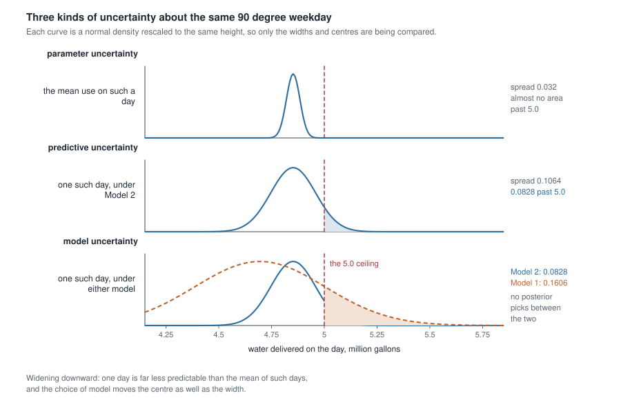
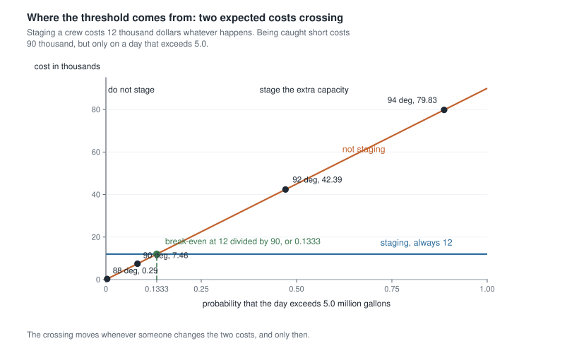
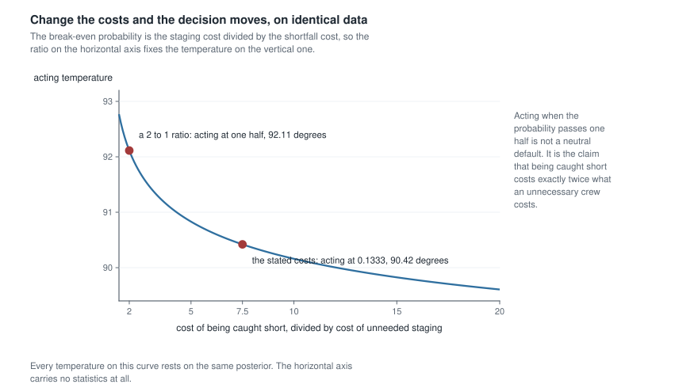
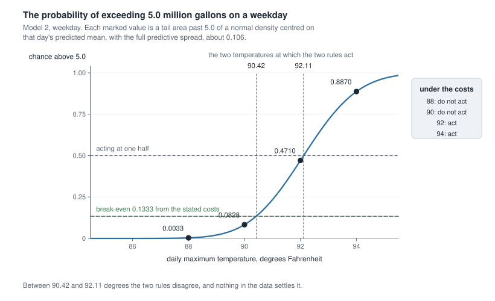
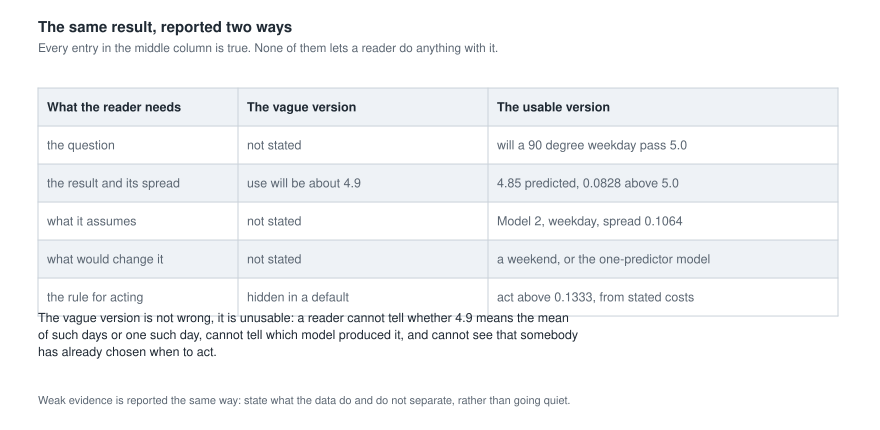

# Week 14 — Decisions, communication, and the shape of uncertainty

## Where this week starts

For thirteen weeks this course has built distributions. A prior said what was plausible before the data, a likelihood said how data arise, a posterior said what is plausible now, and Week 13 let eight neighborhood zones borrow strength from one another. None of that machinery ever told anyone what to do.

That is the gap this week closes. Somebody at the water utility has to decide, on a Thursday morning, whether to call in an extra pump crew for tomorrow. A posterior distribution over tomorrow's water use is not that decision. It is one of two ingredients, and the other is not statistical: a statement of what each mistake costs. Almost every bad statistical decision comes from letting one hide inside the other.

First, though, some bookkeeping students skip. Uncertainty about a parameter is not uncertainty about a future observation, and neither is uncertainty about whether the model has the right shape. The first two live inside the posterior you fitted; the third does not, and pretending otherwise is how confident reports go wrong. This week aligns with Chapter 17 of the primary text; everything here is written independently of it.

Three things should feel different by Friday. You should flinch at a single number with no spread attached. You should ask, whenever someone announces a threshold, who chose it. And you should be able to write four sentences a non-technical reader can act on without ever seeing your posterior.

### Why this matters outside the classroom

Consider the utility's operations manager reading a forecast that says "water use tomorrow will be about 4.9 million gallons". The pumping plan is comfortable up to 5.0. Is 4.9 a reassurance or a warning? It depends on whether that number describes the mean of days like tomorrow, which the model pins down to within a few hundredths, or one particular Tuesday, which it does not. Same number, two conclusions.

The other half of the stake is the threshold. Somewhere a rule says to act when the probability of exceeding capacity passes one half. That rule is not a statistical finding. On this utility's own numbers, acting at one half rather than at the probability the costs imply means waiting an extra one and seven tenths of a degree of forecast temperature. Whether that is prudent or reckless depends on what a shortfall costs relative to an unnecessary crew, which is a question for someone accountable, not for a posterior.

## What you will be able to do

Work through this page with a calculator open, and you should be able to:

- Separate parameter, predictive, and model uncertainty, and say which one a given interval describes.
- Compute an exceedance probability from a posterior predictive distribution, naming the model it assumes.
- Derive a break-even probability from two stated costs and use it to turn a posterior into an action.
- Show how a decision changes when the costs change, and why the data cannot settle the threshold.
- Diagnose a conclusion that rests on model choice rather than evidence, and say what an honest report does.
- Write a short conclusion carrying the question, the result with its spread, the assumptions, and what would overturn it.

## Terms and notation worth fixing

These are the terms this page uses, with the meaning they carry in this course.

| Term or symbol | Meaning as used in this course |
|---|---|
| parameter uncertainty | uncertainty about an unknown of the model, such as $\beta_1$, described by $p(\theta \mid y)$ |
| predictive uncertainty | uncertainty about a new observation $\tilde y$, described by $p(\tilde y \mid y)$ |
| model uncertainty | uncertainty about which model has the right shape; no fitted posterior describes it |
| exceedance probability | the predictive probability that a new observation passes a stated level, here $P(\tilde y > 5.0 \mid y)$ |
| loss | what an outcome costs the person deciding, in stated units, not in probability |
| break-even probability | the exceedance probability at which two actions have equal expected cost |
| threshold | the probability above which someone has decided to act: a value judgment, never a statistic |
| $M_1, M_2$ | the two competing regression models for the utility, from Weeks 9 and 10 |

## Three kinds of uncertainty, kept apart

The Vale Municipal Water Utility, whose twenty summer days Weeks 9 and 10 modelled, asks about a weekday forecast at 90 degrees Fahrenheit. Model 2, carrying temperature and a weekend indicator, has posterior mean coefficients giving a predicted mean use of

$$
4.4266 + 0.0698 \, (\text{temp} - 83.9) - 0.5788 \, (\text{weekend}),
$$

so on a weekday at 90 degrees the predicted mean is $4.4266 + 0.0698188 \times 6.1 = 4.8525$ million gallons, carrying the slope a few places further than the rounded 0.0698 above, with observation-level standard deviation $\sigma = 0.1015$. Three questions can now be asked about that day, and they have three different spreads.

{fig-alt="Three stacked panels on one water-use axis. The top curve, for the mean, is narrow with almost no area past a red line at 5.0. The middle curve, for one day, has 0.0828 past 5.0. The bottom adds a much wider curve with 0.1606 past 5.0."}

Each curve is rescaled to the same height, so only widths and centres are compared. One day, asked about three ways, gives three pictures, and only the top two came out of a posterior.

### Parameter uncertainty and predictive uncertainty

The first question is about the *mean* of days like this one. If the utility ran a hundred 90-degree weekdays, what would their average delivery be? That quantity is a combination of coefficients, so its uncertainty comes only from their posterior, and here the spread is small: the standard deviation of the fitted mean at 90 degrees on a weekday is about 0.032 million gallons. Twenty days is not many, but a straight line through them is pinned down well enough.

The second question is about *one* day, next Tuesday, the day the crew schedule depends on. That day carries the coefficient uncertainty and, on top of it, the day-to-day scatter around the line. The two add on the variance scale, not the standard deviation scale:

$$
\sqrt{0.032^2 + 0.1015^2} = \sqrt{0.001024 + 0.010302} = \sqrt{0.011326} = 0.1064 .
$$

Almost all of that width is observation-level scatter: the coefficient part carries the spread from 0.1015 only up to 0.1064, about five percent wider. It still belongs there, and every exceedance probability on this page uses the combined spread rather than $\sigma$ alone, because a statement about next Tuesday that quotes the residual scatter by itself has dropped one of the two sources. That the coefficient part is so small here is a feature of this data set, not a general rule. Fitted to fewer observations, or asked about a temperature far outside the observed range, it grows and can dominate.

You have met this gap already: Week 6's help desk pairs a posterior standard deviation of 0.7071 calls per hour for the rate $\lambda$ against a predictive standard deviation of 2.345 for one hour's count, about 3.3 times as wide. The ordering never reverses, because predicting one draw carries both the uncertainty about where the distribution sits and the variation of draws around it.

So ask what the number is about. If it is about a parameter, quote the posterior. If it is about something that will happen and be measured, quote the predictive distribution and expect it to be wider. A report using the parameter interval to describe next Tuesday is not being conservative; it understates the risk in exactly the situation where risk matters.

### The uncertainty a posterior does not contain

Now the third panel. Everything above was computed inside Model 2. Week 9 fitted a different model to the same twenty days using temperature alone, a posterior mean line of $4.253 + 0.0724 (\text{temp} - 83.9)$ with residual standard deviation 0.2957. That model is not absurd: it explains about 0.799 of the variation in daily use, and had nobody thought of the weekend indicator, it is what would have been reported.

Under it, the same 90-degree weekday has a predicted mean of $4.253 + 0.0724458 \times 6.1 = 4.6949$ million gallons and a predictive spread of 0.3075, nearly three times as wide. The two curves in the bottom panel describe one Tuesday, and no posterior says which is right, because each was computed by conditioning on its own model being correct.

This is not a counsel of despair. Week 11 supplies real tools: its posterior predictive check found Model 1's residuals averaging $+0.1726$ on the fourteen weekdays against $-0.4028$ on the six weekend days, a gap of 0.5754 a correct model would not produce, and its leave-one-out comparison put Model 1's prediction error at 0.3153 against Model 2's 0.1066. Both point the same way, so this page uses Model 2.

But "better supported of the two models we happened to write down" is a much smaller claim than "correct", and this course's principle holds: a passing check is evidence, not a verdict. An honest report handles model uncertainty in three ways, none a probability. It names the model behind the number, reports what the conclusion would have been under the serious alternative, and says which conclusions survive the switch.

## Turning a posterior into a decision

A posterior predictive distribution handles questions of the form "how likely is it that tomorrow passes 5.0 million gallons?". A decision has a different form: "should we pay for an extra crew tonight?". Getting from one to the other needs something data cannot supply.

### Where a decision threshold comes from

The utility can stage extra pumping capacity for tomorrow, or not. Suppose, and someone at the utility must make and defend this supposition, that staging costs 12 thousand dollars whether or not it proves necessary, while being caught short costs 90 thousand in emergency purchases and disruption. Let $p$ be the probability that tomorrow's use exceeds 5.0 million gallons. Then

$$
\begin{aligned}
\text{expected cost of staging} &= 12, \\
\text{expected cost of not staging} &= 90 \, p .
\end{aligned}
$$

{fig-alt="Expected cost in thousands against exceedance probability. A flat line at 12 for staging and a rising line reaching 90 at probability one cross at 0.1333. Four summer days are marked on the rising line at 0.29, 7.46, 42.39 and 79.83."}

Staging is cheaper exactly when $90 p > 12$, that is when $p > 12/90 = 0.1333$. That number is the **break-even probability**, and it is the entire content of the threshold. In general, with a cost $c_{\text{act}}$ paid whenever you act and a cost $c_{\text{miss}}$ paid only when you failed to act on a day that needed it,

$$
p^{\star} = \frac{c_{\text{act}}}{c_{\text{miss}}} ,
$$

the ratio of what caution costs to what being caught costs. Notice what is absent: no data, no posterior, no sample size. The crossing in the figure moves only when someone changes the two costs.

### What acting at one half quietly asserts

Turn the formula around. A report that acts whenever the probability passes one half has set $c_{\text{act}}/c_{\text{miss}} = 0.5$, which says $c_{\text{miss}} = 2 \, c_{\text{act}}$: being caught short costs exactly twice what an unnecessary crew costs. That may be true, but it is a claim about the world that nobody wrote down.

{fig-alt="A falling curve of the weekday temperature at which the utility acts, plotted against the ratio of shortfall cost to staging cost from 1.5 to 20. A 2 to 1 ratio acts at 92.11 degrees; the stated 90 to 12 costs act at 90.42 degrees."}

The figure traces the consequence for the utility. For each cost ratio, the break-even probability is one divided by that ratio, and the curve gives the weekday temperature at which the exceedance probability first reaches it. At a ratio of 2 the utility waits until 92.11 degrees; at the stated ratio of 7.5 it acts at 90.42. Every temperature on that curve rests on the same posterior, fitted once. Only a judgment about costs is moving.

Three consequences follow. The threshold is a value judgment, not a statistic, so two analysts with the same posterior and different accountabilities can act differently without either being in error. A report that does not state its threshold has hidden the decision inside a default. And when the costs are unknown, do not invent them: report the probability, report the break-even value each action would need, and hand the judgment to whoever owns it.

## Worked example — the pumping plan on four summer weekdays

The planning question in full. Under Model 2, on a weekday, what is the chance that delivery exceeds the 5.0 million gallon ceiling at forecast temperatures of 88, 90, 92, and 94 degrees, and on which of those days should capacity be staged given the costs above?

**Step 1: the predicted mean for each day.** Set $\text{weekend} = 0$ and evaluate. At 88 degrees, $4.4266 + 0.0698188 \times 4.1 = 4.7129$. The same arithmetic at the other temperatures gives 4.8525, 4.9921, and 5.1318 million gallons.

**Step 2: the predictive spread.** For one new day, Model 2 puts a normal distribution around that mean, with a spread combining the uncertainty in the fitted mean and the residual scatter: $\sqrt{\text{se(mean)}^2 + 0.1015^2}$. The four standard errors of the fitted weekday mean are 0.0293, 0.0319, 0.0354, and 0.0395, so the predictive spreads are 0.1056, 0.1064, 0.1075, and 0.1089, each wider than the residual 0.1015 and each widening as the forecast leaves 83.9 degrees.

**Step 3: the exceedance probability.** Standardize the ceiling. At 90 degrees, $z = (5.0 - 4.8525)/0.1064 = 1.3863$, and the standard normal area above it is 0.0828. Repeating with each day's own predictive spread gives the pinned decision table.

| Forecast temperature | Predicted mean use | Predictive spread | $P(\text{use} > 5.0)$ | Expected cost of not staging |
|---|---|---|---|---|
| 88 degrees | 4.713 | 0.1056 | 0.0033 | 0.29 |
| 90 degrees | 4.853 | 0.1064 | 0.0828 | 7.46 |
| 92 degrees | 4.992 | 0.1075 | 0.4710 | 42.39 |
| 94 degrees | 5.132 | 0.1089 | 0.8870 | 79.83 |

Each expected cost is 90 thousand dollars times the probability beside it, carried at full precision before rounding.

**Step 4: compare against the cost of acting.** Staging costs 12 thousand dollars every time. At 88 degrees doing nothing costs 0.29 thousand in expectation, far below 12, so do not stage. At 90 it is 7.46, still below 12, though the margin is thinner. At 92 it is 42.39 and at 94 it is 79.83, both well above, so stage.

**Step 5: read the same conclusion off the probability scale.** Every comparison in Step 4 matches comparing the exceedance probability with 0.1333, which is faster and clearer.

{fig-alt="A rising S-shaped curve of exceedance probability against temperature, marked 0.0033, 0.0828, 0.4710 and 0.8870 at 88, 90, 92 and 94 degrees, with a break-even line at 0.1333 crossed at 90.42 degrees and a one-half line crossed at 92.11."}

The figure puts the decision on one axis. The curve is the exceedance probability, the green line is the break-even value the costs imply, and the utility acts wherever the curve sits above it, from 90.42 degrees up. The grey line at one half waits until 92.11 degrees, and that gap is entirely a matter of costs.

```r
# Model 2, weekday: predicted mean use, the full predictive spread, and the
# chance of passing 5.0, then the break-even probability the costs imply.
temp <- c(88, 90, 92, 94)
mean_use <- 4.4266 + 0.0698188 * (temp - 83.9)
se_mean <- c(0.0293, 0.0319, 0.0354, 0.0395)
pred_sd <- sqrt(se_mean^2 + 0.1015^2)
p_exceed <- 1 - pnorm(5.0, mean = mean_use, sd = pred_sd)

cost_stage <- 12
cost_short <- 90
break_even <- cost_stage / cost_short
stage_capacity <- p_exceed > break_even
```

**Step 6: state what this licenses and what it does not.** It licenses staging capacity on forecast weekdays at or above roughly 90.4 degrees, *given* Model 2, *given* the twenty summer days behind it, and *given* the 90-to-12 cost ratio. It does not license claiming that use will exceed 5.0 on a 92-degree weekday: the probability is 0.4710, slightly less than even. It does not license the same rule on a weekend, where the modelled level is 0.5788 lower. And it does not license extrapolation past 94 degrees, near the top of the observed range, where the straight line is an assumption.

### The same reasoning, transferred

Move to a different case and family. The Meridian seed lot of Week 4 had 26 of 40 test seeds germinate, and with the standing Beta(2, 2) prior the posterior on the germination rate $\pi$ is Beta(28, 16), with mean $28/44 = 0.6364$. A buyer will plant the lot only if that rate is above 0.60, and the pinned posterior gives $P(\pi > 0.6 \mid y) = 0.6987$, so the probability the lot falls short is $1 - 0.6987 = 0.3013$.

Suppose re-testing a second tray costs 300 dollars, while planting a lot whose rate is below 0.60 costs 2,000 dollars in replanting. The break-even probability is $300/2000 = 0.15$, the probability of the bad state is 0.3013, and since 0.3013 is the larger, the buyer re-tests.

What stayed the same: two actions, two costs, a probability from a posterior, and a break-even given by the cost ratio. What changed: the family is Beta rather than normal, and the decision hangs on **parameter** uncertainty, a statement about the lot's underlying rate, rather than on predictive uncertainty about one future observation. The structure does not care which uncertainty supplied the probability, only that you say which one it was.

## Second worked example — the same day, two defensible models

This one is a failure, instructive because nothing in it looks like a mistake. Return to the 90-degree weekday under Model 1, the temperature-only model from Week 9.

**The arithmetic.** Model 1's predicted mean at 90 degrees is $4.253 + 0.0724458 \times 6.1 = 4.6949$ million gallons. Its fitted mean carries a standard error of 0.0844 and its residual standard deviation is 0.2957, so one day's predictive spread is $\sqrt{0.0844^2 + 0.2957^2} = 0.3075$. Standardizing the ceiling gives $z = (5.0 - 4.6949)/0.3075 = 0.9922$, and the standard normal area above it is 0.1606.

**The collision.** Model 2 puts the exceedance probability at 0.0828 and Model 1 at 0.1606. The break-even value from the costs is 0.1333, and it sits between them. Model 2 says do not stage; Model 1 says stage. Same day, same data, same costs, opposite actions, and each model's internal arithmetic is impeccable. They disagree in two ways at once: Model 1 is centred lower, 4.6949 against 4.8525, pushing its probability down, and far wider, 0.3075 against 0.1064, pushing it up. Width wins here, because a model that has not accounted for a real source of variation absorbs it into $\sigma$.

**The check that should have been run, and was.** Week 11 found Model 1's residuals averaging $+0.1726$ on weekdays: it systematically under-predicts them. Adding 0.1726 to 4.6949 gives 4.8675, which rounds to 4.868, close to Model 2's prediction, so the discrepancy is exactly the weekend structure Model 1 cannot see. The leave-one-out errors, 0.3153 against 0.1066, agree. This is not a coin flip between equals, and the Model 2 recommendation stands.

**What an honest report says anyway.** Not "the probability is 0.0828". Instead: under the model carrying day type the probability is 0.0828, below the 0.1333 the costs require, so we do not recommend staging; under the temperature-only alternative it is 0.1606, which would reverse that; the Week 11 checks favour the first model on both a residual pattern and out-of-sample error; and this recommendation is close to the line rather than comfortable. That is the difference between a defensible recommendation and a lucky one.

## Writing a result someone can act on

All of the above is wasted if the person deciding cannot read it. Writing for a non-technical reader has a definite structure of its own.

### A vague paragraph and a usable one

Four elements have to be present: the question, the result with its spread, what the result assumes, and what would change it.

{fig-alt="A three-column table with rows for the question, the result and its spread, the assumptions, what would change it, and the rule for acting. The middle column reads not stated three times; the right column carries 4.85 and 0.0828."}

The vague version: "Our model predicts water use of about 4.9 million gallons on a hot weekday, which is within the capacity of the current pumping plan, so no additional staging is recommended." Every clause is true, and it is still unusable. A reader cannot tell whether 4.9 is the mean of such days or one such day, cannot tell which model produced it, sees no spread, and cannot see that somebody has already chosen when to act.

A usable version of the same result: "For a weekday forecast at 90 degrees we predict delivery of 4.85 million gallons, with about an eight percent chance of passing the 5.0 million gallon plan ceiling. Given the costs we were given, 12 thousand dollars to stage capacity against 90 thousand if we are caught short, staging is worth it above a thirteen percent chance, so we do not recommend staging for this day. Two things would change that: a forecast above 90.4 degrees, or a shortfall cost more than about twelve times the staging cost. The estimate assumes weekday demand behaves as it did over the twenty summer days we fitted, and a simpler model ignoring day type would put the chance at sixteen percent, which would reverse the recommendation."

Four sentences carry the question, the prediction, the spread expressed against the level the reader cares about, the costs, the threshold, two ways the conclusion could flip, and the assumption behind it, with no notation at all. The percentages are loose on purpose: the reader is deciding about a crew, and false precision only invites misplaced confidence.

### What to say when the evidence is weak

Sometimes the honest result is that the data do not settle the question. Silence is not the response, and neither is a hedge. State what the data separate and what they do not.

Week 5's prior sensitivity table gives the sharpest example in this course. On identical seed data, 26 germinations in 40, the standing Beta(2, 2) prior gives a posterior probability of 0.9670 that the germination rate beats one half, while a skeptical Beta(4, 16) prior, worth twenty observations pointed the other way, gives Beta(30, 30) with mean exactly 0.5000 and posterior probability exactly 0.5000. A conclusion that slides from near-certainty to a coin flip under a prior somebody could defend is one the forty seeds did not establish.

Written honestly: with a mild prior the test tray puts the germination rate above one half with probability 0.97, but a prior carrying real skepticism, worth about twenty seeds, would put it at 0.50; forty seeds cannot separate those positions, and a second tray would be worth more than further argument. That tells the reader what to do next, which the word "inconclusive" never does.

## The misreading to avoid

The misreading this week is short and very common: "the probability is above one half, so we act." Dressed up, it runs like this. The 92-degree day has a 0.4710 chance of exceeding capacity, therefore no action is needed, because staying under is more likely.

Take it apart. A probability of 0.4710 that a day exceeds the ceiling is not a prediction that the day stays under. It describes a genuinely uncertain day, and the fact that one side is slightly more likely tells you almost nothing about what to do. That depends on what the two errors cost, and here the costs are lopsided: 12 thousand dollars for an unnecessary crew against 90 thousand for a shortfall. At those costs the utility acts at 0.1333, so 0.4710 is not marginal, it is more than three times past the level at which acting became worthwhile.

The general error is treating one half as though it carried statistical authority. One half is the break-even probability of a decision whose two mistakes cost the same, which is a special case and rarely the one you are in. Screening decisions and safety margins routinely act far below it; expensive or irreversible interventions wait for much more.

Two related slips travel with it. The first treats a credible interval that excludes a value as a decision, when Week 12 was explicit that an interval describes a parameter and does not know what an action costs. The second moves the threshold after seeing the probability, turning a decision rule into a rationalization. Choose the threshold from the costs, before computing the probability, and write it down.

## Practice on your own

These are for your own checking, not for submission. Work them with the numbers here.

1. Under Model 2 on a weekday, the predicted mean at 91 degrees is $4.4266 + 0.0698188 \times 7.1$. Compute it, standardize the 5.0 ceiling with the 90-degree predictive spread 0.1064 as a stand-in, and find the exceedance probability. Is it above or below 0.1333, and does that agree with the acting temperature of 90.42 degrees quoted here?
2. Suppose the cost of being caught short falls from 90 thousand dollars to 20 thousand, staging still at 12 thousand. Compute the new break-even probability, and say which of the four days changes its recommended action.
3. Redo the 92-degree calculation for a *weekend* day by subtracting 0.5788 from the predicted mean before standardizing. In two sentences, say why the recommendation changes and what that means for a temperature rule that never asks what day it is.
4. Write the four-element conclusion for the 94-degree weekday. Keep it under six sentences and use no notation.
5. A colleague proposes reporting only "recommended" or "not recommended" each day, dropping the probabilities. Name two things that report makes impossible for the reader.

## Where to read more

This week aligns with one chapter of the primary text. Read it alongside these notes; the explanations here are written independently, and the notation may not line up exactly.

- [Bayes Rules! Chapter 17](https://www.bayesrulesbook.com/chapter-17), the chapter this week aligns with.
- [Bayes Rules! home page](https://www.bayesrulesbook.com/), the home page of the same book.
- The course [schedule](../schedule.qmd), the [syllabus](../syllabus.qmd), the [notes index](index.qmd), and the [resources page](../resources/index.qmd).
- The models and checks are developed in [week-10.qmd](week-10.qmd) and [week-11.qmd](week-11.qmd); the prior sensitivity table is in [week-05.qmd](week-05.qmd).

## Where this goes next

Week 15 draws the whole course into one argument and asks what a Bayesian report looks like front to back: the question, the prior and where it came from, the likelihood, the posterior, the predictive distribution, the checks, the comparison against alternatives, the sensitivity analysis, and the bounded conclusion. This week supplies two of those pieces, the decision and the written conclusion, so bring the four-element paragraph with you.

Bring three habits too. Name which uncertainty a number describes before quoting it. State the threshold and where it came from, every time. And when a conclusion depends on a modelling choice, say so in the same paragraph. The [notes index](index.qmd) has the full sequence, [week-13.qmd](week-13.qmd) is the hierarchical material this week followed, and the [course home page](../index.qmd) has the rest of the site.
