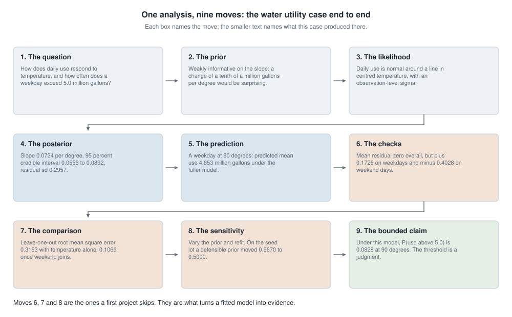
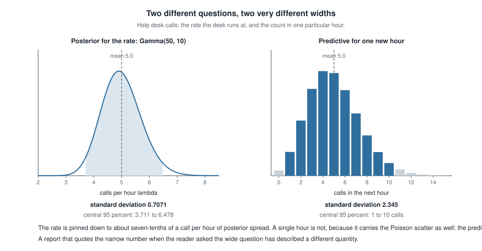
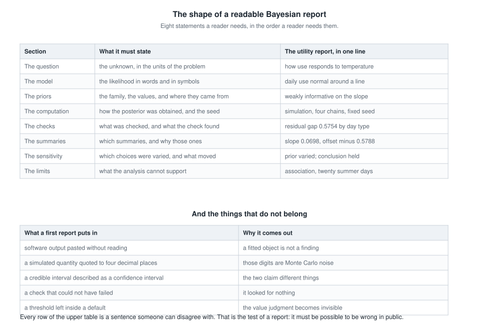
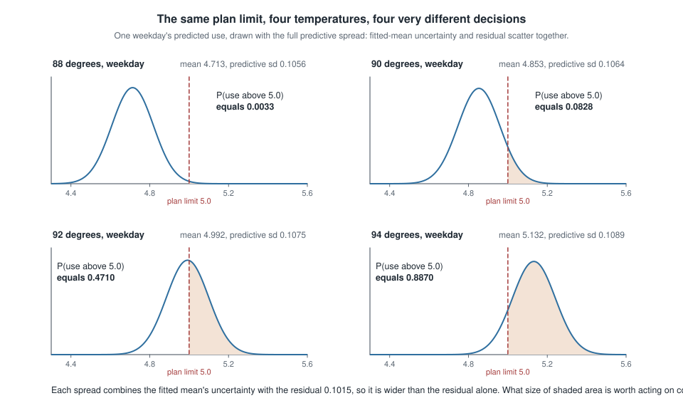
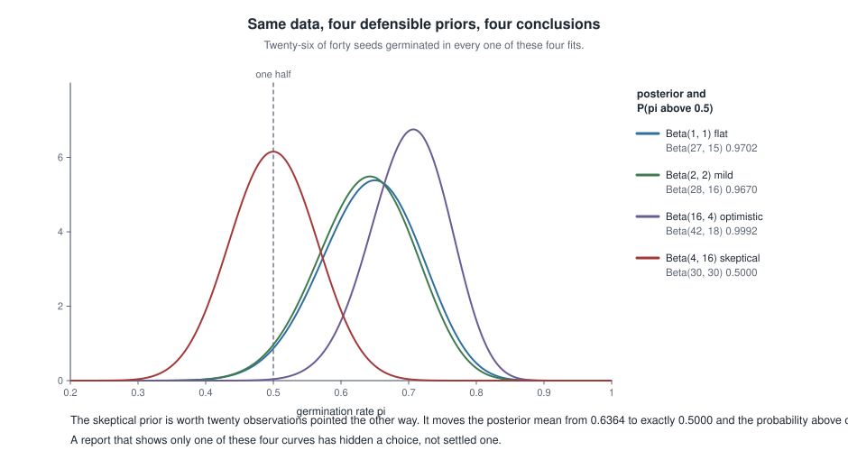

# Week 15 — Course synthesis and the shape of a Bayesian report

## Where this week starts

Fourteen weeks ago the course made a promise: probability is the language of uncertainty, and a statistical result describes what is plausible rather than settling what is true. Since then you have built the pieces one at a time, from the discrete update of Week 2, through the conjugate models and the posterior predictive of Weeks 3 to 6, the simulation of Week 7, the regression and checking of Weeks 9 to 11, and on to the comparison with classical inference, partial pooling, and decisions.

This week introduces no new machinery. It walks a single case end to end through every move the course has taught, so the connective tissue becomes visible: not fifteen techniques, but one argument with nine joints in it. Then it asks what the written account of that argument must contain before another person can evaluate it, and names what a first Bayesian project reliably gets wrong.

What should feel different by the end is your sense of where the difficulty lives. Updating a Beta prior takes two additions; the arithmetic was never the hard part. The hard part is choosing the model, defending the prior, designing a check that could have failed, and stating a conclusion no wider than the evidence supports.

### Why this matters outside the classroom

A report is the only part of your analysis anyone else ever sees. Imagine the water utility's board reading a memo that says a model shows summer demand exceeding the pumping plan. That sentence is compatible with a probability of 0.0033 and with one of 0.8870, both computed in this course for that utility, at 88 and at 94 degrees on a weekday. Without the temperature, the model, the prior, the check, and the threshold, the board cannot tell which world it is in, and will either buy capacity it does not need or fail to buy capacity it does.

A reader who cannot see your choices cannot disagree with them, and an analysis nobody can disagree with is not evidence, it is an assertion.

## What you will be able to do

Work through this page with a calculator and last week's notes open, and you should be able to do each of the following.

- Name the nine moves of a complete Bayesian analysis in order, and say what each produces and what it protects against.
- Walk one case from a stated question through prior, likelihood, posterior, prediction, checking, comparison, sensitivity, and a bounded conclusion, showing the arithmetic at every joint.
- Write the sections of a Bayesian report, and say for each what a reader could not evaluate without it.
- Diagnose the six standard faults of a first Bayesian project in a written paragraph, and repair each in a sentence.
- Distinguish parameter, predictive, and model uncertainty, and say which of the three this course gives you a distribution for.
- Transfer the structure to an unfamiliar question, naming what carries over and what has to be rechosen.

## Terms and notation worth fixing

Nothing here is new notation; these are the pieces the whole course has used, gathered so the report vocabulary below is unambiguous.

| Term or symbol | Meaning as used in this course |
|---|---|
| $p(\theta)$ | the prior: what was plausible about the unknown before these data |
| $p(y \mid \theta)$ | the likelihood: how the data would arise if the unknown took a given value |
| $p(\theta \mid y)$ | the posterior: what is plausible about the unknown after these data |
| $p(\tilde y \mid y)$ | the posterior predictive: what a new, not-yet-observed outcome $\tilde y$ might be |
| $y^{\text{rep}}$ | replicated data the fitted model says could have stood in for the data you saw |
| $T(y)$ | a test quantity: one number computed from data, chosen to expose a failure you care about |
| bounded conclusion | a claim stated with its model, its uncertainty, and its limits attached |
| model uncertainty | doubt about the shape of the model itself, which this course gives no posterior for |

## The whole course as one argument

A complete Bayesian analysis is a chain of nine moves, and a chain is only as good as its weakest joint. Each move takes the previous one's output and produces an object of a specific kind: a distribution, a number, or a sentence. Most first projects run moves one through five competently and skip six, seven, and eight, which is the shape of a project that will be wrong without ever finding out.

{fig-alt="Nine labelled boxes in three rows joined by arrows, reading question, prior, likelihood, posterior, prediction, checks, comparison, sensitivity, bounded claim, each carrying the water utility quantity produced at that step."}

### From a question to a posterior

Move one is the question, stated in the units of the problem and about a quantity that could in principle be measured. "Does temperature matter" is not something a posterior can address; "by how many million gallons does a one-degree rise change expected daily delivery" is, because it names a parameter.

Move two is the prior, held to one standard: a prior is a claim about the world in the units of the world. "A wide prior" says nothing, while "a prior standard deviation of 0.05 million gallons per degree on the slope, so a change of a tenth of a million gallons per degree would be surprising" is something an engineer can agree or disagree with. Weakly informative priors are the honest default for regression coefficients because they rule out the physically absurd while letting the data speak.

Move three is the likelihood, where most of the modelling lives: it says how the data would have been generated for each possible value of the unknown. A count over a fixed interval suggests Poisson, a proportion of successes out of a fixed number of trials suggests binomial, a symmetric measurement scattered around a mean suggests normal. Each is a claim that can be wrong, and moves six and seven look for the ways it is.

Move four is the posterior. In the conjugate cases the update is arithmetic: a Beta$(a, b)$ prior with $y$ successes in $n$ trials gives Beta$(a + y, b + n - y)$, whose mean is a weighted compromise between the prior mean and the sample proportion. In the regression cases it is a joint distribution over several parameters, obtained by simulation.

### From a posterior to a bounded conclusion

Move five is prediction, a different question from estimation. Estimation asks where the parameter is; prediction asks what the next observation will be, and a new observation carries both the uncertainty about the parameter and the natural scatter around it.

{fig-alt="Left: a narrow gamma density for calls per hour centred at 5.0, interval 3.711 to 6.478 shaded, standard deviation 0.7071. Right: much wider bars for one new hour's count, 1 to 10 calls highlighted, standard deviation 2.345."}

The posterior for the rate $\lambda$ has standard deviation 0.7071 calls per hour; the predictive distribution for one particular hour's count has standard deviation 2.345 calls, about $2.345 / 0.7071 = 3.3$ times as wide. The central 95 percent interval for the rate runs from 3.711 to 6.478 calls per hour; the central 95 percent predictive interval for one hour runs from 1 to 10 calls. Hand a supervisor who asked how busy the next hour will be the narrow interval, and you have described a quantity nobody asked about.

Move six is checking: simulate replicated data sets $y^{\text{rep}}$ from the fitted model and compare a chosen test quantity $T(y)$ on the real data against the same quantity on the replicates, choosing $T(y)$ so the check could have failed. Move seven is comparison, usually on out-of-sample predictive accuracy, which establishes only which of the models you compared predicts a held-out observation better. Move eight is sensitivity: refit under a different defensible prior or model and report what moved. Move nine is the conclusion, stated with its model, its uncertainty, and its limits.

## What a Bayesian report must state

The report is not a summary of the analysis; it is the analysis, made checkable by someone who did not run it, so every choice that could have been made differently has to appear where a reader can find it. Eight sections cover the ground, and the table below pairs each with the line the water utility analysis would put there.

{fig-alt="Two ruled tables. The upper lists eight report sections, question, model, priors, computation, checks, summaries, sensitivity, limits, with what each states and the utility line for each. The lower lists five things to leave out."}

### The eight things a reader needs

The question comes first and in the units of the problem, because a reader who does not know what was asked cannot judge whether it was addressed. The model follows, in words and in symbols: "daily use is normally distributed around a straight-line function of that day's maximum temperature, with a standard deviation $\sigma$ describing day-to-day scatter", alongside the formula. The priors come next with their family, their values, and their justification, and "the software default" justifies nothing unless you say what the default asserts.

Then the computation: closed-form update or simulation, and if simulation, how many chains, how many draws, what the diagnostics looked like, and what seed makes it reproducible. Then the checks, stated as what you looked for and what you found, including the checks that found nothing, because a check that passed is informative only if the reader knows it could have failed. Then the summaries the question needs, with a sentence saying why those. Then the sensitivity: which choices you varied and what moved. Then the limits, where you say what the analysis cannot support.

Reproducibility is not a courtesy, and the computation section should hand a reader the few lines that regenerate the number.

```r
# What the computation section of a report should let a reader re-run.
set.seed(2027)
a_post <- 2 + 26            # Beta(2, 2) prior, 26 germinations out of 40 seeds
b_post <- 2 + 40 - 26
qbeta(c(0.025, 0.975), a_post, b_post)
```

That last call is a closed-form quantile, so it returns 0.4907 and 0.7702 however often you run it. The seed matters for the simulated parts of an analysis, not for this one, and saying which parts are which is itself part of the report.

### What does not belong, and why

Raw software output pasted without comment does not belong: a fitted object is not a finding, and a table of numbers with no sentence around it makes the reader do your work. Nor does a simulated quantity quoted to four decimal places: if a posterior mean came from four thousand draws, the fourth decimal is Monte Carlo noise that moves when you re-run with a different seed. Quote what is stable, say "about", and reserve exact decimals for closed-form quantities like a Beta posterior mean of $28/44 = 0.6364$.

Neither does a credible interval relabelled as a confidence interval, a model comparison written as a discovery of truth, or a threshold hidden inside a default. The second worked example takes those three apart in detail.

## Worked example — the water utility from question to bounded conclusion

Here is the whole chain on one case, with every number shown. The Vale Municipal Water Utility recorded twenty summer days: the day's maximum temperature, whether it fell on a weekend, and total water delivered in million gallons. Mean temperature 83.90 degrees, mean delivery 4.253 million gallons, fourteen weekdays and six weekend days.

**Move 1, the question.** How does daily delivery respond to temperature, and how often should the utility expect a weekday to exceed its comfortable pumping plan of 5.0 million gallons a day?

**Move 2, the prior.** Weakly informative on the slope, at the prior standard deviation of 0.05 million gallons per degree argued for above.

**Move 3, the likelihood.** With temperature centred at 83.9 degrees so the intercept means something,

$$
y_i \sim \text{Normal}\left(\beta_0 + \beta_1 (x_i - 83.9), \; \sigma\right).
$$

In words: delivery on day $i$ is normal around a straight-line function of that day's centred temperature, and $\sigma$ says how far a single day scatters around that line.

**Move 4, the posterior.** The slope $\beta_1$ has posterior mean 0.0724 million gallons per degree, posterior standard deviation 0.00857, and a 95 percent credible interval from 0.0556 to 0.0892. Check that against the standard normal 0.975 quantile 1.96: $0.0724 - 1.96 \times 0.00857 = 0.0724 - 0.0168 = 0.0556$, and $0.0724 + 0.0168 = 0.0892$. The centred intercept $\beta_0$ is 4.253, the delivery expected on an average summer day, the residual standard deviation is 0.2957, and the model accounts for 0.799 of the variation.

**Move 5, the prediction.** Hold that back, because move six is about to change the model it would come from.

**Move 6, the checks.** The mean residual across all twenty days is exactly zero, which is not evidence of anything: fitting the intercept forces it, so this check could not have failed. Now split by day type. The mean residual is $+0.1726$ on the fourteen weekdays and $-0.4028$ on the six weekend days, a gap of $0.1726 + 0.4028 = 0.5754$ million gallons, and those group means agree with an overall mean of zero because $14 \times 0.1726 = 2.4164$ and $6 \times 0.4028 = 2.4168$ cancel to within rounding. This check could have failed, and it did: the model has no mechanism producing a systematic weekend deficit, so something it does not know about is real.

**Move 7, the comparison.** Add a weekend indicator. The fuller model puts the weekday level at 4.4266 million gallons at the average temperature, the slope at 0.0698 per degree, and the weekend offset at $-0.5788$, with the residual standard deviation falling to 0.1015 and the variation accounted for rising to 0.978. On leave-one-out prediction error the temperature-only model gets a root mean square error of 0.3153 and the fuller model 0.1066, so the fuller model predicts a held-out day about $0.3153 / 0.1066 = 3.0$ times more accurately. That says which of the two predicts better, not that either is true.

**Move 8, the sensitivity.** Refit under a more skeptical prior on the weekend offset and report whether the offset survives. Here it does, and saying so is part of the result.

**Move 9, the prediction and the bounded conclusion.** On a weekday at 90 degrees the fuller model predicts a mean delivery of $4.4266 + 0.0698 \times (90 - 83.9) = 4.4266 + 0.4258 = 4.8524$ million gallons; carrying the coefficients at the precision the fit holds them at gives the reported value, 4.853, and on a weekend day at the same temperature $4.853 - 0.5788 = 4.274$. The probability of exceeding the plan limit is 0.0033 at 88 degrees, 0.0828 at 90, 0.4710 at 92, and 0.8870 at 94. Those four probabilities use the full predictive spread rather than the residual standard deviation on its own, because a predictive statement about a single new day carries both the uncertainty in the fitted mean and the day-to-day residual spread, which is why the predictive spread at 90 degrees, $\sqrt{0.0319^2 + 0.1015^2} = 0.1064$, exceeds the residual 0.1015. That is the Week 6 lesson about prediction being wider than estimation, arriving one last time in the final week; the spread widens slowly with distance from the average temperature, from 0.1056 at 88 degrees to 0.1089 at 94.

{fig-alt="Four panels, each a bell curve for one weekday's predicted delivery with the area above 5.0 million gallons shaded: probabilities 0.0033 at 88 degrees, 0.0828 at 90, 0.4710 at 92, and 0.8870 at 94 degrees."}

Now the decision, and this is where statistics hands off. Suppose calling up standby pumping that turns out not to be needed costs about forty thousand dollars, and being short of capacity on a hot weekday costs about three hundred and sixty thousand. At 90 degrees acting costs $40 \times (1 - 0.0828) = 36.7$ thousand against $360 \times 0.0828 = 29.8$ thousand for not acting, so do not act. At 92 degrees acting costs $40 \times (1 - 0.4710) = 21.2$ thousand against $360 \times 0.4710 = 169.6$ thousand, so act. Break-even is $40 / (40 + 360) = 0.10$. Make the two errors equally expensive at a hundred thousand each and break-even becomes 0.50, at which the same 0.4710 says do not act. Identical posterior, opposite decision, because the costs differ. The threshold is a value judgment, not a statistic.

The bounded conclusion: under this model and these twenty summer days, delivery rises about 0.0698 million gallons per degree, weekend days run about 0.5788 lower than weekdays at the same temperature, and a weekday at 92 degrees has probability about 0.47 of exceeding the plan limit. That is an association across one summer at one utility, not a causal law, and the model has been checked for a weekend effect but not for humidity, holidays, or drought restrictions.

### The same reasoning, transferred

Nothing above depended on regression. Take an unfamiliar question: a campus makerspace wants to know whether to buy a second three-dimensional printer, and the quantity that matters is $\lambda$, print jobs per open hour. Staff experience suggests around two an hour, so take a Gamma(shape 6, rate 3) prior: mean $6/3 = 2.0$, standard deviation $\sqrt{6}/3 = 0.8165$, worth about three hours of watching. Over ten open hours, 31 jobs arrive, a rate of $31/10 = 3.1$ per hour.

The gamma-Poisson update adds counts to the shape and hours to the rate: the posterior is Gamma$(6 + 31, \; 3 + 10) =$ Gamma$(37, 13)$, with posterior mean $37/13 = 2.8462$ jobs per hour and posterior standard deviation $\sqrt{37}/13 = 0.4679$. The weighted-compromise check works exactly as it did for the seed lot: the prior carries weight $3/13 = 0.2308$, the data carry $10/13 = 0.7692$, and the compromise is $\frac{3}{13} \times 2.0 + \frac{10}{13} \times 3.1 = \frac{6}{13} + \frac{31}{13} = \frac{37}{13} = 2.8462$, reproducing the posterior mean exactly. In decimals those two pieces are 0.4615 and 2.3846, which add to 2.8461: the last digit there is rounding, not disagreement.

What stayed the same is the whole chain: a measurable unknown, a prior in the units of the problem, a likelihood chosen from how the data arise, a posterior that is a distribution rather than a number, and a conclusion that needs a cost before it becomes a purchase. What changed is the family, the units, and the amount of data. What is missing is everything from move six onward: nobody has checked whether jobs arrive in bursts around class times, exactly the failure a Poisson likelihood cannot represent and a well-chosen $T(y)$ would expose. That absence is the difference between an update and an analysis.

## Second worked example — a first report with six repairable faults

Diagnosis is a different skill from application, so this example is a bad report rather than a good analysis. Here is the kind of paragraph a first Bayesian project produces about the utility case above.

> The Bayesian model shows that water use rises with temperature, with a slope of 0.0724 and a 95 percent confidence interval of 0.0556 to 0.0892. We used the default priors. The residuals average zero, so the model fits the data well. Model 2 has a lower prediction error than Model 1, so Model 2 is the correct model. Predicted use on a weekday at 90 degrees is 4.8531 million gallons. The probability of exceeding the plan limit at 92 degrees is 0.4710, which is not above one half, so no action is required.

Six things are wrong with it, and each has a one-sentence repair.

**Fault 1, a prior chosen for convenience and never varied.** "We used the default priors" says nothing about what was assumed and reports no sensitivity. The repair is to state what the prior asserts in the units of the problem, then refit under an alternative and report what moved.

{fig-alt="Four beta curves over germination rates on identical data: flat, mild and optimistic priors peak between 0.63 and 0.70 with probability above one half from 0.9670 to 0.9992, while the skeptical Beta(4, 16) curve centres at 0.5000."}

On the seed lot from Weeks 4 and 5, twenty-six of forty seeds germinated. Under a flat Beta(1, 1) prior the posterior is Beta(27, 15) and $P(\pi > 0.5 \mid y) = 0.9702$; under the mild Beta(2, 2) it is Beta(28, 16) and 0.9670; under an optimistic Beta(16, 4) it is Beta(42, 18) and 0.9992. Three defensible priors, one conclusion. But a skeptical Beta(4, 16), worth twenty observations pointed the other way, gives Beta(30, 30), posterior mean exactly 0.5000 and $P(\pi > 0.5 \mid y) = 0.5000$. Same data, opposite conclusion, and a report that never varied the prior cannot tell the reader which situation it is in.

**Fault 2, a credible interval reported as a confidence interval.** The interval 0.0556 to 0.0892 came from a posterior, so it carries 0.95 posterior probability of containing the slope given this model and this prior, while a confidence interval claims something about the long-run behaviour of the procedure. The repair is to write "95 percent credible interval" and say what it claims.

**Fault 3, a check that could not have failed.** The mean residual is zero because fitting forces it, so "the residuals average zero, so the model fits" reports the arithmetic of least squares as though it were evidence. The repair is to run the check that can fail: split by day type and report the $+0.1726$ and $-0.4028$ group means and their gap of 0.5754.

**Fault 4, a model comparison presented as a discovery of truth.** A leave-one-out error of 0.1066 against 0.3153 says the fuller model beat the one candidate it was compared against; it does not say it is correct, and both could be missing the same third variable. The repair is to report the prediction gain and name the alternatives nobody tried.

**Fault 5, simulation output quoted as though it were exact.** A posterior mean of "4.8531" from a simulation is stable in its first three digits and noise after that. The repair is to write about 4.85, or to give the closed-form value where there is one.

**Fault 6, a decision threshold smuggled in as a default.** "Not above one half, so no action is required" applies a threshold nobody chose and nobody owns. Break-even is 0.10 when being short is nine times as costly as over-preparing, and under those costs the same 0.4710 says act. The repair is to report the probability, state the costs that set the threshold, and name whose judgment those costs are.

Repaired, the paragraph roughly doubles in length. That is not a defect: the long version is the one a reader can disagree with.

## The misreading to avoid

The misreading this week invites is the most comfortable one of the course: "I have now learned how to do Bayesian analysis." It feels earned, because you have fitted beta-binomial, gamma-Poisson, normal-normal, linear, logistic, and hierarchical models, and can compute a posterior interval without looking anything up.

Here is the trouble. Everything you ran this semester came with the model already chosen, the case already framed, and the data already clean. None of that was your judgment call. The hard decisions in applied work are which likelihood the data-generating process warrants, which prior you can defend to someone who disagrees with you, which test quantity would expose the failure that would matter, and how wide the conclusion is allowed to be. This course made most of those for you.

Something truer to carry out: you know the structure of a Bayesian analysis and can run the standard models correctly. What takes longer is the judgment about which model, which prior, which check, and which conclusion the evidence will bear, and that judgment is built by doing analyses that turn out to be wrong and finding out why. Treat the next one as a draft to be checked, and keep the course's standing principle in front of you: a statistical result is evidence, not a verdict.

## Practice on your own

These are for your own checking, not for submission. Work them with a calculator and compare against the arithmetic above.

1. Take the nine moves in order and write one sentence for each on a question of your own choosing, marking the moves where you would need information you do not have.
2. Find the break-even probability when being short of capacity is four times as costly as over-preparing, then say which of the four temperatures in the decision figure would trigger action under that threshold.
3. Redo the makerspace update with a Gamma(shape 2, rate 1) prior on the same 31 jobs in ten hours. Report the posterior, its mean, and the two weights, and say whether that change of prior would change a purchasing recommendation.
4. Write out the eight report sections for the help desk case from Week 6, one line each, and propose a test quantity $T(y)$ that could fail if calls arrive in bursts rather than at a steady rate.
5. Rewrite the faulty paragraph above with all six repairs applied, then mark every sentence a competent reader could disagree with.

## Where to read more

This week aligns with the whole of the course's primary text rather than a single chapter, so the reading below points at the book as a whole and at where the subject continues. The explanations here are written independently, and the notation may not line up exactly.

- [Bayes Rules! home page](https://www.bayesrulesbook.com/), the primary text this course has aligned with week by week.
- [Bayes Rules! Chapter 19](https://www.bayesrulesbook.com/chapter-19), the pointer toward where the material goes after this course.
- [Bayesian Data Analysis, third edition](https://sites.stat.columbia.edu/gelman/book/), named here as the forward pointer at the graduate level.
- [Think Bayes, second edition](https://allendowney.github.io/ThinkBayes2/), named here as the alternative route in.
- *Statistical Rethinking* is worth knowing by name as a further course-length treatment; check its availability yourself, since this course claims nothing about any licence or access.
- [The R Project for Statistical Computing](https://www.r-project.org/), [Quarto](https://quarto.org/), and [Visual Studio Code](https://code.visualstudio.com/), the tools you have written in all semester.
- The course [syllabus](../syllabus.qmd), [schedule](../schedule.qmd), [notes index](index.qmd), and [resources page](../resources/index.qmd), plus [week-09.qmd](week-09.qmd), [week-11.qmd](week-11.qmd), and [week-14.qmd](week-14.qmd).

## Where this goes next

There is no Week 16, so this section points past the course. The natural continuation is hierarchical modelling with predictors: Week 13 pooled eight zone means toward a population mean, but real multilevel work puts regression coefficients inside that structure, so each group gets its own slope and those slopes are themselves drawn from a population. From there the outcome stops being normal, and hierarchical logistic and Poisson regression handle grouped counts and grouped yes-or-no outcomes with the same logic. Beyond that lies the computational and workflow material: what to do when a sampler struggles, and how to organize an analysis so its checks rerun with every refit.

What you should take with you is smaller than any of that. It is the habit of asking, of every statistical claim you meet: what was the unknown, what was assumed beforehand, how were the data supposed to have arisen, what came out, what was checked and could that check have failed, what else was tried, and how wide is the conclusion allowed to be. That list works on somebody else's analysis as well as your own. The [notes index](index.qmd) has the full sequence, and the [course home page](../index.qmd) has the rest of the site.
